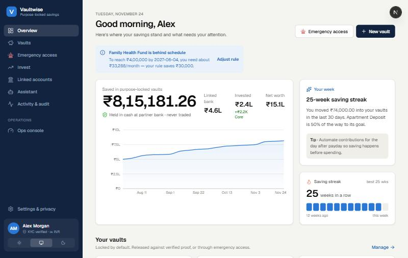
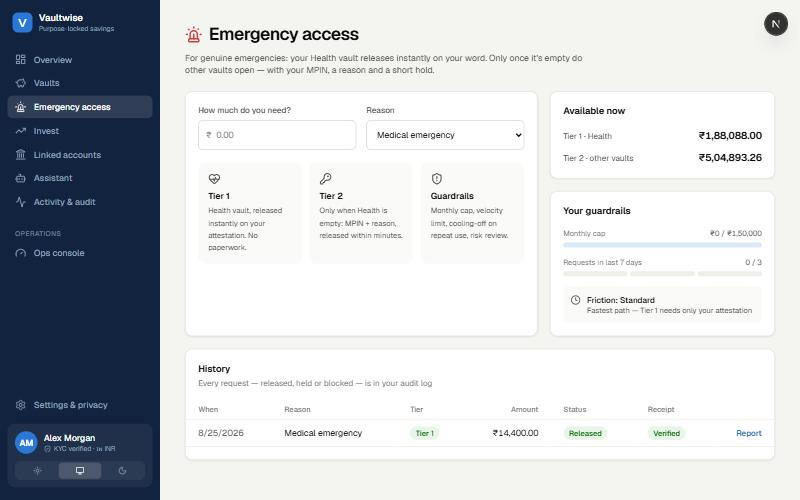
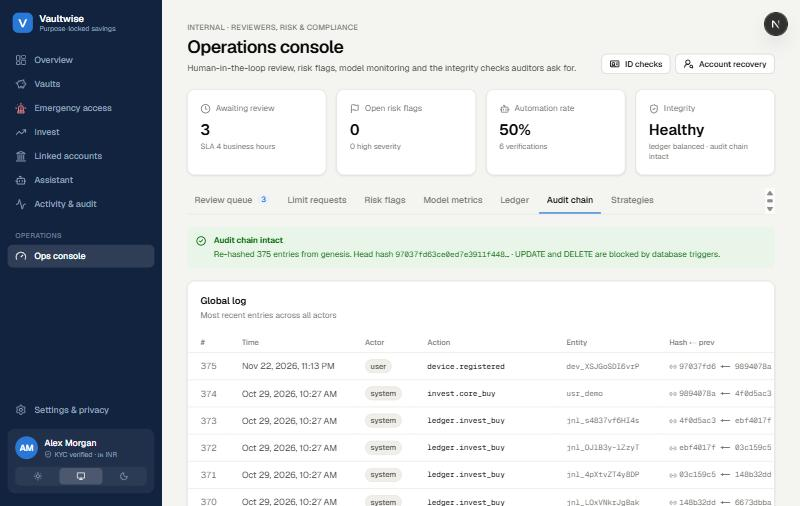
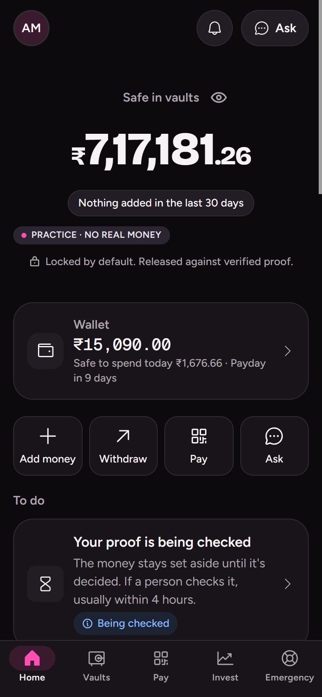
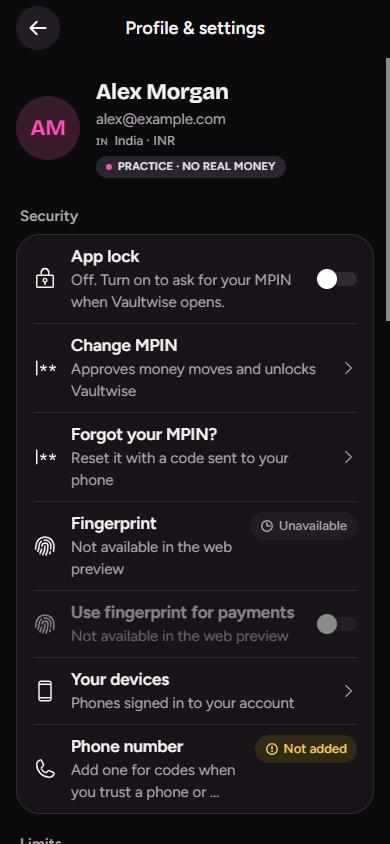
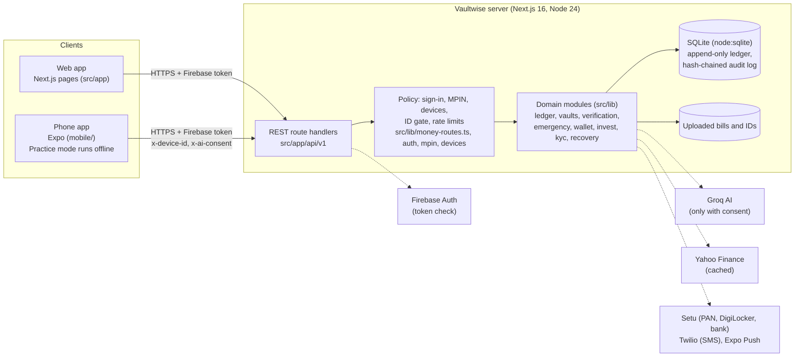

# Vaultwise

**Savings locked to a purpose. Show proof and the money unlocks; in an emergency it never waits.**

[](https://github.com/katabathunilohith/VaultWise/actions/workflows/ci.yml)

Vaultwise is a two-person entrepreneurship capstone: a savings app where money sits in purpose vaults (health, rent, education...) and is released against a verified bill, with a tiered emergency path, a wallet, merchant checkout from vaults, and a Core/Satellite investing engine. It has a Next.js server and web app (this folder) and an Expo phone app ([mobile/](mobile/README.md)).

> **All money is pretend.** Vaultwise is a student prototype, not a bank, payment service or investment adviser. No real money moves, and the ID checks run against test providers.

**Live:** [vaultwise.online](https://vaultwise.online), on one AWS EC2 server in Mumbai with HTTPS and Firebase sign-in. Sign up with any email; all money is test money. Android testers use the `tester-live` build, which talks to the same server, and the phone app's Practice build runs with no server at all. How the server is set up: [deploy/README.md](deploy/README.md).

| Web app: overview | Web app: emergency access | Ops console: audit chain |
|---|---|---|
|  |  |  |

| Phone: Home (Practice) | Phone: security settings |
|---|---|
|  |  |

---

## What it does

| Area | What a person can do | Docs |
|---|---|---|
| Vaults | Save into purpose vaults by rule (fixed, % of income, round-ups); joint vaults | [vaults](docs/features/vaults.md) |
| Payout planner (web) | Check whether the money you have lasts until your next allowance, stipend or pay, what happens if it arrives late, and how the plan compared with what arrived | [payout-planner](docs/features/payout-planner.md) |
| Proof checks | Withdraw by uploading a bill: image forensics, an AI read (only with consent), rules, then approve, decline or send to a person; appeals | [proof-verification](docs/features/proof-verification.md) |
| Emergency | Tier 1 releases the Health vault instantly; Tier 2 opens other vaults with the MPIN and a short hold; receipts afterwards | [emergency](docs/features/emergency.md) |
| Wallet and Pay | A spending balance with a daily limit; pay a merchant from a vault, checked at checkout | [wallet](docs/features/wallet.md), [pay](docs/features/pay-with-vaultwise.md) |
| Investing | Core model portfolios and SIPs; a Satellite price-action engine that stays in paper trading (it didn't pass its own backtest gate) | [investing](docs/features/investing.md) |
| Security | 6-digit MPIN on every money move, registered devices with a new-device cap, alerts, texted codes, app lock and screenshot blocking on the phone | [mpin](docs/features/mpin.md), [devices](docs/features/devices-alerts-otp.md), [phone](docs/features/phone-security.md) |
| Identity | Firebase sign-in; ID check by photo (AI + a person) or, for India, PAN → Aadhaar via DigiLocker → a ₹1 bank check; account recovery | [identity](docs/features/identity.md) |
| Markets | 28 countries on 8 rulebooks (currency, caps, thresholds, disclosures) | [countries](docs/features/countries-and-compliance.md) |

## Architecture



Request path: a route handler resolves the session (sign-in, device, rate limit), applies the money policy for its action (ID gate, MPIN, new-device cap), then calls a domain module, which writes balanced ledger entries and an audit row. More in [docs/architecture.md](docs/architecture.md).

## Where it runs

| Piece | What we use |
|---|---|
| Server | One AWS EC2 instance (`t3.small`, Ubuntu) in Mumbai, `ap-south-1`, with an Elastic IP |
| Domain and HTTPS | [vaultwise.online](https://vaultwise.online); Caddy gets and renews the certificate and proxies to the app |
| App and data | Next.js 16 on Node 24 under systemd; SQLite and uploaded photos in `/var/lib/vaultwise`, with a nightly backup script (`deploy/backup.sh`) |
| Sign-in | Firebase Authentication (email and password) |
| AI | A Groq vision model, only for people who agree |
| Phone builds and updates | Expo EAS: an Android APK for testers (`tester-live`) and over-the-air updates |
| Checks | GitHub Actions on every push and pull request ([ci.yml](.github/workflows/ci.yml)) |

Setup, updates, backups and restores: [deploy/README.md](deploy/README.md) and [deploy/restore.md](deploy/restore.md).

## Quick start

Needs **Node 24** (any Node from 22.18 works: the server uses the built-in `node:sqlite`, and `npm run audit:verify` runs TypeScript with Node's type stripping).

```bash
npm install
cp .env.example .env.local   # add GROQ_API_KEY for AI reading (optional)
npm run dev
```

Open http://localhost:3000. Onboarding asks for a name, a country (suggested from your region) and a 6-digit MPIN. Leave **Start with demo history** on for four months of sample activity. Without Firebase settings the server runs in prototype mode (one customer, no sign-in); see [configuration](docs/reference/configuration.md) to turn sign-in, texted codes and the India ID steps on.

**Phone app:** `cd mobile && npm install && npm run web` (or `npm run start:go` for Expo Go). Practice mode needs no server; the Practice MPIN is `246810` and texted codes are `123456`. See [mobile/README.md](mobile/README.md).

| Command | What it does |
|---|---|
| `npm run dev` | Development server |
| `npm run build && npm start` | Production build (refuses to start without sign-in unless told otherwise) |
| `npm test` | Unit and integration tests (vitest) |
| `npm run test:e2e` | End-to-end API suite against a throwaway production server |
| `npm run test:ai` | Live AI checks of the sample documents (needs `GROQ_API_KEY`) |
| `npm run eval:verification` | Evaluation of the bill checks on a generated, labelled set (add `-- --live` to use the real AI) |
| `npm run audit:verify` | Re-walks the audit chain and checks it against the anchors kept outside the database |
| `npm run typecheck` / `npm run lint` | Static checks (also run in CI) |
| `cd mobile && npm test` | Phone unit tests and the shared contract tests (Jest) |

All commands, including the phone and deploy scripts: [docs/reference/commands.md](docs/reference/commands.md).

## Security

- Every money move needs the MPIN, checked by the server before any money, upload or AI call; wrong tries lock money moves for longer each time.
- A new phone or browser can only move small amounts until it's trusted with a texted code and the MPIN; signed-out devices stay out.
- AI reads a bill or question only after an explicit yes; a missing answer means no.
- Rate limits, security headers, generic errors with an error id, and a production server that refuses to start without sign-in.
- An append-only ledger (database triggers block edits) and a hash-chained audit log, anchored daily to a file outside the database (`npm run audit:verify` checks it).
- Four independent code reviews on 22 November 2026; every finding and fix is listed in [docs/security.md](docs/security.md), with the OWASP MASVS checklist in [docs/security/](docs/security/README.md).

Secrets live only in `.env.local` (git-ignored, never committed). The git history was scanned for keys on 24 November 2026 and is clean.

## How well do the bill checks work?

`npm run eval:verification` generates 50 labelled bills (genuine, edited, duplicate, wrong-purpose and stale, dated relative to the run day) and runs them through the real pipeline. Results on 24 November 2026, pipeline `vw-proof@1.5`, offline with a stand-in reader that returns exactly what's printed on the bill:

| | Result |
|---|---|
| Genuine bills wrongly declined | 0 of 19 (was 3 of 19 before the rule changes the evaluation prompted) |
| Bad bills wrongly approved | 3 of 31: careful same-font edits that look genuine |
| Duplicates and wrong-purpose bills declined | 14 of 14 |
| Sent to a person | 16 of 50 |

The live pass with the real AI read 38 of the 50 bills before hitting Groq's daily limit, on the earlier `vw-proof@1.4`; it needs a re-run. The evaluation is synthetic and small, and says so: [docs/evaluation](docs/evaluation/README.md) has the method, every bill's result and the known weaknesses.

## What's real and what's simulated

| Real | Simulated |
|---|---|
| Double-entry ledger, holds, reconciliation, hash-chained audit log | Bank accounts, e-money and payouts (money moves between ledger accounts) |
| Image forensics, AI document reading, decision rules, review queue | Licensed KYC: the India steps use a test provider until Setu sandbox keys are added |
| MPIN, devices, alerts, rate limits, sign-in (Firebase) | SMS: test mode shows the code in the app until Twilio is set up |
| Market data, FX, SIP illustration, backtests | Brokerage and custody (fills recorded at live prices) |

The Satellite engine never cleared its own walk-forward gate (out-of-sample profit factor ≥ 1.1, positive expectancy, ≤ 20 % drawdown), so it stays in paper trading. Compliance values are illustrative planning defaults, not legal advice.

## Documentation

- [docs/README.md](docs/README.md): architecture, every feature with its files and functions, the API, data model and configuration.
- [docs/process/development-process.md](docs/process/development-process.md) and [module guide](docs/process/module-guide.md): how changes are planned, built, tested and released.
- [docs/plans/roadmap.md](docs/plans/roadmap.md): what was built in which order, and what's next.
- [CHANGELOG.md](CHANGELOG.md) (server and web) and [mobile/CHANGELOG.md](mobile/CHANGELOG.md) (phone).
