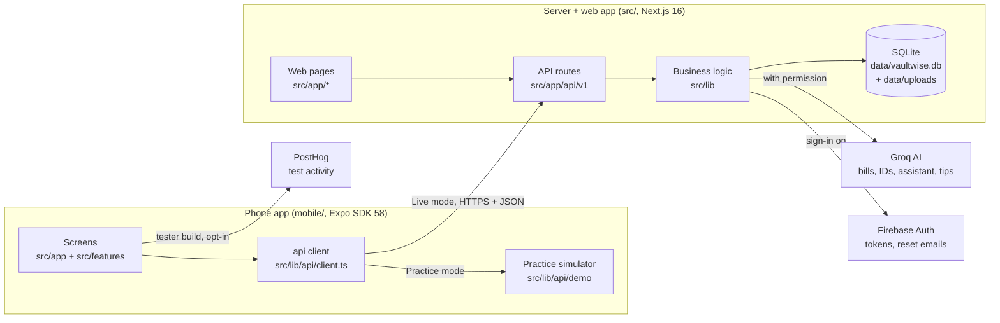
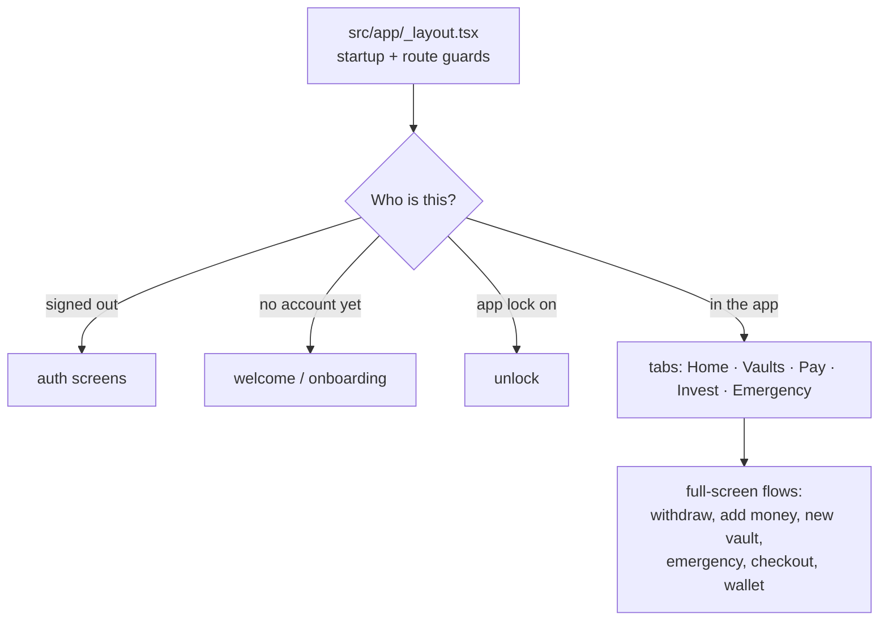

# Architecture

> How Vaultwise fits together: one server, a web app and a phone app, with a simulator so the phone works without the server.

## The three parts

| Part | Folder | Built with | Job |
|---|---|---|---|
| Server | `src/app/api/v1`, `src/lib` | Next.js 16 route handlers, Node's built-in SQLite, zod | All rules and all money moves. The single source of truth. |
| Web app | `src/app/*` (pages), `src/components` | Next.js pages, React | The original prototype UI, the reviewer console and sign-in pages |
| Phone app | `mobile/` | Expo SDK 58, React Native 0.88, expo-router, React Query | The main product. Runs live against the server, or in Practice mode on its own |

## Server layers

A request goes through the same layers every time.

1. **Route** (`src/app/api/v1/.../route.ts`): parses input with zod, calls `customer()` or `admin()` to find who is asking and what they may do, then calls one function in `src/lib`. Routes hold no business rules.
2. **Request wrapper** (`handle()` in `src/lib/api.ts`): turns thrown `HttpError`s and zod errors into `{ error, code }` JSON, and runs the request inside `withRequest()` so lower layers can read headers (the sign-in token, `x-ai-consent`).
3. **Business logic** (`src/lib/*`): one module per area: `vaults.ts`, `emergency.ts`, `limits.ts`, `wallet/`, `kyc/`, `recovery/`, `verification/`, `invest/` and so on.
4. **Ledger and audit** (`ledger.ts`, `audit.ts`): every money movement is a balanced double-entry journal, and every important action adds a row to a hash-chained audit log.
5. **Storage** (`db.ts`): `get`, `all`, `run` and `tx` over one SQLite file. Modules that can be removed (wallet, custom rules, identity) create their own tables on first use.

The lazy scheduler (`scheduler.ts`) runs due auto-saves, held emergency releases and SIP buys whenever a customer's data is read, so the prototype needs no background worker.

## The phone app

- **Routes** live in `mobile/src/app`. Each file is a thin wrapper around a screen in `mobile/src/features/<feature>`.
- **Features** (`mobile/src/features/*`) each own their screens, hooks and copy. Removable features have a `config.ts` switch, an `index.ts` barrel and a README listing every touch point.
- **Shared code**: `mobile/src/components/ui` (the UI kit), `mobile/src/theme` (tokens), `mobile/src/lib` (API, storage, auth, haptics, money formatting).
- **Data**: every screen calls `api.*` from `mobile/src/lib/api/client.ts`. A Proxy sends each call to the live server or to the Practice simulator, depending on the connection mode. React Query caches answers, keyed by mode so the two never mix.

Details: [app structure](mobile/app-structure.md), [data layer](mobile/data-layer.md).

## Live mode and Practice mode

| | Live | Practice |
|---|---|---|
| Where data lives | Server database | The phone: the simulator's memory, saved to device storage |
| Money | Simulated bank ledger on the server | Simulated on the phone |
| AI checks | Real Groq calls, if the person allows them | Simulated from the sample bill's file name |
| Sign-in and ID check | Available when configured | Off in store, APK and tester builds |
| Used by | Development, and later the hosted tester build | Store build, shareable APK, tester website, Expo Go without a server |

`EXPO_PUBLIC_PRACTICE_ONLY=1`, or an `apk` or `production` update channel, locks a build to Practice (`mobile/src/lib/build.ts`). App stores only accept real-money finance apps from licensed companies, so every public build is Practice.

## Builds and releases

| Build | Made with | Who gets it | Updates |
|---|---|---|---|
| Development | `npm start` / `npm run start:go` | You, through Expo Go or a dev build | Live reload |
| Tester website | `npm run deploy:tester` | Anyone with the link | Redeploy |
| Shareable APK | `npm run build:apk` | Android testers | `npm run update:apk` over the air |
| Store | `eas build --profile production` | App stores (later) | `npm run update:production` |

Versions and over-the-air updates: [mobile/README.md](../mobile/README.md#releases-and-updates) and the [development process](process/development-process.md).

## Cross-cutting rules

- **One source of truth.** The server decides every rule. The simulator copies the rules the screens need, and its files say which server code they mirror.
- **Switches, not forks.** Optional modules turn off with one flag and come out by deleting a folder plus the lines marked with their name (`// wallet`, `// identity`, `// tester`).
- **Consent before AI.** No personal data goes to Groq unless the person said yes (`x-ai-consent`, see [AI](features/ai.md)).
- **Least data.** ID numbers are kept as the last 4 digits plus a keyed hash. Proof photos are deleted when a check is rejected.
- **Everything audited.** Money moves, decisions and identity events go into the hash-chained audit log.

## Where to go next

- The feature you're changing: [docs index](README.md#features).
- How to add a module the same way: [module guide](process/module-guide.md).
- What's weak today: [security overview](security.md) and [maintainability review](maintainability.md).
