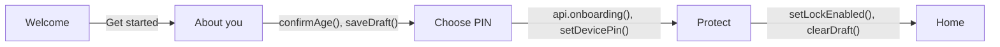
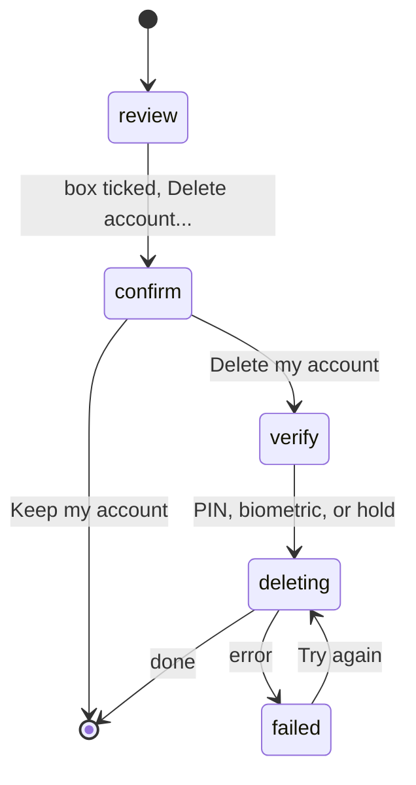

# Account and settings (phone)

> How a person starts the Vaultwise phone app, unlocks it, manages their account and preferences, and asks a person for help.

**Status/Switch:** Built and on in every build at commit `012a9fc`. A few rows depend on build switches: the store and APK builds (`PRACTICE_ONLY`) show a fixed "Practice" row instead of Data source; the identity rows (ID check, recovery, sign-in preview, Sign out) show only when those features are on. Support cases are simulated on the phone: there is no support API yet.

Security details (PIN storage, app lock timing, biometrics, the server PIN) live in [phone-security.md](phone-security.md). The UI pieces these screens use are in [../mobile/design-system.md](../mobile/design-system.md). Server-side limit rules are in [limits.md](limits.md); sign-in, ID checks, recovery and account closing are in [identity.md](identity.md); the Practice simulator behind demo mode is in [../mobile/data-layer.md](../mobile/data-layer.md).

## What it does

| Screen | Route | Purpose |
|---|---|---|
| Welcome | `/welcome` | First screen on a phone with no account. Brand, three promises, "Free. No fees on vaults.", a Practice note, an 18+ note and **Get started**. Always drawn on the dark palette. |
| About you | `/onboarding` | Step 1 of 3: name, optional email, country, 18+ check, demo history switch. |
| Choose PIN | `/onboarding/pin` | Step 2 of 3: a 6-digit MPIN typed twice, checked against the MPIN policy (`checkNewMpin()`, the same rules as the server), then the account is created on the server. The same PIN approves money moves and unlocks the app. See [mpin.md](mpin.md). |
| Protect | `/onboarding/protect` | Step 3 of 3: offer app lock (Face ID or fingerprint, with the PIN as fallback). |
| Unlock | `/unlock` | The app lock screen. Biometric first, PIN always works. |
| Profile & settings | `/settings` | Profile header and grouped settings rows. Pushed from the avatar on each tab root. |
| Security | `/settings/security?intent=` | Change or set the PIN, turn app lock on or off. Full-screen modal. |
| Your limits | `/settings/limits` | See and change withdrawal and emergency limits. |
| Haptics & sounds | `/settings/haptics` | Off / Subtle / Full, plus a preview of every haptic. |
| Appearance | `/settings/appearance` | System / Light / Dark. Android and web only. |
| Notifications | `/settings/notifications` | Notification choices, saved for later use. |
| Data source | `/settings/connection` | Auto / Live server / Demo data, and the server address. |
| Trust centre | `/settings/trust` | Plain answers about money, fees, decisions and data, plus AI consent switches. |
| Help & legal | `/settings/about?doc=` | Privacy policy, Terms of use, About. |
| Delete account | `/settings/delete-account` | Review, confirm, verify, delete. |
| Talk to a person | `/support?topic=&ref=` | Open and track support cases. |

### Settings home

`SettingsHome` shows the profile header (initials, name, email, country and market rules, Practice badge), then these groups. Pull to refresh re-reads `/me` and the limits.

| Group | Row | What it does |
|---|---|---|
| Security | App lock (switch) | On: turns lock on at once if a device PIN exists, otherwise opens Security with `intent=lock`. Off: opens Security with `intent=off`. |
| Security | Change PIN / Set a PIN | Opens Security with `intent=change`. The title depends on whether a device PIN exists. |
| Security | Face ID / Fingerprint | Status only: On, Off or Unavailable. Not tappable. |
| Limits | Your limits | Opens `/settings/limits`. Subtitle shows the per-withdrawal and daily limits. |
| Feel & look | Haptics & sounds | Opens `/settings/haptics`. Subtitle shows the level. |
| Feel & look | Appearance | Opens `/settings/appearance`. Hidden on iOS. |
| Feel & look | Colour-blind friendly gains and losses | Switch. Blue and orange instead of green and red. Saved with the theme. |
| Notifications | Notifications | Opens `/settings/notifications`. |
| App | Data source | Opens `/settings/connection`. A fixed "Practice" row replaces it when `PRACTICE_ONLY` is on. |
| App | Trust centre | Opens `/settings/trust`. |
| Help & legal | Talk to a person | Opens `/support`. |
| Help & legal | Privacy policy, Terms of use, About Vaultwise | Open `/settings/about` with `doc=privacy`, `terms` or `about`. |
| Account | Verify ID, recovery request, sign-in preview | Identity rows, each shown only when its feature is on. |
| Account | Export my data | See "Export my data" below. |
| Account | Start Practice over | Practice only. Opens `/settings/start-over`, which puts back the sample account and keeps the PIN, app lock and settings ([plan 01](../plans/01-practice-data-saved.md)). |
| Account | Sign out | Identity row, shown when signed in. Signing out also wipes the phone's account data. |
| Account | Delete account | Opens `/settings/delete-account`. Drawn in the danger colour. |

### Each settings screen

- **Security** (`SecurityFlow`). Four intents. `change`: the current MPIN and a new one, sent to the server (`POST /mpin`); the phone's unlock PIN follows. `lock`: with no PIN yet, choose one, then lock turns on; confirming with Face ID / fingerprint also turns biometric unlock back on. `off`: confirm with the PIN, then lock turns off. `bio`: save the MPIN behind Face ID / fingerprint for payments (live only; Practice shows "Live only"). **Forgot your MPIN?** opens the reset with a texted code (paused for 72 hours after the phone number was added or changed). See [mpin.md](mpin.md) and [phone-security.md](phone-security.md).
- **Your limits** (`LimitsScreen`, `LimitEditor`). Three cards: per withdrawal, per day (with a used-today bar) and emergency per month. Each shows the country maximum and Lower / Raise buttons, disabled with a reason when not possible. A pill says whether a raise is available this month. A raise opens a full-screen modal that starts with a scam check ("Is someone telling you to do this?") whose main button is **Talk to us**. Then an amount keypad in whole units, checked against the current value and the country bounds, saved with `api.setLimits` (`PUT /limits`). Lowering skips the scam check. The wallet card comes from the wallet feature. Temporary emergency raises are only on the web app.
- **Haptics & sounds** (`HapticsScreen`). Off / Subtle / Full radio rows. Choosing Subtle or Full plays `unlock.success` so the person feels it. Notes say which haptics engine runs on this phone. "Try them" lists every token from `hapticCatalog.ts` by group, each with a Play button (previews play even when haptics are off). Tokens with no system fallback are disabled without the Pulsar engine.
- **Appearance** (`AppearanceScreen`). System / Light / Dark. On iOS the screen sends the person back to `/settings`, because Vaultwise follows the system there.
- **Notifications** (`NotificationsScreen`). An info banner says push is not switched on in this build. "Always on" rows for money moves and security. Switches for reminders before auto-saves (default on) and tips & offers (default off). Quiet hours switch with three windows: 9 pm–6 am, 10 pm–7 am (default), 11 pm–8 am.
- **Data source** (`ConnectionScreen`). Segmented Auto / Live server / Demo data. A server address field (must start with `https://`; `http://` only in development builds, see [phone-security.md](phone-security.md#https-only)). **Test connection** calls `/api/v1/me` with a 4-second timeout; a 401 counts as working when sign-in is on. **Use default** fills the default address. **Save and switch** calls `applyConnection`, which reloads the app on the new source. If someone is signed in and the address changes, the app signs them out first.
- **Trust centre** (`TrustScreen`). Five sections: who holds your money, if Vaultwise shuts down, fee pledge, how decisions are made, your data. Controls: AI assistant switch (`aiConsent`), AI reads bills and IDs switch (`aiChecks`, through `setAiChecks`), and links to Settings, Haptics and Notifications.
- **Help & legal** (`AboutScreen`). Segmented Privacy / Terms / About. Privacy and Terms are placeholders with a warning banner. About shows `versionLine()`, a short description and credits.
- **Export my data** (in `SettingsHome`). In Practice it shows "Nothing to export in demo mode". When signed in it calls `downloadSignedInExport`, which only works in the web preview; on a phone it shows "Export isn't in the app yet". Otherwise it opens `<server>/api/v1/me/export` in the browser, and shows the address if that fails. The server leaves `pin_hash` out of the export.
- **Delete account** (`DeleteAccountScreen`). See the flow below.

### Talk to a person

`SupportScreen` shows a Practice banner ("cases are simulated"), a case form and the open cases.

- **Topics:** Money held, Proof decision, Emergency, Payment, Something else. `?topic=` accepts aliases such as `hold`, `decision`, `pay` and `checkout`. `?ref=` is cut to 64 safe characters.
- **Form:** topic chips, a message of up to 600 characters, and "Include my recent activity" (on by default; it records how many of the last 5 money moves would go with the case). Send is disabled without a topic and message, or with 5 open cases.
- **From the assistant:** the chat hands over its topic and last question in memory (`handoff.ts`). The form pre-fills "About my chat with Vaultwise AI: ...".
- **Case:** a number like `VW-48213`, a random queue place from 2 to 5, and a reply time 4 hours after sending. The status is worked out from the clock: in line, then "With a person" after half the window, then "No reply in Practice".
- **Entry points:** Settings, a failed delete, the limit scam check, emergency, invest errors, KYC, checkout (with `topic=payment`), proof links, vault detail, withdrawals and the wallet limit flow.

## How it works

### Onboarding

1. **About you** validates: name 2 to 60 characters, email optional but well formed, a country, and the 18+ box. The country list comes from `/me`; the server's region guess (`api.region`) is preselected once if supported. When signed in, the sign-in email is shown and used instead of the email field. On Continue it saves the age consent, keeps the answers in an in-memory draft (never in route params, never the PIN) and pushes the PIN step.
2. **Choose PIN** sends the person back to step 1 if the draft is incomplete (for example after a web refresh). It rejects weak PINs and mismatches. Then it calls `api.onboarding({ name, email, country, pin, demo })` with a 130-second timeout. If that fails, it asks `/me` whether the wallet exists anyway (up to 4 times, 2.5 s apart, after a timeout). On success it saves the device PIN and replaces the route with Protect. Back gestures and Android Back are blocked while the account is created. A progress line changes with elapsed time ("Adding sample vaults", "Adding four months of practice history").
3. **Protect** offers app lock. If the person turns it on and the phone has biometrics, it shows the biometric prompt once so the permission prompt appears now. The result is not checked. It saves the lock choice, clears the draft and re-reads `/me`. When `/me` says the account is onboarded it goes to Home; otherwise a warning banner asks the person to try again. Android Back is blocked and the screen has no swipe back.

### Start-up gate

The root layout (`mobile/src/app/_layout.tsx`) picks what the person sees. With no account it shows Welcome and onboarding. With app lock on and the session locked it shows only `/unlock`. Otherwise it opens the tabs. [../mobile/app-structure.md](../mobile/app-structure.md) covers the gate in full.

### Delete account

- **Review** lists each vault balance and "Back to your bank", what is deleted, and an "I understand this can't be undone" box. With sign-in on (live, `auth.mode === "firebase"`) it becomes **Close** instead: records are kept and no balances are listed.
- **Confirm** makes **Keep my account** the main button. **Delete my account** is a danger outline button.
- **Verify** asks for the PIN from `pinVerifier()`: the device PIN, or the Practice MPIN `246810` in Practice when there is no device PIN. Biometrics also work. With no PIN at all (a live account made on the web), a press-and-hold button replaces the PIN.
- **Deleting** runs `finishDeletion()`: `api.reset()` (`POST /reset`), then, whenever a Firebase login is on the phone, `signOutOfVaultwise()` (Firebase first, then the phone is wiped); otherwise `resetDevice()`. A closed live account also drops the install id; deleting the Practice account while a live login is on the phone signs that login out too (the phone's PIN and lock are gone, so it can't stay open) and keeps the install id, since the live account still exists. Then it re-reads `/me` and drops or refreshes cached queries.
- iOS swipe-back works only on review and failed. Android Back steps back one phase and is blocked while deleting.

## Where the code is

| File | What it holds | Key exports |
|---|---|---|
| [WelcomeScreen.tsx](../../mobile/src/features/account/WelcomeScreen.tsx) | Welcome screen | `WelcomeScreen()` first-run screen |
| [UnlockScreen.tsx](../../mobile/src/features/account/UnlockScreen.tsx) | App lock screen | `UnlockScreen()` biometric then PIN |
| [pin-guard.ts](../../mobile/src/features/account/pin-guard.ts) | PIN rules shared by PIN screens | `usePinGuard()` wrong-PIN limit, `pinVerifier()` which PIN counts, `isWeakPin()` weak check, `useBiometricKind()`, `biometricName()`, `resetPinAttempts()` |
| [PinLayout.tsx](../../mobile/src/features/account/PinLayout.tsx) | PIN screen layout | `PinLayout()` title, status, pad; `GuardedPinPad()` pad wired to the guard; `PinStatus()` wrong/wait line; `formatWait()` |
| [pin.tsx](../../mobile/src/features/account/pin.tsx) | Re-export of the two files above | same names |
| [layout.tsx](../../mobile/src/features/account/layout.tsx) | Account screen frames | `StepScreen()` flow step, `Page()` pushed page, `Header()`, `HeaderButton()`, `goBack()` |
| [controls.tsx](../../mobile/src/features/account/controls.tsx) | Settings controls | `Group()` titled row group, `RadioRow()`, `CheckRow()`, `FieldError()`, `CalmError()`, `IconButton()` |
| [icons.ts](../../mobile/src/features/account/icons.ts) | Extra Phosphor icons | `DoorOpenIcon`, `ScalesIcon`, `HandPalmIcon` |
| [onboarding/draft.ts](../../mobile/src/features/account/onboarding/draft.ts) | In-memory onboarding answers | `getDraft()`, `saveDraft()`, `clearDraft()`, `draftReady()` |
| [onboarding/AboutYouStep.tsx](../../mobile/src/features/account/onboarding/AboutYouStep.tsx) | Step 1 | `AboutYouStep()` |
| [onboarding/ChoosePinStep.tsx](../../mobile/src/features/account/onboarding/ChoosePinStep.tsx) | Step 2 and account creation | `ChoosePinStep()` |
| [onboarding/ProtectStep.tsx](../../mobile/src/features/account/onboarding/ProtectStep.tsx) | Step 3 | `ProtectStep()` |
| [onboarding/CountryPicker.tsx](../../mobile/src/features/account/onboarding/CountryPicker.tsx) | Searchable country modal | `CountryField()` field plus modal, `countryDetail()` "rules · currency" |
| [onboarding/TextField.tsx](../../mobile/src/features/account/onboarding/TextField.tsx) | Text field with error state | `TextField` labelled input with hint or error |
| [settings/SettingsHome.tsx](../../mobile/src/features/account/settings/SettingsHome.tsx) | Settings list and export | `SettingsHome()` |
| [settings/ProfileHeader.tsx](../../mobile/src/features/account/settings/ProfileHeader.tsx) | Profile header | `ProfileHeader()` |
| [settings/security/SecurityFlow.tsx](../../mobile/src/features/account/settings/security/SecurityFlow.tsx) | PIN and app lock flow | `SecurityFlow()`, `SecurityIntent` type |
| [settings/limits/LimitsScreen.tsx](../../mobile/src/features/account/settings/limits/LimitsScreen.tsx) | Limits overview | `LimitsScreen()` |
| [settings/limits/LimitEditor.tsx](../../mobile/src/features/account/settings/limits/LimitEditor.tsx) | Raise or lower one limit | `LimitEditor()` |
| [settings/limits/limitMeta.ts](../../mobile/src/features/account/settings/limits/limitMeta.ts) | Limit names and rules | `LIMITS`, `limitMeta()`, `raiseBlocked()`, `lowerBlocked()`, `shortDate()` |
| [settings/HapticsScreen.tsx](../../mobile/src/features/account/settings/HapticsScreen.tsx) | Haptics settings and preview | `HapticsScreen()` |
| [settings/hapticCatalog.ts](../../mobile/src/features/account/settings/hapticCatalog.ts) | Plain names for every token | `HAPTIC_CATALOG`, `HAPTIC_GROUPS`, `HAPTIC_LEVELS`, `hapticLevelLabel()` |
| [settings/AppearanceScreen.tsx](../../mobile/src/features/account/settings/AppearanceScreen.tsx) | Theme choice | `AppearanceScreen()`, `appearanceLabel()` |
| [settings/NotificationsScreen.tsx](../../mobile/src/features/account/settings/NotificationsScreen.tsx) | Notification choices | `NotificationsScreen()` |
| [settings/notificationPrefs.ts](../../mobile/src/features/account/settings/notificationPrefs.ts) | Notification store | `useNotificationPrefs()`, `setNotificationPrefs()`, `notificationSummary()`, `QUIET_WINDOWS` |
| [settings/ConnectionScreen.tsx](../../mobile/src/features/account/settings/ConnectionScreen.tsx) | Data source | `ConnectionScreen()`, `connectionLabel()` |
| [settings/TrustScreen.tsx](../../mobile/src/features/account/settings/TrustScreen.tsx) | Trust centre | `TrustScreen()` |
| [settings/AboutScreen.tsx](../../mobile/src/features/account/settings/AboutScreen.tsx) | Privacy, Terms, About | `AboutScreen()` |
| [settings/delete/DeleteAccountScreen.tsx](../../mobile/src/features/account/settings/delete/DeleteAccountScreen.tsx) | Delete flow | `DeleteAccountScreen()` |
| [settings/delete/DeleteReview.tsx](../../mobile/src/features/account/settings/delete/DeleteReview.tsx) | What deleting does | `DeleteReview()` |
| [settings/delete/finishDeletion.ts](../../mobile/src/features/account/settings/delete/finishDeletion.ts) | Server call and phone wipe | `finishDeletion()` |
| [support/SupportScreen.tsx](../../mobile/src/features/assistant/support/SupportScreen.tsx) | Talk to a person | `SupportScreen()` |
| [support/CaseForm.tsx](../../mobile/src/features/assistant/support/CaseForm.tsx) | New case form | `CaseForm()` |
| [support/cases.ts](../../mobile/src/features/assistant/support/cases.ts) | Case store and status | `addCase()`, `closeCase()`, `useCases()`, `caseStatus()`, `MAX_OPEN_CASES`, `MESSAGE_MAX`, `REPLY_WINDOW_MS` |
| [support/caseSteps.ts](../../mobile/src/features/assistant/support/caseSteps.ts) | Case timeline and badge | `caseSteps()`, `caseBadge()` |
| [support/CaseCard.tsx](../../mobile/src/features/assistant/support/CaseCard.tsx), [SentCard.tsx](../../mobile/src/features/assistant/support/SentCard.tsx), [SupportHeader.tsx](../../mobile/src/features/assistant/support/SupportHeader.tsx) | Case display and header | `CaseCard()`, `SentCard()`, `SupportHeader()` |
| [support/topics.ts](../../mobile/src/features/assistant/support/topics.ts), [time.ts](../../mobile/src/features/assistant/support/time.ts) | Topics and clock text | `parseTopic()`, `parseRef()`, `topicLabel()`, `clockTime()`, `ordinal()` |
| [assistant/handoff.ts](../../mobile/src/features/assistant/handoff.ts) | Chat-to-support context | `setHandoff()`, `peekHandoff()`, `clearHandoff()` |
| [app/welcome.tsx](../../mobile/src/app/welcome.tsx), [unlock.tsx](../../mobile/src/app/unlock.tsx), [support.tsx](../../mobile/src/app/support.tsx), [onboarding/](../../mobile/src/app/onboarding), [settings/](../../mobile/src/app/settings) | Route files (thin) | default exports |

## Data (storage keys)

All keys go through `lib/storage.ts`: the Keychain or Keystore on phones (expo-secure-store), `localStorage` in the web preview.

| Key | Written by | Holds | After Delete account |
|---|---|---|---|
| `vw.devicePin` | `device-pin.ts` | `pbkdf2:<iterations>:<salt>:<hash>:<digits>` of the unlock PIN (an older `salt:hash` value is rewritten at the next unlock) | wiped |
| `vw.bioUnlock` | `app-lock.ts` | `"0"` when Face ID / fingerprint unlock was turned off | wiped |
| `vw.hideBalances` | `features/protection/balances.ts` | Hide balances on or off | wiped |
| `vw.deviceId` | `lib/api/device.ts` | this install's id, sent as `x-device-id` | kept through a normal sign-out and Delete account in Practice; wiped when Delete account closes a signed-in account, by a remote sign-out and by the wrong-PIN lockout |
| `vw.practice.<key>` | `lib/api/demo/persist.ts` | the Practice save's sensitive slices (MPIN, typed names, devices), in chunks | wiped |
| `vwauth.*` | `lib/auth/firebase.ts` | the Firebase sign-in, in chunks (listed under `vw.chunkedKeys`, not in the index; Firebase removes it at sign-out) | removed at sign-out |
| `vw.install` | `lib/storage.ts`, in AsyncStorage | the fresh-install marker (iOS: a fresh install wipes what the last install left in the Keychain) | kept |
| `vw.appLock` | `app-lock.ts` | `"1"` or `"0"` | wiped |
| `vw.pinAttempts` | `pin-guard.ts` | `{ fails, until }` | wiped |
| `vw.consents` | `consents.ts` | `{ ai, checks, age }` | wiped |
| `vw.notifications` | `notificationPrefs.ts` | `{ reminders, tips, quiet, quietWindow }` | wiped |
| `vw.cases` | `cases.ts` | case list without messages | wiped |
| `vw.cases.<caseId>` | `cases.ts` | one case message | wiped |
| `vw.theme` | `theme/index.tsx` | `{ pref, cvd }` | kept |
| `vw.haptics` | `haptics/engine.ts` | `off`, `subtle` or `full` | kept |
| `vw.connection` | `lib/api/connection.ts` | `{ pref, baseUrl }` | kept |
| `vw.itemKeys` | `storage.ts` | index of every `vw.*` key written | kept (it is the index) |

In memory only: the onboarding draft (`draft.ts`) and the assistant handoff (`handoff.ts`). Both clear on Delete account.

On the server: onboarding creates the user, including `pin_hash`. Limits go to `PUT /limits`. Export reads `GET /me/export`. Delete calls `POST /reset`: with sign-in on it closes this account and keeps records; without sign-in it wipes the server database.

## Rules and limits

| Rule | Value | Where |
|---|---|---|
| Name length | 2 to 60 characters | `AboutYouStep.tsx` |
| Age | 18+ box must be ticked | `AboutYouStep.tsx` |
| MPIN | exactly 6 digits, typed twice; no single repeated digit, no straight run up or down, not on the common-PIN list, not the date of birth when known | `features/mpin/policy.ts` `checkNewMpin()`, server `src/lib/mpin/policy.ts` |
| Wrong unlock PIN on the phone | 4 free tries, then waits of 1, 5, 30 and 60 minutes; the 10th in a row signs out whenever a Firebase login is on the phone (Practice too), offers only Start Practice over in Practice with nobody signed in, and keeps waiting 60 minutes on a server without sign-in | `features/protection/pin-policy.ts`, `lockout.ts`, `pin-guard.ts` |
| Wrong MPIN on the server | 5 wrong tries lock money moves for 1 minute, then 5 minutes, 30 minutes, 24 hours | `src/lib/mpin/attempts.ts` |
| Onboarding request timeout | 130 seconds | `lib/api/client.ts` |
| Limit raise | once a month, up to the country maximum, after the scam check | `LimitEditor.tsx`, server quota |
| Limit lower | any time, not below the country minimum | `LimitEditor.tsx`, `limitMeta.ts` |
| Open support cases | 5 at most | `cases.ts` |
| Support message | 600 characters | `cases.ts` |
| Support reply window | 4 hours | `cases.ts` |
| Activity sent with a case | last 5 money moves (count only) | `CaseForm.tsx` |
| Connection test timeout | 4 seconds | `ConnectionScreen.tsx` |

## Server and web settings (plans 03, 05, 06 and 07)

This page is about the phone. These are the settings changes on the server and the web Settings page ([src/app/settings/page.tsx](../../src/app/settings/page.tsx)) that the phone's screens talk to.

| Setting | Web Settings page | Server | Details |
|---|---|---|---|
| Change the MPIN | "MPIN" card: Current MPIN and New MPIN (6 digits), "Update". Shows "Choose a 6-digit MPIN" while `mpin.upgradeDue` is true. Wrong or locked answers clear the current-MPIN box. | `POST /api/v1/mpin { currentPin, newPin }`; `PATCH /api/v1/me { pin, currentPin }` follows the same rules. The current MPIN is always needed, in both sign-in modes, and wrong tries count toward the lock. The old `current_pin_required` and `pin_mismatch` codes are gone. | [mpin.md](mpin.md) |
| Close the account | With sign-in on, an MPIN box above "Close account"; the button stays off until it holds 4 to 6 digits. | `POST /api/v1/reset { pin }` checks the MPIN (`close_account`) in firebase mode. Prototype mode still wipes everything with no MPIN. | [mpin.md](mpin.md), [identity.md](identity.md) |
| Name | "Profile" card. With sign-in on, a verified ID makes the name read-only ("This matches your verified ID…"), and saving sends only the email. | `PATCH /api/v1/me { name }` answers 409 `name_in_check` while an ID check uses the name (a check pending or with a person, or a steps-flow step that compared it), and 403 `name_locked` after a real ID check verified it. | [identity.md](identity.md) |
| Phone number | "Devices and alerts" card: type a number with the country code, get a code, type it, then the MPIN ("Adding or changing your number needs your MPIN."). Shows the verified number masked. | `POST /otp/send { purpose: "phone_verify", phone }`, `POST /otp/verify`, then `POST /me/phone { verificationToken, pin }`. The MPIN is always checked (also with `MPIN_ENFORCED=false`); replacing a verified number also needs a trusted device. A new or changed number can't reset the MPIN for 72 hours. `GET /me` adds `phone: { number, verified }`. | [devices-alerts-otp.md](devices-alerts-otp.md) |
| Devices | Same card: the signed-in phones and browsers, "This device", trusted or "New · limited until …", and "Sign out" (needs the MPIN). An untrusted browser gets "Trust this device": a code to the verified number, then the MPIN. | `GET /devices`, `POST /devices/{id}/revoke { pin }`, `POST /otp/send { purpose: "device_trust" }`, `POST /devices/trust { verificationToken, pin }`. `GET /me` adds `device: { registered, trusted, trustableAt }`. Signing a device out also ends sign-ins that started earlier on untrusted devices (401 `signed_out`). | [devices-alerts-otp.md](devices-alerts-otp.md) |
| Alerts | Same card: the 10 newest alerts, an unread count and "Mark all read". | `GET /alerts`, `POST /alerts/read`, `POST`/`DELETE /push/register` | [devices-alerts-otp.md](devices-alerts-otp.md) |
| AI reading | "AI reading" switch in the privacy card (`AiConsentSwitch`). | The answer travels as `x-ai-consent` on every request; a missing header now means no. | [ai.md](ai.md) |

The web card is `DevicesAlertsCard` in [src/components/devices-alerts.tsx](../../src/components/devices-alerts.tsx); the MPIN box is `MpinField` in [src/components/mpin.tsx](../../src/components/mpin.tsx).

## Configuration

- **`PRACTICE_ONLY`** ([lib/build.ts](../../mobile/src/lib/build.ts)): on when `EXPO_PUBLIC_PRACTICE_ONLY=1` or the update channel is `apk` or `production`. Replaces the Data source row with a fixed Practice row.
- **Sign-in** (`features/auth/config.ts` and `EXPO_PUBLIC_FIREBASE_*`): changes the email field in step 1, adds Sign out, turns Delete into Close, and makes a server address change sign the person out.
- **`KYC_ENABLED`** (`features/kyc`): shows the ID check row.
- **Biometric prompt text:** `faceIDPermission` in [app.json](../../mobile/app.json).

## Tests

The phone app has no tests. [mobile/package.json](../../mobile/package.json) has `lint` and `typecheck` scripts only. Server tests that touch this area: [tests/auth.test.ts](../../tests/auth.test.ts) (onboarding, PIN change rules), [tests/limits.test.ts](../../tests/limits.test.ts) (limits), [tests/emergency.test.ts](../../tests/emergency.test.ts) (the server PIN for Tier 2), [tests/mpin.test.ts](../../tests/mpin.test.ts) (MPIN change and closing an account), [tests/devices.test.ts](../../tests/devices.test.ts), [tests/alerts.test.ts](../../tests/alerts.test.ts) and [tests/otp.test.ts](../../tests/otp.test.ts) (the Devices and alerts card's routes).

## Known limits

- Support cases never reach a person. They live only on the phone. "Include my recent activity" stores a count; no activity is sent. The Practice banner shows in live mode too.
- Notification choices are saved, but nothing sends push notifications.
- Privacy policy and Terms of use are placeholders.
- Export does not work on a phone while signed in.
- The onboarding draft is in memory, so a web refresh sends the person back to step 1.
- Temporary emergency limit raises are only on the web app.
- `KEYS.onboardedLocally` (`vw.onboarded`) is defined in `storage.ts` but nothing reads or writes it.

## Maintainability notes

- `layout.tsx` and `controls.tsx` act as a second UI kit. The auth, KYC, recovery and wallet features import `StepScreen`, `Page`, `Group`, `RadioRow`, `FieldError` and `CalmError` from here, and `onboarding/TextField.tsx` too.
- `Page` and `StepScreen` repeat logic from the kit's `Screen`, `ModalScreen` and `BottomSlot` (pull-to-refresh with its haptic, the faded footer, the round header button). `SupportHeader` repeats the header button again.
- There are two text fields: `onboarding/TextField.tsx` (error state, focus border, ref) and `components/ui/TextField.tsx` (neither).
- Some screens import PIN pieces from the `pin.tsx` barrel, others from `pin-guard.ts` and `PinLayout.tsx` directly.
- `SettingsHome.tsx` holds the export logic and its four outcome banners next to the settings list.
- `ProfileHeader.tsx` and `components/ui/ProfileAvatar.tsx` each have their own `initials()`, with different fallbacks.
- `ConnectionScreen.tsx` has its own `normalise()`, the same as `normaliseServer()` in `lib/auth/firebase.ts`.
- `layout.tsx` line 17 is a comment about a re-export that no longer exists.
- Identity code is marked inline with `// identity` comments across these files.
