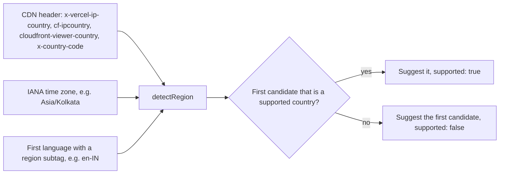

# Countries, markets and compliance rules

> One codebase with per-market switches: a customer's country picks a market, the market picks the currency and every rule number, and onboarding suggests the country from network, time zone and language signals.

**Status:** built · **Switch:** always on (rule values are illustrative planning defaults, not legal advice; the file says each market needs counsel sign-off)

## What it does

- Supports **8 markets** (US, EU, UK, IN, SG, CA, AU, AE) and **28 countries**: 7 that map one-to-one, plus 21 euro-area countries that share the EU market.
- Each market sets the wallet currency, the number-formatting locale, regulatory notes, emergency guardrails, personal-limit bounds, verification thresholds, Satellite investing rules, a cooling-off period and disclosures.
- Shared money defaults are written once in USD and scaled per currency, so a market entry lists only what differs.
- Onboarding suggests a country from the CDN's country header, the device time zone and the browser languages. The person always confirms or changes it.
- A customer's "day" for wallet limits is midnight in their country's main time zone, from [timezones.ts](../../src/lib/timezones.ts).
- Moving an existing wallet to a market with a different currency is refused.

## How it works

### From country to rules

1. Onboarding sends a `country` (ISO 3166-1 alpha-2). Older clients may send a `jurisdiction` (market code) instead; `defaultCountryFor()` turns it into a country (`UK` → `GB`, `EU` → `DE`, otherwise the same code).
2. `createUser()` in [users.ts](../../src/lib/users.ts) calls `countryInfo()`. An unknown country → 400 "That country isn't supported yet".
3. The country's market gives `users.jurisdiction` (market code), and the market's currency gives `users.currency`. `users.country` keeps the ISO code.
4. Every rule lookup calls `rulesFor(user.jurisdiction)`. An unknown code falls back to the US rules.

### How a market is built

`defineMarket()` in [compliance.ts](../../src/lib/compliance.ts) takes a short `MarketDef` and fills in the rest:

1. `scale = CURRENCY_SCALE[currency]` from [shared.ts](../../src/lib/shared.ts) (USD 1, EUR 0.95, GBP 0.8, SGD 1.3, INR 80, CAD 1.35, AUD 1.5, AED 3.67).
2. Each USD default is multiplied by the scale and passed to `niceRound()`: to the nearest 10 below 1,000, 100 below 10,000, 1,000 below 100,000, else 10,000. The result is stored in minor units (× 100).
3. An explicit `emergencyMonthlyCap` (major units) replaces the scaled default.
4. Optional `assetClasses`, `maxAllocationPct` and `coolingOffDays` replace their defaults.

`JURISDICTIONS` holds the built rules by code; `MARKET_CODES` lists the codes for zod enums.

### Region detection

1. `GET /api/v1/region` reads the first CDN country header it finds and parses `Accept-Language` by quality. It returns `networkCountry`, `languages` and a server-side guess (no time zone, since the server can't see it).
2. Network candidates must be two letters and not `XX` or `T1`.
3. `countryFromTimezone()` uses a fixed table of 54 IANA zones covering the 28 countries. Zones not in the table give nothing.
4. `countryFromLanguage()` takes the region subtag (`en-IN` → `IN`, `zh-Hant-TW` → `TW`, `de` → nothing). Only the first language with a region is used.
5. `detectRegion()` keeps the strongest candidate that is supported; if none is, it reports the strongest one with `supported: false`.
6. **Web** ([onboarding.tsx](../../src/components/onboarding.tsx)): fetches `/api/v1/region` for the network country, then runs `detectRegion()` in the browser with the device time zone and `navigator.languages`. It preselects the country only if supported.
7. **Phone** ([AboutYouStep.tsx](../../mobile/src/features/account/onboarding/AboutYouStep.tsx)): uses the server's guess as is (network header and `Accept-Language`, no device time zone) and preselects it once if it is in the country list from `/api/v1/me`.

No third-party IP lookup is used.

### Time zones

- `timeZoneFor(user)` returns the country's main zone, else a market fallback (for users saved before countries existed), else `UTC`. The US, Canada and Australia use their most populous zone (New York, Toronto, Sydney).
- `zonedDayStart()` and `zonedNextDayStart()` find local midnight as a UTC instant, correcting twice for daylight-saving changes. They use cached `Intl.DateTimeFormat` objects.
- Only the wallet uses these today ([moves.ts](../../src/lib/wallet/moves.ts), [plan.ts](../../src/lib/wallet/plan.ts), [view.ts](../../src/lib/wallet/view.ts)). Personal limits, streaks and the scheduler use the server's clock (see [limits.md](limits.md)).

### Where rule values are used

| Rule group | Used by |
|---|---|
| `limits.*`, `emergency.monthlyCap` | [src/lib/limits/](../../src/lib/limits/README.md): bounds (`bounds.ts`, `store.ts`), monthly allowance (`change.ts`), emergency requests (`emergency-request.ts`, `policy.ts`, `increase.ts`) |
| `emergency.*` | [emergency.ts](../../src/lib/emergency.ts) velocity, cooling-off, Tier 2 hold, receipt window |
| `verification.*` | Auto-approve and auto-deny thresholds in [stages/decision.ts](../../src/lib/verification/stages/decision.ts), document age in [stages/rules.ts](../../src/lib/verification/stages/rules.ts); admin overview SLA |
| `satellite.*` | [satellite.ts](../../src/lib/invest/satellite.ts) eligibility, allocation cap, asset classes, risk and drawdown halts |
| `dataRegime` | Assistant prompt; settings page |
| `*Regime`, `disclosures`, `coolingOffDays` | Settings page "market rules" card; Satellite page disclosures |
| `locale`, `verification.reviewSlaHours`, `emergency.tier2HoldSeconds`, `emergency.receiptWindowDays`, `verification.maxDocAgeDays` | Phone, via `rules` in `/api/v1/me` (`useRules()` in [hooks.ts](../../mobile/src/lib/api/hooks.ts); locale feeds `setMoneyLocale()`) |

## Where the code is

### Server

| File | What it holds | Key exports |
|---|---|---|
| [src/lib/compliance.ts](../../src/lib/compliance.ts) | Market table, builder, countries | `rulesFor()` rules or US fallback, `JURISDICTIONS`, `MARKET_CODES`, `COUNTRIES`, `COUNTRY_CODES`, `countryInfo()` country + flag + currency, `countryFlag()` emoji from code, `defaultCountryFor()`, `JurisdictionRules` type, `MarketCode` (`JurisdictionCode` is a deprecated alias) |
| [src/lib/region.ts](../../src/lib/region.ts) | Region detection (shared by browser and server) | `detectRegion()`, `countryFromTimezone()`, `countryFromLanguage()`, `parseAcceptLanguage()`, `regionName()` display name, `GEO_HEADERS` |
| [src/lib/timezones.ts](../../src/lib/timezones.ts) | Customer-local day boundaries | `timeZoneFor()`, `zonedDayStart()`, `zonedNextDayStart()` |
| [src/lib/shared.ts](../../src/lib/shared.ts) | Currency scale and formatting | `CURRENCY_SCALE`, `CURRENCY_LOCALE`, `fmtMoney()` |
| [src/lib/users.ts](../../src/lib/users.ts) | Wallet creation | `createUser()` country → market → currency |
| [src/lib/db.ts](../../src/lib/db.ts) | Migration | `migrate()` adds `users.country` and backfills it |
| [src/app/api/v1/region/route.ts](../../src/app/api/v1/region/route.ts) | Server region signals | `GET` |
| [src/app/api/v1/onboarding/route.ts](../../src/app/api/v1/onboarding/route.ts) | Opens a wallet (empty or Practice data) | `POST` |
| [src/app/api/v1/me/route.ts](../../src/app/api/v1/me/route.ts) | Returns rules, markets, countries; market change guard | `GET`, `PATCH` |

### Web app

| File | What it holds | Key exports |
|---|---|---|
| [src/components/onboarding.tsx](../../src/components/onboarding.tsx) | Onboarding form with country detection | `Onboarding()` |
| [src/app/settings/page.tsx](../../src/app/settings/page.tsx) | Shows the market's regimes, guardrails, thresholds and disclosures | — |

### Phone app

| File | What it holds | Key exports |
|---|---|---|
| [mobile/src/features/account/onboarding/AboutYouStep.tsx](../../mobile/src/features/account/onboarding/AboutYouStep.tsx) | Name, email, country, age | `AboutYouStep()` |
| [mobile/src/features/account/onboarding/CountryPicker.tsx](../../mobile/src/features/account/onboarding/CountryPicker.tsx) | Country field and list sheet | `CountryField()`, `countryDetail()` |
| [mobile/src/features/recovery/market.ts](../../mobile/src/features/recovery/market.ts) | Picks ID types by market, using the region guess when signed out | `useIdMarket()` |
| [mobile/src/lib/api/hooks.ts](../../mobile/src/lib/api/hooks.ts) | Rules with published defaults | `useRules()` |

## API endpoints

| Method | Path | Who can call | Purpose |
|---|---|---|---|
| GET | `/api/v1/region` | Anyone (no sign-in) | Network country, languages, server guess |
| POST | `/api/v1/onboarding` | Anyone without a wallet (prototype: no wallet on the server; firebase: signed in with no wallet) | `name`, `email`, `country` or `jurisdiction`, `pin` (4–6 digits), `demo` |
| GET | `/api/v1/me` | Anyone; full data for the customer | `rules`, `jurisdictions` (markets), `countries` (with flag, currency, market name) |
| PATCH | `/api/v1/me` | Customer | Can change `jurisdiction` only to a market with the same currency |

## Data

| Table | Columns |
|---|---|
| `users` | `jurisdiction` (market code), `country` (ISO code, added by migration), `currency` |
| `accounts` | `currency` on every ledger account; journals must be single-currency |

The rules themselves are code, not data. No phone storage keys in this area.

## Rules and limits

Shared values (all markets):

| Group | Values |
|---|---|
| Emergency | 3 requests per 7 days; cooling-off of 24 h after 2 requests in 72 h; Tier 2 hold 90 s; receipt window 14 days |
| Limits | 1 standard raise per month; 2 emergency limit requests per month; emergency increase lasts 14 days; max increase ratio 3× |
| Verification | auto-approve ≥ 0.85; auto-deny ≤ 0.35; documents up to 120 days old; review SLA 4 hours |
| Satellite | enabled; minimum risk band 3; risk per trade 1 %; halt at 3 % daily or 6 % weekly drawdown |

Per-market differences (money in major units; see [limits.md](limits.md) for single and daily limits):

| Market | Currency / locale | Emergency cap | Satellite cap | Asset classes | Cooling-off |
|---|---|---|---|---|---|
| US | USD / en-US | 2,500 (explicit) | 10 % | equities, crypto, forex | 0 |
| EU | EUR / de-DE | 2,000 (explicit) | 10 % | equities, crypto, forex | 14 days |
| UK | GBP / en-GB | 2,000 (explicit) | 10 % | equities, crypto, forex | 14 days |
| IN | INR / en-IN | 1,50,000 (explicit) | 10 % | equities, crypto | 0 |
| SG | SGD / en-SG | 3,000 (explicit) | 5 % | equities, crypto, forex | 0 |
| CA | CAD / en-CA | 3,400 (scaled) | 10 % | equities, crypto, forex | 0 |
| AU | AUD / en-AU | 3,800 (scaled) | 10 % | equities, crypto, forex | 0 |
| AE | AED / en-AE | 9,200 (scaled) | 10 % | equities, crypto, forex | 0 |

Euro-area countries: AT, BE, BG, HR, CY, EE, FI, FR, DE, GR, IE, IT, LV, LT, LU, MT, NL, PT, SK, SI, ES.

## Configuration

| Setting | Effect |
|---|---|
| CDN country header | Read when deployed behind Vercel, Cloudflare or CloudFront, or any proxy that sets `x-country-code` |
| Adding a market | Add a `MarketDef` to `MARKET_DEFS`; add its currency to `CURRENCY_SCALE` and `CURRENCY_LOCALE` |
| Adding a country | Add it to `COUNTRIES`, to `TIMEZONE_COUNTRY` in region.ts and to `BY_COUNTRY` in timezones.ts |

No environment variables.

## Tests

| File | What it covers |
|---|---|
| [tests/region.test.ts](../../tests/region.test.ts) | Time zone without network; network wins; fallback when the network country is unsupported; language as last resort; unsupported reported honestly; `Accept-Language` order; euro countries share EU and EUR; wallet opens in the country's currency; unsupported country refused |
| [tests/limits.test.ts](../../tests/limits.test.ts) | Market defaults scale with currency (US, IN, CA single defaults; IN explicit cap; AE currency) |
| [tests/wallet.test.ts](../../tests/wallet.test.ts) | Wallet day resets at the customer's midnight (India), which exercises `timeZoneFor()` and `zonedDayStart()` |

## Known limits and open issues

- `rulesFor()` silently returns US rules for an unknown code, which could hide a bad `jurisdiction` value.
- No two markets share a currency, so `PATCH /api/v1/me` refuses every market change in practice. The message says to reset the demo.
- `coolingOffDays` is shown on the settings page but not enforced anywhere. Not confirmed whether enforcement is planned.
- All euro-area countries format money with `de-DE`.
- One time zone per country: a customer in Los Angeles gets New York's midnight for wallet limits.
- The phone does not send its time zone, so its onboarding suggestion relies on the network header and `Accept-Language` only.
- Region detection knows only the zones in its table; other zones in a supported country give no signal.

## Maintainability notes

- **Good seams.** Markets are data: `defineMarket()` plus `MarketDef` keeps a new market to about 20 lines. `detectRegion()` is pure and shared by browser and server. `rulesFor()` is the single entry point every feature uses.
- **Duplication.** Country-to-zone data lives in two tables (`TIMEZONE_COUNTRY` in region.ts maps zones to countries; `BY_COUNTRY` in timezones.ts maps countries to zones). The market → default-country mapping exists in `defaultCountryFor()`, in the SQL `CASE` in `migrate()`, and implicitly in `BY_MARKET`.
- **OCP.** Adding a country means editing three files ([compliance.ts](../../src/lib/compliance.ts), [region.ts](../../src/lib/region.ts), [timezones.ts](../../src/lib/timezones.ts)). Keeping the main zone on the `Country` record would make it one edit.
- **Naming.** The code says both "market" and "jurisdiction" for the same thing (`users.jurisdiction`, `JURISDICTIONS`, `JurisdictionRules`, `MarketCode`). A deprecated alias exists but the column and the big exports keep the old name.
- **ISP.** `JurisdictionRules` is one wide object; most callers need one group (`limits`, `emergency`, `verification`, `satellite`). The phone receives all of it through `/api/v1/me`.
