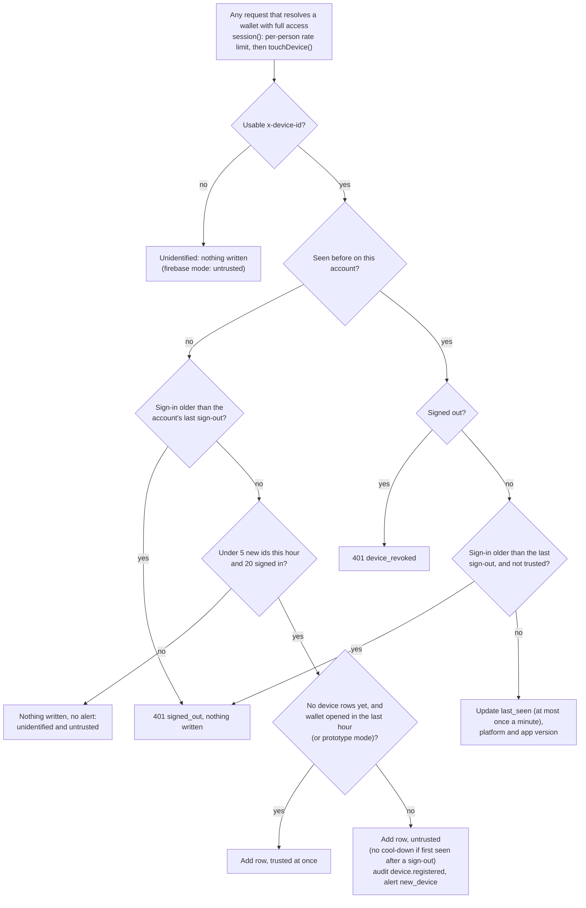
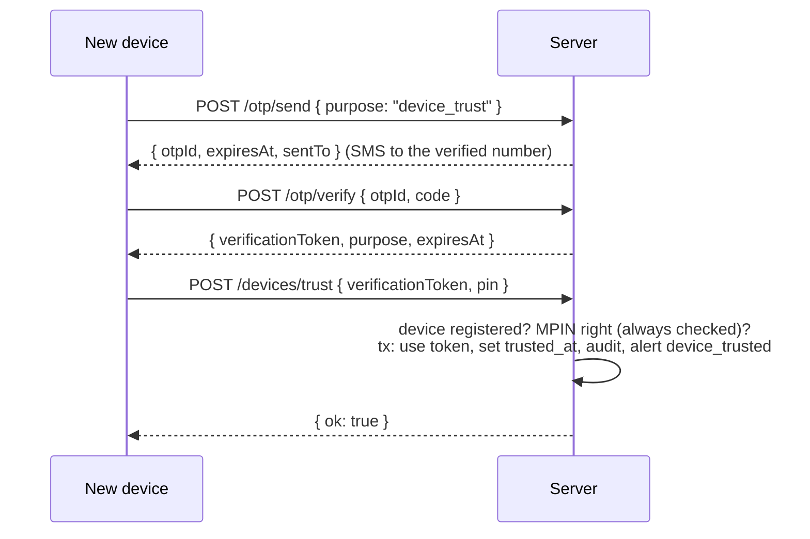

# Devices, alerts and phone OTP

> The server knows which phones and browsers use an account, holds a new one back for 24 hours, tells the person about every security-relevant event, and texts 6-digit codes to prove a phone number.

**Status:** built on the server, the web app and the phone ([plan 06](../plans/06-devices-alerts-otp.md)); the phone side is in [On the phone](#on-the-phone). SMS through Twilio is written but not yet run against Twilio, and phone push hasn't been tried on a real build. · **Switches:** `DEVICES_ENFORCED` (on unless `false`), `ALERTS_PUSH` (on unless `false`), `OTP_MODE` (off unless `test` or `twilio`)

Each module has its own README: [src/lib/devices/README.md](../../src/lib/devices/README.md), [src/lib/alerts/README.md](../../src/lib/alerts/README.md), [src/lib/otp/README.md](../../src/lib/otp/README.md). The binding interface is in [contracts.md](../plans/contracts.md), "Devices, alerts and OTP (plan 06)".

## What it does

For a person using Vaultwise:

- **A new phone is held back.** With sign-in on, the device that signs up (the first one, within an hour of opening the wallet) is trusted; in prototype mode, the first device is. Any other device, including the first one seen on an older account, can move money out only up to about USD 50 per move (₹4,000, €48, £40) for its first 24 hours. It can skip the wait by being trusted with a texted code and the MPIN.
- **A new phone can't take over.** During those 24 hours it also can't sign out a trusted device, replace the verified phone number or reset the MPIN.
- **Any device can be signed out.** A signed-out device is refused on every request, so the app signs itself out. Any sign-in that started before the sign-out ends too, except on a trusted device. Signing in again, or reinstalling the app, makes a new device that waits for a texted code and the MPIN (no 24-hour wait after a sign-out).
- **Alerts for what matters.** A new device, a device trusted or signed out, money leaving, a limit raised, the MPIN locked or changed, and a new phone number each write an alert to the in-app inbox and, if the phone registered for push, a push notification.
- **Phone number by OTP.** A 6-digit code texted to the number proves it, and adding or replacing the number also needs the MPIN. The same codes, sent to the verified number, trust a new device and reset a forgotten MPIN. A number added or changed in the last 72 hours can't reset the MPIN.

## How it works

### Devices

- **Headers.** Clients send `x-device-id` (8 to 100 characters of `A-Z a-z 0-9 . _ : -`; `unknown` counts as missing), `x-device-platform` (`ios`, `android` or `web`) and `x-app-version`. `readDeviceHeaders()` treats anything malformed as missing.
- **Recording.** `session()` in [src/lib/auth/session.ts](../../src/lib/auth/session.ts) calls `touchDevice()` on every request that finds a wallet with full access, in both sign-in modes (in firebase mode, after the per-person rate limit). A recovery claimant's read-only access is not recorded: the claimant never becomes a device of the wallet it claims, and `/me` shows no `device` for it. The result is `Session.device`.
- **The first device.** With sign-in on, the account's first device (no rows yet) is trusted at once only on a wallet opened in the last hour (`NEW_ACCOUNT_WINDOW_MS`), so it is the device that signed up. "Opened" is the wallet's first ledger account's `created_at` (`walletOpenedAt()`), because the practice data back-dates `users.created_at`. On an older wallet with no devices, the first device starts untrusted with a `new_device` alert, like any other. In prototype mode (no sign-in) the first device is trusted at once whatever the wallet's age, as before: texted codes are off locally, so the demo phone would otherwise be capped for 24 hours with no way to trust it, and there is no sign-in to protect. Later devices start untrusted there too. Signed-out rows still count, so signing out every phone doesn't make the next one "first".
- **Trusted** means: trusted with a code and the MPIN, or the sign-up device, or 24 hours past `first_seen` (`isTrusted()`, `coolDownEnds()`). A signed-out device is never trusted. A device first seen after a device was signed out of the account (`devices.cool_down = 0`) never trusts itself after 24 hours: only a texted code and the MPIN trust it (`trustableAt: null`).
- **The new-device limit.** An account adds at most 5 device rows an hour (`NEW_DEVICES_PER_HOUR`) and has at most 20 signed in (`MAX_ACTIVE_DEVICES`). Past either, a new id is not recorded, raises no alert, and the request counts as unidentified and untrusted, in both sign-in modes. So rotating `x-device-id` can't fill the table or flood the inbox. `/me` then shows `device: { registered: false, trusted: false, trustableAt: null }`, and `POST /devices/trust` answers 400 `device_unknown`. The limit applies even with `DEVICES_ENFORCED=false`, since it only stops recording.
- **Older sign-ins end.** Signing a device out also records the time on the account (`users.devices_revoked_at`, set by `markAccountRevoked()`, also when a device signs itself out). After that, a request whose sign-in started earlier gets 401 `signed_out` unless it comes from a trusted, signed-in device of the account. The sign-in time is `signedInAt` from `verifyIdToken()` ([verify.ts](../../src/lib/auth/verify.ts)): the token's `auth_time`, falling back to `iat`, compared in whole seconds (`signedInBefore()`). `auth_time` stays the same when the app refreshes its one-hour ID token, so a stolen refresh token can't outlive the sign-out. A new id on such a request is refused before anything is written. Firebase mode only (prototype mode has no sign-in time).
- **The cap.** `assertDeviceMayMove(user, amountMinor, action)` runs in the money-out routes (actions marked `deviceCap` in [src/lib/money-routes.ts](../../src/lib/money-routes.ts): `withdraw`, `wallet_spend`, `wallet_cash_out`, `emergency`) before the MPIN check. Above `untrustedMoveCap(user)` (USD 50 × `CURRENCY_SCALE`, rounded to a whole unit) an untrusted device gets 403 `device_untrusted` with `trustableAt`. The cap is per move; the account's own limits still apply on top. Moves into a vault and investing are not capped.
- **Account changes.** `assertTrustedDevice(ctx, "phone_change" | "mpin_reset")` refuses an untrusted device. `revokeDevice()` refuses an untrusted caller signing out a trusted device. A device may always sign itself out, and any device may sign out an untrusted one.

**Requests without a device id** (scripts, tests, older phone builds, and the web app with sign-in off) are *unidentified*. They are not recorded and can't be trusted or signed out. In prototype mode they count as trusted, so the web demo keeps working. In firebase mode they are always untrusted and never cool down (`trustableAt: null`), whatever devices the account has, so leaving the header off can't skip the rules (and a stolen token on an account with no devices yet doesn't count as trusted).

**The web app** sends its own device id when web sign-in is on ([src/components/identity/device.ts](../../src/components/identity/device.ts)): a random `web-<uuid>` in localStorage under `vw-device-id`, with `x-device-platform: web`, on every API call (`request()` in `src/lib/client.ts`) and the assistant's streaming call. So a browser follows the same rules as a phone and shows up in the devices list. When the server answers 401 `device_revoked`, `reportApiError()` in [session.ts](../../src/components/identity/session.ts) treats it as a sign-out and marks the id (`vw-device-revoked`); the id is dropped at the next sign-out, so signing in again starts as a new device. With web sign-in off (the usual prototype set-up) the web sends no device id.

### Trusting a device

`POST /otp/send` with `device_trust` already refuses a request without a device id (400 `device_unknown`, also for an id the new-device limit didn't record) and an account without a verified number (409 `phone_required`), so no SMS is spent on a request that would fail.

### Alerts

- `raiseAlert(userId, kind, title, body)` ([raise.ts](../../src/lib/alerts/raise.ts)) writes the alert to the `alerts` table **inside the caller's transaction**, so a money move that rolls back leaves no alert. After the caller's work finishes (`setImmediate`), it runs the push sender, but only if the alert row still exists. It never throws.
- Senders sit behind the `AlertSender` interface ([senders.ts](../../src/lib/alerts/senders.ts)): `inAppSender` (`when: "now"`, always on) and `expoPushSender` (`when: "later"`, only when `ALERTS_PUSH` is on and the person has push tokens). A new channel is a new sender; `setAlertSenders()` swaps the list.
- Expo push: one `POST https://exp.host/--/api/v2/push/send` with one message per token, a 10-second timeout, and `Authorization: Bearer <EXPO_ACCESS_TOKEN>` if set. A ticket error `DeviceNotRegistered` removes that token. Failures are logged; nothing is retried.
- The wording of every alert lives in [messages.ts](../../src/lib/alerts/messages.ts), so each call site is one line.

| Kind | Raised by |
|---|---|
| `new_device` | `touchDevice()`, for any device not trusted at once (every device but a new account's sign-up device); not past the new-device limit |
| `device_trusted` | `trustDevice()` |
| `device_revoked` | `revokeDevice()`. The text says the device must sign in again and can then send only small amounts until trusted; it doesn't promise the device is out for good. |
| `money_out` | `payoutWithdrawal()` (`src/lib/vaults.ts`); `spend()` and `cashOut()` (`src/lib/wallet/moves.ts`); `executeEmergency()` and `settleEmergencies()` (`src/lib/emergency.ts`) |
| `limit_loosened` | `changeLimits()` (a standard raise), `requestEmergencyLimitChange()` when approved, `reviewLimitChange()` when approved (`src/lib/limits.ts`); `updateWalletSettings()` when the daily limit goes up or off |
| `mpin_locked` | `recordFailure()` when a wrong try starts a lock. With `MPIN_ENFORCED=false` the text says only the changes that need the MPIN are locked, not money moves. |
| `mpin_changed` | `setMpin()` (change and reset) |
| `phone_verified` | `setVerifiedPhone()`, when a number is added or replaced. The text says the number can't reset the MPIN for 72 hours. |

Push tokens: at most 10 per person (the newest are kept). A token registered by another account moves to the new one. A token is tied to the calling device, so signing that device out removes its tokens.

### OTP

- `sendOtp()` ([service.ts](../../src/lib/otp/service.ts)): `phone_verify` sends to the number in the body (normalised to E.164 by `normalisePhone()`); `device_trust` and `mpin_reset` send to the verified number. It checks the hourly limits, stores the code's HMAC, marks earlier unused codes for the same purpose as used, and calls the sender. A send the provider refuses still counts toward the limit.
- **Send limits** (each 429 `otp_rate_limited` with `retryAt`): 5 codes an hour per person, and 5 an hour per person to one number (`OTP_SENDS_PER_HOUR`); and 15 `phone_verify` codes an hour to one number from all accounts together (`OTP_NEW_NUMBER_SENDS_PER_HOUR`). The last one counts only sends to a number the sending account hasn't verified (`otp_codes.new_number = 1`) and refuses only those. So other accounts can slow down new sign-ups to a number, but can't block the owner's own `device_trust` and `mpin_reset` codes (or re-verifying) on their verified number.
- `verifyOtp()`: a right code marks the code used and returns a random 32-byte verification token, stored as its SHA-256 and bound to the person, the purpose and the number. A wrong code counts a try; the third wrong try uses the code up. Something that isn't 6 digits is refused without counting.
- `consumeVerification(user, token, purpose)` uses the token once. Routes call it **inside** the action's `tx()`, so a failed action leaves the token unused.
- Senders sit behind `OtpSender` ([senders.ts](../../src/lib/otp/senders.ts)), picked by `OTP_MODE`: `testOtpSender` returns the code as `testCode`; `twilioSender()` ([twilio.ts](../../src/lib/otp/twilio.ts)) posts to Twilio's Messages API with HTTP Basic auth, using `MessagingServiceSid` when `TWILIO_FROM` starts with `MG`, else `From`.
- The SMS says what the code is for and to never share it (`smsText()`).

**Phone number.** `users.phone` and `users.phone_verified_at` are added on first use by `ensurePhoneColumns()` ([phone.ts](../../src/lib/otp/phone.ts)), not by `db.ts`, so the module can be removed. A number is stored only once a code proved it. `/me` shows it masked (`+91••••••3210`, `maskPhone()`). Proving the number that is already verified changes nothing (and doesn't restart the 72-hour hold).

**Adding or replacing the number needs the MPIN.** `POST /me/phone` takes `{ verificationToken, pin }`. The route opts in with `customer({ money: "phone_change" })` and checks the MPIN with `requireMpin(..., "phone_change", { always: true })`, so it is checked even with `MPIN_ENFORCED=false`, and wrong tries count toward the lock. The number receives the codes that trust devices and reset the MPIN, so a stolen sign-in alone must not be able to put its own number on the account. Replacing a verified number also needs a trusted device, checked first. The MPIN is checked before the token is used, so a wrong MPIN leaves the token for another try.

**72-hour hold on MPIN reset.** For 72 hours after the verified number was added or changed (`phone_verified_at`, `PHONE_RESET_HOLD_MS`), it can't reset the MPIN: `POST /otp/send` with `mpin_reset` and `POST /mpin/reset` answer 403 `phone_recently_changed` with `allowedAt` (ms). `assertPhoneSettled()` in [phone.ts](../../src/lib/otp/phone.ts) does the check; the route checks it before a code is sent.

## Where the code is

### Server

| File | What it holds | Key exports |
|---|---|---|
| [src/lib/devices/config.ts](../../src/lib/devices/config.ts) | Switch and numbers | `devicesEnforced()`, `UNTRUSTED_CAP_USD` (50), `COOL_DOWN_MS` (24 h), `NEW_ACCOUNT_WINDOW_MS` (1 h), `NEW_DEVICES_PER_HOUR` (5), `MAX_ACTIVE_DEVICES` (20), `LAST_SEEN_EVERY_MS` (1 minute) |
| [src/lib/devices/rules.ts](../../src/lib/devices/rules.ts) | Pure rules | `readDeviceHeaders()`, `isTrusted()`, `trustableAtOf()`, `coolDownEnds()`, `signedInBefore()`, `untrustedMoveCap()` |
| [src/lib/devices/store.ts](../../src/lib/devices/store.ts) | `devices` table and `users.devices_revoked_at` | `ensureDevicesTable()`, `deviceByInstall()`, `deviceById()`, `deviceCount()`, `devicesFirstSeenSince()`, `activeDeviceCount()`, `activeDevices()`, `insertDevice()`, `markSeen()`, `markTrusted()`, `markRevoked()`, `accountRevokedAt()`, `markAccountRevoked()`, `walletOpenedAt()` |
| [src/lib/devices/service.ts](../../src/lib/devices/service.ts) | Use cases | `touchDevice()`, `deviceContext()`, `currentDevice()`, `assertDeviceMayMove()`, `assertTrustedDevice()`, `assertRegisteredDevice()`, `trustDevice()`, `revokeDevice()`, `listDevices()`, `deviceStatus()`, `DeviceContext` |
| [src/lib/devices/errors.ts](../../src/lib/devices/errors.ts) | Errors | `DeviceError` (with `extra.trustableAt`), `DEVICE_REVOKED`, `revokedError()`, `SESSION_ENDED`, `sessionEndedError()` (401 `signed_out`) |
| [src/lib/alerts/config.ts](../../src/lib/alerts/config.ts) | Switches and limits | `pushEnabled()`, `expoAccessToken()`, `EXPO_PUSH_URL`, `MAX_PUSH_TOKENS_PER_USER` (10), `PUSH_TIMEOUT_MS` (10 s) |
| [src/lib/alerts/store.ts](../../src/lib/alerts/store.ts) | `alerts` and `push_tokens` tables | `ALERT_KINDS`, `insertAlert()`, `listAlerts()`, `unreadCount()`, `markRead()`, `savePushToken()`, `pushTokensFor()`, `removePushToken()`, `removePushTokensForDevice()`, `alertView()` |
| [src/lib/alerts/raise.ts](../../src/lib/alerts/raise.ts) | Raising an alert | `raiseAlert()` |
| [src/lib/alerts/senders.ts](../../src/lib/alerts/senders.ts) | Channels | `AlertSender`, `inAppSender`, `expoPushSender`, `alertSenders()`, `setAlertSenders()` |
| [src/lib/alerts/push.ts](../../src/lib/alerts/push.ts) | Push tokens | `isExpoPushToken()`, `registerPushToken()`, `unregisterPushToken()` |
| [src/lib/alerts/messages.ts](../../src/lib/alerts/messages.ts) | Alert wording | `alertMoneyOut()`, `alertEmergency()`, `alertLimitLoosened()`, `alertMpinLocked()`, `alertMpinChanged()`, `alertPhoneVerified()`, `alertNewDevice()`, `alertDeviceTrusted()`, `alertDeviceRevoked()`, `durationText()`, `deviceLabel()` |
| [src/lib/otp/config.ts](../../src/lib/otp/config.ts) | Switches and numbers | `otpMode()`, `otpTestAllowed()`, `OTP_PURPOSES`, `OTP_DIGITS`, `OTP_TTL_MS`, `OTP_MAX_TRIES`, `OTP_SENDS_PER_HOUR` (5), `OTP_NEW_NUMBER_SENDS_PER_HOUR` (15), `VERIFICATION_TTL_MS`, `PHONE_RESET_HOLD_MS` (72 h) |
| [src/lib/otp/senders.ts](../../src/lib/otp/senders.ts), [twilio.ts](../../src/lib/otp/twilio.ts) | Where codes go | `OtpSender`, `testOtpSender`, `otpSender()`, `twilioConfig()`, `twilioSender()`, `TWILIO_API` |
| [src/lib/otp/store.ts](../../src/lib/otp/store.ts) | `otp_codes`, `otp_verifications` | `ensureOtpTables()`, `sendsByUser()`, `sendsByUserTo()`, `newNumberSendsTo()`, `insertCode()`, `supersedeCodes()`, `codeFor()`, `recordWrongTry()`, `markCodeUsed()`, `insertVerification()`, `verificationByHash()`, `spendVerification()` |
| [src/lib/otp/service.ts](../../src/lib/otp/service.ts) | Use cases | `newCode()`, `smsText()`, `sendOtp()`, `verifyOtp()`, `consumeVerification()` |
| [src/lib/otp/phone.ts](../../src/lib/otp/phone.ts) | The phone number on `users` | `ensurePhoneColumns()`, `normalisePhone()`, `maskPhone()`, `verifiedPhone()`, `phoneStatus()`, `phoneChangedAt()`, `assertPhoneSettled()`, `setVerifiedPhone()` |
| [src/lib/otp/errors.ts](../../src/lib/otp/errors.ts) | Errors | `OtpError` (with `extra.triesLeft`, `extra.retryAt` or `extra.allowedAt`) |
| [src/lib/auth/session.ts](../../src/lib/auth/session.ts) | Device on every session | `session()` applies the per-person rate limit, then calls `touchDevice()` with the token's `signedInAt` (not for recovery access); `Session.device` |
| [src/lib/auth/verify.ts](../../src/lib/auth/verify.ts) | When the sign-in started | `VerifiedToken.signedInAt` (`auth_time`, else `iat`, in ms) |
| Routes: [devices](../../src/app/api/v1/devices/), [alerts](../../src/app/api/v1/alerts/), [push/register](../../src/app/api/v1/push/register/route.ts), [otp](../../src/app/api/v1/otp/), [me/phone](../../src/app/api/v1/me/phone/route.ts), [mpin/reset](../../src/app/api/v1/mpin/reset/route.ts), [me](../../src/app/api/v1/me/route.ts) | Thin handlers; lines in shared files marked `// devices`, `// alerts`, `// otp` | `GET`, `POST`, `DELETE` |

### Web app

| File | What it holds | Key exports |
|---|---|---|
| [src/components/devices-alerts.tsx](../../src/components/devices-alerts.tsx) | Settings card "Devices and alerts": verify a phone number with a code and the MPIN, list devices and sign one out (needs the MPIN), "Trust this device" for an untrusted browser (a code to the verified number, then the MPIN), recent alerts with "mark all read" | `DevicesAlertsCard` |
| [src/components/identity/device.ts](../../src/components/identity/device.ts) | This browser's device id (sign-in on only) | `webDeviceId()`, `webDeviceHeaders()`, `withWebDevice()`, `markWebDeviceRevoked()`, `resetWebDeviceIfRevoked()` |
| [src/components/identity/session.ts](../../src/components/identity/session.ts) | `device_revoked` read as a sign-out | `reportApiError()`, `signOutNow()` |
| [src/lib/client.ts](../../src/lib/client.ts) | Adds the device headers to every web API call | `request()` (internal) |
| [src/app/settings/page.tsx](../../src/app/settings/page.tsx) | Shows the card | `SettingsPage` |

The web trusts itself the same way as the phone: `TrustThisDevice` sends `POST /otp/send` with `device_trust` from the browser, verifies the code, then sends `POST /devices/trust` with the token and the MPIN. The phone-number form sends `POST /me/phone` with the token and the MPIN.

## API endpoints

| Method | Path | Who can call | Body or query | Returns |
|---|---|---|---|---|
| GET | `/api/v1/devices` | customer read | | `{ devices: [{ id, platform, appVersion, firstSeen, lastSeen, trusted, trustableAt, current }] }`, signed-in devices, most recently used first |
| POST | `/api/v1/devices/trust` | customer write (`money: "device_trust"`) | `{ verificationToken, pin }` | `{ ok: true }`. Trusts the calling device (400 `device_unknown` without a recorded device id; then the MPIN, always checked; then the token). Already trusted: nothing changes and the token stays unused. |
| POST | `/api/v1/devices/{id}/revoke` | customer write (`money: "device_revoke"`) | `{ pin }` | `{ ok: true }`. Signing out twice is a no-op. |
| GET | `/api/v1/alerts` | customer read | `?unread=1` (or `true`), `?limit=` (default 50, max 200) | `{ alerts: [{ id, kind, title, body, createdAt, readAt }], unread }`, newest first |
| POST | `/api/v1/alerts/read` | customer write | `{ ids?: string[] }` (up to 200; none = all) | `{ ok: true, unread }` |
| POST | `/api/v1/push/register` | customer write | `{ token, platform }` (`ios`, `android`, `web`; an Expo push token) | `{ ok: true }` |
| DELETE | `/api/v1/push/register` | customer write | `{ token }` | `{ ok: true }` (also when it wasn't registered). Call on sign-out. |
| POST | `/api/v1/otp/send` | customer write | `{ purpose, phone? }` (`phone` only for `phone_verify`) | `{ otpId, expiresAt, sentTo, testCode? }` (`sentTo` masked; `testCode` only with `OTP_MODE=test`). Device checks and the 72-hour hold run before a code is sent. |
| POST | `/api/v1/otp/verify` | customer write | `{ otpId, code }` | `{ verificationToken, purpose, expiresAt }` |
| POST | `/api/v1/me/phone` | customer write (`money: "phone_change"`) | `{ verificationToken, pin }` (purpose `phone_verify`; `pin` is the current MPIN) | `{ ok: true }`. Sets the number the code went to. The MPIN is always checked; replacing a verified number also needs a trusted device (checked first). Raises `phone_verified`. |
| POST | `/api/v1/mpin/reset` | customer write | `{ verificationToken, newPin }` (purpose `mpin_reset`) | `{ ok: true }`. Needs a trusted device and a verified number at least 72 hours old. See [mpin.md](mpin.md). |
| GET | `/api/v1/me` | signed in | | adds `phone: { number, verified }` and, when the request resolved a device context (not for a recovery claimant), `device: { registered, trusted, trustableAt }` |

### Errors

Extra fields are sent next to `error` and `code`.

| Code | Status | Extra | When |
|---|---|---|---|
| `device_untrusted` | 403 | `trustableAt` (ms; null for an unidentified request or a device first seen after a sign-out) | Over the new-device cap; signing out a trusted device, replacing the phone number, resetting the MPIN or asking for those codes from an untrusted device |
| `device_revoked` | 401 | | Any request from a signed-out device, `/me` included |
| `signed_out` | 401 | | Firebase mode: a sign-in older than the account's last device sign-out, from anything but a trusted signed-in device (the same code as a missing token, so the app signs in again) |
| `device_unknown` | 400 | | Trusting, or asking for a `device_trust` code, without a recorded device id (none sent, or past the new-device limit) |
| `device_not_found` | 404 | | Signing out a device that isn't on this account |
| `push_token_invalid` | 400 | | Not an Expo push token (`ExponentPushToken[…]` or `ExpoPushToken[…]`) |
| `otp_unavailable` | 503 | | No sender set up (`OTP_MODE` unset, test mode on production, or Twilio settings missing) |
| `otp_send_failed` | 502 | | Twilio refused or didn't answer within 10 seconds |
| `otp_rate_limited` | 429 | `retryAt` (ms) | 5 codes in the last hour for this person (or from this person to this number), or 15 `phone_verify` codes to this number from accounts that haven't verified it. No `Retry-After` header. |
| `phone_invalid` | 400 | | Not a full international number (`+` and 8 to 15 digits) |
| `phone_required` | 409 | | `device_trust` or `mpin_reset` without a verified number |
| `phone_recently_changed` | 403 | `allowedAt` (ms) | `mpin_reset` (sending the code, or the reset) within 72 hours of the verified number being added or changed |
| `otp_not_found` | 404 | | Not this person's code |
| `otp_wrong` | 400 | `triesLeft` | Wrong code, or not 6 digits (not counted) |
| `otp_exhausted` | 410 | | The third wrong try, and any try after it |
| `otp_expired` | 410 | | Over 5 minutes old |
| `otp_used` | 410 | | Already used, or replaced by a newer code |
| `verification_invalid` | 400 | | Token unknown, used, expired, another person's or for another purpose |

The MPIN errors (`mpin_required`, `mpin_wrong`, `mpin_locked`) also apply to trusting, signing out and `POST /me/phone`, whatever `MPIN_ENFORCED` says. See [mpin.md](mpin.md).

## Data

| Table | Columns | Notes |
|---|---|---|
| `devices` | `id` PK (`dev_…`), `user_id`, `install_id`, `platform`, `app_version`, `first_seen`, `last_seen`, `trusted_at`, `revoked_at`, `cool_down` | Unique on `(user_id, install_id)`. Signed-out rows are kept. `cool_down` (default 1) is 0 for a device first seen after a device was signed out of the account; it is added to older tables on first use. |
| `users.devices_revoked_at` | added on first use | When a device was last signed out of the account (any sign-out, a device signing itself out included). A sign-in older than it is refused unless from a trusted device. |
| `alerts` | `id` PK (`alt_…`), `user_id`, `kind`, `title` (≤ 120), `body` (≤ 500), `created_at`, `read_at` | Index on `(user_id, created_at)` |
| `push_tokens` | `token` PK, `user_id`, `platform`, `device_id`, `created_at`, `updated_at` | At most 10 per person |
| `otp_codes` | `id` PK (`otp_…`), `user_id`, `purpose`, `phone`, `salt`, `code_hash`, `tries`, `created_at`, `expires_at`, `used_at`, `new_number` | Code stored as `HMAC-SHA256(IDENTITY_SECRET or a fixed dev key, "otp:<id>:<salt>:<code>")`. `new_number` is 1 for a `phone_verify` send to a number the sending account hadn't verified (the cross-account limit counts only these); added to older tables on first use. |
| `otp_verifications` | `token_hash` PK (SHA-256), `otp_id`, `user_id`, `purpose`, `phone`, `created_at`, `expires_at`, `used_at` | Single use |
| `users.phone`, `users.phone_verified_at` | added on first use | Set only after a code proved the number |

Every table is created on first use. Audit actions: `device.registered`, `device.trusted`, `device.revoked`, `otp.sent` (masked number), `otp.failed`, `otp.verified`, `phone.verified` (masked numbers). Codes and tokens are never logged.

| Web storage | Backend | Holds |
|---|---|---|
| `vw-device-id` | localStorage | This browser's device id (sign-in on only) |
| `vw-device-revoked` | localStorage | `"1"` after a `device_revoked` answer, until the next sign-out |

## Rules and limits

| Rule | Value |
|---|---|
| New-device cap | USD 50 per move, scaled by `CURRENCY_SCALE` and rounded to a whole unit |
| Cool-down | 24 hours after the device was first seen; none for a device first seen after a sign-out (code and MPIN only) |
| First device trusted at once | with sign-in on, only on a wallet opened in the last hour; in prototype mode always |
| New-device limit | 5 new device rows an hour, 20 signed in at once, per account |
| `last_seen` writes | at most once a minute per device (platform and version whenever they change) |
| OTP | 6 digits, 5 minutes, 3 tries |
| OTP sends | 5 per hour per person, and 5 per hour per person to one number; 15 `phone_verify` per hour to one number from accounts that haven't verified it |
| MPIN reset after a number change | not for 72 hours after the verified number was added or changed |
| Verification token | 10 minutes, single use, bound to person, purpose and number |
| Push tokens | 10 per person |
| Alerts per page | 50 by default, 200 at most |

## Configuration

| Variable | Default | Effect |
|---|---|---|
| `DEVICES_ENFORCED` | on | `false`: devices are still recorded and alerts raised, but nothing is refused (no cap, signed-out devices and older sign-ins get in, new devices may change the number and reset the MPIN). The new-device limit still applies, since it only stops recording. |
| `ALERTS_PUSH` | on | `false`: in-app alerts only. |
| `EXPO_ACCESS_TOKEN` | unset | Sent to Expo when the project has "enhanced push security" on. |
| `OTP_MODE` | off | `test`: no SMS, the code comes back as `testCode`. `twilio`: SMS through Twilio. Anything else: 503 `otp_unavailable`. |
| `OTP_TEST_ALLOWED` | unset | `true` lets `OTP_MODE=test` run when `NODE_ENV=production` (a demo server). |
| `TWILIO_ACCOUNT_SID`, `TWILIO_AUTH_TOKEN`, `TWILIO_FROM` | unset | All three needed for `OTP_MODE=twilio`. `TWILIO_FROM` is an E.164 number or a Messaging Service SID (`MG` + 32 hex). |
| `IDENTITY_SECRET` | unset | Keys the code hashes; a fixed development key is used without it. |

For development put `OTP_MODE=test` in `.env.local`.

## Tests

| File | What it covers |
|---|---|
| [tests/devices.test.ts](../../tests/devices.test.ts) | Header parsing; the cap per currency; trust rules (no cool-down after a sign-out, sign-in times in whole seconds); which actions are capped; first device trusted, later ones alerted; `last_seen` throttling; the list; the cap and its 24-hour lift; rollback mode; trusting with token and MPIN; signing out (self, untrusted, trusted), `device_revoked` on every request; the new-device limit (5 an hour, 20 signed in); the first device of a new and of an older wallet (and of an older wallet in prototype mode); firebase mode: requests without a device id untrusted from the start, older sign-ins ended by a sign-out, a device first seen after a sign-out, no device for a recovery claimant, the per-person rate limit on `GET /me` |
| [tests/alerts.test.ts](../../tests/alerts.test.ts) | Inbox and unread count; nothing written for rolled-back work; the routes; each kind raised where things happen; only the contract's kinds; push registration; Expo calls, dropped tokens, Expo down, `ALERTS_PUSH=false`; 10 tokens per person; swapping senders |
| [tests/otp.test.ts](../../tests/otp.test.ts) | Codes, numbers and SMS text; choosing a sender; the Twilio request (fetch mocked) and its failures; hashed storage; tries, expiry and replacement; hourly limits, and the 15-an-hour cross-account limit that doesn't block the owner's codes; tokens; verifying the number (the MPIN needed, wrong tries counted); a new device can't replace the number; MPIN reset, refused for 72 hours after a number change and from a new device |
| [tests/mpin.test.ts](../../tests/mpin.test.ts) | Reset needs a texted-code token |

## On the phone

The phone tells the server which install is asking, shows the devices and alerts, trusts itself with a code and the MPIN, registers for push, and signs out when another device signed it out. The server decides every rule above. Three modules, each with a README that lists its touch points and how to remove it: [features/devices](../../mobile/src/features/devices/README.md), [features/alerts](../../mobile/src/features/alerts/README.md) and [features/phone-verify](../../mobile/src/features/phone-verify/README.md).

### What a person sees

| Where | What |
|---|---|
| Settings → Security → **Your devices** (`app/settings/devices.tsx`) | Every signed-in install, this one first ("iPhone · This phone"), with the app version, last seen, first signed in, and Trusted, Not trusted yet or Needs a code (an icon and a word; `trustLabel()` in `features/devices/model.ts`). Every other device has **Sign out**, confirmed with the MPIN sheet (`withMpin`, `POST /devices/{id}/revoke`). While this phone isn't trusted, a banner says when large amounts can move, with **Trust this phone**; for a phone that won't trust itself (`trustableAt: null`) it says waiting won't do it, with **Trust with a code**. |
| A phone the account couldn't add (`/me` `device.registered: false`, or 400 `device_unknown`) | A calm note on Your devices, in Settings and in the MPIN sheet (`UNRECOGNISED_TEXT`): lots of new devices signed in lately, or 20 are signed in already; it can still move small amounts. No Trust button anywhere, since it would be refused. |
| **Trust this phone** (`app/settings/trust-device.tsx`, full-screen modal) | Step 1: a code to the verified number (`device_trust`). Step 2: the MPIN, using the MPIN prompt itself. Then `POST /devices/trust`. With no verified number it asks for one first. A token that ran out sends the person back for a new code. A phone the account couldn't add is told why instead of being sent a code. |
| The MPIN sheet, on a money move over the cap | "This phone isn't trusted yet. Large amounts can move from it from 3:40 pm tomorrow, or trust it now…" with **Trust this phone**; with `trustableAt: null`, that waiting won't do it, with **Trust with a code** (`readDeviceError()` and `deviceProblemFor()` in `features/mpin/errors.ts`). |
| Signed out from another device | The next request answers 401 `device_revoked`; the app signs out of Vaultwise with "This phone was signed out of Vaultwise from another device…" on the sign-in screen. |
| A sign-in older than a device sign-out | Any request answering 401 `signed_out` (not only `/me`): the app signs out once, with the server's words ("A device was signed out of your account since you signed in here. Sign in again to continue."). See [identity.md](identity.md#on-the-phone). |
| The **bell** on Home's header, and Settings → Notifications → **Alerts** (`app/settings/alerts.tsx`) | The unread count ("9+" above nine). The inbox: newest first, an icon per kind, title, body and when. Opening one marks it read; **Mark all as read** marks the rest. |
| Settings → Security → **Phone number**, and **Add your phone number** (`app/settings/verify-phone.tsx`, full-screen modal) | The verified number as `/me` masks it, or Not added. Adding or changing: the number with its country code (pre-filled from the person's country), **Send code** (`phone_verify`), the code, then **the MPIN** (the shared `MpinPanel`, handed to `PhoneVerifyScreen` as a prop by the route, so tries and locks read as everywhere else), then `POST /me/phone` with the token and the MPIN. A wrong MPIN keeps the token (no new code); a token that ran out goes back to the code step. Done says a new number can't reset the MPIN for 72 hours. |
| The code step (`OtpCodeScreen`), shared by the three flows | Where the code went, a 6-digit field that the phone can fill from the text (`textContentType="oneTimeCode"`, `autoComplete="one-time-code"`), **Send a new code** after 30 seconds, and what went wrong in words. When the server is in `OTP_MODE=test` (or in Practice) it shows "Test mode code: 123456" with **Use this code**. |
| Settings → Security → **Forgot your MPIN?** | Uses the same code step ([mpin.md](mpin.md#on-the-phone)). Within 72 hours of the number being added or changed (403 `phone_recently_changed`) it says resetting is paused until the time in `allowedAt`. |

### How it works

- **Headers on every request.** `deviceHeaders()` in [lib/api/device.ts](../../mobile/src/lib/api/device.ts) gives `x-device-id` (`installId()`, a random UUID kept in `vw.deviceId`), `x-device-platform` (`ios`, `android` or `web`) and `x-app-version` (`expo.version`). `request()` in `lib/api/http.ts` adds them to every call to the server; so do the assistant's streaming call in `client.ts` and the signed-in export download (`features/auth/exportData.ts`). A new id is made only when none is saved: the read (`getItemStrict()`) is tried a second time after 250 ms, and if storage still fails the id is `"unknown"` for that run (the server treats it as none) and the saved id is left alone, since a new id would be a new, untrusted device and an alert to the owner.
- **The install id rule.** The id stays through a normal sign-out, so signing back in on the same phone is the same, still trusted device. It is replaced after Delete account (when it closes a signed-in account), a remote sign-out (`device_revoked`) and the wrong-PIN lockout, because those call `resetDevice({ forgetDevice: true })` in [lib/session.ts](../../mobile/src/lib/session.ts), through `signOutOfVaultwise()`, which signs Firebase out first, so no request goes out signed in with the new id. `installId()` reads storage again after every wipe (`onDeviceReset`). Deleting the Practice account keeps it (a live login kept on the phone is signed out, but the live account still exists and it is the same phone). On iOS a fresh install also gets a new id, because its first launch wipes what the last install left in the Keychain ([phone-security.md](phone-security.md)).
- **Remote sign-out.** `http.ts` calls `noteDeviceRevoked()` on any 401 with code `device_revoked`. `useDeviceWatch()` ([features/devices/useDeviceWatch.ts](../../mobile/src/features/devices/useDeviceWatch.ts)), mounted on Home's header, hears it through `onDeviceRevoked()` and calls `signOutOfVaultwise(notice, { forgetDevice: true })`. It acts only when sign-in is on and someone is signed in. A revocation that happened before Home mounted (behind the unlock screen, say) is handled when it mounts. With sign-in off (a prototype server) there is nobody to sign out and the old id stays refused, so only the id goes (`forgetInstallId()` in `lib/api/device.ts`, at most once a minute) and the next request comes from a new device.
- **Trust states.** `phoneTrust()` in `features/mpin/errors.ts` turns `/me`'s `device` into one of four states that every screen uses: `trusted`, `cooling` (a future time in `trustableAt`), `needs_code` (`trustableAt` null or past) and `unrecognised` (`registered: false`).
- **Alerts.** One React Query (`qk.alerts`) feeds the bell and the inbox (`useAlerts()` in [features/alerts/hooks.ts](../../mobile/src/features/alerts/hooks.ts)): stale after 10 seconds, fetched on focus and every 60 seconds while the app is open (`ALERTS_POLL_MS`). A 404 (a server without plan 06) stops the polling and the retries. `alerts` is in `MONEY_QUERIES`, so `useInvalidateMoney()` refreshes it after a money move. Marking read updates the cache at once, then posts `POST /alerts/read` and refetches.
- **Push.** `usePushRegistration()` ([features/alerts/push.ts](../../mobile/src/features/alerts/push.ts)) runs from the bell, so only once someone is in the app, and only on live data. It calls `registerForPushNotifications()` ([lib/notify.ts](../../mobile/src/lib/notify.ts)), which creates the Android `default` channel, asks for permission if it hasn't been refused for good, and returns the Expo push token (needs the EAS project id). The token goes to `POST /push/register` with the platform. No permission, Expo Go, the web, no FCM credentials or no network just mean no token; it tries again next launch. Practice never asks and never registers.
- **Unregistering on sign-out.** `push.ts` registers a step with `onBeforeSignOut()` ([features/auth/gate.ts](../../mobile/src/features/auth/gate.ts)). `signOutOfVaultwise()` runs these steps first, while the login still works, and waits at most 3 seconds (`BEFORE_SIGN_OUT_MS`); failures are ignored. The step sends `DELETE /push/register` with the install id the token was registered from in `x-device-id`. A sign-out that Firebase starts by itself skips this step; the server drops tokens Expo reports as gone.
- **Codes.** `useOtp(purpose)` ([features/phone-verify/useOtp.ts](../../mobile/src/features/phone-verify/useOtp.ts)) sends (`POST /otp/send`), verifies (`POST /otp/verify`) for a single-use token, and times the resend. `readOtpError()` ([errors.ts](../../mobile/src/features/phone-verify/errors.ts)) maps codes in one table: `otp_wrong` (with `triesLeft`); `otp_expired`, `otp_exhausted`, `otp_used`, `otp_not_found`, `verification_invalid` (send a new code); `otp_rate_limited` (with `retryAt`); `phone_required`; `phone_invalid`; `phone_recently_changed` (with `allowedAt`). Anything else shows through `errorMessage()`, which has plain fallbacks for `device_untrusted`, `device_revoked`, `device_unknown`, `phone_required`, `phone_recently_changed`, `verification_invalid`, `otp_unavailable` and `otp_send_failed` (`lib/api/errors.ts`).
- **Numbers.** `phoneProblem()` in [phone.ts](../../mobile/src/features/phone-verify/phone.ts) applies the server's E.164 rule (`+` and 8 to 15 digits) before sending; `dialCodeFor()` pre-fills the country code.
- **API methods.** [lib/api/security.ts](../../mobile/src/lib/api/security.ts) (`securityLive`, spread into `live` in `client.ts`) reads every answer defensively (`toDevice()`, `toAlert()`), so a server a version ahead or behind doesn't break a screen. Shapes are in [security-types.ts](../../mobile/src/lib/api/security-types.ts). `/me` adds `phone` and `device` (`MePhone`, `MeDevice` in `lib/api/types.ts`).

### Practice

| What | Practice ([demo/devices.ts](../../mobile/src/lib/api/demo/devices.ts), [demo/alerts.ts](../../mobile/src/lib/api/demo/alerts.ts)) |
|---|---|
| Devices | One trusted device, "This phone", first seen 30 days ago. A device is trusted once trusted with a code and the MPIN, or 24 hours after first seen, and never when signed out (`practiceTrusted()`, the server's `isTrusted`), for every rule: `/me`, the list, signing out, changing the number, resetting the MPIN and the cap. A device first seen after a Practice sign-out never trusts itself (`coolsDown: false`, `trustableAt: null`). |
| New-device cap | USD 50 scaled by `CURRENCY_SCALE` and rounded to a whole unit like the server's (₹4,000 for the sample account) per move, on withdraw, wallet spend, cash out and emergency (`assertPracticeDeviceCap()`), checked on the amount asked for **before** the MPIN, as the server does; 403 `device_untrusted` with `trustableAt` |
| Codes | Always `123456`, returned as `testCode`; 5 minutes, 3 tries, 5 sends an hour; a new code replaces older unused ones; tokens single use, 10 minutes |
| Trust, sign out, reset | Same token and MPIN rules and codes as the server, in the server's order (trusting checks the MPIN, then the token; signing out checks the MPIN first and records the account's last sign-out); an untrusted phone can't sign out a trusted one, replace the number or reset the MPIN |
| Phone number | None at the start. Keeping a number needs the MPIN (`phone_change`; a wrong MPIN keeps the token). The 72-hour reset hold counts from when the number was added or changed (403 `phone_recently_changed`); proving the same number again doesn't restart it. Only the masked number is kept, with a one-way key of the whole number (SHA-256 with a fixed prefix) to tell the same number apart. |
| Alerts | An inbox slice with one read alert to start. `practiceAlert()` is called by withdraw, wallet spend and cash out, emergency (`money_out`), limit raises and the wallet's daily limit (`limit_loosened`), Change MPIN and reset (`mpin_changed`), and the device and phone events. Their words never carry the phone number or a typed payee ("your verified number", "the payee"); `generaliseAlert()` rewords alerts from older saves as they load. Nothing is pushed. |
| Saved | `devices` is a sensitive slice (secure storage, chunked); `alerts` is in the bulk save. Codes and tokens are memory only. |
| Not simulated | The new-device limit (`registered: false`) and the 401 `signed_out` for older sign-ins |

**Try it in Practice** (a group on Your devices, Practice only) uses `practiceDeviceTools`, exported from `lib/api/client.ts` so the screen never imports the simulator:

- **Pretend another phone signed in:** adds an untrusted iPhone or Android phone and a `new_device` alert, so Sign out can be tried.
- **Start this phone over as new:** makes this phone untrusted, first seen now, so the cap and Trust this phone can be tried. After signing the pretend phone out, it gives a phone first seen after a sign-out: no 24-hour wait, only Trust with a code.

### Phone switches

| Switch | File | Off |
|---|---|---|
| `DEVICES_ENABLED` | `features/devices/config.ts` | No Your devices row and no sign-out (or new install id) on `device_revoked` (errors say what happened). The headers are still sent. |
| `ALERTS_ENABLED` | `features/alerts/config.ts` | No bell, no Alerts row, no push permission prompt |
| `PHONE_VERIFY_ENABLED` | `features/phone-verify/config.ts` | No Phone number row. Trust and reset still use the code step for an account that already has a number. |

### Phone known limits

- Device names are platforms only ("iPhone", "Android phone"); the phone sends no model name.
- Tapping a push notification opens the app, not the inbox (no response listener yet).
- Push needs a development or store build with an EAS project id, and on Android the project's `google-services.json` in the build ([plan 02](../plans/02-apk-rebuild-prep.md#before-you-build-push-notifications)) plus FCM credentials uploaded to Expo. Not yet tried on a real build.
- A real revocation and sign-out needs the live server and two devices; Practice can't revoke the phone it runs on.
- The embedded MPIN steps (Core buy, limit raise) say where to trust the phone instead of opening the flow; the server doesn't cap those actions anyway.
- Alerts have no paging (the server sends the newest 50) and aren't grouped by day.
- The number is typed with its country code; there's no country picker.

## How to change it safely

- **Add an alert kind:** add it to `ALERT_KINDS` in `store.ts`, a wording function in `messages.ts`, and one call where it happens. Update the contract and `tests/alerts.test.ts` ("uses only the contract's kinds"). The phone may show an icon per kind.
- **Add an alert channel** (email, SMS): write an `AlertSender` with `when: "later"` and add it to `DEFAULT_SENDERS` in `senders.ts`. It must never throw.
- **Add an SMS provider** (MSG91, Firebase): write an `OtpSender`, add a branch in `otpSender()` and a value for `OTP_MODE`.
- **Change the cap or cool-down:** `UNTRUSTED_CAP_USD` and `COOL_DOWN_MS` in `devices/config.ts`, plus the phone's copy if it shows the amount.
- **Make another action capped:** set `deviceCap: true` in `MONEY_ROUTES` and call `assertDeviceMayMove()` in its route, before `requireMpin()`.
- **Use a token in a new action:** add a purpose to `OTP_PURPOSES` and call `consumeVerification()` inside that action's `tx()`.
- **Roll back** devices with `DEVICES_ENFORCED=false` and push with `ALERTS_PUSH=false`. Leave `OTP_MODE` unset to switch codes off (trusting, phone verification and MPIN reset then answer 503).

## Known limits and open issues

- **Twilio is untested against Twilio.** It is written from Twilio's docs and unit-tested with `fetch` mocked. Indian numbers in production also need DLT registration of the sender and template.
- **Production needs a sender.** With `OTP_MODE` unset on a live server, trusting a device, verifying a phone and resetting an MPIN all answer 503. `.env.example` and the settings table in `deploy/README.md` list `OTP_MODE`.
- **Push on Android** goes through Expo's push service, which needs the project's Firebase Cloud Messaging credentials uploaded to Expo. Push receipts aren't checked and nothing is retried.
- **Not every login alerts.** Only a sign-in from a new device raises `new_device`. Money into vaults or investments raises nothing.
- **Closing an account and approving a recovery claim don't sign out devices.** Plan 06 planned both. Recovery notices still go through `src/lib/recovery/notify.ts`, not the alert senders, and the `account_closed` notice is still never sent ([maintainability](../maintainability.md) B15).
- **The device id is chosen by the client.** It is not proof the app is genuine; plan 08 can add Play Integrity or App Attest. The new-device limit, the account-wide sign-out time and the untrusted default for requests without an id stop the obvious abuses (rotating ids, dropping the header, carrying on after a sign-out), but a stolen sign-in on a new id can still move up to the cap for 24 hours until the owner signs it out.
- **Prototype mode trusts unidentified requests**, so the open demo is not protected by the cap.
- **No clean-up job.** Old `otp_codes`, `otp_verifications`, alerts and signed-out devices are never deleted.
- A phone number is not required at sign-up, and email addresses are still not verified.

## Maintainability notes

- **Open/closed:** alert channels and SMS providers are registries behind small interfaces; alert wording is in one file.
- **Dependency direction:** devices imports alerts and OTP (for `consumeVerification()`); OTP and the MPIN module import alerts; alerts imports none of them. The routes, not the modules, combine devices with OTP and MPIN checks.
- **Schema in code:** every table, and the three `users` columns (`phone`, `phone_verified_at`, `devices_revoked_at`), are created on first use with their own `WeakSet`. Later columns (`devices.cool_down`, `otp_codes.new_number`) are added to older tables the same way.
- **Two duration helpers:** `durationText()` in `alerts/messages.ts` and `waitText()` in `mpin/verify.ts` are the same function.
