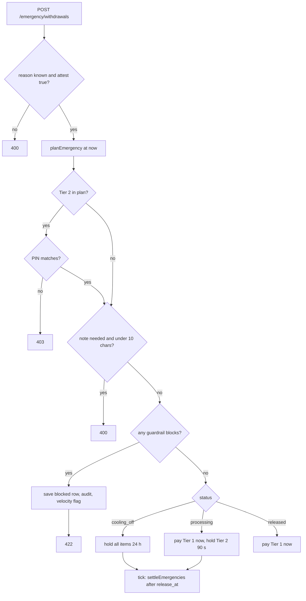
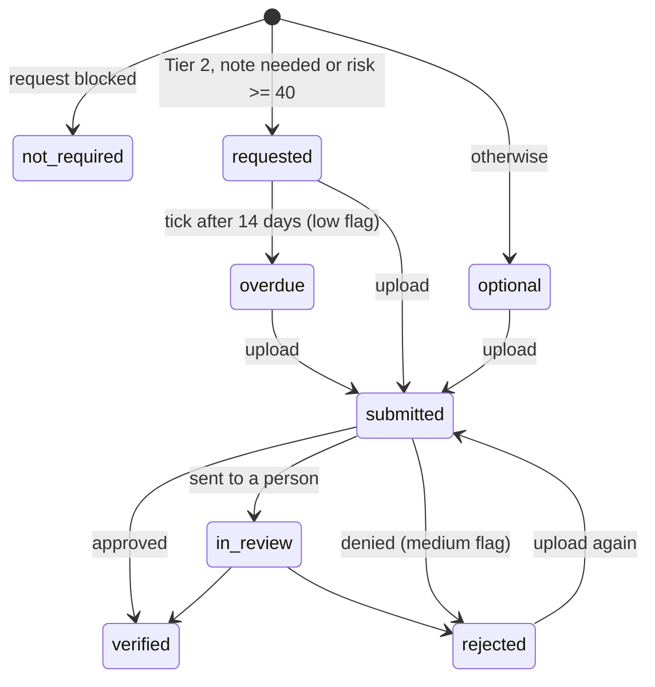

# Emergency money

> A tiered way to get savings out fast in a genuine emergency: Health vaults pay at once, other vaults pay after the PIN and a short safety pause, inside fixed limits, with a receipt asked for afterwards.

**Status:** built (server, web app, phone app); Practice-simulated on the phone when it runs without a server · **Switch:** always on (submitting needs a verified ID when the KYC gate is on, see [identity.md](identity.md))

## What it does

- Splits the amount across vaults: Health vaults first (Tier 1), then the other vaults in a fixed order (Tier 2).
- Pays Tier 1 to the linked bank account straight away, on the customer's attestation alone. No document is needed.
- Asks for the PIN when Tier 2 is involved, then holds the Tier 2 money for 90 seconds before it moves.
- Checks guardrails on every request: monthly cap, requests in the last 7 days and funds available. Each can block.
- Adds friction on repeat use: a short note after any use in the last 30 days, and a 24-hour cooling-off on the third request inside 72 hours.
- Scores each request for risk (0-100). The score never blocks. A score of 60 or more raises a flag for ops.
- Asks for a receipt within 14 days when Tier 2 was used, a note was needed or the score was 40 or more. The receipt never delays or reverses the payout.
- Saves every request, including blocked ones, in `emergency_requests` and writes it to the audit log.

Tier 1 always means vaults in the `health` category. The reason code does not choose the vault.

## How it works

### Request and release (server)

1. **Preview.** `POST /api/v1/emergency/preview` calls `planEmergency()`. It runs the lazy scheduler first, then builds the plan and guardrails. Nothing changes.
2. **Submit.** `POST /api/v1/emergency/withdrawals` calls `executeEmergency()`:
   1. An unknown reason code or `attest: false` returns 400.
   2. Inside one database transaction it plans again at the current time, so the preview is never trusted.
   3. If the plan has Tier 2 items and the PIN does not match, it returns 403.
   4. If a note is needed and it is shorter than 10 characters, it returns 400.
   5. If any guardrail says `block`, it saves a `blocked` row, writes `emergency.blocked` to the audit log and returns 422 with the plan. If the velocity check blocked, it also raises a flag.
   6. Otherwise it picks a status: `cooling_off` (friction level 3), else `processing` (any Tier 2), else `released`.
   7. Unless cooling off, it moves each Tier 1 item from its vault to the bank as a ledger journal of kind `emergency` and marks the item settled.
   8. It saves the row (plan, guardrails, risk score, `release_at`, receipt status, `receipt_due_at`) and writes `emergency.attested`.
   9. If the risk score is 60 or more, it raises a flag. The route returns 201.
3. **Hold.** Until release, unsettled plan items count as held in `heldFor()` ([vaults.ts](../../src/lib/vaults.ts)). The vault's `available` drops at once; its balance does not.
4. **Release.** `settleEmergencies()` runs inside the lazy scheduler `tick()` ([scheduler.ts](../../src/lib/scheduler.ts)) before most customer API reads. For each `processing` or `cooling_off` row whose `release_at` has passed, it moves the unsettled items (actor `emergency-orchestrator`) and sets the row to `released`. Money therefore moves on the first read after the release time, not on a timer.
5. **Overdue receipts.** The same tick turns `requested` receipts past their due date into `overdue` and raises a low flag.

### Cascade order

| Tier | Vaults used | Order |
| --- | --- | --- |
| 1 | Category `health` | Oldest vault first |
| 2 | `emergency`, then `custom`, `housing`, `education`, `retirement` | Category order, then oldest first |

Each vault gives `min(amount still needed, vault available)`. Any amount left over is a shortfall, and the `funds` guardrail blocks.

### Receipts afterwards

The receipt is post-hoc accountability. It runs the normal proof pipeline ([proof-verification.md](proof-verification.md)) with purpose `emergency_receipt`.

- Uploads are accepted only while the status is `requested`, `optional`, `overdue` or `rejected`; otherwise 409.
- `createProof()` sets `submitted` and stores `receipt_proof_id`. `applyOutcome()` in [pipeline.ts](../../src/lib/verification/pipeline.ts) sets `verified`, `in_review` or `rejected`, for both the model and a human reviewer.
- Optional receipts never become overdue. An overdue flag stays open after a later upload.

### Phone flow

The modal at `/emergency-request` ([RequestFlow.tsx](../../mobile/src/features/emergency/request/RequestFlow.tsx)) runs amount, reason, review, PIN (Tier 2 only), then an outcome.

1. **Amount.** A keypad. The hint shows `min(remaining cap, Tier 1 + Tier 2 available)`, or says the week is full. "Use X" fills in what Health can pay now. `usePlanPreview()` calls the preview endpoint 350 ms after typing stops. Continue works only when a fresh, unblocked preview matches the amount. A blocked preview offers "Ask for a higher limit" and "Talk to a person".
2. **Reason.** Seven reason codes with icons. A note is required when the plan says `needsNote` or the server asked for one (10 to 300 characters).
3. **Review.** Amount, where the money comes from, when it arrives, the reason and the guardrails in plain words (`plainCheck()`). The person ticks "I confirm this is a genuine emergency", then holds the button for 800 ms (`HoldToConfirm`). Tier 1 only: the hold submits. With Tier 2: the hold opens the PIN step.
4. **PIN.** The pad submits on the last digit (4 or 6 digits). A 403 shakes the dots and says "That PIN isn't right." In Practice the screen shows the demo PIN.
5. **Outcome.** `Released`, `SafetyPause` (countdown, soft haptic ticks in the last 5 seconds, a spoken note at 10 seconds), `CoolingOff` or `Blocked`. The countdown uses the server's `release_at` unless the phone clock is 30 seconds or more off.

Error mapping: 403 or "PIN" in the message means wrong PIN; 422 means blocked; 400 mentioning a note sends the person back to the reason step. The live client accepts a 422 body and, if it has no plan, asks for a preview so it can still explain the block. The phone always sends `attest: true`; the hold control stays disabled until the box is ticked.

From `Released`, "add receipt" swaps the modal to `?receipt=<id>` ([ReceiptUpload.tsx](../../mobile/src/features/emergency/receipt/ReceiptUpload.tsx)): camera, photo library or a sample, then the AI-consent question, then upload. It then replaces itself with the proof screen.

### Emergency tab

[EmergencyHome.tsx](../../mobile/src/features/emergency/home/EmergencyHome.tsx) shows, top to bottom: a "receipts owed" card (when any are owed, sorted overdue, rejected, requested, optional), "Need money now?" with the amount ready, three safety-limit rows (left this month, requests this week, what the next request needs), the two tier cards (tap to list their vaults), the "Get emergency money" button, the line "A proof under review never blocks emergency money", and the request history. Each history row opens `/track?kind=emergency&id=…` ([EmergencyTrack.tsx](../../mobile/src/features/proof/track/EmergencyTrack.tsx)). While a request is in its safety pause the tab refetches once it is due, so the server settles it.

### Web page

[src/app/emergency/page.tsx](../../src/app/emergency/page.tsx) does the same on one screen: amount and reason, a live preview (300 ms debounce) with the cascade and guardrails, then note, PIN and attestation fields when needed. The status refetches every 15 seconds. The history table offers a receipt upload modal or a link to the proof report. The dashboard shows an "Emergency readiness" card, and `nudges()` in [engagement.ts](../../src/lib/engagement.ts) shows "A supporting receipt is requested" while any receipt is `requested` or `overdue`.

## Where the code is

### Server

| File | What it holds | Key exports |
| --- | --- | --- |
| [src/lib/emergency.ts](../../src/lib/emergency.ts) | Cascade, guardrails, execution, settlement | `emergencyStatus()` caps, counts, vaults, last 20 requests; `planEmergency()` dry-run plan and guardrails; `executeEmergency()` validate, pay Tier 1, save, audit, flag; `settleEmergencies()` release held money, mark overdue; `viewRequest()` row to API shape |
| [src/lib/compliance.ts](../../src/lib/compliance.ts) | Per-market emergency rules | `rulesFor()` market rule set |
| [src/lib/limits.ts](../../src/lib/limits.ts) | Personal monthly emergency limit | `effectiveEmergencyCap()` stricter of market and personal cap |
| [src/lib/fraud.ts](../../src/lib/fraud.ts) | Risk score and flags | `emergencyRiskScore()` 0-100 score; `raiseFlag()` open a flag (see [fraud-and-audit.md](fraud-and-audit.md)) |
| [src/lib/vaults.ts](../../src/lib/vaults.ts) | Holds and vault views | `heldFor()` held amount incl. emergency; `listVaults()` open vaults oldest first |
| [src/lib/ledger.ts](../../src/lib/ledger.ts) | Money movement | `transfer()` vault to bank journal; `userAccount()` bank account |
| [src/lib/users.ts](../../src/lib/users.ts) | PIN check | `checkPin()` scrypt compare |
| [src/lib/scheduler.ts](../../src/lib/scheduler.ts) | Lazy scheduler | `tick()` calls `settleEmergencies()` |
| [src/lib/shared.ts](../../src/lib/shared.ts) | Reason codes | `EMERGENCY_REASONS` seven codes |
| [src/lib/verification/pipeline.ts](../../src/lib/verification/pipeline.ts) | Receipt proofs | `createProof()` sets `submitted`; `runPipeline()` decides; `reviewDecision()` human decision |
| [src/app/api/v1/emergency/](../../src/app/api/v1/emergency/) | Route handlers | `GET` status, `POST preview`, `POST withdrawals`, `POST [id]/receipt` |

### Web app

| File | What it holds | Key exports |
| --- | --- | --- |
| [src/app/emergency/page.tsx](../../src/app/emergency/page.tsx) | Emergency access page | `EmergencyPage()` form, preview, result, history; `CascadeViz()` tier boxes; `ReceiptUpload()` receipt modal |
| [src/app/page.tsx](../../src/app/page.tsx) | Dashboard readiness card | reads `emergency` from `/api/v1/dashboard` |
| [src/app/activity/page.tsx](../../src/app/activity/page.tsx) | Audit trail with an "emergency" filter | `describe()` text for `emergency.attested` |

### Phone app

| File | What it holds | Key exports |
| --- | --- | --- |
| [mobile/src/app/(tabs)/emergency.tsx](<../../mobile/src/app/(tabs)/emergency.tsx>) | Tab route | default `EmergencyTab()` |
| [mobile/src/app/emergency-request.tsx](../../mobile/src/app/emergency-request.tsx) | Modal route | default; `?receipt=` picks receipt upload |
| [mobile/src/features/emergency/home/](../../mobile/src/features/emergency/home/) | Tab screen | `EmergencyHome()`, `Hero()`, `SafetyLimits()`, `TierCards()`, `GuaranteeLine()`, `ReceiptsOwed()`, `History()` |
| [mobile/src/features/emergency/request/](../../mobile/src/features/emergency/request/) | Request flow | `RequestFlow()` step machine; `AmountStep()`, `ReasonStep()`, `ReviewStep()`, `PinStep()`; `Released()`, `SafetyPause()`, `CoolingOff()`, `Blocked()`, `Sending()`; `usePlanPreview()` debounced preview; `releaseText()`; `PlanItems()`, `SplitLines()` |
| [mobile/src/features/emergency/receipt/](../../mobile/src/features/emergency/receipt/) | Receipt upload | `ReceiptUpload()`; `takePhoto()`, `choosePhoto()`, `pickSample()` |
| [mobile/src/features/emergency/copy.ts](../../mobile/src/features/emergency/copy.ts) | Plain-language copy | `plainCheck()` guardrail text; `blockedReason()`; `maxRequest()`; `requestStatus()`; `owedReceipts()`; `receiptPill()`; `receiptDueText()`; `NOTE_MIN`, `NOTE_MAX` |
| [mobile/src/features/emergency/format.ts](../../mobile/src/features/emergency/format.ts) | Money and date words | `fmt()`, `whenText()`, `dayWord()`, `rowDate()` |
| [mobile/src/features/emergency/routes.ts](../../mobile/src/features/emergency/routes.ts) | Navigation | `go` from the tab; `leave` from inside the modal |
| [mobile/src/features/proof/track/EmergencyTrack.tsx](../../mobile/src/features/proof/track/EmergencyTrack.tsx) | Release tracker sheet | `EmergencyTrack()` |
| [mobile/src/lib/api/client.ts](../../mobile/src/lib/api/client.ts) | Live API calls | `emergency`, `emergencyPreview`, `emergencyWithdraw` (keeps 422 body), `emergencyReceipt` |
| [mobile/src/lib/api/demo/emergency.ts](../../mobile/src/lib/api/demo/emergency.ts) | Practice simulator | `emergencyApi` same four calls; `refreshEmergency()` end safety pauses |
| [mobile/src/lib/categories.ts](../../mobile/src/lib/categories.ts) | Tier per category | `emergencyTier()`, `TIER1_CATEGORY` |
| [mobile/src/lib/api/types.ts](../../mobile/src/lib/api/types.ts) | Shapes | `EmergencyOverview`, `EmergencyPreview`, `EmergencyResult`, `Guardrail`, `EMERGENCY_REASONS` |

## API endpoints

Full request and response shapes are in [docs/reference/api.md](../reference/api.md#emergency-access).

| Method | Path | Who can call | Purpose |
| --- | --- | --- | --- |
| GET | `/api/v1/emergency` | Customer (read) | `emergencyStatus()` plus `currency` and `hasPin` |
| POST | `/api/v1/emergency/preview` | Customer (read) | `{ amount }` in major units; returns the plan, no changes |
| POST | `/api/v1/emergency/withdrawals` | Customer (write, verified ID when the KYC gate is on) | `{ amount, reasonCode, note?, attest, pin? }`; 201 with `{ id, status, plan, releaseAt, receiptRequired }`, or 422 with `{ id, status: "blocked", plan }` |
| POST | `/api/v1/emergency/{id}/receipt` | Customer (write, verified ID when gated); own requests only | Multipart `file`; 202 with `{ id: proofId, status: "processing" }`; pipeline runs after the response |
| GET | `/api/v1/dashboard` | Customer (read, recovery sign-in allowed) | Includes `emergency` readiness and `receiptsDue` |

## Data

**`emergency_requests`** ([db.ts](../../src/lib/db.ts)), ids start `emg_`:

| Column | Meaning |
| --- | --- |
| `amount`, `reason_code`, `note`, `tier` | What was asked; `tier` is 2 if any Tier 2 item |
| `plan` | JSON `PlanItem[]` (`vaultId`, `vaultName`, `category`, `amount`, `tier`, `settled`) |
| `guardrails` | JSON `GuardrailCheck[]` (`key`, `label`, `status`, `detail`) |
| `risk_score` | 0-100 at request time |
| `status` | `released`, `processing`, `cooling_off` or `blocked` |
| `release_at`, `released_at` | When held money is due and when it moved |
| `receipt_status`, `receipt_due_at`, `receipt_proof_id` | Receipt lifecycle above; due date is always `created_at` + 14 days |

Also used: `journals` and `ledger_entries` (kind `emergency`, `ref_type` `emergency`), `vaults`, `user_limits.monthly_emergency`, `proofs.emergency_id`, `fraud_flags`, `audit_log`. `GET /api/v1/me/export` includes all of the person's `emergency_requests`.

**Phone:** no emergency storage keys. Query keys are `["emergency"]` and `["emergency-preview", amount]` ([keys.ts](../../mobile/src/lib/api/keys.ts)); `emergency` is in `MONEY_QUERIES`, so it refreshes after any money move. Practice state starts from [emergency.json](../../mobile/src/data/fixtures/emergency.json).

## Rules and limits

All values come from `defineMarket()` in [compliance.ts](../../src/lib/compliance.ts) and are the same in every market except the cap.

| Rule | Value |
| --- | --- |
| Monthly cap (calendar month, server time) | US $2,500 · EU €2,000 · UK £2,000 · IN ₹1,50,000 · SG S$3,000 · CA, AU, AE: $2,500 scaled by price level (C$3,400, A$3,800, AED 9,200) |
| Effective cap | `min(market cap, personal monthlyEmergency limit)`; the personal limit is set in [limits.md](limits.md) |
| Velocity | Blocked once 3 non-blocked requests exist in the last rolling 7 days |
| Repeat-use note | Needed if any non-blocked request in the last 30 days; 10+ characters (300 max at the API) |
| Cooling-off | When 2 or more non-blocked requests exist in the last 72 hours; every item waits 24 hours |
| Tier 2 hold | 90 seconds after submit |
| Receipt window | 14 days |
| Receipt asked for | Tier 2 used, note needed, or risk score 40 or more |
| Risk score | Shown as a `warn` at 60+, never blocks; flag at 60+ (high at 80+) |
| Blocked requests | Do not count toward the cap, velocity, friction or the 30-day risk feature; they do count in the 72-hour risk feature |

Guardrail keys in the plan: `cap`, `velocity`, `funds` (can block), `cooloff`, `risk` (pass or warn only).

## Configuration

| Setting | Effect |
| --- | --- |
| Market rules in [compliance.ts](../../src/lib/compliance.ts) | All limits above; code change, no env var |
| `KYC_ENFORCED`, `FIREBASE_PROJECT_ID` | Whether submit and receipt routes need a verified ID and a signed-in customer ([src/lib/auth/README.md](../../src/lib/auth/README.md)) |
| `VAULTWISE_DATA_DIR` | Where the SQLite database and uploaded receipts live |
| `EXPO_PUBLIC_API_URL`, `EXPO_PUBLIC_PRACTICE_ONLY` (phone) | Live server address; Practice-only builds ([mobile/README.md](../../mobile/README.md)) |
| `PRACTICE_PIN` = `1234` (phone code) | The PIN the simulator accepts |

## Tests

| File | What it covers |
| --- | --- |
| [tests/emergency.test.ts](../../tests/emergency.test.ts) | Tier 1 only, cascade into Tier 2, PIN required, Tier 1 paid and Tier 2 held then settled, note and cap friction, weekly velocity block |
| [tests/scheduler.test.ts](../../tests/scheduler.test.ts) | 24-hour cooling-off then release; receipt becomes overdue, one flag, no duplicate |
| [tests/limits.test.ts](../../tests/limits.test.ts) | A lower personal emergency limit becomes the effective cap |
| [tests/fuzz.test.ts](../../tests/fuzz.test.ts) | Random emergencies and settles keep the ledger balanced |
| [scripts/e2e.mjs](../../scripts/e2e.mjs) | Over HTTP: preview, no attestation 400, Tier 1 release, Tier 2 with note and PIN, wrong PIN 403, cap 422, unknown reason 400, receipt verified (with AI samples) |

There are no phone tests for this area.

## Known limits and open issues

- **Wrong-PIN audit row is lost.** `emergency.pin_failed` is written inside the transaction and then the 403 is thrown, so the row rolls back. A probe confirmed zero rows. The phone's activity screen has text for this action that never appears.
- **No PIN attempt limit.** Tier 2 PIN checks have no counter or lockout on the server.
- **Blocked attempts can go unrecorded.** The PIN and note checks run before the blocked check, so a blocked request with a wrong PIN or short note leaves no row and no velocity flag.
- **Release is lazy.** Held money moves on the next customer read after `release_at`. If nobody reads, nothing moves.
- **Month and windows use server time.** The cap resets on the server's calendar month; the note rule says "this month" but uses a rolling 30 days.
- **History is capped at 20.** `emergencyStatus()` returns the latest 20 requests, so the phone tracker cannot find older ones.
- **Practice differs from the server.** The simulator takes Tier 2 money from the vault at once, never cools off, uses a fixed risk score of 7, always asks for a receipt, never marks receipts overdue, does not save blocked requests, orders Tier 2 by largest balance, and uses guardrail key `frequency` and status `fail` (the server uses `velocity` and `block`).
- If a settle transfer ever failed, the error would escape `tick()` and fail that customer's API calls. Normal withdrawals respect holds; whether every other debit path does is not confirmed.

## Maintainability notes

- **Good seams.** Every function takes `now`, so tests drive time without mocks. All limits live in one rules table. The phone feature talks only to `api`, which switches between live and Practice behind one interface.
- **SRP.** `emergencyStatus()` and `planEmergency()` mix SQL counts, policy and customer-facing copy (`fmtMoney` strings in guardrail details). A pure `evaluateGuardrails(stats, rules, amount)` returning codes would be easier to test and translate.
- **OCP.** Tier membership (`health` only) and `TIER2_ORDER` are hard-coded in [emergency.ts](../../src/lib/emergency.ts); the phone has its own copy in `categories.ts`, and the simulator uses a different order.
- **Duplication.** The "receipt can be uploaded" status list appears in the receipt route, the web page, `copy.ts` and the simulator; `EmergencyTrack.tsx` maps statuses again with regexes. "Used this month" SQL and `monthStart()` are repeated in [limits.ts](../../src/lib/limits.ts). The web page redeclares the plan types instead of importing them.
- **Coupling.** The audit write and the money move share one transaction, which is right for success but loses failure records. Receipt status changes happen in [pipeline.ts](../../src/lib/verification/pipeline.ts) by raw SQL on `emergency_requests`, outside this module.
- **LSP.** The Practice `emergencyWithdraw` satisfies the same type as the live one but behaves differently (see above). A shared contract test would catch drift.
