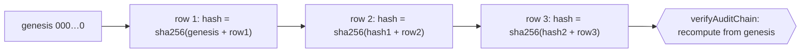

# Fraud signals and the audit log

> A rule-based risk score and open/resolve fraud flags for the ops team, plus an append-only, SHA-256 hash-chained log of every state change that anyone can re-verify from the first row.

**Status:** built (server and web ops console; the phone reads only the customer's own audit rows) · **Switch:** always on (who may read ops data depends on `FIREBASE_PROJECT_ID` and `ADMIN_EMAILS`)

## What it does

- Scores each emergency request from 0 to 100 using six hand-set features. The score never blocks money.
- Raises a fraud flag (`fraud_flags`) when emergency, proof or limit-request checks see something odd.
- Lets a reviewer resolve or dismiss each flag with a written reason, from the ops console.
- Writes one audit row for every state change: money moves, proofs, decisions, limits, investing, identity and flags.
- Chains each audit row to the one before it with SHA-256, so editing any old row breaks every hash after it.
- Blocks `UPDATE` and `DELETE` on the log with database triggers.
- Re-hashes the whole chain on demand and shows the result in the ops console.

## How it works

### Risk score

`emergencyRiskScore(userId, amount, now)` in [fraud.ts](../../src/lib/fraud.ts) runs inside `planEmergency()` for every preview and submit. It adds up six features, caps the total at 100 and rounds. The emergency code then uses the score:

| Score | Effect (in [emergency.ts](../../src/lib/emergency.ts)) |
| --- | --- |
| 40 or more | Receipt status `requested` instead of `optional` |
| 60 or more | Guardrail `risk` shows `warn`; after a successful request, a `medium` flag is raised |
| 80 or more | The flag is `high` instead of `medium` |

The full feature list, with points, is in [Rules and limits](#rules-and-limits).

### Fraud flags

1. A module calls `raiseFlag({ userId, source, refId, severity, score, description })`.
2. It inserts an `open` row (id prefix `flg_`) with `created_at = Date.now()`.
3. It writes audit action `fraud.flag_raised` (actor `risk-engine`, type `system`, entity type = the source, entity id = `refId`), with `user_id` set.
4. Ops see it in **Ops console → Risk flags**. A reviewer clicks Resolve or Dismiss and types a reason.
5. `POST /api/v1/admin/flags/{id}` calls `resolveFlag()`. In one transaction it refuses an unknown flag (404 `flag_not_found`) or one already closed (409 `flag_closed`), sets the status, resolution and `resolved_at`, and writes `fraud.flag_resolved` or `fraud.flag_dismissed` with the flag's user id (actor = reviewer email or `ops.reviewer@vaultwise`, type `reviewer`).

Flags never block anything by themselves. Open flags feed back in two places: 5 risk points each (up to 15) in the emergency score, and the `openRiskFlags` fact sent to the AI that assesses emergency limit requests ([limits.md](limits.md)).

### Where flags are raised

| Source | Trigger | Severity | Score | Code |
| --- | --- | --- | --- | --- |
| `emergency` | Request blocked by the 7-day velocity limit | medium | 70 | [emergency.ts:275](../../src/lib/emergency.ts) |
| `emergency` | Released or held request with risk score 60+ | medium, high at 80+ | the risk score | [emergency.ts:343](../../src/lib/emergency.ts) |
| `emergency` | Requested receipt passed its due date (tick) | low | 40 | [emergency.ts:402](../../src/lib/emergency.ts) |
| `emergency` | Post-hoc receipt denied by the model or a reviewer | medium | 65 | [pipeline.ts:805](../../src/lib/verification/pipeline.ts) |
| `proof_verification` | Each forensic finding: exact or content duplicate, editing software, totals mismatch, ELA inconsistency, capture time before document date, strong tamper evidence | from the finding | high 85, medium 60, low 35 | [pipeline.ts:753](../../src/lib/verification/pipeline.ts) |
| `limits` | Emergency limit request denied with scam risk 0.6+ | high | scam risk × 100 | [limits.ts:545](../../src/lib/limits.ts) |
| `limits` | Request text tried to instruct the AI assessor | medium | 60 | [limits.ts:554](../../src/lib/limits.ts) |
| `limits` | Scam risk 0.6+ but not denied | medium | scam risk × 100 | [limits.ts:563](../../src/lib/limits.ts) |

The proof findings are explained in [proof-verification.md](proof-verification.md).

### Audit log

`audit(entry)` in [audit.ts](../../src/lib/audit.ts) appends one row:

1. Read the newest row's `hash`, or the genesis value (64 zeros) if the table is empty.
2. Serialise the row as `JSON.stringify([ts, user_id, actor, actor_type, action, entity_type, entity_id, details])`. `details` is already a JSON string or `null`.
3. `hash = sha256(prev_hash + canonical)` in hex.
4. Insert the row with `prev_hash` and `hash`.

`verifyAuditChain()` reads every row in `id` order, recomputes each hash from the previous one and returns `{ ok, checked, brokenAt, headHash }`. `brokenAt` is the id of the first row whose `prev_hash` or `hash` does not match.

`audit()` uses the same SQLite connection as the caller. Inside `tx()` the row commits or rolls back with the rest of the change, so the log never claims a change that did not happen. The flip side: a row written just before a thrown error is lost (see Known limits).

### What gets audited

Action names are `<area>.<event>`. Every ledger journal is audited as `ledger.<kind>` by `post()` in [ledger.ts](../../src/lib/ledger.ts).

| Area | Actions | Written by |
| --- | --- | --- |
| Emergency | `emergency.attested`, `emergency.blocked`, `emergency.pin_failed` (rolled back, see below) | [emergency.ts](../../src/lib/emergency.ts) |
| Fraud | `fraud.flag_raised`, `fraud.flag_resolved`, `fraud.flag_dismissed` | [fraud.ts](../../src/lib/fraud.ts) |
| Ledger | `ledger.<kind>` (for example `ledger.emergency`, `ledger.withdrawal`, `ledger.income`) with memo and legs | [ledger.ts](../../src/lib/ledger.ts) |
| Vaults | `vault.created`, `vault.updated`, `contribution.missed`, `withdrawal.requested`, `withdrawal.cancelled`, `withdrawal.expired` | [vaults.ts](../../src/lib/vaults.ts), [vaults/[id]/route.ts](../../src/app/api/v1/vaults/[id]/route.ts) |
| Proofs | `proof.uploaded`, `verification.<auto_approved\|auto_denied\|human_review>`, `verification.error`, `verification.reviewed.<approved\|denied>`, `verification.appealed` | [pipeline.ts](../../src/lib/verification/pipeline.ts) |
| Limits | `limits.<kind>`, `limits.emergency_<decision>`, `limits.emergency_expired`, `limits.reviewed_<decision>` | [limits.ts](../../src/lib/limits.ts) |
| Investing | `invest.risk_profiled`, `invest.core_buy`, `invest.sip_configured`, `invest.sip_paused`, `invest.sip_missed`, `satellite.*`, `strategy.gate_passed`, `strategy.gate_failed` | [invest/](../../src/lib/invest/) |
| Wallet | `wallet.topped_up`, `wallet.moved_to_vault`, `wallet.spent`, `wallet.cashed_out`, `wallet.settings_changed`, `contribution.missed` | [wallet/moves.ts](../../src/lib/wallet/moves.ts) |
| Account and privacy | `user.onboarded`, `user.updated`, `privacy.data_exported`, `demo.seeded` | [users.ts](../../src/lib/users.ts), [me/](../../src/app/api/v1/me/), [seed.ts](../../src/lib/seed.ts) |
| Identity | `kyc.*`, `identity.bound`, `user.closed`, `recovery.*`, `notice.*` | See [identity.md](identity.md) |

Actor types are `user`, `system`, `model` and `reviewer`. Callers may pass a past `ts` (the seed, settlement and ledger do), so `ts` is not in order; the chain order is `id`.

### Who can read audit and flag data

| Reader | Route | What they get |
| --- | --- | --- |
| Ops | `GET /api/v1/audit/{userId}` or `/api/v1/audit/all` | Full rows (with `details`, `prev_hash`, `hash`) newest first, plus `verifyAuditChain()` |
| Ops | `GET /api/v1/admin/overview` | `flags` (latest 200, any status) and `auditChain` summary |
| Ops | `GET /api/v1/admin/reviews/{proofId}` | The proof owner's latest 10 flags |
| Customer | `GET /api/v1/activity` | Own rows only (`user_id` = them), without `prev_hash`; includes `fraud.flag_raised` rows with severity, score and description |
| Customer | `GET /api/v1/me/export` | Every own row, all columns (the `fraud_flags` table itself is not exported) |
| Server | `nudges()` in [engagement.ts](../../src/lib/engagement.ts) | Recent `contribution.missed` rows |

"Ops" means `admin()` in [api.ts](../../src/lib/api.ts): in prototype mode the routes are open and act as `ops.reviewer@vaultwise`; in firebase mode only verified emails in `ADMIN_EMAILS` pass ([src/lib/auth/README.md](../../src/lib/auth/README.md)). Rows with no `user_id` (for example flag resolutions) are visible to ops only.

### Ops console views

[src/app/admin/page.tsx](../../src/app/admin/page.tsx) polls the overview every 20 seconds. It loads `/api/v1/audit/all?limit=60` on open and again after any console action that calls `refreshAll()`.

- **Tiles.** "Open risk flags" (open count among the 200 loaded, plus how many are high) and "Integrity" (Healthy only if the ledger reconciles and the chain is intact).
- **Risk flags tab.** Raised time, severity and score, source, description, resolution and status. A "view proof" link appears when `ref_id` starts with `prf_`. Resolve and Dismiss ask for a reason in a browser prompt.
- **Audit chain tab.** A green or red notice with entries checked, the first 24 characters of the head hash and the trigger note; then the last 60 rows with id, time, actor type, action, entity id and `hash ← prev_hash` (8 characters each). `details` are not shown.
- **Review page** ([src/app/admin/review/[proofId]/page.tsx](../../src/app/admin/review/[proofId]/page.tsx)) lists the owner's recent flags beside the proof.

The customer's own trail is [src/app/activity/page.tsx](../../src/app/activity/page.tsx) on the web and the Activity screen on the phone, which turns proof, withdrawal and emergency actions into plain rows and hides the rest ([activity-model.ts](../../mobile/src/features/home/activity-model.ts)). In Practice the phone's audit rows come from a static fixture, so new Practice actions add none.

## Where the code is

### Server

| File | What it holds | Key exports |
| --- | --- | --- |
| [src/lib/fraud.ts](../../src/lib/fraud.ts) | Flags and the emergency risk score | `raiseFlag()` open a flag and audit it; `listFlags()` by status or latest 200; `resolveFlag()` close with a reason; `emergencyRiskScore()` 0-100 with features; type `FraudFlag` |
| [src/lib/audit.ts](../../src/lib/audit.ts) | Hash-chained log | `audit()` append a row; `verifyAuditChain()` re-hash from genesis; types `AuditRow`, `ActorType` |
| [src/lib/db.ts](../../src/lib/db.ts) | Tables and triggers | `audit_log`, `fraud_flags`, `audit_no_update`, `audit_no_delete`; `tx()` nested transactions; `destroyDatabase()` |
| [src/lib/api.ts](../../src/lib/api.ts) | Route access helpers | `admin()` ops gate; `REVIEWER` default reviewer name |
| [src/app/api/v1/audit/[userId]/route.ts](../../src/app/api/v1/audit/[userId]/route.ts) | Ops audit query | `GET` with `limit` and `action` prefix |
| [src/app/api/v1/admin/overview/route.ts](../../src/app/api/v1/admin/overview/route.ts) | Ops console data | `GET` flags, chain, queue, metrics, reconciliation |
| [src/app/api/v1/admin/flags/[id]/route.ts](../../src/app/api/v1/admin/flags/[id]/route.ts) | Close a flag | `POST` `{ status, resolution }` |
| [src/app/api/v1/admin/reviews/[proofId]/route.ts](../../src/app/api/v1/admin/reviews/[proofId]/route.ts) | Proof review detail | `GET` includes owner's flags |
| [src/app/api/v1/activity/route.ts](../../src/app/api/v1/activity/route.ts) | Customer's own trail | `GET` own audit rows and journals |

`/api/v1/reports/tax` reads the ledger and orders only; it does not use the audit log or flags.

### Web app

| File | What it holds | Key exports |
| --- | --- | --- |
| [src/app/admin/page.tsx](../../src/app/admin/page.tsx) | Ops console | `AdminPage()` tiles and tabs; `SEV` severity colours |
| [src/app/admin/review/[proofId]/page.tsx](../../src/app/admin/review/[proofId]/page.tsx) | Proof review | flag list beside the proof |
| [src/app/activity/page.tsx](../../src/app/activity/page.tsx) | Customer audit trail | `ActivityPage()`; `GROUPS` filters; `describe()` row text |

### Phone app

| File | What it holds | Key exports |
| --- | --- | --- |
| [mobile/src/features/home/activity-model.ts](../../mobile/src/features/home/activity-model.ts) | Audit rows as activity items | `humaniseAudit()` proof, withdrawal and emergency actions; `buildActivity()` |
| [mobile/src/lib/api/types.ts](../../mobile/src/lib/api/types.ts) | Shapes | `AuditEvent`, `Activity` |

The phone has no ops views and never sees flags directly.

## API endpoints

| Method | Path | Who can call | Purpose |
| --- | --- | --- | --- |
| GET | `/api/v1/audit/{userId}` | Ops | Rows for one user, or `all`; `?limit=` (default 300, max 1000) and `?action=` prefix; includes chain check |
| GET | `/api/v1/admin/overview` | Ops | Flags and `auditChain`, with queue, metrics, reconciliation and strategies |
| POST | `/api/v1/admin/flags/{id}` | Ops | `{ status: "resolved" \| "dismissed", resolution: 3-300 chars }` |
| GET | `/api/v1/admin/reviews/{proofId}` | Ops | Proof detail plus the owner's latest 10 flags |
| GET | `/api/v1/activity` | Customer (read) | Own audit rows (`?limit=`, default 200, max 500) and journals |
| GET | `/api/v1/me/export` | Customer (read) | Data export including the full own audit log |

There is no route that lists flags alone; the overview carries them. See [docs/reference/api.md](../reference/api.md#admin-operations-console).

## Data

**`audit_log`**: `id` (autoincrement, chain order), `ts`, `user_id`, `actor`, `actor_type`, `action`, `entity_type`, `entity_id`, `details` (JSON text), `prev_hash`, `hash`. Triggers `audit_no_update` and `audit_no_delete` abort any change. There is no index besides the primary key.

**`fraud_flags`**: `id` (`flg_…`), `user_id`, `source`, `ref_id` (an `emg_`, `prf_` or limit-change id), `severity` (`low`, `medium`, `high`), `score`, `description`, `status` (`open`, `resolved`, `dismissed`), `resolution`, `created_at`, `resolved_at`.

Risk-score inputs: `emergency_requests`, `ledger_entries` joined to `accounts` (kind `vault`), `users.created_at`, `fraud_flags`.

**Phone:** no storage keys; the Activity query key is `["activity"]`.

## Rules and limits

| Risk feature | Points |
| --- | --- |
| Requests in the last 30 days (not blocked) | 10 each, up to 30 |
| Requests in the last 72 hours (including blocked) | 12 each, up to 25 |
| Amount vs average positive vault ledger entry | `3 × log2(amount ÷ average)`, 0 to 15; 5 if there are no vault credits |
| Account tenure | 15 under 14 days, 6 under 60 days, else 0 |
| `requested` or `rejected` receipts past due | 15 each, up to 25 |
| Open flags for the user | 5 each, up to 15 |

The weights are hand-set; the code comment says production would fit them on labelled outcomes.

| Rule | Value |
| --- | --- |
| Hash | SHA-256 over `prev_hash` + canonical JSON; genesis is 64 zeros |
| Flag list in the overview | Latest 200, any status; `listFlags(status)` returns all of that status |
| Ops console global log | Last 60 rows |
| Resolution text | 3 to 300 characters after trimming |

## Configuration

| Setting | Effect |
| --- | --- |
| `FIREBASE_PROJECT_ID` | Unset: prototype mode, ops routes open to anyone who can reach the server. Set: sign-in required |
| `ADMIN_EMAILS` | Comma list of verified emails allowed on ops routes in firebase mode |
| `VAULTWISE_DATA_DIR` | Folder of the SQLite file that holds the log and flags |

Risk weights and thresholds are code constants in [fraud.ts](../../src/lib/fraud.ts) and [emergency.ts](../../src/lib/emergency.ts).

## Tests

| File | What it covers |
| --- | --- |
| [tests/ledger.test.ts](../../tests/ledger.test.ts) ("hash-chained audit log") | An intact chain verifies; a row edited after dropping the trigger is detected with `brokenAt` set |
| [tests/scheduler.test.ts](../../tests/scheduler.test.ts) | Overdue receipt raises one `emergency` flag, not a duplicate on the next tick |
| [tests/limits.test.ts](../../tests/limits.test.ts) | Scam-shaped limit request raises a `high` `limits` flag |
| [scripts/e2e.mjs](../../scripts/e2e.mjs) | Chain intact after the full run; head hash unchanged across a server restart; export includes the audit log |

[tests/fraud.test.ts](../../tests/fraud.test.ts) covers closing a flag once, recording its user and refusing unknown or closed flags; [tests/emergency.test.ts](../../tests/emergency.test.ts) checks an overdue receipt still scores. Not covered: `listFlags()`, the other risk-score feature values, the audit and flag routes, and the `UPDATE`/`DELETE` triggers on `audit_log` directly.

## Known limits and open issues

- **Failure records roll back.** `emergency.pin_failed` is written inside the emergency transaction and then a 403 is thrown, so the row is lost. A probe confirmed zero rows.
- **Tamper-evident, not tamper-proof.** The hash has no secret key and the head hash is not published or signed anywhere. Someone who can write the database file can drop the triggers and recompute every hash.
- **Prototype reset wipes the log.** `POST /api/v1/reset` deletes the database file in prototype mode. Firebase mode closes the account and keeps the data.
- **Customers see flag details.** `fraud.flag_raised` rows carry the user id, so `/activity` and the export show the customer the severity, score and description of flags about them. Not confirmed whether this is intended.
- **Flags use wall-clock time.** `raiseFlag()` uses `Date.now()`, not the caller's `now`, so flags raised in simulated time (tests, seed) get today's date.
- **Full re-hash on every read.** `verifyAuditChain()` reads the whole table. The ops page triggers it twice on load (overview and `audit/all`) and again every 20 seconds.
- **Single-writer assumption.** `audit()` reads the head and inserts in two statements. With the synchronous `node:sqlite` driver nothing interleaves inside one process; several processes writing one file could fork the chain. Not confirmed how production would run.
- **Audit route input.** `limit` is not validated: `-1` means no limit in SQLite. The `action` prefix is used in `LIKE` without escaping `%` or `_`.

## Maintainability notes

- **Good seams.** `audit()` is one small function with a stable signature used by more than 60 call sites in `src/`. `verifyAuditChain()` is pure apart from the read, which makes the tamper test simple. `raiseFlag()` hides the table from callers.
- **DIP / testing.** `raiseFlag()` reads the clock directly; `resolveFlag()` takes an optional `now`. Passing `ts` to `raiseFlag()` too would make flag times testable.
- **SRP.** `emergencyRiskScore()` lives in the general fraud module but is emergency-specific and runs six queries. Splitting feature extraction from weighting would let other areas reuse the scoring shape.
- **Coupling.** Receipt status names (`requested`, `overdue`, `rejected`) are matched as raw strings in [fraud.ts](../../src/lib/fraud.ts), [emergency.ts](../../src/lib/emergency.ts) and [pipeline.ts](../../src/lib/verification/pipeline.ts); the overdue bug comes from that.
- **Duplication.** The open-flag count query is repeated in [limits.ts](../../src/lib/limits.ts). The audit row type is declared again inline in the audit route and the activity route instead of reusing `AuditRow`.
- **OCP.** Flag `source` values are free strings. A small union type would let the console add per-source links (it only links `prf_` today).
