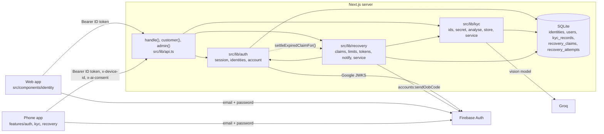
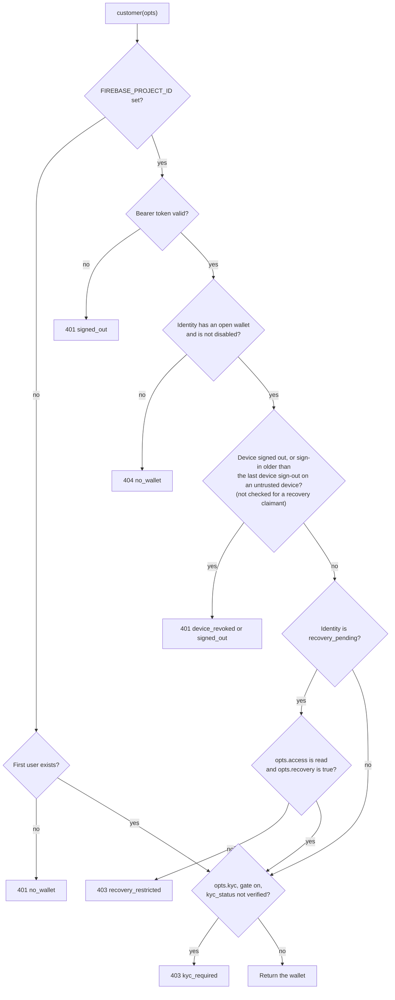
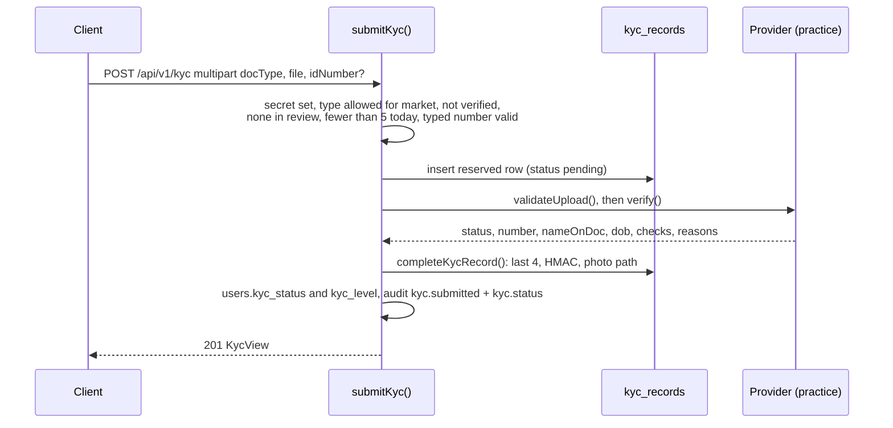
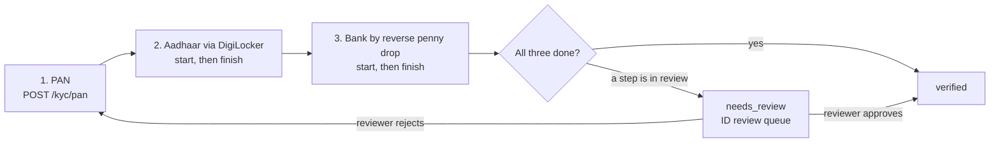
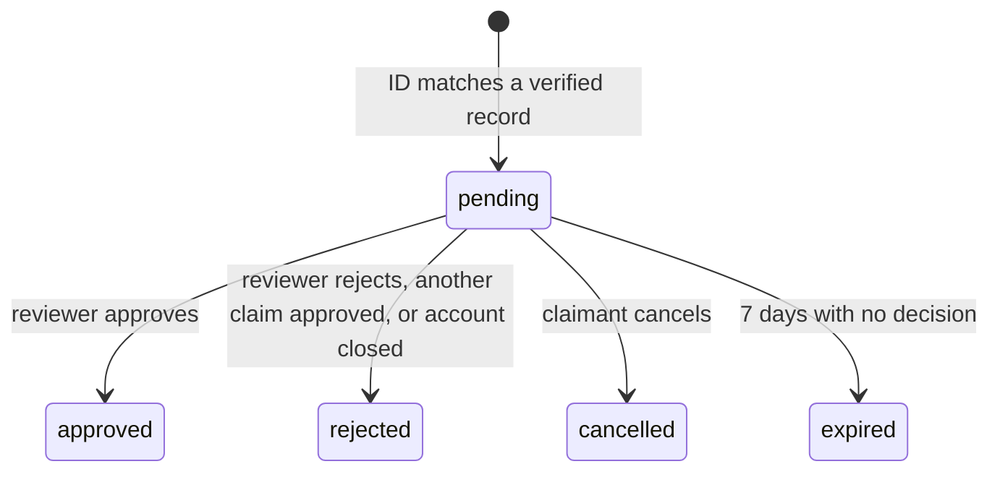

# Identity: sign-in, ID checks, recovery and closing an account

> People sign in with Firebase, verify a government ID before money can leave, get back in with that ID if they lose their login, and a reviewer decides anything the automatic checks are unsure about.

**Status:** partly built. Sign-in, sessions, access rules, recovery claims, the reviewer console and account closing are built. The ID photo check is a Practice-grade check (vision model plus rules), not official KYC; the official provider slot and real email delivery are not built. The steps flow for India (PAN, Aadhaar through DigiLocker, bank account by reverse penny drop, [plan 07](../plans/07-onboarding-checks.md)) is built on the server and web with a test provider and a Setu adapter that hasn't run against Setu yet. The phone has the same steps against a live server and simulates them in Practice ([On the phone](#on-the-phone)). · **Switch:** `FIREBASE_PROJECT_ID` on the server (unset = prototype mode); `KYC_FLOW` (`photo` or `steps`). Web: `NEXT_PUBLIC_FIREBASE_*` plus `IDENTITY_ENABLED`. Phone: `EXPO_PUBLIC_FIREBASE_*` plus `SIGN_IN_ENABLED`, `KYC_ENABLED`, `RECOVERY_ENABLED`.

## What it does

- Runs in one of two modes. **Prototype mode** (no `FIREBASE_PROJECT_ID`): one wallet per server, the first user is the customer, nobody signs in. **Firebase mode**: every API call carries a Firebase ID token, and each sign-in opens its own wallet.
- Applies access gates on every route: signed out, no wallet, read-only recovery access, ID not verified, not an admin.
- Checks a government ID (KYC). Only the last 4 characters and an HMAC of the number are stored. A clean, confident result is verified at once. Anything else waits for a person.
- With `KYC_FLOW=steps`, an India account verifies in three steps instead of a photo: its PAN, its Aadhaar through DigiLocker, and a bank account by a ₹1 reverse penny drop. A name that doesn't match goes to the same reviewer queue.
- Offers three ways back in: a password-reset email, "find my account" by ID (shows a masked email), and a recovery claim from a new login that a person approves.
- Gives reviewers (emails in `ADMIN_EMAILS`) two queues: ID checks and recovery claims, with the photo, the automatic checks and approve or reject with a note.
- In Firebase mode, "reset" closes the caller's account. Every sign-in for it is disabled and the data stays for audit.

Each part already has a README. This page links them together; read them for detail.

| README | Covers |
|---|---|
| [src/lib/auth/README.md](../../src/lib/auth/README.md) | Modes, token checks, the gate table, `identities`, how to remove |
| [src/lib/kyc/README.md](../../src/lib/kyc/README.md) | ID types, storage, photo retention, practice provider, official KYC in India, plugging in a provider |
| [src/lib/kyc/checks/README.md](../../src/lib/kyc/checks/README.md) | The steps flow: switches, steps, test provider answers, the Setu adapter and how to try its sandbox |
| [src/lib/bank/README.md](../../src/lib/bank/README.md) | The bank account record the steps flow saves |
| [src/lib/recovery/README.md](../../src/lib/recovery/README.md) | Find, reset, claim, rate limits, provisional access, notices |
| [src/components/identity/README.md](../../src/components/identity/README.md) | Web screens, the web switch, touch points, known gaps |
| [mobile/src/features/auth/README.md](../../mobile/src/features/auth/README.md) | Phone sign-in, server binding of a login, sign-out clean-up, full removal list |
| [mobile/src/features/kyc/README.md](../../mobile/src/features/kyc/README.md) | Verify your ID screen (photo check and the PAN, DigiLocker and bank steps), Home to-do, Practice sample card and sample answers |
| [mobile/src/features/recovery/README.md](../../mobile/src/features/recovery/README.md) | Find my account, recovery request, read-only bar, Practice behaviour |

## How it works

### How the pieces connect

### 1. How a request is resolved

1. `handle()` in [src/lib/api.ts](../../src/lib/api.ts) runs each route inside `withRequest(req)` ([context.ts](../../src/lib/auth/context.ts)). Library code then reads the headers through `AsyncLocalStorage`, without passing the request around.
2. `session()` ([session.ts](../../src/lib/auth/session.ts)) works out who is calling. Prototype mode returns `currentUser()` with full access. Firebase mode verifies the Bearer token, loads the `identities` row for the uid, lapses a recovery claim older than 7 days, syncs the identity's email from the token, then loads the wallet if the identity is not `disabled` and the wallet is not closed. With a wallet, firebase mode then applies the per-person rate limit (a recovery claimant is counted under its own uid, not the wallet), and both modes record the calling device (`touchDevice()`, given the token's `signedInAt`), except for a recovery claimant. Both happen in `session()`, so `GET /me` gets them too. Recording the device can refuse the request: 401 `device_revoked` for a signed-out device, and 401 `signed_out` for a sign-in older than the account's last device sign-out unless it comes from a trusted device ([devices-alerts-otp.md](devices-alerts-otp.md)).
3. `customer(opts)` calls `resolveCustomer(opts)`, which applies the gates below, then runs the lazy scheduler `tick()` unless `tick: false`.

`access` defaults to `"write"`. GET routes pass `{ access: "read" }`. Money routes pass `{ money: "<action>" }`, and the map in `src/lib/money-routes.ts` decides whether that action keeps the KYC gate (see [mpin.md](mpin.md)); a few money-in routes still pass `{ kyc: true }` directly. Only two routes opt in with `recovery: true`: `GET /api/v1/dashboard` and `GET /api/v1/vaults`. `GET /api/v1/me` calls `session()` directly, so it answers during recovery but shows only the first name, a masked email and no risk profile.

**Admin routes** call `admin()`, which calls `requireAdmin()`. Prototype mode is open and records the reviewer as `ops.reviewer@vaultwise`. Firebase mode needs a valid token whose email is verified and listed in `ADMIN_EMAILS`, otherwise 403 `admin_only`. The reviewer does not need a wallet.

### 2. How Firebase ID tokens are verified

`verifyIdToken()` in [verify.ts](../../src/lib/auth/verify.ts) uses `jose` against Google's securetoken JWKS (`createRemoteJWKSet`, 30 s cooldown, 6 h cache). It checks: RS256 only, issuer `https://securetoken.google.com/<project>`, audience `<project>`, expiry with 5 s clock tolerance, a non-empty `sub` of at most 128 characters, and `auth_time` no more than 5 minutes in the future. It returns `{ uid, email (lower-cased), emailVerified, provider, signedInAt }`. `signedInAt` is when the person last signed in, in ms: the token's `auth_time`, or `iat` if a token has none (Firebase always sends `auth_time`). It stays the same when the app refreshes its one-hour ID token, so the devices module uses it to end sign-ins that started before a device sign-out. Any failure becomes 401 `signed_out`. Tests swap the key with `setVerificationKey()`.

### 3. ID verification (KYC)

- **ID types** ([ids.ts](../../src/lib/kyc/ids.ts)): India accepts `aadhaar`, `pan`, `passport`, `driving_licence`, `voter_id`. Other markets accept `passport` and `national_id`. Aadhaar is 12 digits, not starting 0 or 1, with a valid **Verhoeff** check digit. The other formats are regular expressions; the README lists them.
- **Numbers**: normalised (upper case, no spaces, dots, hyphens or slashes). The database keeps `id_last4` and `id_hash = HMAC-SHA256(IDENTITY_SECRET, "<docType>:<number>")` ([secret.ts](../../src/lib/kyc/secret.ts)). Never the full number.
- **Practice provider** ([providers/practice.ts](../../src/lib/kyc/providers/practice.ts)) runs `analyseId()` ([analyse.ts](../../src/lib/kyc/analyse.ts)): the vision model reads the card, the typed and read numbers must be valid and agree, the name must match the account name ([names.ts](../../src/lib/kyc/names.ts)), and expiry, legibility, EXIF editing software and error-level analysis are checked. It then looks for the same hash on another open account. Clean means `verified`; anything else means `needs_review`. It never rejects. If the request says `x-ai-consent: no`, or AI is off, a person reads the card.
- **External provider** ([providers/external.ts](../../src/lib/kyc/providers/external.ts)) is a slot that throws. `KYC_PROVIDER=external` therefore fails every check.
- **Statuses**: customers see `not_started`, `pending`, `needs_review`, `verified`, `rejected`. `users.kyc_status` follows the latest record.
- **Review queue**: `kycQueue()` lists `needs_review` records plus `pending` records that have checks, oldest first, and the 20 most recent decisions. `decideKyc()` sets the record and the user. A rejection's note becomes the customer's reason, and the photo is deleted.
- **Steps flow**: with `KYC_FLOW=steps`, `POST /kyc` refuses an India account with 409 `kyc_flow_steps` (`assertPhotoFlow()`, called by the route before the upload is counted and again in `submitKyc()`), because it verifies through the steps in section 3a instead.
- **The account name is held during a check.** ID checks compare documents with the account name, so `assertNameChangeAllowed()` in [service.ts](../../src/lib/kyc/service.ts) refuses a new `name` on `PATCH /me` with 409 `name_in_check` while a check is `pending` or `needs_review`, or once a steps-flow step since the last rejection has compared it (`stepsHoldName()` in [checks/view.ts](../../src/lib/kyc/checks/view.ts)). After a real ID check verified the account it answers 403 `name_locked` (prototype users verified by the simulated check keep editing it). A rejection frees the name.

### 3a. The steps flow: PAN, DigiLocker, bank (`KYC_FLOW=steps`)

Built for [plan 07](../plans/07-onboarding-checks.md). Module: [src/lib/kyc/checks/](../../src/lib/kyc/checks/README.md), plus [src/lib/bank/](../../src/lib/bank/README.md). It works through a licensed provider's **test mode**; going live needs a registered company and the provider's business checks.

**Who gets it.** `flowFor(user)` is `steps` only when `KYC_FLOW=steps` **and** the account's market is India (`jurisdiction` `IN`), because PAN, Aadhaar and UPI are Indian. Every other account keeps the photo check, whatever the switch says. With `KYC_FLOW` unset, the photo flow's answers are exactly as before.

| Step | Routes | What happens | What is kept |
|---|---|---|---|
| 1. PAN | `POST /kyc/pan { pan }` | The PAN is format-checked (5 letters, 4 digits, 1 letter), then `PanVerifier.verify()` says `valid` (with the registered name), `invalid` or `not_found`. | Last 4 and `HMAC-SHA256(IDENTITY_SECRET, "pan:<number>")`, and the registered name on the step (like the other steps' names), so the outcome can compare all three with the account name. |
| 2. Aadhaar | `POST /kyc/digilocker/start` → `{ url, requestId }`; the person signs in at DigiLocker and allows sharing; DigiLocker sends them back to `KYC_DIGILOCKER_REDIRECT_URL` (default `<request origin>/verify`) with `success`, `id` and `scope`; then `POST /kyc/digilocker/finish { requestId }` | `DigiLockerClient.finish()` answers `waiting` (409 `kyc_step_waiting`), `failed` with a reason, or `done` with the name, year of birth and last 4. | Name, year of birth, last 4. Never the number, address, photo or document. |
| 3. Bank | `POST /kyc/bank/start` → `{ upiLink, requestId, expiresAt }`; the person pays ₹1 from their bank with any UPI app; the provider reads the account from the payment and refunds it; then `POST /kyc/bank/finish { requestId }` | `BankVerifier.result()` answers `waiting` (409 `kyc_step_waiting`), `failed`, or `done` with the holder name, IFSC and last 4. A wallet account (Setu `accountType: PPI`) fails. | IFSC, last 4 and holder name, in `bank_accounts` (`saveBankAccount()`). Never the full account number. Saved verified only when the step is `done`; a holder name that went to a person is saved unverified. |

**Rules** ([checks/service.ts](../../src/lib/kyc/checks/service.ts)):

- **Order.** A step can start once the one before is `done` or `review` (409 `kyc_step_order`). A `done` step can't be redone (409 `kyc_step_done`). A `todo`, `failed` or `review` step can be tried again until the whole check goes to a person.
- **Tries.** 5 per step in any 24 hours (429 `rate_limited`). Each try is a `kyc_checks` row reserved before the provider call (`insertCheck()`), so parallel tries count. If the provider call throws (for example 503 `provider_unavailable`), the row is deleted and the try doesn't count.
- **Requests.** A new start expires the step's older open requests (`expireOpen()`). Finishing an expired or replaced request: 409 `kyc_request_expired`. Another account's request: 404 `kyc_request_not_found`. Finishing a request that is already settled just answers the view again.
- **Names.** `compareNames()` ([names.ts](../../src/lib/kyc/names.ts)) compares the name from each check with the account name. Only `match` passes; `partial`, `mismatch` and `unknown` put the step in `review`.
- **Duplicate PANs.** A PAN already used by another open account (in `kyc_records` or `kyc_checks`) also goes to `review`, except the providers' shared sample PANs. The customer sees only a generic sentence ("A person needs to look at your PAN before it can be accepted."), so the step can't be used to find out whether a PAN has an account. The reason is kept for the reviewer in `kyc_checks.review_note` and shown in the PAN check line; the audit row gets `duplicate: true`.
- **Only the current provider counts.** Until the account is verified, a step whose newest try was made with another provider than the one that runs it now shows as `todo` and must be done again (`statusOf()` in [checks/view.ts](../../src/lib/kyc/checks/view.ts), `currentProviderNames()` in [registry.ts](../../src/lib/kyc/checks/registry.ts)). So steps finished with the test provider's sample data don't carry over when a server switches to Setu. A verified account keeps its steps.
- **The outcome** (`conclude()`, after every step). All three `done`: one `verified` `kyc_records` row (`doc_type = pan`, `provider = checks:<provider>`), `users.kyc_status = verified`, `kyc_level = 2` (`setUserKyc()`), audit `kyc.verified`. All three finished with one or more in `review`: one `needs_review` row with no photo and a check line per step, audit `kyc.needs_review`. A `done` step whose document name no longer matches the account name (it slipped past the name hold, such as a PAN step from before its name was kept) also sends the check to a person, with the reason "The names on your documents don't all match…". The existing reviewer console (`/admin/kyc`, `decideKyc()`) decides it, so a person sees every name at once and approving can't skip a step.
- **The bank account.** Saved verified only when the bank step is `done`. When it went to a person, `decideKyc()` calls `confirmBankOnApproval()` ([checks/approval.ts](../../src/lib/kyc/checks/approval.ts)) on approval, which marks the account verified (`verifyBankAccount()` in [src/lib/bank](../../src/lib/bank/README.md)). Only the newest bank try made after the last rejection and before the record was written counts, so an account from a try before a rejection is never marked verified. A rejected check's account stays unverified.
- **After a decision.** Approved: steps that were in `review` show as `done`. Rejected: the reviewer's note is the reason shown, and the steps start again (`resetAt()` ignores tries made before the rejection when working out each step's status). A rejection also frees the account name.
- **Recovery.** A steps-verified account can be found and recovered by its PAN, because the verified `kyc_records` row holds the PAN's HMAC (`verifiedHolder()`).
- **Flow mismatch.** The step routes answer 409 `kyc_flow_off` for a photo-flow account; `POST /kyc` answers 409 `kyc_flow_steps` for a steps-flow account.

**Providers.** Each check has its own small interface in [checks/types.ts](../../src/lib/kyc/checks/types.ts) (`PanVerifier`, `DigiLockerClient`, `BankVerifier`), so each could come from a different provider. `checkProviders()` in [registry.ts](../../src/lib/kyc/checks/registry.ts) picks the set from `KYC_CHECKS_PROVIDER`; tests replace any one with `setCheckProviders()`.

| `KYC_CHECKS_PROVIDER` | Behaviour |
|---|---|
| `test` (default) | Deterministic and offline ([providers/test.ts](../../src/lib/kyc/checks/providers/test.ts)). PAN `ABCDE1234F` matches any name (`done`); `ABCDE0000F` is registered to someone else (`review`); any other valid PAN is not found (`failed`). DigiLocker's "page" is the redirect URL with `success=True&id=<requestId>&scope=ADHAR`, valid 10 minutes; finish gives the account name, year of birth 1990 and last 4 `1234`. The bank link is a test `upi://pay?...am=1.00...` link (nothing to pay), valid 10 minutes; finish gives the account name, IFSC `HDFC0000001` and last 4 `4321`. Because it verifies anyone who types its sample PAN, it answers 500 `server_config` when `NODE_ENV=production`, unless `KYC_CHECKS_TEST_ALLOWED=true`. |
| `setu` | Setu's APIs ([providers/setu.ts](../../src/lib/kyc/checks/providers/setu.ts)), **written from Setu's public docs (November 2026), not yet run against the sandbox**; tests mock `fetch`. Sends `x-client-id`, `x-client-secret` and `x-product-instance-id`. Missing keys, network errors, timeouts and 5xx answers give 503 `provider_unavailable`; an unexpected 4xx is logged by its code and also answered as 503. Response bodies are never logged. `SETU_BASE_URL` defaults to the sandbox outside production. With `NODE_ENV=production` it must be set to an https URL (`https://dg.setu.co`), and the sandbox host is refused unless `KYC_CHECKS_TEST_ALLOWED=true`: 500 `server_config` and a log line (`setuBaseUrl()`), plus a start-up warning (`productionStartupWarnings()`). The endpoints and sandbox steps are in the [checks README](../../src/lib/kyc/checks/README.md). |

**The web page.** `/verify` ([kyc.tsx](../../src/components/identity/kyc.tsx)) shows `KycStepsCard` ([kyc-steps.tsx](../../src/components/identity/kyc-steps.tsx)) when `GET /kyc` has `flow: "steps"`. Step 1 is a PAN field. Step 2 is "Continue with DigiLocker", which navigates to the provider's `url`; on the way back the page reads `success`, `id` and `errCode` from the query and calls finish. A failed return shows a fixed sentence for a known `errCode` (`digilockerErrorText()`), else a generic one. The link's `errMessage` is never shown, since anyone can craft a `/verify` link. The request id is also kept in sessionStorage (`vw.kyc.digilocker`), so "I've finished in DigiLocker" works if the return link didn't. Step 3 is "Get a ₹1 payment link", then "Pay ₹1 with UPI" and "I've paid". The "What we keep" card switches to the steps' wording (`STEPS_KEEPS`).

### 4. Account recovery

| Way back in | Route | Sign-in needed | Result |
|---|---|---|---|
| Forgot password | `POST /recovery/reset { email }` | No | Firebase reset email, always `{ ok: true }` |
| Forgot which email | `POST /recovery/find` then `/recovery/reset { findToken }` | No | Masked email; the reset goes to the full address the client never sees |
| Lost the login | Make a new login, then `POST /recovery/claim` | Yes, a login with no wallet | A claim a person decides |

- **Find** ([service.ts](../../src/lib/recovery/service.ts) `findAccount()`) takes a typed number, a photo or both. It matches only a **verified** KYC record on an open account (`verifiedHolder()`). On a match with an email, it returns a `findToken`: `base64url({u, e}).HMAC`, valid for 10 minutes ([tokens.ts](../../src/lib/recovery/tokens.ts)). Every try is audited with a hashed client tag.
- **Claim** (`createClaim()`) needs a photo. It matches the same way, adds checks (name on account, matched ID, new sign-in email, account email, other pending claims), then decides **provisional access**. Provisional (`access: "read_only"`) needs every one of: AI read the card, it is an ID document of the chosen type, legible, not expired, no edit signals, the number read from the card equals the matched number and any typed number, and the name is a match or partial match. Then the new login's identity becomes `recovery_pending` and it gets the read-only allowlist. Otherwise (`"after_approval"`) the login stays unbound and sees nothing until approval.
- **Notices** ([notify.ts](../../src/lib/recovery/notify.ts)) go to the account's current email: `recovery_started`, `recovery_approved`, `recovery_rejected`, `recovery_cancelled`. There is no email provider: `deliver()` logs a masked line and an audit row `notice.<kind>` is written.

**Approve**: the claimant identity becomes `active` on the wallet, every other identity for that wallet becomes `disabled`, `users.email` becomes the claimant's email, and other pending claims for the wallet are rejected. Approval answers 409 `claimant_has_wallet` if the claimant now has a different open wallet. **Reject, cancel, expire**: the claimant is unbound and the claim photo is deleted. Expiry is lazy: it runs when the claimant makes a request, and when the queue or a claim is read.

### 5. Closing an account

In Firebase mode, `POST /api/v1/reset` calls `resolveCustomer({ access: "write" })`, checks the MPIN in the body (`{ pin }`, action `close_account`, see [mpin.md](mpin.md)), then `closeAccount()` ([account.ts](../../src/lib/auth/account.ts)). In one transaction it rejects the wallet's pending recovery claims (`decided_by = 'system:closed'`) and deletes their photos, unbinds `recovery_pending` claimants, disables every identity on the wallet, sets `users.closed_at` and audits `user.closed`. Data is kept. In prototype mode the same route calls `destroyDatabase()`. The web Settings page and the phone's Delete account flow then sign the login out.

### 6. Screens

| Who | Web | Phone |
|---|---|---|
| Signed out | Gate shows `SignInScreen`: sign in, create login, forgot password, find account, recover intro (`/sign-in`, `/recover`) | `auth/` stack: welcome, sign in, create, forgot, find, recover; "Try Practice without an account" |
| Signed in, no wallet | Onboarding with a "signed in as" chip; `/recover` shows the claim form | `/setup`: onboarding or "Get my old account back"; `recovery/claim` |
| Claim waiting, no access | `RecoverClaimScreen` on every page, polls every 20 s | Set-up shows the request; `recovery/status`, polls every 30 s |
| Claim waiting, read-only | Banner; only `/`, `/vaults`, `/recover` open; others show a placeholder | `RecoveryChrome` bar; Home and Vaults load; others show "Available once a person confirms it's you" |
| ID not verified | Banner and `/verify` (polls every 15 s) | Home to-do card, Settings row, `/verify-id` modal |
| Any `kyc_required` answer | Dialog: "Verify your ID first" | `errorMessage()` text |
| Reviewer | `/admin/kyc`, `/admin/recovery` (poll every 20 s), links with counts on `/admin` | None |
| Closing | Settings: "Close account", then sign-out | Delete account says "close", then `signOutOfVaultwise()` |

## Where the code is

### Server

| File | What it holds | Key exports |
|---|---|---|
| [src/lib/auth/config.ts](../../src/lib/auth/config.ts) | Mode and switches, read on every call | `authMode()` prototype or firebase; `adminEmails()` parsed list; `kycEnforced()` new sign-ups pending; `kycGateOn()` money-out gate |
| [src/lib/auth/verify.ts](../../src/lib/auth/verify.ts) | Firebase token check | `verifyIdToken()` claims to `VerifiedToken` (with `signedInAt`); `setVerificationKey()` test key |
| [src/lib/auth/context.ts](../../src/lib/auth/context.ts) | Request headers and client keys | `withRequest()` binds headers; `requestHeaders()` reads them; `bearerToken()`; `clientIp()` proxy-aware IP; `clientKeys()` rate-limit keys |
| [src/lib/auth/identities.ts](../../src/lib/auth/identities.ts) | `identities` table, `users.closed_at` | `bindIdentity()` upsert; `identityByUid()`; `unbindIdentity()`; `disableOtherIdentities()`; `isClosed()`; `markClosed()` |
| [src/lib/auth/session.ts](../../src/lib/auth/session.ts) | Session and gates | `session()` who is calling, the per-person rate limit and the calling device; `signedIn()` token or 401; `resolveCustomer()` gates; `optionalUser()` never throws; `requireAdmin()`; `isAdminRequest()` |
| [src/lib/auth/account.ts](../../src/lib/auth/account.ts) | Bind and close | `bindNewWallet()` onboarding bind; `closeAccount()` close and disable |
| [src/lib/api.ts](../../src/lib/api.ts) | Route helpers | `handle()` errors and headers; `customer()` gates plus tick; `admin()` reviewer name |
| [src/lib/ai-consent.ts](../../src/lib/ai-consent.ts) | `x-ai-consent` header | `aiConsented()` true only for `yes` (a missing header means no; see [ai.md](ai.md)) |
| [src/lib/kyc/ids.ts](../../src/lib/kyc/ids.ts) | ID types, formats, masking | `docTypesFor()` per market; `validateIdNumber()`; `verhoeffValid()`; `maskId()`; `maskEmail()`; `last4()` |
| [src/lib/kyc/secret.ts](../../src/lib/kyc/secret.ts) | HMAC with `IDENTITY_SECRET` | `idHash()` number hash; `sign()` token MAC; `safeEqual()`; `assertIdentitySecret()` |
| [src/lib/kyc/analyse.ts](../../src/lib/kyc/analyse.ts) | Automated ID checks, shared with recovery | `analyseId()` checks and signals; `setIdExtractor()` test override |
| [src/lib/kyc/extract.ts](../../src/lib/kyc/extract.ts) | Vision prompt and parsing | `visionExtractor()` fields from the card |
| [src/lib/kyc/names.ts](../../src/lib/kyc/names.ts) | Loose name matching | `compareNames()` match, partial, mismatch, unknown |
| [src/lib/kyc/form.ts](../../src/lib/kyc/form.ts) | Multipart or JSON ID form | `readIdForm()` docType, file, idNumber |
| [src/lib/kyc/store.ts](../../src/lib/kyc/store.ts) | `kyc_records` and photo files | `insertKycRecord()`; `completeKycRecord()` race-safe fill; `otherHolders()` duplicates; `verifiedHolder()` recovery match; `storeIdImage()`; `deleteKycPhoto()` |
| [src/lib/kyc/service.ts](../../src/lib/kyc/service.ts) | KYC use cases | `submitKyc()`; `assertPhotoFlow()`; `assertNameChangeAllowed()` name held or locked; `kycView()`; `kycSummary()` for `/me`; `kycQueue()`; `decideKyc()`; `setKycProvider()` |
| [src/lib/kyc/types.ts](../../src/lib/kyc/types.ts), [providers/](../../src/lib/kyc/providers/) | Provider contract and providers | `KycProvider` interface; `practiceProvider`; `externalProvider` (throws) |
| [src/lib/kyc/levels.ts](../../src/lib/kyc/levels.ts) | The one status-to-level rule | `kycLevelFor()` |
| [src/lib/kyc/checks/config.ts](../../src/lib/kyc/checks/config.ts) | Steps-flow switches | `kycFlow()`; `flowFor(user)` steps only for India; `checksProviderName()`; `assertTestChecksAllowed()`; `digilockerRedirectUrl()`; `TRIES_PER_DAY` (5) |
| [src/lib/kyc/checks/types.ts](../../src/lib/kyc/checks/types.ts) | The three check interfaces and step views | `PanVerifier`, `DigiLockerClient`, `BankVerifier`, `CheckProviders`, `StepStatus`, `KycSteps` |
| [src/lib/kyc/checks/registry.ts](../../src/lib/kyc/checks/registry.ts) | Which providers run | `checkProviders()`; `currentProviderNames()` read-only, for the view; `setCheckProviders()` test override |
| [src/lib/kyc/checks/providers/test.ts](../../src/lib/kyc/checks/providers/test.ts), [setu.ts](../../src/lib/kyc/checks/providers/setu.ts) | The providers | `testProviders`, `TEST_PAN_MATCH`, `TEST_PAN_MISMATCH`, `TEST_AADHAAR`, `TEST_BANK`; `setuProviders` |
| [src/lib/kyc/checks/store.ts](../../src/lib/kyc/checks/store.ts) | `kyc_checks` | `insertCheck()` reserve a try; `completeCheck()` race-safe; `expireOpen()`; `latestCheck()`; `checkByRequest()`; `triesSince()`; `otherPanHolders()`; `resetAt()` |
| [src/lib/kyc/checks/view.ts](../../src/lib/kyc/checks/view.ts) | Read-only step state, used by `kycView()` | `stepsState()`; `stepsView()`; `stepsHoldName()` |
| [src/lib/kyc/checks/approval.ts](../../src/lib/kyc/checks/approval.ts) | What a reviewer's approval means for the bank account | `confirmBankOnApproval()` (called by `decideKyc()`) |
| [src/lib/kyc/checks/service.ts](../../src/lib/kyc/checks/service.ts) | Steps use cases | `submitPan()`; `startDigiLocker()`; `finishDigiLocker()`; `startBank()`; `finishBank()`; internal `conclude()` |
| [src/lib/bank/index.ts](../../src/lib/bank/index.ts), [store.ts](../../src/lib/bank/store.ts) | `bank_accounts` | `saveBankAccount()` last 4 only; `verifyBankAccount()`; `linkedBankAccount()`; `bankAccountById()` |
| [src/lib/recovery/claims.ts](../../src/lib/recovery/claims.ts) | `recovery_claims`, `recovery_attempts`, expiry | `pendingClaimFor()`; `expireClaims()`; `settleExpiredClaimFor()`; `deleteClaimPhoto()`; `CLAIM_TTL_MS` |
| [src/lib/recovery/service.ts](../../src/lib/recovery/service.ts) | Recovery use cases | `findAccount()`; `requestReset()`; `createClaim()`; `cancelClaim()`; `claimStatus()`; `recoveryQueue()`; `decideClaim()` |
| [src/lib/recovery/limits.ts](../../src/lib/recovery/limits.ts) | Rate limits | `spendTry()` per key and global; `clientTag()` hashed tag; `LIMITS` |
| [src/lib/recovery/tokens.ts](../../src/lib/recovery/tokens.ts), [notify.ts](../../src/lib/recovery/notify.ts), [config.ts](../../src/lib/recovery/config.ts) | Find tokens, notices, switch | `makeFindToken()`; `readFindToken()`; `notifyAccount()`; `assertRecoveryEnabled()` |
| Steps routes: [kyc/pan](../../src/app/api/v1/kyc/pan/route.ts), [kyc/digilocker/start](../../src/app/api/v1/kyc/digilocker/start/route.ts), [finish](../../src/app/api/v1/kyc/digilocker/finish/route.ts), [kyc/bank/start](../../src/app/api/v1/kyc/bank/start/route.ts), [finish](../../src/app/api/v1/kyc/bank/finish/route.ts) | Thin handlers, `customer({ tick: false })` and zod | `POST` |
| Routes: [kyc](../../src/app/api/v1/kyc/route.ts), [recovery/*](../../src/app/api/v1/recovery/), [admin/kyc/*](../../src/app/api/v1/admin/kyc/), [admin/recovery/*](../../src/app/api/v1/admin/recovery/), [me](../../src/app/api/v1/me/route.ts), [onboarding](../../src/app/api/v1/onboarding/route.ts), [reset](../../src/app/api/v1/reset/route.ts) | Thin handlers; identity lines marked `// identity` | `GET`, `POST`, `PATCH`, `DELETE` |

### Web app

| File | What it holds | Key exports |
|---|---|---|
| [src/components/identity/config.ts](../../src/components/identity/config.ts) | Switch and Firebase config | `SIGN_IN_ON` on when flag and config set; `RECOVERY_PAGES` open pages; `CLAIM_TTL_MS` |
| [src/components/identity/session.ts](../../src/components/identity/session.ts) | Lazy Firebase, session store, API notices | `useSession()`; `withIdentity()` adds the token; `signIn()`; `createLogin()`; `signOutNow()`; `reportApiError()`; `useApiNotice()` |
| [src/components/identity/gate.tsx](../../src/components/identity/gate.tsx) | What the shell shows | `useIdentityGate()` full-screen views; `IdentityMain()` placeholders; `IdentityBanners()` |
| [src/components/identity/sign-in.tsx](../../src/components/identity/sign-in.tsx) | Signed-out screens | `SignInScreen()` sign in, forgot, find, recover intro; `SignInRoute()` |
| [src/components/identity/claim-form.tsx](../../src/components/identity/claim-form.tsx), [recovery.tsx](../../src/components/identity/recovery.tsx) | Claim form and status | `RecoverClaimScreen()`; `RecoverRoute()` |
| [src/components/identity/kyc.tsx](../../src/components/identity/kyc.tsx), [id-form.tsx](../../src/components/identity/id-form.tsx) | `/verify` and the shared ID form | `KycPage()`; `IdForm()`; `idFormData()` |
| [src/components/identity/kyc-steps.tsx](../../src/components/identity/kyc-steps.tsx) | The steps flow on `/verify` | `KycStepsCard()`; `readKycSteps()`; `digilockerErrorText()`; `STEPS_KEEPS` |
| [src/components/identity/device.ts](../../src/components/identity/device.ts) | This browser's device id, sent with sign-in on ([devices-alerts-otp.md](devices-alerts-otp.md)) | `webDeviceHeaders()`; `withWebDevice()`; `markWebDeviceRevoked()`; `resetWebDeviceIfRevoked()` |
| [src/components/identity/admin.tsx](../../src/components/identity/admin.tsx) | Reviewer queues | `KycQueuePage()`; `RecoveryQueuePage()`; `IdentityAdminLinks()` counts |
| [src/components/identity/settings.tsx](../../src/components/identity/settings.tsx), [media.tsx](../../src/components/identity/media.tsx), [frame.tsx](../../src/components/identity/frame.tsx) | Settings card, token-carrying links and images, frames | `IdentitySettingsCard()`; `AuthedDownloadLink()`; `AuthedImage()`; `OpsFrame()`; `SignedInChip()` |
| [src/components/identity/types.ts](../../src/components/identity/types.ts) | Server shapes, client-side ID checks, tolerant readers | `checkIdNumber()`; `passwordOk()`; `readKyc()`; `readClaim()`; `readKycQueue()`; `kycStatusOf()` |
| Pages: [sign-in](../../src/app/sign-in/page.tsx), [recover](../../src/app/recover/page.tsx), [verify](../../src/app/verify/page.tsx), [admin/kyc](../../src/app/admin/kyc/page.tsx), [admin/recovery](../../src/app/admin/recovery/page.tsx) | One-line pages | default exports |
| Touch points: [client.ts](../../src/lib/client.ts), [shell.tsx](../../src/components/shell.tsx), [settings/page.tsx](../../src/app/settings/page.tsx), [admin/page.tsx](../../src/app/admin/page.tsx) | Token on fetch, gate, close account, admin links | marked `// identity` |

### Phone app

| File | What it holds | Key exports |
|---|---|---|
| [mobile/src/lib/auth/firebase.ts](../../mobile/src/lib/auth/firebase.ts) | Firebase Auth, session store, login-to-server binding | `initAuth()`; `authReady()`; `getIdToken()` only for the bound server; `signInWithEmail()`; `createAccountWithEmail()`; `sendResetEmail()`; `signOutNow()` |
| [mobile/src/lib/api/http.ts](../../mobile/src/lib/api/http.ts) | Request headers | `authHeaders()` Bearer token, waits for restore |
| [mobile/src/lib/api/identity.ts](../../mobile/src/lib/api/identity.ts) | Live identity API | `identityLive` kyc, submitKyc, submitPan, startDigiLocker, finishDigiLocker, startBankCheck, finishBankCheck, findAccount, resetPassword, recoveryClaim, submitClaim, cancelClaim; `toKycView()`; `toKycSteps()`; `toClaim()` |
| [mobile/src/lib/api/identity-types.ts](../../mobile/src/lib/api/identity-types.ts), [identity-ids.ts](../../mobile/src/lib/api/identity-ids.ts) | Shapes; ID formats copied from the server | `KycView` (with `flow`, `steps`); `KycSteps`; `DigiLockerStart`; `BankCheckStart`; `RecoveryClaim`; `MeAuth`; `validateIdNumber()`; `maskId()`; `spokenId()` |
| [mobile/src/lib/api/demo/identity.ts](../../mobile/src/lib/api/demo/identity.ts), [identity-state.ts](../../mobile/src/lib/api/demo/identity-state.ts) | Practice simulation, including the steps with the test provider's answers | `identityDemo`; `withIdentity()` adds `/me` fields; `assertPracticeCanMove()`; `freshIdentity()`; `freshSteps()` |
| [mobile/src/features/auth/](../../mobile/src/features/auth/) | Gate, signed-out screens, set-up, settings rows, steps before sign-out | `startAuth()`; `useSignInGate()`; `signOutOfVaultwise()`; `onBeforeSignOut()`; `useServerSignOut()`; `SetupScreen()`; `downloadSignedInExport()` |
| [mobile/src/features/kyc/](../../mobile/src/features/kyc/) | Verify your ID: the photo check and the steps flow | `VerifyIdScreen()`; `IdForm()`; `checkIdForm()`; `StepsFlow()`; `useIdentityTodo()`; `IdentityRow()`; `SampleIdCard()` |
| [mobile/src/features/recovery/](../../mobile/src/features/recovery/) | Find, claim, status, read-only bar | `FindAccountScreen()`; `ClaimScreen()`; `RecoveryStatusScreen()`; `RecoveryChrome()`; `useRecoveryClaim()`; `useIdMarket()` |
| Routes: [app/auth/](../../mobile/src/app/auth/), [setup.tsx](../../mobile/src/app/setup.tsx), [verify-id.tsx](../../mobile/src/app/verify-id.tsx), [app/recovery/](../../mobile/src/app/recovery/); guards in [_layout.tsx](../../mobile/src/app/_layout.tsx) | Expo Router screens | default exports |
| [finishDeletion.ts](../../mobile/src/features/account/settings/delete/finishDeletion.ts) | Delete or close account | `finishDeletion()` calls `/reset`, then signs out when live |

Phone `lib/auth/app-lock.ts`, `biometrics.ts`, `device-pin.ts` and `session-state.ts` are the on-device app lock, not sign-in; they are not covered here.

## API endpoints

| Method | Path | Who can call | Purpose |
|---|---|---|---|
| GET | `/api/v1/me` | Anyone (prototype); signed in (firebase) | Profile plus `auth`, `kyc`, `recovery`; limited view during recovery (and no `device`) |
| PATCH | `/api/v1/me` | Wallet owner, full access | Name (409 `name_in_check` while an ID check uses it, 403 `name_locked` once verified), email, MPIN (always needs `currentPin`; see [mpin.md](mpin.md)) |
| POST | `/api/v1/onboarding` | Prototype: anyone; firebase: signed in, no wallet, no pending claim | Create a wallet and bind the identity. The `pin` must pass the MPIN policy. |
| POST | `/api/v1/reset` | Prototype: anyone; firebase: wallet owner, full access, with the MPIN | Wipe the database (prototype) or close the account |
| GET | `/api/v1/kyc` | Wallet owner, read | Current `KycView`. In the steps flow it adds `flow: "steps"` and `steps: { pan, aadhaar, bank }`, each `{ status: "todo" \| "done" \| "review" \| "failed", last4? }`. In the photo flow neither field is sent. |
| POST | `/api/v1/kyc` | Wallet owner, write | Submit an ID photo check (201). 409 `kyc_flow_steps` in the steps flow, before the upload is counted. Otherwise counts toward the 20 uploads an hour. |
| POST | `/api/v1/kyc/pan` | Wallet owner, write | `{ pan }`: step 1. Answers the `KycView`. |
| POST | `/api/v1/kyc/digilocker/start` | Wallet owner, write | No body. `{ url, requestId }` |
| POST | `/api/v1/kyc/digilocker/finish` | Wallet owner, write | `{ requestId }`. Answers the `KycView`. |
| POST | `/api/v1/kyc/bank/start` | Wallet owner, write | No body. `{ upiLink, requestId, expiresAt }` (ms) |
| POST | `/api/v1/kyc/bank/finish` | Wallet owner, write | `{ requestId }`. Answers the `KycView`. |
| POST | `/api/v1/recovery/reset` | Anyone, rate-limited | Password-reset email by `email` or `findToken` |
| POST | `/api/v1/recovery/find` | Anyone, rate-limited | Find an account by ID, masked email and `findToken` |
| GET | `/api/v1/recovery/claim` | Signed in (prototype answers `{ claim: null }`) | Latest claim by this login |
| POST | `/api/v1/recovery/claim` | Signed in, no active wallet, firebase only | Create a claim (201) |
| DELETE | `/api/v1/recovery/claim` | Signed in, firebase only | Cancel the pending claim |
| GET | `/api/v1/admin/kyc` | Admin | KYC queue and 20 recent decisions |
| POST | `/api/v1/admin/kyc/[id]` | Admin | `{ decision: verified or rejected, note }` |
| GET | `/api/v1/admin/kyc/[id]/file` | Admin | ID photo, `Cache-Control: private, no-store` |
| GET | `/api/v1/admin/recovery` | Admin | Claim queue (with every sign-in on the account) and 20 recent outcomes |
| POST | `/api/v1/admin/recovery/[id]` | Admin | `{ decision: approved or rejected, note }` |
| GET | `/api/v1/admin/recovery/[id]/file` | Admin | Claim photo |

The other `/api/v1/admin/*` routes and `/api/v1/audit/[userId]` use the same `admin()` check. Error codes are listed in the server READMEs and in [api.md](../reference/api.md).

Steps-flow errors:

| Code | Status | When |
|---|---|---|
| `invalid_id` | 400 | The PAN isn't 5 letters, 4 digits, 1 letter |
| `kyc_flow_off` | 409 | A step route on an account that uses the photo flow |
| `kyc_flow_steps` | 409 | `POST /kyc` on an account that uses the steps flow |
| `kyc_done` | 409 | Already verified |
| `kyc_in_review` | 409 | A person is checking (or a photo check is running) |
| `kyc_step_order` | 409 | The step before isn't finished |
| `kyc_step_done` | 409 | This step is already done |
| `kyc_step_waiting` | 409 | Finish: DigiLocker isn't finished, or the ₹1 hasn't arrived. Try again later. |
| `kyc_request_expired` | 409 | Finish: the request expired or a newer one replaced it. Start again. |
| `kyc_request_not_found` | 404 | Finish: not this account's request |
| `rate_limited` | 429 | 5 tries of this step in 24 hours |
| `provider_unavailable` | 503 | The provider is down or not set up |
| `server_config` | 500 | `IDENTITY_SECRET` missing where required; the test provider, or Setu's sandbox, on a production server without `KYC_CHECKS_TEST_ALLOWED=true`; Setu on a production server without an https `SETU_BASE_URL` |

`PATCH /me` with a new `name` answers 409 `name_in_check` once a step has compared the name (until a rejection).

## Data

| Table | Columns | Notes |
|---|---|---|
| `identities` | `uid` PK, `user_id`, `email`, `provider`, `status` (`active`, `recovery_pending`, `disabled`), `created_at`, `updated_at` | Created on first use. `user_id NULL` = signed in, no wallet |
| `users` (identity columns) | `kyc_status`, `kyc_level`, `email`, `closed_at` | `closed_at` added by `ensureIdentityTables()`; `email` is overwritten on recovery approval |
| `kyc_records` | `id`, `user_id`, `doc_type`, `id_last4`, `id_hash`, `name_on_doc`, `dob`, `status`, `provider`, `checks`, `reasons`, `file_path`, `decided_by`, `decided_at`, `created_at` | Indexes on `(user_id, created_at)` and `id_hash` |
| `recovery_claims` | `id`, `claimant_uid`, `claimant_email`, `user_id`, `doc_type`, `id_last4`, `status`, `checks`, `reasons`, `file_path`, `provisional`, `created_at`, `decided_at`, `decided_by` | Unique index: one `pending` claim per `claimant_uid` |
| `recovery_attempts` | `id`, `bucket`, `client_key` (SHA-256, 32 hex), `ts` | Rows older than 7 days are pruned on each try |
| `kyc_checks` | `id` (`chk_…`), `user_id`, `step` (`pan`, `aadhaar`, `bank`), `status` (`started`, `done`, `review`, `failed`, `expired`), `provider`, `request_id`, `last4`, `id_hash` (PAN only), `name`, `year_of_birth`, `name_match`, `bank_account_id`, `reasons` (JSON, shown to the customer), `review_note` (reviewer only, e.g. a duplicate PAN), `expires_at`, `created_at`, `updated_at` | Steps flow. One row per try. Created on first use (`review_note` is added to older tables). Indexes on `(user_id, step, created_at)` and `id_hash` |
| `bank_accounts` | `id` (`bank_…`), `user_id`, `ifsc`, `account_last4`, `holder_name`, `verified_at`, `provider_ref`, `created_at` | Steps flow. Created on first use. Never the full account number. `verified_at` is set when the bank step passed, or when a person approves a check whose holder name differed; null until then, and for good after a rejection. |
| `audit` (shared) | actions `identity.bound`, `user.closed`, `kyc.*` (including `kyc.step.pan`, `kyc.step.aadhaar`, `kyc.step.bank`, `kyc.verified`, `kyc.needs_review`), `recovery.*`, `notice.*` | No ID numbers or names; last 4 only |

ID photos are files in the upload folder: `kyc_<id>.<ext>` and `rcv_<id>.<ext>` (`storeIdImage()`).

| Phone storage | Holds |
|---|---|
| `vw.authServer` | The API address the login belongs to; the token is sent nowhere else |
| `vw.deviceId` | Random install id sent as `x-device-id` on every request ([devices-alerts-otp.md](devices-alerts-otp.md#on-the-phone)) |
| `vw.kyc.openTry` | The open DigiLocker or ₹1 payment try (its id, the link to reopen, its expiry, whether it's Practice), until it finishes |
| Firebase persistence | The Keychain / Keystore in chunks on phones (`vwauth.*`, [phone-security.md](phone-security.md)); browser local storage on web |
| Practice state `S.identity` | `DemoIdentity`: the Practice KYC record, claim, steps and open tries |

The web app keeps, beyond the Firebase SDK's storage: `vw-device-id` and `vw-device-revoked` (localStorage, sign-in on only) and `vw.kyc.digilocker` (sessionStorage, the open DigiLocker request).

## Rules and limits

| Rule | Value |
|---|---|
| KYC tries | 5 per user per rolling 24 h; one check in review at a time (409 `kyc_in_review`) |
| KYC level | verified 2, pending or needs_review 1, rejected 0 (`kycLevelFor()` in `src/lib/kyc/levels.ts`, used by `createUser()` and `setUserKyc()`) |
| Steps-flow tries | 5 per step per rolling 24 h; provider failures don't count |
| Steps-flow requests | DigiLocker and the test bank link last 10 minutes (Setu's own `validUpto` for Setu) |
| Upload | JPEG, PNG or WebP, at most 10 MB; HEIC refused (415) |
| Vision model | Legibility below 0.6 sends to a person; 45 s timeout; ELA score 0.2 warns, 0.5 fails |
| Name match | `match` needs one exact word and a score of at least 0.75; `partial` at least 0.4; initials score 0.5 |
| Reviewer note | 3 to 500 characters, required for every decision |
| `find` limit | 5 per key per hour, 300 per hour server-wide |
| `reset` limit | 5 per key per hour, 500 per hour server-wide |
| `claim` limit | 3 per key per day (uid, IP, device), 200 per day server-wide |
| `findToken` | 10 minutes, HMAC-signed, only for `/recovery/reset` |
| Claim life | 7 days, then `expired` |
| Typed ID number | Trimmed to 40 characters |
| Password (client) | At least 8 characters, a letter and a number (web and phone) |
| Polling (only while waiting) | Web claim and status 20 s, `/verify` 15 s; phone 30 s live, 4 s Practice. Web admin queues refresh every 20 s |
| Practice reviewer | Decides after 20 s; sample card verifies at once |
| Name hold and lock | `PATCH /me` refuses a name change while an ID check is pending or with a person, or once a steps-flow step has compared it (409 `name_in_check`), and once a verified `kyc_records` row exists (403 `name_locked`) |

## Configuration

| Name | Where | Effect |
|---|---|---|
| `FIREBASE_PROJECT_ID` | Server | Set = firebase mode |
| `ADMIN_EMAILS` | Server | Comma list of reviewer emails (firebase mode) |
| `IDENTITY_SECRET` | Server | HMAC key; required in firebase mode or `NODE_ENV=production`, else 500 `server_config`; dev key with a warning otherwise |
| `KYC_ENFORCED` | Server | New sign-ups start `pending` (firebase default on, prototype only if `"true"`); `"false"` also turns off the money-out gate |
| `KYC_PROVIDER` | Server | `practice` (default) or `external` (not built); unknown values fall back to `practice` |
| `GROQ_API_KEY`, `GROQ_VISION_MODEL` | Server | Vision model for reading cards; unset sends every check to a person |
| `RECOVERY_ENABLED` | Server | `"false"` = 404 `recovery_off` on find, reset, claim |
| `FIREBASE_WEB_API_KEY` | Server | Lets the server send reset emails; unset logs a warning and sends nothing |
| `TRUST_PROXY_HOPS`, `TRUST_PROXY_HEADER` | Server | Which proxy headers hold the client IP for rate limits ([running-online.md](running-online.md)) |
| `KYC_FLOW` | Server | `photo` (default) or `steps` (India accounts only) |
| `KYC_CHECKS_PROVIDER` | Server | `test` (default) or `setu` |
| `KYC_CHECKS_TEST_ALLOWED` | Server | `true` lets the test provider, and Setu's sandbox, run when `NODE_ENV=production` |
| `KYC_DIGILOCKER_REDIRECT_URL` | Server | Where DigiLocker sends the person back; default `<request origin>/verify`. Setu needs a public https URL. |
| `SETU_BASE_URL` | Server | Setu's address. Default the sandbox outside production; required, https, and not the sandbox (unless `KYC_CHECKS_TEST_ALLOWED=true`) with `NODE_ENV=production` |
| `SETU_CLIENT_ID`, `SETU_CLIENT_SECRET`, `SETU_PAN_PRODUCT_INSTANCE_ID`, `SETU_DIGILOCKER_PRODUCT_INSTANCE_ID`, `SETU_RPD_PRODUCT_INSTANCE_ID`, `SETU_PRODUCT_INSTANCE_ID` | Server | Setu keys; see [configuration.md](../reference/configuration.md) |
| `NEXT_PUBLIC_FIREBASE_API_KEY`, `_AUTH_DOMAIN`, `_PROJECT_ID`, `_APP_ID` | Web | Turn web sign-in on (with `IDENTITY_ENABLED = true` in `config.ts`) |
| `EXPO_PUBLIC_FIREBASE_API_KEY`, `_AUTH_DOMAIN`, `_PROJECT_ID`, `_APP_ID` | Phone | Turn phone sign-in on |
| `SIGN_IN_ENABLED`, `KYC_ENABLED`, `RECOVERY_ENABLED` | Phone code flags | `SIGN_IN_ENABLED = !PRACTICE_ONLY`. `KYC_ENABLED` and `RECOVERY_ENABLED` are `!PRACTICE_ONLY && !TESTER_LIVE`: off in the Practice-only builds and in the online tester build |

## Tests

| File | What it covers |
|---|---|
| [tests/auth.test.ts](../../tests/auth.test.ts) | Prototype mode unchanged; 401 `signed_out`; 404 `no_wallet`; onboarding bind with KYC pending; wallets kept apart; KYC gate; recovery allowlist; name lock; current PIN; admin needs verified `ADMIN_EMAILS`; reset closes one account |
| [tests/kyc.test.ts](../../tests/kyc.test.ts) | Verhoeff and formats; masking; HMAC stability; log redaction; name matching; practice provider outcomes; duplicates; parallel reservation; photo deletion on reject; `IDENTITY_SECRET` required |
| [tests/recovery.test.ts](../../tests/recovery.test.ts) | Find with masked email; rate limits and proxy headers; reset never reveals accounts; `findToken`; claims with and without provisional access; approve, reject, cancel, expire; parallel claims; dev CORS for `x-device-id` |
| [tests/kyc-steps.test.ts](../../tests/kyc-steps.test.ts) | Photo flow unchanged by default and for non-India accounts; the steps from nothing to verified with the contract's shapes and no full PAN stored; the redirect URL; name mismatches, duplicate PANs and bank names going to a person; reject and start again; the bank account verified at once on a passed step, and never from a try before a rejection; steps from another provider not counted; the name held during the steps and freed by a rejection; drifted names sent to a person; 5 tries a day; provider failures not counted; `kyc_step_waiting`; expired and other people's requests; the test provider refused on production; `SETU_BASE_URL` on production and its start-up warning; DigiLocker's return link on the web; the Setu adapter with `fetch` mocked, including a full flow |
| [tests/ai-consent.test.ts](../../tests/ai-consent.test.ts) | ID photos are not read by the AI when the request says no (or says nothing) |

There are no automated tests for the web identity components or the phone identity code.

## On the phone

This section covers the phone's side of the ID check, mainly the steps flow from [plan 07](../plans/07-onboarding-checks.md). Recovery on the phone is unchanged and covered by its README (table at the top). The module is [mobile/src/features/kyc/](../../mobile/src/features/kyc/README.md).

### Sign-in changes from the security review

The details are in [mobile/src/features/auth/README.md](../../mobile/src/features/auth/README.md):

- **401 `signed_out` from any request**, not only `/me`, signs the phone out once with the server's words. That covers a sign-in older than a device sign-out on the account ("A device was signed out of your account since you signed in here. Sign in again to continue."), which refreshing the token can't fix. `http.ts` and the assistant stream report it to [lib/api/signed-out.ts](../../mobile/src/lib/api/signed-out.ts); `startAuth()` acts only live, while someone is signed in, and only for a request sent since the current sign-in.
- **A 429 never signs out.** Queries don't retry a 4xx by themselves (only status 0 or a 5xx, once), `/me` stays fresh for 30 s (it counts toward the server's per-person limit), and a 429's `Retry-After` is kept as `retryAt`.
- **Sign-out order.** `signOutOfVaultwise()` runs the before-sign-out steps, then Firebase signs out, then the phone is cleared (`resetDevice()`), so a live account is never on screen unlocked and no request goes out signed in with a fresh install id. If Firebase can't sign out, nothing is cleared. See [data-layer.md](../mobile/data-layer.md#sign-out-and-device-reset).
- **The session in the Keychain** moves over from an older build's AsyncStorage copy without signing anyone out, and on iOS a fresh install wipes a session the last install left in the Keychain ([phone-security.md](phone-security.md#sign-in-session-in-secure-storage)).

### Who sees it

- `KYC_ENABLED = !PRACTICE_ONLY && !TESTER_LIVE` ([features/kyc/config.ts](../../mobile/src/features/kyc/config.ts)); `RECOVERY_ENABLED` follows the same rule. So Verify your ID is on in development and preview builds (live, or on Practice data), and off in the APK, the store build and the online tester build (`tester-live`). The tester server runs with `KYC_ENFORCED=false`, so testers never upload a real ID to a student project.
- The phone does what the server's `GET /kyc` says: `flow: "steps"` shows the steps; a missing `flow` (an older server) is read as `"photo"` (`toKycView()`).
- `verify-id` is a full-screen modal behind the in-app guard, and one of the routes where screenshots are blocked ([phone-security.md](phone-security.md)).

### The steps, one screen each

`StepsFlow` ([StepsFlow.tsx](../../mobile/src/features/kyc/StepsFlow.tsx)) shows the first step that isn't finished (`currentStep()` in [steps-model.ts](../../mobile/src/features/kyc/steps-model.ts)) under `StepsProgress` ("Step 2 of 3", a three-part bar, and each step's state and last 4). A failed step is shown again to retry. When all three are finished, Verify your ID shows the server's outcome (verified, or a person is checking) with the steps and their last 4s.

| Step | Screen | Calls | On the phone |
|---|---|---|---|
| 1. PAN | [PanStep.tsx](../../mobile/src/features/kyc/PanStep.tsx) | `api.submitPan(pan)` | The format is checked first (`checkPan()`, the server's rule from `identity-ids.ts`). The PAN is sent once and the field is cleared. |
| 2. Aadhaar | [DigiLockerStep.tsx](../../mobile/src/features/kyc/DigiLockerStep.tsx) | `api.startDigiLocker()`, then `api.finishDigiLocker(requestId)` (60 s timeout) | Only an `http(s)` URL is accepted from the server. `openDigiLocker()` ([external.ts](../../mobile/src/features/kyc/external.ts)) opens it with `expo-web-browser` `openAuthSessionAsync` in an ephemeral session, with `Linking.createURL("verify-id")` as the return address. The server sends DigiLocker back to its own web page, so the person closes the browser themselves; finish then runs. Not finished yet: **I've allowed sharing** tries finish again. On the web preview it opens a new tab. |
| 3. Bank account | [BankStep.tsx](../../mobile/src/features/kyc/BankStep.tsx) | `api.startBankCheck()`, then `api.finishBankCheck(requestId)` (30 s timeout) | Only a `upi://pay?…` link is accepted. `openUpiLink()` hands it to a UPI app with `expo-linking` and waits until the person is back (at most 10 minutes). **I've paid** calls finish. With no UPI app, the link is shown as selectable text to copy. The link's expiry is shown as a time. |

- **Leaving the app.** DigiLocker and the UPI app run inside `withSystemUi()`, so on Android the app lock waits for them (90 seconds at most) and the idle lock doesn't fire.
- **Picking a try up again.** The open try is kept in `vw.kyc.openTry` ([open-try.ts](../../mobile/src/features/kyc/open-try.ts)): the step, its `requestId`, the link to reopen, its expiry, whether it's Practice, and when it was saved. Never a number. If the lock or the phone closes the screen while the person pays, Verify your ID offers the same try again, so nobody pays ₹1 twice. A try past its expiry (or 30 minutes old when there's none) is dropped. Practice and live tries never mix. Delete account wipes it.
- **Answers** (`steps-model.ts`):

| Server code | What the phone does |
|---|---|
| `kyc_step_waiting` | Keeps the try open and shows the server's sentence (`isStepWaiting()`) |
| `kyc_request_expired`, `kyc_request_not_found` | Starts the step again (`isTryGone()`) |
| `kyc_done`, `kyc_in_review`, `kyc_flow_off`, `kyc_step_done`, `kyc_step_order` | Fetches `GET /kyc` again so the screen catches up (`isOutOfStep()`) |
| `provider_unavailable`, any 503 | Says the check is down for now (`isProviderDown()`) |

- **Reading answers.** `toKycSteps()` in `lib/api/identity.ts` reads each step defensively (a missing or unknown status is `todo`) and cuts any number to its last 4 letters or digits, so a longer value from a server is never shown.
- **Screen readers** hear numbers as "ending in 2 3 4 F" (`spokenStepNumber()`), and each step's result is announced.

### Practice

`demo/identity.ts` answers like the server's test provider. The Practice person (India) starts verified with a passport, so the steps start as all to do; **Practice the check again** walks them through.

| Step | Practice answer |
|---|---|
| PAN | `ABCDE1234F` passes (**Use the sample PAN** fills it in), `ABCDE0000F` has another name on it and goes to a pretend person, any other well-formed PAN is not found |
| Aadhaar | DigiLocker never opens; the sample answer comes back at once (ending 1234) |
| Bank | No UPI app opens and nothing is paid; **I've paid** finishes with IFSC `HDFC0000001`, account ending 4321 |
| Outcome | All three done: verified. A step in review: the pretend person approves about 20 seconds after the last step (`PRACTICE_REVIEW_MS`). Starting again unverifies the Practice person until all three are done. |

**Practice the photo check instead** keeps the old photo check available in Practice. The steps and open tries live in `S.identity` inside the bulk `state` slice, so they survive a reload; saves from before plan 07 get empty steps.

### Phone known limits

- There is no webhook, and DigiLocker returns to the server's web page, so the person comes back and taps to finish each external step.
- The UPI hand-off and DigiLocker in an in-app browser haven't been tried on a real phone against Setu's sandbox.
- The steps aren't reachable in the APK, the store build or `tester-live` (`KYC_ENABLED` is off there), only in development and preview builds.
- No phone tests; `steps-model.ts` and `open-try.ts` are pure enough for a test runner.

## Known limits and open issues

- The practice provider is not official KYC. `external` throws on every check. The KYC README explains what a real launch needs.
- Steps flow: the Setu adapter is written from Setu's docs and has not run against the sandbox. Some answers are assumptions to check there (the reverse penny drop's `validUpto` is read as India time; the invalid-PAN body isn't documented).
- Steps flow: there is no webhook, so the finish routes poll the provider. Setu's `RPD_VERIFICATION_UPDATE` webhook would let the server finish the bank step by itself.
- Steps flow: the server's "Linked bank" ledger account and the phone's simulated bank don't read `bank_accounts` yet.
- Steps flow: on a live server, set `KYC_DIGILOCKER_REDIRECT_URL`. The default is built from the request's origin, which behind a proxy may not be the public https address.
- Steps flow: the daily try count (`triesSince()`) includes tries made before a reviewer's rejection, so someone rejected late in the day may have to wait to retry.
- Steps flow: `kyc_records.dob` holds only the year of birth, so the MPIN date-of-birth rule doesn't apply to these accounts.
- No email provider. Notices are log lines and audit rows only.
- The `account_closed` notice kind exists in `notify.ts` but `closeAccount()` never sends it.
- Find and claim match only `kyc_records` rows. Users verified without a row (seed data, `createUser()` default, sign-ups with `KYC_ENFORCED=false`) cannot be found or recovered by ID.
- A closed account's login is disabled, but onboarding then binds it to a fresh wallet (the upsert in `bindIdentity()` sets it `active`). No test covers this; Not confirmed as intended.
- Claim expiry is lazy. No job runs it.
- No job deletes photos of verified checks after the retention period.
- Prototype mode leaves admin routes open.
- Web: proof images, the sample download and the assistant's streaming `fetch` do not carry the token (web README).
- Web `normalizeIdNumber()` strips only spaces and hyphens; the server and phone also strip dots and slashes.
- Phone: Export my data with sign-in on works only in the web preview. Email verification is not asked for.

## Maintainability notes

- **Good seams.** `KycProvider` lets an official provider drop in without touching callers. `setIdExtractor()`, `setVerificationKey()` and `setKycProvider()` make the external services testable. `withRequest()` avoids threading the request through library code. Every touch point outside the folders is marked `// identity`, and each README has removal steps.
- **Tolerant readers.** Web `types.ts` and phone `identity.ts` parse answers defensively, so server shape changes fail soft.
- **Coupling between auth and recovery.** `session.ts` imports `recovery/claims` to lapse claims, and `account.ts` edits `recovery_claims` with raw SQL after probing `sqlite_master`. Recovery also imports auth. The two packages depend on each other.
- **Side effects in reads.** `session()` writes the identity's email and may expire claims on every request.
- **Duplication.** Verhoeff and ID formats live in three places (server `ids.ts`, web `types.ts`, phone `identity-ids.ts`). `userById` is defined in `session.ts` and `recovery/service.ts`, and inlined in `kyc/service.ts`. The two admin photo routes are copies. `CLAIM_TTL_MS` is defined on the server, the web and in Practice. `maskEmail` is copied into Practice.
- **SRP.** `recovery/service.ts` (388 lines) holds find, reset (including the Identity Toolkit HTTP call), claims and the admin queue.
- **Schema in code.** Three `ensure*Tables()` functions create tables and add columns lazily, each with its own `WeakSet`, instead of migrations.
- **Inconsistent answers.** `no_wallet` is 401 in prototype mode and 404 in firebase mode.
