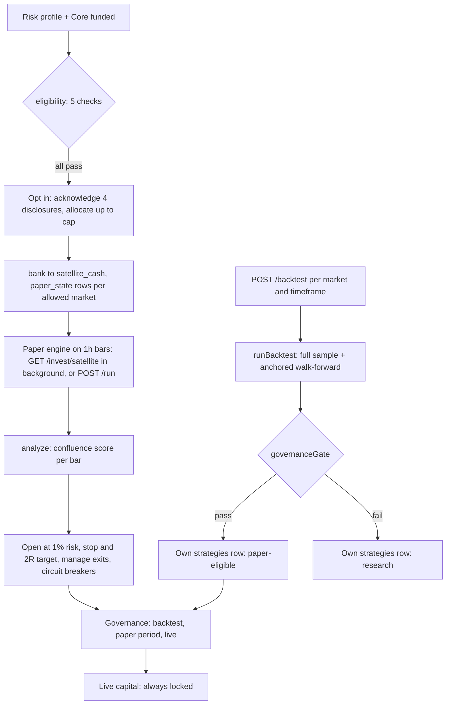

# Investing

> A Core sleeve that buys a model ETF portfolio on a plan, and an opt-in Satellite sleeve that paper-trades a price-action strategy behind risk gates.

**Status:** partly built. Core is built (prices are live, brokerage execution is simulated as ledger fills). Satellite is built as paper trading only; live capital is always locked. · **Switch:** always on. Per market, `rulesFor(jurisdiction).satellite` in [src/lib/compliance.ts](../../src/lib/compliance.ts) sets which asset classes and what allocation cap Satellite allows.

The module's own notes are in [src/lib/invest/README.md](../../src/lib/invest/README.md): the price-provider seam, per-customer strategies and which routes need the MPIN. Other code imports from `@/lib/invest` (the barrel, [index.ts](../../src/lib/invest/index.ts)); the browser imports only `sip-rule.ts`, because the barrel pulls in the database.

## What it does

- Scores a seven-question **risk profile** into a 0–100 score and one of five bands.
- Maps the band and the customer's market to a **model portfolio** of low-cost ETFs (equity, international equity, bonds, gold, cash).
- Buys that portfolio from the bank as a **lump sum** or on a weekly or monthly **SIP** (recurring plan), run by the lazy scheduler. A buy, setting a SIP up and raising one need the MPIN ([mpin.md](mpin.md)); lowering or pausing a SIP doesn't.
- Shows Core holdings priced live in the wallet currency, a **10-year SIP illustration** on real monthly closes, and a **Monte Carlo** range of outcomes.
- Lets an eligible customer **opt in** to Satellite with a capped allocation, after acknowledging four risk disclosures and entering the MPIN (every allocation; since 2026-11-24).
- Runs an **SMC/FVG strategy engine** (Smart Money Concepts, Fair Value Gaps) on live candles, **backtests** it with walk-forward validation, and gates it. Each customer's backtest is their own (since 2026-11-24).
- **Paper-trades** the strategy on hourly bars with risk-per-trade sizing and drawdown circuit breakers. No live money is ever traded.
- Combines both sleeves in a **portfolio** summary.

## How it works

### Core

1. `POST /invest/profile` refuses a partial questionnaire with a 400 (`missing_answer`, via `missingAnswers()`), then scores the answers with `scoreAnswers()` and saves the profile as JSON in `users.risk_profile`.
2. `modelPortfolio(jurisdiction, band)` returns the allocations from the band's weights and the market's tickers.
3. A buy (`executeSip()`) prices each fund with `latestPrice()` and converts it to the wallet currency with `fxRate()` (Yahoo pair `{FROM}{TO}=X`).
4. In one transaction it moves the amount bank → `core_cash` (journal `invest_fund`), then `core_cash` → `core_securities` per fund (journal `invest_buy`), inserts a filled `orders` row, and upserts `holdings`. The last fund takes the rounding remainder.
5. `tick()` in [src/lib/scheduler.ts](../../src/lib/scheduler.ts) calls `runDueSips()` on customer reads. A run the bank can't cover is audited as `invest.sip_missed` and skipped. Scheduled debits need no MPIN: the plan was authorised when it was set up or raised.

### Money actions and the MPIN

From the money map in [src/lib/money-routes.ts](../../src/lib/money-routes.ts). Each takes the MPIN as `pin` in the JSON body and checks it with `requireMpin()` before any money moves (`mpin_required` 401, `mpin_wrong` 403, `mpin_locked` 423). The ID gate (403 `kyc_required`) comes first.

| Route | Action | MPIN | ID gate |
|---|---|---|---|
| `POST /invest/core/buy` | `invest_buy` | always | yes |
| `POST /invest/core/sip` | `invest_sip` | setting one up, or a change that moves more money (`sipNeedsMpin()` in [sip-rule.ts](../../src/lib/invest/sip-rule.ts)) | yes |
| `DELETE /invest/core/sip` (pause) | | no | no |
| `POST /invest/satellite/opt-in` | `satellite_opt_in` | always (opting in and every later allocation) | yes |
| `POST /invest/satellite/opt-out` | | no (money goes back to the bank) | no |
| `POST /invest/satellite/run` | | no: it records paper positions only and moves no ledger money | yes |

`sipNeedsMpin(current, next)` says yes when there is no active plan, when the amount per month goes up (`sipPerMonth()`: weekly counts as 52/12 a month, so monthly → weekly at the same amount is a raise), or when a `startDate` comes before the current next debit (a past date runs up to 6 missed debits at once). Lower, the same or later: no. The SIP route reads the current plan with `activeSip(user)`. Before 2026-11-24 the SIP and opt-in routes had the ID gate but no MPIN.

### Prices: the provider seam

Every price read goes through `getSeries()` / `latestPrice()` in [market.ts](../../src/lib/invest/market.ts), which ask the **price provider** ([prices.ts](../../src/lib/invest/prices.ts)) and cache the answer in `market_cache`.

- `PriceProvider` is `{ source, fetchCandles(symbol, interval, range) }`: candles oldest first plus their currency, throwing when the data can't be had. `interval` is never `4h`; 4-hour bars are built from hourly ones.
- `yahooProvider` ([yahoo.ts](../../src/lib/invest/yahoo.ts)) is the default and the only file that calls Yahoo (the chart API, 12-second timeout).
- `setPriceProvider(p)` swaps it; `null` goes back to Yahoo. `priceProvider()` returns the one in use.
- When the provider fails, `getSeries()` falls back to the stale cache, then to `syntheticCandles()`. A series' `source` is the provider's name (`"yahoo"`), `"cache"` or `"synthetic"`.

Tests never reach the network: [tests/setup.ts](../../tests/setup.ts) installs `fakePrices()` from [tests/helpers/prices.ts](../../tests/helpers/prices.ts) for every test file and replaces `fetch` with one that fails like a machine with no connection. `downPrices()` is a provider that always throws.

### Satellite

- `analyze()` in [smc.ts](../../src/lib/invest/smc.ts) scores six components per bar into a 0–100 confluence for long and short (maximum points shown; HTF bias gives 10 when neutral, and a BOS gives 16 instead of 20): higher-timeframe bias 25, structure (BOS/CHoCH) 20, FVG 20, order block 15, liquidity sweep 10, location (premium/discount 5 + volume-profile POC 5) 10.
- A setup needs a score at or above the threshold (60), beating the other side, inside an FVG or order block, and not against the higher-timeframe bias. The stop sits beyond the zone or recent extreme, clamped to 0.5–3 ATR.
- Every decision uses only data known at that bar's close. A test checks a bar's signal is the same with or without later bars.
- `runPaperEngine()` in [satellite.ts](../../src/lib/invest/satellite.ts) processes each completed hourly bar since `paper_state.last_bar_t`: it manages the open position first (stop, target, or 48-bar time exit), checks circuit breakers after each close, then opens a new position if the market has none and the account is not halted.
- Paper P&L is not on the ledger. Satellite equity is `satellite_cash` balance + realised paper P&L.
- **Strategies are per customer.** `strategies` has one row per customer and strategy, key `(user_id, id)`, where `id` is `strategyId(symbol, tf)` (`smc:BTC-USD:1h`). `backtestMarket()` saves only the caller's row (`saveStrategyBacktest()` in [strategies.ts](../../src/lib/invest/strategies.ts)) and `satelliteOverview()` reads only the caller's rows (`strategyFor()`). The reviewer console lists everyone's (`allStrategies()`, with the customer's name): each row in `GET /admin/overview`'s `strategies` carries `id` (`{userId}:{strategyId}`, unique per row), `strategyId`, `userId`, `customer`, `name`, `stage` and `last_backtest`. Databases from before 2026-11-24 are migrated on open by `splitSharedStrategies()` in [src/lib/db.ts](../../src/lib/db.ts): each old shared row goes to the customer who ran that backtest (the newest `strategy.gate_passed` / `strategy.gate_failed` audit entry for it); a row with no such entry is dropped. Before, one customer's backtest overwrote another's (maintainability B9).

### The honest backtest result

The project [README.md](../../README.md#whats-real-and-whats-simulated) reports that the Satellite engine never cleared its own walk-forward gate. The earlier README said that across the eight Satellite markets and three timeframes surveyed, **no configuration cleared the gate** (out-of-sample profit factor at least 1.1, positive expectancy, drawdown at most 20 %, t at least 1). The code follows from that: Satellite money stays in cash, the engine only paper-trades, and the "Live capital" stage is hard-coded to `passed: false` with "Requires a licensed brokerage partner". The run behind the README claim is not stored in the repo; results depend on live market data, so a rerun can differ. Not confirmed which date the survey used.

## Where the code is

### Server

| File | What it holds | Key exports |
|---|---|---|
| [src/lib/invest/profile.ts](../../src/lib/invest/profile.ts) | Questionnaire, bands, model portfolios (shared by client and server) | `QUESTIONS`, `BANDS`, `scoreAnswers()` score and band, `modelPortfolio()` allocations per market and band, `bandInfo()` |
| [src/lib/invest/core.ts](../../src/lib/invest/core.ts) | Core buys, holdings, SIPs, illustrations | `executeSip()` buy into the portfolio, `coreHoldings()` priced holdings, `activeSip()` / `upsertSip()` / `cancelSip()` / `sipPlans()`, `runDueSips()` scheduler run, `historicalIllustration()` 10-year monthly SIP, `projection()` Monte Carlo fan, `fxRate()`, `riskProfile()` / `requireProfile()` |
| [src/lib/invest/sip-rule.ts](../../src/lib/invest/sip-rule.ts) | When saving a SIP needs the MPIN (pure, no imports, browser-safe) | `sipNeedsMpin()`, `sipPerMonth()`, `SipFrequency` |
| [src/lib/invest/market.ts](../../src/lib/invest/market.ts) | Market data with cache and offline fallback | `getSeries()` candles from the price provider, the cache or synthetic, `latestPrice()`, `syntheticCandles()` seeded random walk, `rng()`, `SATELLITE_UNIVERSE` eight markets |
| [src/lib/invest/prices.ts](../../src/lib/invest/prices.ts) | The price-provider interface and registry | `PriceProvider`, `RawSeries`, `NativeInterval`, `setPriceProvider()`, `priceProvider()` |
| [src/lib/invest/yahoo.ts](../../src/lib/invest/yahoo.ts) | The Yahoo Finance adapter (the default provider) | `yahooProvider` |
| [src/lib/invest/strategies.ts](../../src/lib/invest/strategies.ts) | Per-customer strategy rows | `strategyFor()`, `saveStrategyBacktest()`, `allStrategies()`, `StrategyRow` |
| [src/lib/invest/index.ts](../../src/lib/invest/index.ts) | The module's public surface | re-exports |
| [src/lib/invest/smc.ts](../../src/lib/invest/smc.ts) | SMC/FVG analysis | `analyze()` swings, structure, OBs, FVGs, sweeps, bias, signals, `signalAt()` signal at a higher threshold, `DEFAULT_PARAMS`, `WEIGHTS`, `COST_BPS` |
| [src/lib/invest/backtest.ts](../../src/lib/invest/backtest.ts) | Backtester and gate | `runBacktest()` full sample + walk-forward, `stats()`, `governanceGate()` five checks |
| [src/lib/invest/satellite.ts](../../src/lib/invest/satellite.ts) | Satellite sleeve | `eligibility()`, `optIn()`, `optOut()`, `setMarketEnabled()`, `runPaperEngine()`, `paperEquity()`, `satelliteOverview()`, `backtestMarket()`, `marketAnalysis()`, `DISCLOSURES`, `PAPER_TIMEFRAME` |
| [src/app/api/v1/invest/](../../src/app/api/v1/invest/core/route.ts) | Route handlers (see API endpoints) | `GET`, `POST`, `PATCH`, `DELETE` |
| [src/app/api/v1/portfolio/route.ts](../../src/app/api/v1/portfolio/route.ts) | Combined Core + Satellite summary | `GET` |
| [src/app/api/v1/admin/overview/route.ts](../../src/app/api/v1/admin/overview/route.ts) | Every customer's strategies for the reviewer console | `allStrategies()` |
| [src/lib/db.ts](../../src/lib/db.ts) | The `strategies` table (`STRATEGIES_TABLE`) and the one-off split of the old shared table | `splitSharedStrategies()` (internal, run by `migrate()`) |
| [src/lib/money-routes.ts](../../src/lib/money-routes.ts) | The money map | `invest_buy`, `invest_sip`, `satellite_opt_in` |
| [src/lib/scheduler.ts](../../src/lib/scheduler.ts) | Lazy scheduler | `tick()` runs `runDueSips()`, swallowing errors |
| [src/lib/seed.ts](../../src/lib/seed.ts) | Demo history: profile, back-dated SIP buys, paper engine | uses `executeSip()`, `runPaperEngine()` |
| [src/app/api/v1/dashboard/route.ts](../../src/app/api/v1/dashboard/route.ts) | Counts Core and Satellite in net worth | uses `coreHoldings()`, `paperEquity()` |

### Web app

| File | What it holds | Key exports |
|---|---|---|
| [src/app/invest/page.tsx](../../src/app/invest/page.tsx) | Overview: total, Core vs Satellite split, sleeve cards; prompts for the risk profile first | `InvestPage` |
| [src/app/invest/profile/page.tsx](../../src/app/invest/profile/page.tsx) | Seven-question questionnaire and the resulting mix | default page |
| [src/app/invest/core/page.tsx](../../src/app/invest/core/page.tsx) | Model portfolio with quotes, holdings, SIP illustration, range of outcomes, order history, buy and SIP modal, pause SIP. The MPIN box shows on a buy, and on a SIP when `sipNeedsMpin()` (imported from `src/lib/invest/sip-rule.ts`) says so | default page |
| [src/app/invest/satellite/page.tsx](../../src/app/invest/satellite/page.tsx) | Eligibility, disclosures and opt-in (with the MPIN box); live chart with layers; confluence breakdown; backtest with folds and gate; governance; paper positions; market coverage toggles; run engine; opt out | `SatellitePage`, `OptIn`, `Confluence`, `StatGrid` |
| [src/app/admin/page.tsx](../../src/app/admin/page.tsx) | Strategy governance tab: each customer's backtests, with a Customer column | default page |
| [src/components/candle-chart.tsx](../../src/components/candle-chart.tsx) | SVG candlestick chart with overlay layers | `CandleChart`, `Overlays`, `Layer` (`fvg`, `ob`, `structure`, `swings`, `sweeps`, `profile`, `signals`) |
| [src/components/charts.tsx](../../src/components/charts.tsx) | Shared charts | `FanChart` projection percentiles, `TwoLineChart` SIP history and backtest equity vs buy-and-hold |
| [src/components/invest-nav.tsx](../../src/components/invest-nav.tsx) | Tabs: Overview, Core sleeve, Satellite sleeve, Risk profile | `InvestNav` |

### Phone app

The Invest tab has two views: **Core** and **Practice** (the Satellite sleeve). The risk quiz is web-only; the phone says "For now the quiz is in Vaultwise on the web". On the phone, Satellite's one action is setting money aside: "Turn on Practice" when the server says the customer is eligible, then "Set aside more" while the cap allows (since 2026-11-24). Backtests and engine runs are web-only.

| File | What it holds | Key exports |
|---|---|---|
| [mobile/src/features/invest/InvestScreen.tsx](../../mobile/src/features/invest/InvestScreen.tsx) | Tab root, Core/Practice switch, pull to refresh | `InvestScreen` |
| [mobile/src/features/invest/core/CoreView.tsx](../../mobile/src/features/invest/core/CoreView.tsx) | Core: hero, actions, plan card, model portfolio, holdings | `CoreView` |
| [mobile/src/features/invest/core/PlanModal.tsx](../../mobile/src/features/invest/core/PlanModal.tsx) | Start, change or stop the plan (SIP). Starting it, or a change that moves more money, has an MPIN step (`sipNeedsMpin()`); a save that gets no answer isn't offered again ("Check your plan") | `PlanModal` calls `api.setSip(amount, frequency, pin?)`, `api.cancelSip()` |
| [mobile/src/features/invest/core/LumpSumModal.tsx](../../mobile/src/features/invest/core/LumpSumModal.tsx) | One-off buy with the split previewed; warns if over the bank balance | `LumpSumModal` calls `api.buyCore()` |
| [mobile/src/features/invest/core/](../../mobile/src/features/invest/core/CoreSummary.tsx) (parts) | Summary, mix and holdings views | `CoreHero`, `PlanCard`, `CoreActions`, `ModelPortfolio`, `Holdings`, `FlowModal`, `FlowDone`, `FlowError` |
| [mobile/src/features/invest/practice/PracticeView.tsx](../../mobile/src/features/invest/practice/PracticeView.tsx) | Satellite as a quiet paper view; "Turn on Practice" / "Set aside more" when eligible with room under the cap, else the first failing eligibility check | `PracticeView` |
| [mobile/src/features/invest/practice/AllocateModal.tsx](../../mobile/src/features/invest/practice/AllocateModal.tsx) | Opt in or set more aside: each risk statement confirmed, the amount (up to the headroom), a review, then the MPIN, every time | `AllocateModal` calls `api.satelliteOptIn(amount, acknowledged, pin)` |
| [mobile/src/features/invest/practice/parse.ts](../../mobile/src/features/invest/practice/parse.ts) | Narrows the untyped `/invest/satellite` reply, including `eligibility` and `disclosures` | `parseSatellite()`, `SatelliteView`, `SatelliteEligibility`, `paperProgress()` reads "N of 30 days · M of 20 trades" |
| [mobile/src/features/invest/practice/](../../mobile/src/features/invest/practice/StrategyStatus.tsx) (parts) | Gates in plain words, positions, blueprint surface | `StrategyStages`, `statusSentence()`, `PaperPositions`, `Blueprint`, `PracticeChip` |
| [mobile/src/features/invest/use-invest.ts](../../mobile/src/features/invest/use-invest.ts) | Helpers | `hasPortfolio()`, `activePlan()`, `useInvalidateInvest()` |
| [mobile/src/features/invest/format.ts](../../mobile/src/features/invest/format.ts) | Money, percent, units, price, day formats | `fmtMoney()`, `fmtPct()`, `fmtUnits()`, `asFrequency()` |
| [mobile/src/lib/invest.ts](../../mobile/src/lib/invest.ts) | Server rules mirrored on the phone | `nextRunFrom()` now + 7 or 30 days, `splitByWeight()` same rounding as `executeSip()`, `sipNeedsMpin()` and `perMonth()` (the server's `sip-rule.ts`, held to it by `tests/contract/vectors/sip-mpin.json`) |
| [mobile/src/lib/api/demo/invest.ts](../../mobile/src/lib/api/demo/invest.ts) | Practice simulator | `investApi`: fixture portfolio and satellite with this session's Satellite allocations added, Core with session buys and plan laid over; a verified ID first, then the MPIN for a buy, a plan that moves more money and every allocation |
| [mobile/src/lib/api/client.ts](../../mobile/src/lib/api/client.ts), [hooks.ts](../../mobile/src/lib/api/hooks.ts) | Live calls and queries | `portfolio()`, `investCore()`, `investSatellite()`, `buyCore(amount, pin?)`, `setSip(amount, frequency, pin?)`, `cancelSip()`, `satelliteOptIn(amount, acknowledged, pin?)`; `usePortfolio()`, `useInvestCore()`, `useInvestSatellite()` |

## API endpoints

All under `/api/v1`. Amounts in requests are major units. "Verified ID" means `kyc: true` (403 `kyc_required` unless verified and `KYC_ENFORCED` is not `false`). "Ticks" means the route runs the lazy scheduler, including due SIPs.

| Method | Path | Who can call | Purpose |
|---|---|---|---|
| GET | `/invest/profile` | Customer, read | Questions, bands, saved profile, model portfolio |
| POST | `/invest/profile` | Customer, write | Body `{ answers: { [id]: 0-3 } }`; saves the scored profile |
| GET | `/invest/core` | Customer, read, ticks | Profile, band, allocations, quotes, holdings, SIP plans, last 40 orders; `{ profile: null }` without a profile |
| POST | `/invest/core/buy` | Customer, write, verified ID, MPIN (`invest_buy`) | Body `{ amount, pin }`; lump-sum buy; 201 `{ fills }` |
| POST | `/invest/core/sip` | Customer, write, verified ID, MPIN when setting up or moving more money (`invest_sip`) | Body `{ amount, frequency: "weekly" \| "monthly", startDate?, pin? }`; create or update the one active plan; `{ ok: true }`. 400 `bad_start_date` when `startDate` isn't a date |
| DELETE | `/invest/core/sip` | Customer, write | Pause the active plan (no MPIN) |
| GET | `/invest/core/history` | Customer, read | Query `monthly` (default 300), `band`; 10-year SIP illustration |
| GET | `/invest/core/projection` | Customer, read | Query `band`, `monthly` (300), `initial` (0), `years` (15, clamped 1–40); Monte Carlo fan |
| GET | `/invest/satellite` | Customer, read, ticks | Overview: eligibility, disclosures, rules, equity, last 100 positions, stats, markets with gate, governance. Runs the paper engine in the background (`after()`) when opted in |
| POST | `/invest/satellite/opt-in` | Customer, write, verified ID, MPIN (`satellite_opt_in`) | Body `{ amount, acknowledged, pin }`; allocate (again) up to the cap; 201 `{ ok: true }` |
| POST | `/invest/satellite/opt-out` | Customer, write | Return the allocation to the bank, cancel open positions |
| POST | `/invest/satellite/run` | Customer, write, verified ID | Run the paper engine now (no MPIN: no ledger money moves); `{ processed, opened, closed }`; max 90 s |
| POST | `/invest/satellite/backtest` | Customer, write | Body `{ symbol, tf: "1h" \| "4h" \| "1d" }`; backtest and store the gate in this customer's own `strategies` row; max 90 s |
| GET | `/invest/satellite/analysis` | Customer, read | Query `symbol` (BTC-USD), `tf` (4h), `bars` (160, clamped 60–400); chart overlays and latest confluence |
| PATCH | `/invest/satellite/markets` | Customer, write | Body `{ symbol, enabled }`; turn a market on or off for the paper engine |
| GET | `/portfolio` | Customer, read, ticks | Core value, cash, cost, P&L, holdings; Satellite (paper) equity; total and split |

## Data

| Table | Columns used | Written by |
|---|---|---|
| `users` | `risk_profile` (JSON), `satellite_opt_in`, `satellite_opted_at` | profile route, `optIn()`, `optOut()` |
| `sip_plans` | `id`, `user_id`, `amount`, `frequency`, `next_run_at`, `active`, `created_at` | `upsertSip()`, `cancelSip()`, `runDueSips()` |
| `orders` | `sleeve = 'core'`, `symbol`, `side = 'buy'`, `units`, `price`, `amount`, `status = 'filled'`, `source` (`manual` or `sip`) | `executeSip()` |
| `holdings` | PK `(user_id, sleeve, symbol)`, `units`, `cost` | `executeSip()` |
| `paper_state` | PK `(user_id, symbol, timeframe)`, `enabled`, `last_bar_t`, `halted_until` | `optIn()`, `setMarketEnabled()`, `runPaperEngine()`, `optOut()` |
| `paper_positions` | `strategy_id = 'smc-confluence-v1'`, `direction`, `entry`, `stop`, `target`, `risk_amount`, `confluence`, `components`, `status` (`open`, `closed`, `cancelled`), `exit`, `r_multiple`, `pnl` | `runPaperEngine()`, `optOut()` |
| `strategies` | PK `(user_id, id)` with `id = smc:{symbol}:{tf}`, `name`, `params`, `stage` (`paper-eligible` or `research`), `last_backtest` (JSON). `paper_started_at` and `promoted_at` are unused | `backtestMarket()` through `saveStrategyBacktest()`; `splitSharedStrategies()` once, for an old database |
| `market_cache` | `key = symbol\|interval\|range`, `fetched_at`, `source` (the provider's name, `yahoo` by default), `payload` | `getSeries()` |
| `journals`, `ledger_entries` | kinds `invest_fund`, `invest_buy`, `satellite_allocate`, `satellite_return`; accounts `core_cash`, `core_securities`, `satellite_cash` | `transfer()` |
| `audit_log` | `invest.risk_profiled`, `invest.core_buy`, `invest.sip_configured`, `invest.sip_paused`, `invest.sip_missed`, `satellite.opted_in`, `satellite.allocation_increased`, `satellite.opted_out`, `satellite.paper_opened`, `satellite.paper_closed`, `satellite.circuit_breaker`, `strategy.gate_passed`, `strategy.gate_failed` | `audit()` |

**Phone storage:** none. Practice reads fixtures `invest-core.json`, `portfolio.json` and `invest-satellite.json` from [mobile/src/data/fixtures](../../mobile/src/data/fixtures), with the plan, buys and Satellite allocations (`satellite`, missing from saves made before 2026-11-24) kept in `S.invest`, which the Practice save keeps on the device ([plan 01](../plans/01-practice-data-saved.md)).

## Rules and limits

| Rule | Value | Where |
|---|---|---|
| Bands | Conservative (score ≥ 0, 4 % return, 5 % vol), Moderately conservative (≥ 25, 5 %, 8 %), Balanced (≥ 45, 6 %, 11 %), Growth (≥ 65, 7 %, 14 %), Aggressive (≥ 83, 7.8 %, 17 %) | `BANDS` |
| No emergency cushion | band capped at 2 | `scoreAnswers()` |
| Weights (equity home / intl / bonds / gold / cash, %) | 1: 15/5/55/10/15 · 2: 30/10/45/10/5 · 3: 40/20/30/10/0 · 4: 55/25/12/8/0 · 5: 65/30/0/5/0 | `WEIGHTS` in profile.ts |
| Ticker sets | US, EU, UK, IN, CA, AU, SG; any other market uses the US set. UK has no cash fund, so cash folds into bonds | `TICKERS`, `modelPortfolio()` |
| SIP | one active plan; weekly or monthly; first run at `startDate` or now + 7 / 30 days; later runs +7 days or +1 calendar month; up to 6 catch-up runs per plan per tick | `upsertSip()`, `runDueSips()` |
| SIP and the MPIN | needed to set one up, raise the amount per month (weekly = 52/12 a month), or bring the next debit forward; not to lower, keep or pause | `sipNeedsMpin()` |
| Projection | 2,000 paths, seed `1234 + band`, log-normal monthly steps from the band's return and volatility; p10/p25/p50/p75/p90 per year | `projection()` |
| Satellite eligibility | region enabled, profile done, band ≥ 3, experience points ≥ 3, Core value > 0 | `eligibility()` |
| Allocation cap | 10 % of investments (5 % in SG); `capAmount = floor(core × pct ÷ (100 − pct))` | compliance.ts, `eligibility()` |
| Asset classes | equities, crypto, forex (IN: equities and crypto only) | compliance.ts |
| Disclosures | all 4 must be acknowledged, and the MPIN entered, on every allocation | `optIn()`, the opt-in route |
| Universe | BTC-USD, ETH-USD, EURUSD=X, GBPUSD=X, USDJPY=X, SPY, AAPL, NVDA | `SATELLITE_UNIVERSE` |
| Costs per side | crypto 8 bps, forex 0.8 bps, equities 1.5 bps | `COST_BPS` |
| Paper engine | 1h bars, needs ≥ 200 completed bars, one position per market, risk 1 % of paper equity, target 2R, time exit after 48 bars | `runPaperEngine()`, `DEFAULT_PARAMS` |
| Circuit breakers | daily loss > 3 % halts new entries to the next UTC midnight; weekly loss > 6 % halts for 7 days; applies to all the customer's markets | `runPaperEngine()` |
| Backtest | 730 days for 1h/4h, 5 years for 1d; enters at the next bar's open; same-bar stop and target resolve to the stop; thresholds 50–75 tried in-sample; 4 anchored walk-forward folds | `backtestMarket()`, `runBacktest()` |
| Gate | ≥ 30 trades, OOS profit factor ≥ 1.1, OOS expectancy > 0, max drawdown ≤ 20 %, t ≥ 1.0 | `governanceGate()` |
| Paper period stage | ≥ 30 days (from the earlier of opt-in and the oldest listed position), ≥ 20 closed trades, average R > 0 | `satelliteOverview()` |
| Live stage | always `passed: false` | `satelliteOverview()` |
| Market data cache | 1h 5 min, 4h 10 min, 1d 30 min, 1wk 6 h, 1mo 12 h; 12 s fetch timeout (yahoo.ts); 4h built from 1h | market.ts |
| Offline fallback | stale cache, then a seeded synthetic series (600 bars, quoted as USD) | `getSeries()` |

## Configuration

| Name | Where | Effect |
|---|---|---|
| `rulesFor(code).satellite` | [src/lib/compliance.ts](../../src/lib/compliance.ts) | `enabled`, `maxAllocationPct`, `assetClasses`, `minRiskBand` 3, `riskPerTradePct` 1, `dailyDrawdownHaltPct` 3, `weeklyDrawdownHaltPct` 6 |
| `KYC_ENFORCED` | server env | `false` turns off the verified-ID check on buy, SIP, opt-in and run |
| `MPIN_ENFORCED` | server env | `false` is rollback mode: buy, SIP and opt-in go through without the MPIN ([mpin.md](mpin.md)) |
| `maxDuration = 90` | backtest and run routes | Route time limit in seconds |

There is no env var for market data. The default provider (`yahooProvider`) fetches `query1.finance.yahoo.com`; another vendor would be one more `PriceProvider`, installed with `setPriceProvider()`.

## Tests

| File | What it covers |
|---|---|
| [tests/smc.test.ts](../../tests/smc.test.ts) | No lookahead (signals match with and without future bars); a bullish FVG is detected; `runBacktest()` returns 4 folds, a gate with checks, finite trade results |
| [tests/scheduler.test.ts](../../tests/scheduler.test.ts) (SIP part) | `runDueSips()` runs every missed date, records a miss when the bank is short, advances the schedule, and does nothing on an immediate rerun; it still fills from synthetic prices when the provider is down, without touching the network |
| [tests/invest-money.test.ts](../../tests/invest-money.test.ts) | The price provider (Yahoo by default, the fake in tests; reads from the provider then the cache; 4-hour bars from hourly; stale cache then synthetic when it's down); `sipNeedsMpin()`; the SIP route's MPIN rule, pause and `bad_start_date`; opt-in needs the MPIN before money moves; `/satellite/run` needs none; `kyc_required` comes before the MPIN |
| [tests/invest-strategies.test.ts](../../tests/invest-strategies.test.ts) | Each customer's backtest stays theirs; the reviewer list carries whose each row is and a unique id; the migration gives each old shared row to the customer who ran it and drops rows nobody ran |
| [tests/invest-profile.test.ts](../../tests/invest-profile.test.ts) | The questionnaire and scoring |
| [tests/contract/sip-mpin.test.ts](../../tests/contract/sip-mpin.test.ts) | `sipNeedsMpin()` against `tests/contract/vectors/sip-mpin.json`, the same vectors the phone's `lib/__tests__/contract-sip-mpin.test.ts` runs |
| Phone (Jest): [mobile/src/lib/__tests__/invest.test.ts](../../mobile/src/lib/__tests__/invest.test.ts), [mobile/src/lib/api/demo/__tests__/invest.test.ts](../../mobile/src/lib/api/demo/__tests__/invest.test.ts) | `sipNeedsMpin()`, `splitByWeight()`, `nextRunFrom()`; in Practice, the plan's MPIN rule, Satellite allocations (the cap from Core holdings, the MPIN before its own checks, the money moving from the bank), a verified ID first |

No test network: every price comes from `fakePrices()` (see [Prices](#prices-the-provider-seam)). Still untested: the paper engine and its breakers, `executeSip()` splitting, `projection()`, and the phone's Invest screens.

## Known limits and open issues

- Brokerage is simulated: fills are ledger moves at live prices. There is no sell path for Core.
- Satellite is paper only. Paper P&L never reaches the ledger.
- Strategies used to be shared across customers, so one customer's backtest overwrote another's. Fixed 2026-11-24 (B9): one row per customer and strategy. An old shared row whose backtest has no `strategy.gate_*` audit entry is dropped by the migration; the customer can run it again.
- The paper-period day count starts at the earlier of `satellite_opted_at` and the oldest of the last 100 positions. After an opt-out and a new opt-in, positions cancelled at the opt-out still count toward that start. Not confirmed whether this is intended.
- Synthetic offline candles are always quoted as USD around fixed start prices, so offline Core prices for non-US funds are not meaningful.
- `getSeries()` never throws (it falls back to synthetic data). The "market data unavailable" catch in `tick()` therefore rarely, if ever, fires for that reason.
- The web Core page multiplies amounts by 80 for INR only; other currencies are not scaled.
- The phone Practice portfolio is a fixture plus this session's Satellite allocations; a Practice Core buy changes only the Core view.
- On the phone, "Practice" names both the Satellite view and the on-device simulator mode.

## Maintainability notes

- **Good seams.** `smc.ts` and `backtest.ts` are pure functions over candles, which is why the no-lookahead test is cheap. `profile.ts` is shared by client and server.
- **DIP (fixed 2026-11-24, B21 and C4).** `market.ts` depends on the `PriceProvider` interface, not on Yahoo; `yahoo.ts` is the only adapter, and tests plug in a fake, so Core and the paper engine run offline.
- **One barrel.** Routes, the scheduler, the seed and the dashboard import from `@/lib/invest`. The web form imports `sip-rule.ts` on its own, because the barrel pulls in the database.
- **SRP.** `runPaperEngine()` in [satellite.ts](../../src/lib/invest/satellite.ts) fetches data, manages exits, computes breakers, opens positions and audits in one loop.
- **Duplication with drift.** The paper engine enters at the signal bar's close while the backtester ([backtest.ts](../../src/lib/invest/backtest.ts)) enters at the next bar's open. The exit logic is written twice. Paper results therefore do not test exactly what the gate validated.
- **Coupling to display text.** The phone parses the paper stage's sentence with a regex (`paperProgress()` in [parse.ts](../../mobile/src/features/invest/practice/parse.ts)) against the string built in `satelliteOverview()`. `investSatellite()` is typed `Record<string, unknown>` in the phone client, which forces that defensive parsing.
- **Duplicated constants.** The web satellite page writes the 2R target as text instead of reading `DEFAULT_PARAMS.rr`. The web Core page hard-codes INR × 80 instead of `CURRENCY_SCALE` from [src/lib/shared.ts](../../src/lib/shared.ts). [mobile/src/lib/invest.ts](../../mobile/src/lib/invest.ts) mirrors the server's split, next-run and SIP-MPIN rules by hand; the SIP-MPIN rule is held to the server's by contract vectors, the other two are not.
- **Large page files.** [satellite/page.tsx](../../src/app/invest/satellite/page.tsx) is 765 lines and [core/page.tsx](../../src/app/invest/core/page.tsx) is 461 lines, each mixing data fetching, forms and charts.
