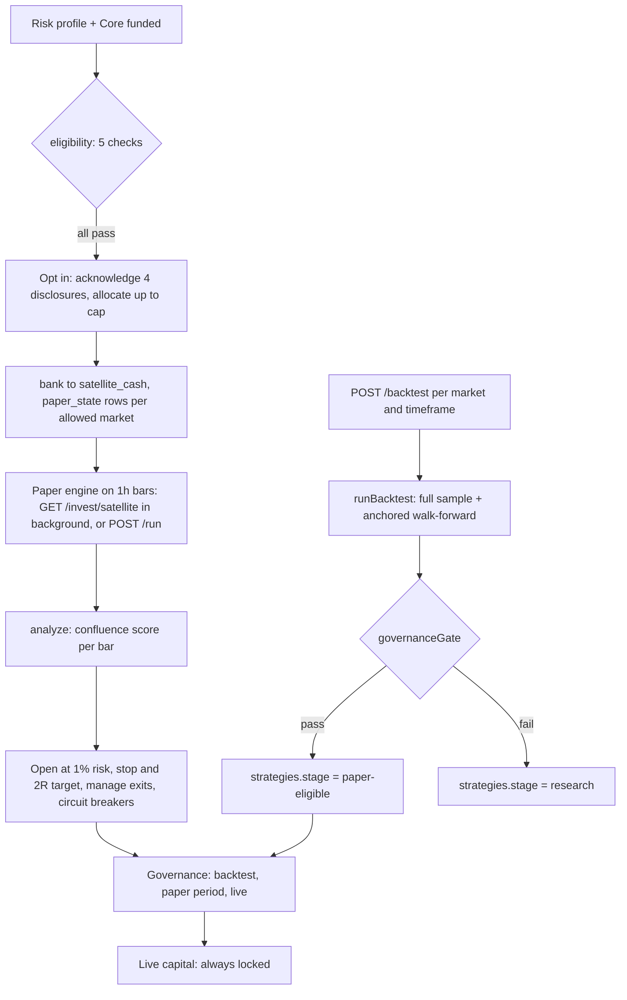

# Investing

> A Core sleeve that buys a model ETF portfolio on a plan, and an opt-in Satellite sleeve that paper-trades a price-action strategy behind risk gates.

**Status:** partly built. Core is built (prices are live, brokerage execution is simulated as ledger fills). Satellite is built as paper trading only; live capital is always locked. · **Switch:** always on. Per market, `rulesFor(jurisdiction).satellite` in [src/lib/compliance.ts](../../src/lib/compliance.ts) sets which asset classes and what allocation cap Satellite allows.

## What it does

- Scores a seven-question **risk profile** into a 0–100 score and one of five bands.
- Maps the band and the customer's market to a **model portfolio** of low-cost ETFs (equity, international equity, bonds, gold, cash).
- Buys that portfolio from the bank as a **lump sum** or on a weekly or monthly **SIP** (recurring plan), run by the lazy scheduler.
- Shows Core holdings priced live in the wallet currency, a **10-year SIP illustration** on real monthly closes, and a **Monte Carlo** range of outcomes.
- Lets an eligible customer **opt in** to Satellite with a capped allocation, after acknowledging four risk disclosures.
- Runs an **SMC/FVG strategy engine** (Smart Money Concepts, Fair Value Gaps) on live candles, **backtests** it with walk-forward validation, and gates it.
- **Paper-trades** the strategy on hourly bars with risk-per-trade sizing and drawdown circuit breakers. No live money is ever traded.
- Combines both sleeves in a **portfolio** summary.

## How it works

### Core

1. `POST /invest/profile` refuses a partial questionnaire with a 400 (`missing_answer`, via `missingAnswers()`), then scores the answers with `scoreAnswers()` and saves the profile as JSON in `users.risk_profile`.
2. `modelPortfolio(jurisdiction, band)` returns the allocations from the band's weights and the market's tickers.
3. A buy (`executeSip()`) prices each fund with `latestPrice()` and converts it to the wallet currency with `fxRate()` (Yahoo pair `{FROM}{TO}=X`).
4. In one transaction it moves the amount bank → `core_cash` (journal `invest_fund`), then `core_cash` → `core_securities` per fund (journal `invest_buy`), inserts a filled `orders` row, and upserts `holdings`. The last fund takes the rounding remainder.
5. `tick()` in [src/lib/scheduler.ts](../../src/lib/scheduler.ts) calls `runDueSips()` on customer reads. A run the bank can't cover is audited as `invest.sip_missed` and skipped.

### Satellite

- `analyze()` in [smc.ts](../../src/lib/invest/smc.ts) scores six components per bar into a 0–100 confluence for long and short (maximum points shown; HTF bias gives 10 when neutral, and a BOS gives 16 instead of 20): higher-timeframe bias 25, structure (BOS/CHoCH) 20, FVG 20, order block 15, liquidity sweep 10, location (premium/discount 5 + volume-profile POC 5) 10.
- A setup needs a score at or above the threshold (60), beating the other side, inside an FVG or order block, and not against the higher-timeframe bias. The stop sits beyond the zone or recent extreme, clamped to 0.5–3 ATR.
- Every decision uses only data known at that bar's close. A test checks a bar's signal is the same with or without later bars.
- `runPaperEngine()` in [satellite.ts](../../src/lib/invest/satellite.ts) processes each completed hourly bar since `paper_state.last_bar_t`: it manages the open position first (stop, target, or 48-bar time exit), checks circuit breakers after each close, then opens a new position if the market has none and the account is not halted.
- Paper P&L is not on the ledger. Satellite equity is `satellite_cash` balance + realised paper P&L.

### The honest backtest result

The project [README.md](../../README.md#investing-engine--and-an-honest-result) reports that across the eight Satellite markets and three timeframes surveyed, **no configuration cleared the gate** (out-of-sample profit factor at least 1.1, positive expectancy, drawdown at most 20 %, t at least 1). The code follows from that: Satellite money stays in cash, the engine only paper-trades, and the "Live capital" stage is hard-coded to `passed: false` with "Requires a licensed brokerage partner". The run behind the README claim is not stored in the repo; results depend on live market data, so a rerun can differ. Not confirmed which date the survey used.

## Where the code is

### Server

| File | What it holds | Key exports |
|---|---|---|
| [src/lib/invest/profile.ts](../../src/lib/invest/profile.ts) | Questionnaire, bands, model portfolios (shared by client and server) | `QUESTIONS`, `BANDS`, `scoreAnswers()` score and band, `modelPortfolio()` allocations per market and band, `bandInfo()` |
| [src/lib/invest/core.ts](../../src/lib/invest/core.ts) | Core buys, holdings, SIPs, illustrations | `executeSip()` buy into the portfolio, `coreHoldings()` priced holdings, `upsertSip()` / `cancelSip()` / `sipPlans()`, `runDueSips()` scheduler run, `historicalIllustration()` 10-year monthly SIP, `projection()` Monte Carlo fan, `fxRate()`, `riskProfile()` / `requireProfile()` |
| [src/lib/invest/market.ts](../../src/lib/invest/market.ts) | Market data with cache and offline fallback | `getSeries()` candles from Yahoo, cache or synthetic, `latestPrice()`, `syntheticCandles()` seeded random walk, `rng()`, `SATELLITE_UNIVERSE` eight markets |
| [src/lib/invest/smc.ts](../../src/lib/invest/smc.ts) | SMC/FVG analysis | `analyze()` swings, structure, OBs, FVGs, sweeps, bias, signals, `signalAt()` signal at a higher threshold, `DEFAULT_PARAMS`, `WEIGHTS`, `COST_BPS` |
| [src/lib/invest/backtest.ts](../../src/lib/invest/backtest.ts) | Backtester and gate | `runBacktest()` full sample + walk-forward, `stats()`, `governanceGate()` five checks |
| [src/lib/invest/satellite.ts](../../src/lib/invest/satellite.ts) | Satellite sleeve | `eligibility()`, `optIn()`, `optOut()`, `setMarketEnabled()`, `runPaperEngine()`, `paperEquity()`, `satelliteOverview()`, `backtestMarket()`, `marketAnalysis()`, `DISCLOSURES`, `PAPER_TIMEFRAME` |
| [src/app/api/v1/invest/](../../src/app/api/v1/invest/core/route.ts) | Route handlers (see API endpoints) | `GET`, `POST`, `PATCH`, `DELETE` |
| [src/app/api/v1/portfolio/route.ts](../../src/app/api/v1/portfolio/route.ts) | Combined Core + Satellite summary | `GET` |
| [src/lib/scheduler.ts](../../src/lib/scheduler.ts) | Lazy scheduler | `tick()` runs `runDueSips()`, swallowing errors |
| [src/lib/seed.ts](../../src/lib/seed.ts) | Demo history: profile, back-dated SIP buys, paper engine | uses `executeSip()`, `runPaperEngine()` |
| [src/app/api/v1/dashboard/route.ts](../../src/app/api/v1/dashboard/route.ts) | Counts Core and Satellite in net worth | uses `coreHoldings()`, `paperEquity()` |

### Web app

| File | What it holds | Key exports |
|---|---|---|
| [src/app/invest/page.tsx](../../src/app/invest/page.tsx) | Overview: total, Core vs Satellite split, sleeve cards; prompts for the risk profile first | `InvestPage` |
| [src/app/invest/profile/page.tsx](../../src/app/invest/profile/page.tsx) | Seven-question questionnaire and the resulting mix | default page |
| [src/app/invest/core/page.tsx](../../src/app/invest/core/page.tsx) | Model portfolio with quotes, holdings, SIP illustration, range of outcomes, order history, buy and SIP modal, pause SIP | default page |
| [src/app/invest/satellite/page.tsx](../../src/app/invest/satellite/page.tsx) | Eligibility, disclosures and opt-in; live chart with layers; confluence breakdown; backtest with folds and gate; governance; paper positions; market coverage toggles; run engine; opt out | `SatellitePage`, `OptIn`, `Confluence`, `StatGrid` |
| [src/components/candle-chart.tsx](../../src/components/candle-chart.tsx) | SVG candlestick chart with overlay layers | `CandleChart`, `Overlays`, `Layer` (`fvg`, `ob`, `structure`, `swings`, `sweeps`, `profile`, `signals`) |
| [src/components/charts.tsx](../../src/components/charts.tsx) | Shared charts | `FanChart` projection percentiles, `TwoLineChart` SIP history and backtest equity vs buy-and-hold |
| [src/components/invest-nav.tsx](../../src/components/invest-nav.tsx) | Tabs: Overview, Core sleeve, Satellite sleeve, Risk profile | `InvestNav` |

### Phone app

The Invest tab has two views: **Core** and **Practice** (the Satellite sleeve). The risk quiz is web-only; the phone says "For now the quiz is in Vaultwise on the web". Satellite is read-only on the phone: no opt-in, backtest or engine run.

| File | What it holds | Key exports |
|---|---|---|
| [mobile/src/features/invest/InvestScreen.tsx](../../mobile/src/features/invest/InvestScreen.tsx) | Tab root, Core/Practice switch, pull to refresh | `InvestScreen` |
| [mobile/src/features/invest/core/CoreView.tsx](../../mobile/src/features/invest/core/CoreView.tsx) | Core: hero, actions, plan card, model portfolio, holdings | `CoreView` |
| [mobile/src/features/invest/core/PlanModal.tsx](../../mobile/src/features/invest/core/PlanModal.tsx) | Start, change or stop the plan (SIP) | `PlanModal` calls `api.setSip()`, `api.cancelSip()` |
| [mobile/src/features/invest/core/LumpSumModal.tsx](../../mobile/src/features/invest/core/LumpSumModal.tsx) | One-off buy with the split previewed; warns if over the bank balance | `LumpSumModal` calls `api.buyCore()` |
| [mobile/src/features/invest/core/](../../mobile/src/features/invest/core/CoreSummary.tsx) (parts) | Summary, mix and holdings views | `CoreHero`, `PlanCard`, `CoreActions`, `ModelPortfolio`, `Holdings`, `FlowModal`, `FlowDone`, `FlowError` |
| [mobile/src/features/invest/practice/PracticeView.tsx](../../mobile/src/features/invest/practice/PracticeView.tsx) | Satellite as a quiet paper view | `PracticeView` |
| [mobile/src/features/invest/practice/parse.ts](../../mobile/src/features/invest/practice/parse.ts) | Narrows the untyped `/invest/satellite` reply | `parseSatellite()`, `paperProgress()` reads "N of 30 days · M of 20 trades" |
| [mobile/src/features/invest/practice/](../../mobile/src/features/invest/practice/StrategyStatus.tsx) (parts) | Gates in plain words, positions, blueprint surface | `StrategyStages`, `statusSentence()`, `PaperPositions`, `Blueprint`, `PracticeChip` |
| [mobile/src/features/invest/use-invest.ts](../../mobile/src/features/invest/use-invest.ts) | Helpers | `hasPortfolio()`, `activePlan()`, `useInvalidateInvest()` |
| [mobile/src/features/invest/format.ts](../../mobile/src/features/invest/format.ts) | Money, percent, units, price, day formats | `fmtMoney()`, `fmtPct()`, `fmtUnits()`, `asFrequency()` |
| [mobile/src/lib/invest.ts](../../mobile/src/lib/invest.ts) | Server rules mirrored on the phone | `nextRunFrom()` now + 7 or 30 days, `splitByWeight()` same rounding as `executeSip()` |
| [mobile/src/lib/api/demo/invest.ts](../../mobile/src/lib/api/demo/invest.ts) | Practice simulator | `investApi`: fixture portfolio and satellite, Core with session buys and plan laid over |
| [mobile/src/lib/api/client.ts](../../mobile/src/lib/api/client.ts), [hooks.ts](../../mobile/src/lib/api/hooks.ts) | Live calls and queries | `portfolio()`, `investCore()`, `investSatellite()`, `buyCore()`, `setSip()`, `cancelSip()`; `usePortfolio()`, `useInvestCore()`, `useInvestSatellite()` |

## API endpoints

All under `/api/v1`. Amounts in requests are major units. "Verified ID" means `kyc: true` (403 `kyc_required` unless verified and `KYC_ENFORCED` is not `false`). "Ticks" means the route runs the lazy scheduler, including due SIPs.

| Method | Path | Who can call | Purpose |
|---|---|---|---|
| GET | `/invest/profile` | Customer, read | Questions, bands, saved profile, model portfolio |
| POST | `/invest/profile` | Customer, write | Body `{ answers: { [id]: 0-3 } }`; saves the scored profile |
| GET | `/invest/core` | Customer, read, ticks | Profile, band, allocations, quotes, holdings, SIP plans, last 40 orders; `{ profile: null }` without a profile |
| POST | `/invest/core/buy` | Customer, write, verified ID | Body `{ amount }`; lump-sum buy; 201 `{ fills }` |
| POST | `/invest/core/sip` | Customer, write, verified ID | Body `{ amount, frequency: "weekly" \| "monthly", startDate? }`; create or update the one active plan |
| DELETE | `/invest/core/sip` | Customer, write | Pause the active plan |
| GET | `/invest/core/history` | Customer, read | Query `monthly` (default 300), `band`; 10-year SIP illustration |
| GET | `/invest/core/projection` | Customer, read | Query `band`, `monthly` (300), `initial` (0), `years` (15, clamped 1–40); Monte Carlo fan |
| GET | `/invest/satellite` | Customer, read, ticks | Overview: eligibility, disclosures, rules, equity, last 100 positions, stats, markets with gate, governance. Runs the paper engine in the background (`after()`) when opted in |
| POST | `/invest/satellite/opt-in` | Customer, write, verified ID | Body `{ amount, acknowledged }`; allocate (again) up to the cap |
| POST | `/invest/satellite/opt-out` | Customer, write | Return the allocation to the bank, cancel open positions |
| POST | `/invest/satellite/run` | Customer, write, verified ID | Run the paper engine now; `{ processed, opened, closed }`; max 90 s |
| POST | `/invest/satellite/backtest` | Customer, write | Body `{ symbol, tf: "1h" \| "4h" \| "1d" }`; backtest and store the gate; max 90 s |
| GET | `/invest/satellite/analysis` | Customer, read | Query `symbol` (BTC-USD), `tf` (4h), `bars` (160, clamped 60–400); chart overlays and latest confluence |
| PATCH | `/invest/satellite/markets` | Customer, write | Body `{ symbol, enabled }`; turn a market on or off for the paper engine |
| GET | `/portfolio` | Customer, read, ticks | Core value, cash, cost, P&L, holdings; Satellite (paper) equity; total and split |

## Data

| Table | Columns used | Written by |
|---|---|---|
| `users` | `risk_profile` (JSON), `satellite_opt_in`, `satellite_opted_at` | profile route, `optIn()`, `optOut()` |
| `sip_plans` | `id`, `user_id`, `amount`, `frequency`, `next_run_at`, `active`, `created_at` | `upsertSip()`, `cancelSip()`, `runDueSips()` |
| `orders` | `sleeve = 'core'`, `symbol`, `side = 'buy'`, `units`, `price`, `amount`, `status = 'filled'`, `source` (`manual` or `sip`) | `executeSip()` |
| `holdings` | PK `(user_id, sleeve, symbol)`, `units`, `cost` | `executeSip()` |
| `paper_state` | PK `(user_id, symbol, timeframe)`, `enabled`, `last_bar_t`, `halted_until` | `optIn()`, `setMarketEnabled()`, `runPaperEngine()`, `optOut()` |
| `paper_positions` | `strategy_id = 'smc-confluence-v1'`, `direction`, `entry`, `stop`, `target`, `risk_amount`, `confluence`, `components`, `status` (`open`, `closed`, `cancelled`), `exit`, `r_multiple`, `pnl` | `runPaperEngine()`, `optOut()` |
| `strategies` | `id = smc:{symbol}:{tf}`, `name`, `params`, `stage` (`paper-eligible` or `research`), `last_backtest` (JSON). `paper_started_at` and `promoted_at` are unused | `backtestMarket()` |
| `market_cache` | `key = symbol\|interval\|range`, `fetched_at`, `source`, `payload` | `getSeries()` |
| `journals`, `ledger_entries` | kinds `invest_fund`, `invest_buy`, `satellite_allocate`, `satellite_return`; accounts `core_cash`, `core_securities`, `satellite_cash` | `transfer()` |
| `audit_log` | `invest.risk_profiled`, `invest.core_buy`, `invest.sip_configured`, `invest.sip_paused`, `invest.sip_missed`, `satellite.opted_in`, `satellite.allocation_increased`, `satellite.opted_out`, `satellite.paper_opened`, `satellite.paper_closed`, `satellite.circuit_breaker`, `strategy.gate_passed`, `strategy.gate_failed` | `audit()` |

**Phone storage:** none. Practice reads fixtures `invest-core.json`, `portfolio.json` and `invest-satellite.json` from [mobile/src/data/fixtures](../../mobile/src/data/fixtures), with the plan and buys kept in `S.invest`, which the Practice save keeps on the device ([plan 01](../plans/01-practice-data-saved.md)).

## Rules and limits

| Rule | Value | Where |
|---|---|---|
| Bands | Conservative (score ≥ 0, 4 % return, 5 % vol), Moderately conservative (≥ 25, 5 %, 8 %), Balanced (≥ 45, 6 %, 11 %), Growth (≥ 65, 7 %, 14 %), Aggressive (≥ 83, 7.8 %, 17 %) | `BANDS` |
| No emergency cushion | band capped at 2 | `scoreAnswers()` |
| Weights (equity home / intl / bonds / gold / cash, %) | 1: 15/5/55/10/15 · 2: 30/10/45/10/5 · 3: 40/20/30/10/0 · 4: 55/25/12/8/0 · 5: 65/30/0/5/0 | `WEIGHTS` in profile.ts |
| Ticker sets | US, EU, UK, IN, CA, AU, SG; any other market uses the US set. UK has no cash fund, so cash folds into bonds | `TICKERS`, `modelPortfolio()` |
| SIP | one active plan; weekly or monthly; first run at `startDate` or now + 7 / 30 days; later runs +7 days or +1 calendar month; up to 6 catch-up runs per plan per tick | `upsertSip()`, `runDueSips()` |
| Projection | 2,000 paths, seed `1234 + band`, log-normal monthly steps from the band's return and volatility; p10/p25/p50/p75/p90 per year | `projection()` |
| Satellite eligibility | region enabled, profile done, band ≥ 3, experience points ≥ 3, Core value > 0 | `eligibility()` |
| Allocation cap | 10 % of investments (5 % in SG); `capAmount = floor(core × pct ÷ (100 − pct))` | compliance.ts, `eligibility()` |
| Asset classes | equities, crypto, forex (IN: equities and crypto only) | compliance.ts |
| Disclosures | all 4 must be acknowledged | `optIn()` |
| Universe | BTC-USD, ETH-USD, EURUSD=X, GBPUSD=X, USDJPY=X, SPY, AAPL, NVDA | `SATELLITE_UNIVERSE` |
| Costs per side | crypto 8 bps, forex 0.8 bps, equities 1.5 bps | `COST_BPS` |
| Paper engine | 1h bars, needs ≥ 200 completed bars, one position per market, risk 1 % of paper equity, target 2R, time exit after 48 bars | `runPaperEngine()`, `DEFAULT_PARAMS` |
| Circuit breakers | daily loss > 3 % halts new entries to the next UTC midnight; weekly loss > 6 % halts for 7 days; applies to all the customer's markets | `runPaperEngine()` |
| Backtest | 730 days for 1h/4h, 5 years for 1d; enters at the next bar's open; same-bar stop and target resolve to the stop; thresholds 50–75 tried in-sample; 4 anchored walk-forward folds | `backtestMarket()`, `runBacktest()` |
| Gate | ≥ 30 trades, OOS profit factor ≥ 1.1, OOS expectancy > 0, max drawdown ≤ 20 %, t ≥ 1.0 | `governanceGate()` |
| Paper period stage | ≥ 30 days (from the earlier of opt-in and the oldest listed position), ≥ 20 closed trades, average R > 0 | `satelliteOverview()` |
| Live stage | always `passed: false` | `satelliteOverview()` |
| Market data cache | 1h 5 min, 4h 10 min, 1d 30 min, 1wk 6 h, 1mo 12 h; 12 s fetch timeout; 4h built from 1h | market.ts |
| Offline fallback | stale cache, then a seeded synthetic series (600 bars, quoted as USD) | `getSeries()` |

## Configuration

| Name | Where | Effect |
|---|---|---|
| `rulesFor(code).satellite` | [src/lib/compliance.ts](../../src/lib/compliance.ts) | `enabled`, `maxAllocationPct`, `assetClasses`, `minRiskBand` 3, `riskPerTradePct` 1, `dailyDrawdownHaltPct` 3, `weeklyDrawdownHaltPct` 6 |
| `KYC_ENFORCED` | server env | `false` turns off the verified-ID check on buy, SIP, opt-in and run |
| `maxDuration = 90` | backtest and run routes | Route time limit in seconds |

There is no env var for market data. The server fetches `query1.finance.yahoo.com` directly.

## Tests

| File | What it covers |
|---|---|
| [tests/smc.test.ts](../../tests/smc.test.ts) | No lookahead (signals match with and without future bars); a bullish FVG is detected; `runBacktest()` returns 4 folds, a gate with checks, finite trade results |
| [tests/scheduler.test.ts](../../tests/scheduler.test.ts) (SIP part) | `runDueSips()` runs every missed date, records a miss when the bank is short, advances the schedule, and does nothing on an immediate rerun |

There are no tests for `satellite.ts` (eligibility, cap, opt-in/out, paper engine, breakers), `executeSip()` splitting, `projection()`, or the phone Invest code. The SIP test calls the real Yahoo endpoint and falls back to synthetic prices offline.

## Known limits and open issues

- Brokerage is simulated: fills are ledger moves at live prices. There is no sell path for Core.
- Satellite is paper only. Paper P&L never reaches the ledger.
- The `strategies` table is shared across customers (`smc:{symbol}:{tf}`), so one customer's backtest overwrites another's. This fits the single-customer prototype.
- The paper-period day count starts at the earlier of `satellite_opted_at` and the oldest of the last 100 positions. After an opt-out and a new opt-in, positions cancelled at the opt-out still count toward that start. Not confirmed whether this is intended.
- Synthetic offline candles are always quoted as USD around fixed start prices, so offline Core prices for non-US funds are not meaningful.
- `getSeries()` never throws (it falls back to synthetic data). The "market data unavailable" catch in `tick()` therefore rarely, if ever, fires for that reason.
- The web Core page multiplies amounts by 80 for INR only; other currencies are not scaled.
- The phone Practice portfolio is a fixture and does not change after a Practice buy (only the Core view does).
- On the phone, "Practice" names both the Satellite view and the on-device simulator mode.

## Maintainability notes

- **Good seams.** `smc.ts` and `backtest.ts` are pure functions over candles, which is why the no-lookahead test is cheap. `profile.ts` is shared by client and server.
- **DIP.** `core.ts` and `satellite.ts` call `getSeries()` and `latestPrice()` directly ([core.ts:25](../../src/lib/invest/core.ts), [satellite.ts:207](../../src/lib/invest/satellite.ts)), and those reach Yahoo over the network. Passing in a price source would make Core and the paper engine testable offline.
- **SRP.** `runPaperEngine()` ([satellite.ts:195-330](../../src/lib/invest/satellite.ts)) fetches data, manages exits, computes breakers, opens positions and audits in one loop.
- **Duplication with drift.** The paper engine enters at the signal bar's close ([satellite.ts:290](../../src/lib/invest/satellite.ts)) while the backtester enters at the next bar's open ([backtest.ts:73](../../src/lib/invest/backtest.ts)). The exit logic is written twice. Paper results therefore do not test exactly what the gate validated.
- **Coupling to display text.** The phone parses the paper stage's sentence with a regex ([parse.ts:85](../../mobile/src/features/invest/practice/parse.ts)) against the string built at [satellite.ts:401](../../src/lib/invest/satellite.ts). `investSatellite()` is typed `Record<string, unknown>` in the phone client, which forces that defensive parsing.
- **Duplicated constants.** The web satellite page hard-codes the 2R target ([satellite/page.tsx:358](../../src/app/invest/satellite/page.tsx)) instead of reading `DEFAULT_PARAMS.rr`. The web Core page hard-codes INR × 80 ([core/page.tsx:79](../../src/app/invest/core/page.tsx)) instead of `CURRENCY_SCALE` from [src/lib/shared.ts](../../src/lib/shared.ts). [mobile/src/lib/invest.ts](../../mobile/src/lib/invest.ts) mirrors the server's split and next-run rules by hand.
- **Large page files.** [satellite/page.tsx](../../src/app/invest/satellite/page.tsx) is 761 lines and [core/page.tsx](../../src/app/invest/core/page.tsx) is 442 lines, each mixing data fetching, forms and charts.
