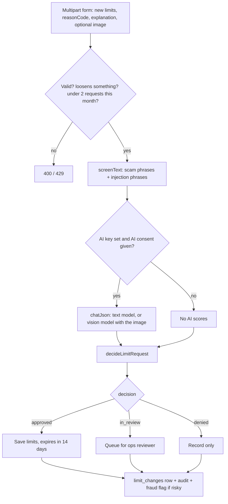

# Personal limits

> A commitment device: customers can tighten their withdrawal limits at any time, loosen them once a calendar month, and ask for a short emergency increase that an AI scores, a fixed policy decides and a person checks when unsure.

**Status:** built on the server and web app; the phone app can view, lower and raise limits but sends emergency requests to the web app · **Switch:** always on (the AI assessment needs `GROQ_API_KEY` and the person's AI consent)

## What it does

- Three limits per customer, in minor units: **single withdrawal**, **daily withdrawals**, and **monthly emergency access**.
- Each limit has a market default and a market maximum from [compliance.ts](../../src/lib/compliance.ts). The market maximum always wins, even over a saved value.
- Lowering any limit works at once, as often as the customer likes.
- Raising one or more limits uses the monthly allowance: one standard raise per calendar month.
- Outside that allowance, the customer can file an **emergency request**. Text is screened for scam phrases and prompt injection; an AI model scores the need; a deterministic policy approves, declines or sends it to a person.
- An approved emergency increase lasts 14 days, then falls back without ever loosening anything.
- Scam-shaped and manipulative requests raise a fraud flag for the ops team.

## How it works

### Reading and enforcing limits

1. `getLimits(user)` ([store.ts](../../src/lib/limits/store.ts)) reads `user_limits`. With no row it uses the market defaults. It then caps each value at the market maximum.
2. `assertWithinWithdrawalLimits()` ([usage.ts](../../src/lib/limits/usage.ts)) runs inside `createWithdrawal()` ([vaults.ts](../../src/lib/vaults.ts)). It refuses an amount above the single limit, or one that would take today's total past the daily limit. "Today" counts withdrawals created since local midnight on the server that are not `denied`, `cancelled` or `expired`.
3. `effectiveEmergencyCap()` returns the lower of the market's emergency cap and the personal monthly emergency limit. The emergency module ([emergency.ts](../../src/lib/emergency.ts)) uses it.

### Standard change (`PUT /api/v1/limits`)

1. `validate()` checks each value is an integer, at least 0 and not above the market maximum.
2. `changeLimits()` ([change.ts](../../src/lib/limits/change.ts)) compares before and after. No change → 400.
3. If any limit goes up and the customer already used this month's allowance → 409 with the date of the next allowance.
4. Kind is `standard` if anything went up (even if other limits went down), otherwise `tighten`.
5. It saves `user_limits`, writes a `limit_changes` row with status `applied`, and audits `limits.standard` or `limits.tighten`.
6. A `standard` change marks any active emergency increase as `superseded`.

### Emergency request (`POST /api/v1/limits/emergency`)

1. The route reads limit fields in major units, converts to minor units, and validates an optional image with `validateUpload()` from the verification pipeline.
2. `requestEmergencyLimitChange()` ([emergency-request.ts](../../src/lib/limits/emergency-request.ts)) requires a known `reasonCode` (`medical`, `accident`, `job_loss`, `urgent_travel`, `home_repair`, `bereavement`, `other`) and an explanation of at least 20 characters. A request that only lowers limits is refused ("just save it"). A third request in the calendar month → 429.
3. **Ratio.** For each raised limit, `after / max(before, unit)`, where `unit = max(100, singleWithdrawal default / 100)`. The largest ratio is kept.
4. **Deterministic screen.** `screenText()` matches 8 scam patterns (gift cards, crypto transfer, investment pitch, instructed by a third party, "safe account" or verification request, prize or inheritance, online relationship, remote access) and 4 prompt-injection patterns.
5. **AI assessment.** Only when `aiEnabled()` and `aiConsented()` are both true. The prompt marks the customer's text as data between fixed markers, adds account facts (account age, emergency releases this month, open risk flags, whether the monthly allowance is used), and asks for JSON scores. With an image it uses the vision model; the image is first normalised by `preprocess()`. Temperature 0, 700 tokens, 45 s timeout. Scores are clamped to 0–1; an AI error is stored as `aiError` and the request continues without scores.
6. **Policy.** `decideLimitRequest()` decides (see the rules table below). The model informs; it never approves on its own.
7. **Record.** One transaction first counts this month's requests again (429 with the same message: requests that passed step 2 together while the model was asked can't all be recorded). It then writes one `limit_changes` row of kind `emergency` with before, after, reason, explanation, the full assessment JSON and the model name. Approved → the increase is applied on top of the limits as they are at that moment (`planIncrease()`, see [Temporary increases](#temporary-increases)) and `expires_at = now + 14 days`.
8. **Flags.** Denied with scam risk ≥ 0.6 → high-severity fraud flag. Manipulation → medium flag (score 60). Other scam risk ≥ 0.6 → medium flag.
9. The response returns the decision, reasons, the model's customer message, the expiry and the updated overview. The web app shows the model's message only when the request goes to a person.

### Review and expiry

- **Ops review.** `pendingLimitReviews()` feeds the admin overview's "Limit requests" tab. `reviewLimitChange()` (via `POST /api/v1/admin/limit-requests/{id}`) approves or denies a request in `in_review` (404 unknown, 409 not awaiting review). On approval it re-validates the requested limits, applies the increase on top of the limits as they are now (`planIncrease()`), rewrites the row's `before_limits` / `after_limits` to the increase actually applied, and sets a fresh 14-day expiry. The `limits.reviewed_<decision>` audit row is stamped with the decision time (`ts: now`).
- **Expiry.** `revertExpiredLimitIncreases()` ([expiry.ts](../../src/lib/limits/expiry.ts)) runs in every `tick`. For each applied emergency increase past `expires_at`, `fallBack()` works out the limits, they are saved, and the row is marked `reverted`, all in one transaction.

### Temporary increases

An approved emergency increase, whether the policy approves it at once or a reviewer approves it later, is applied on top of the limits **as they are when it is applied**, read inside the transaction that saves it ([increase.ts](../../src/lib/limits/increase.ts)):

- `planIncrease()`: a limit the request **raises** goes to the requested value (or stays higher, if it is higher by then). A limit the request **lowers** goes to the lower of its current and requested values. **Every other limit keeps its current value**, so a limit lowered while the request waited, or during the AI call, stays lowered.
- The row stores, for each raised limit, `before_limits` = the level it falls back to (the lower of the limit when applied and the fall-back of any other increase still applied to that limit) and `after_limits` = the level this increase grants.
- `fallBack()`: when an increase expires, each limit it raised falls back to the higher of its fall-back level and what any other still-active increase grants that limit, never above the current value. Limits it didn't raise are left alone. So an expiring increase never undoes another active one, a tightening made during the window is kept, and a chain of overlapping increases ends at the level before the first.

**Changed 2026-11-24.** Before, an approval saved the request's filed `after_limits` whole (undoing any limit lowered since), the monthly number of requests was checked only before the AI call, an expiry set every limit to the lower of now and the expiring request's `before` (undoing other active increases early), and `limits.reviewed_*` audit rows took the clock's time. `limits.emergency_approved` details now carry the applied `before` / `after`, which equal the filed ones unless the limits changed meanwhile or another increase was active.

### Phone app

The Limits screen shows usage, bounds and whether this month's raise is free. Raising starts with a scam interstitial ("Is someone telling you to do this?") with a "Talk to us" button, then the amount. Saving calls `PUT /api/v1/limits`. The phone has no emergency request form; when a temporary raise is active it says the details are on the web app. In Practice mode, [demo/vaults.ts](../../mobile/src/lib/api/demo/vaults.ts) copies the monthly-raise and maximum checks.

## Where the code is

### Server

| File | What it holds | Key exports |
|---|---|---|
| [src/lib/limits/index.ts](../../src/lib/limits/index.ts) | The module's public surface (re-exports only); other code imports `@/lib/limits` | everything below marked exported |
| [src/lib/limits/bounds.ts](../../src/lib/limits/bounds.ts) | Which limits exist, their market bounds, how a change compares | `LIMIT_KEYS`, `Limits`, `Bound`, `limitBounds()`; internal `validate()` (400 out of bounds), `diff()` → `{ loosened, tightened }` |
| [src/lib/limits/period.ts](../../src/lib/limits/period.ts) | Calendar boundaries in the server's local time | internal `dayStart()`, `monthStart()`, `nextMonthStart()` |
| [src/lib/limits/store.ts](../../src/lib/limits/store.ts) | `user_limits` reads and writes; the `limit_changes` row shape | `getLimits()` effective limits, `effectiveEmergencyCap()`; internal `saveLimits()`, `ChangeRow` |
| [src/lib/limits/usage.ts](../../src/lib/limits/usage.ts) | Daily and monthly counters, the withdrawal guard | `withdrawnToday()`, `assertWithinWithdrawalLimits()`; internal `standardChangesThisMonth()`, `emergencyRequestsThisMonth()` |
| [src/lib/limits/change.ts](../../src/lib/limits/change.ts) | Standard change: lower any time, raise once a month | `changeLimits()` |
| [src/lib/limits/screen.ts](../../src/lib/limits/screen.ts) | Deterministic text screen | `screenText()` → `TextScreen` |
| [src/lib/limits/policy.ts](../../src/lib/limits/policy.ts) | Pure decision over the scores and the screen | `decideLimitRequest()`, `LimitAssessment`, `StoredAssessment` |
| [src/lib/limits/assess.ts](../../src/lib/limits/assess.ts) | The AI assessor: account facts, prompt, model call (scores only) | internal `accountFacts()`, `assessWithModel()` → `{ ai, aiError, model }` |
| [src/lib/limits/emergency-request.ts](../../src/lib/limits/emergency-request.ts) | Emergency request end to end: checks, screen, assessment, policy, row, audit, fraud flag | `requestEmergencyLimitChange()` |
| [src/lib/limits/increase.ts](../../src/lib/limits/increase.ts) | The arithmetic of temporary increases | internal `planIncrease()`, `fallBack()` |
| [src/lib/limits/expiry.ts](../../src/lib/limits/expiry.ts) | Scheduler tick: approved increases expire | `revertExpiredLimitIncreases()` |
| [src/lib/limits/review.ts](../../src/lib/limits/review.ts) | The reviewer's queue and decision | `pendingLimitReviews()`, `reviewLimitChange()` |
| [src/lib/limits/view.ts](../../src/lib/limits/view.ts) | What the screens read | `limitsOverview()` screen data, `viewChange()` |
| [src/lib/limits/README.md](../../src/lib/limits/README.md) | The module's file map, flow, audit and touch points | — |
| [src/lib/compliance.ts](../../src/lib/compliance.ts) | Market bounds and quotas | `rulesFor()` → `limits` and `emergency.monthlyCap` |
| [src/lib/shared.ts](../../src/lib/shared.ts) | Labels shared with clients | `LIMIT_LABELS`, `EMERGENCY_REASONS`, `LimitKey` |
| [src/lib/groq.ts](../../src/lib/groq.ts) | AI provider client | `aiEnabled()`, `chatJson()`, `TEXT_MODEL`, `VISION_MODEL`, `describeAiError()` |
| [src/lib/ai-consent.ts](../../src/lib/ai-consent.ts) | The person's AI consent | `aiConsented()` |
| [src/lib/fraud.ts](../../src/lib/fraud.ts) | Risk flags | `raiseFlag()` |
| [src/app/api/v1/limits/route.ts](../../src/app/api/v1/limits/route.ts) | GET overview, PUT standard change | `GET`, `PUT` |
| [src/app/api/v1/limits/emergency/route.ts](../../src/app/api/v1/limits/emergency/route.ts) | Emergency request (multipart, `maxDuration` 90 s) | `POST` |
| [src/app/api/v1/admin/limit-requests/[id]/route.ts](../../src/app/api/v1/admin/limit-requests/[id]/route.ts) | Reviewer decision | `POST` |

### Web app

| File | What it holds | Key exports |
|---|---|---|
| [src/components/limits-panel.tsx](../../src/components/limits-panel.tsx) | Limits card, change form, emergency form, history | `LimitsCard()`, `AssessmentScores()` (reused by admin), `LimitsOverview` type |
| [src/app/settings/page.tsx](../../src/app/settings/page.tsx) | Hosts `LimitsCard` | — |
| [src/app/admin/page.tsx](../../src/app/admin/page.tsx) | "Limit requests" tab with approve/deny | `LimitRequests()` |

### Phone app

| File | What it holds | Key exports |
|---|---|---|
| [mobile/src/features/account/settings/limits/LimitsScreen.tsx](../../mobile/src/features/account/settings/limits/LimitsScreen.tsx) | Limits list, quota pill, wallet limit card | `LimitsScreen()` |
| [mobile/src/features/account/settings/limits/LimitEditor.tsx](../../mobile/src/features/account/settings/limits/LimitEditor.tsx) | Full-screen editor: scam check → amount → done | `LimitEditor()` |
| [mobile/src/features/account/settings/limits/limitMeta.ts](../../mobile/src/features/account/settings/limits/limitMeta.ts) | Titles and blocked-reason text | `LIMITS`, `limitMeta()`, `raiseBlocked()`, `lowerBlocked()`, `shortDate()` |
| [mobile/src/lib/api/client.ts](../../mobile/src/lib/api/client.ts) | API calls | `api.limits()`, `api.setLimits()` |

## API endpoints

| Method | Path | Who can call | Purpose |
|---|---|---|---|
| GET | `/api/v1/limits` | Customer (read) | Limits, bounds, today's usage, quota, emergency usage, active increases, last 20 changes; runs `tick` |
| PUT | `/api/v1/limits` | Customer | Standard change; body in major units (`0`–`1e9` each) |
| POST | `/api/v1/limits/emergency` | Customer | Emergency request; multipart with `singleWithdrawal`, `dailyWithdrawal`, `monthlyEmergency`, `reasonCode`, `explanation`, optional `file`; returns 201 |
| GET | `/api/v1/admin/overview` | Admin | Includes `limitRequests` (pending reviews) |
| POST | `/api/v1/admin/limit-requests/{id}` | Admin | `{decision: "approved" \| "denied", note}` (note 3–500 characters) |

Admin is open in prototype mode and needs an email in `ADMIN_EMAILS` in firebase mode.

## Data

| Table | Columns |
|---|---|
| `user_limits` | `user_id`, `single_withdrawal`, `daily_withdrawal`, `monthly_emergency`, `updated_at` |
| `limit_changes` | `id` (`lim_`), `kind` (`tighten` / `standard` / `emergency`), `status` (`applied` / `in_review` / `denied` / `reverted` / `superseded`), `before_limits`, `after_limits` (JSON), `reason_code`, `explanation`, `assessment` (JSON: `ai`, `aiError`, `screen`, `ratio`, `decision`, `reasons`, `scamRisk`), `model`, `reviewer`, `reviewer_note`, `expires_at`, `created_at`, `decided_at` |
| `fraud_flags` | Rows with `source = 'limits'` |
| `audit_log` | `limits.tighten`, `limits.standard` (change.ts), `limits.emergency_<decision>` (emergency-request.ts; actor the model, or `limits-policy`), `limits.reviewed_<decision>` (review.ts; `ts` = the decision time), `limits.emergency_expired` (expiry.ts; actor `scheduler`) |

No phone storage keys.

## Rules and limits

Market values (major units; the code stores minor units; INR uses Indian digit grouping). They come from the formula in [countries-and-compliance.md](countries-and-compliance.md):

| Market | Single default / max | Daily default / max | Monthly emergency (default = max) |
|---|---|---|---|
| US (USD) | 5,000 / 25,000 | 10,000 / 50,000 | 2,500 |
| EU (EUR) | 4,800 / 24,000 | 9,500 / 48,000 | 2,000 |
| UK (GBP) | 4,000 / 20,000 | 8,000 / 40,000 | 2,000 |
| IN (INR) | 4,00,000 / 20,00,000 | 8,00,000 / 40,00,000 | 1,50,000 |
| SG (SGD) | 6,500 / 33,000 | 13,000 / 65,000 | 3,000 |
| CA (CAD) | 6,800 / 34,000 | 14,000 / 68,000 | 3,400 |
| AU (AUD) | 7,500 / 38,000 | 15,000 / 75,000 | 3,800 |
| AE (AED) | 18,000 / 92,000 | 37,000 / 180,000 | 9,200 |

All markets: 1 standard raise per calendar month, 2 emergency requests per calendar month, emergency increases last 14 days, and the policy sends increases above 3× the current limit to a person. Minimum for every limit is 0.

Decision policy (`decideLimitRequest()`), checked in this order:

| # | Condition | Decision |
|---|---|---|
| 1 | Keyword risk ≥ 0.6 (any scam phrase; risk = min(1, 0.5 + 0.2 × matches)) | denied |
| 2 | Injection phrase found, or the model says `manipulation` | in_review |
| 3 | Model `scam_risk` ≥ 0.8 | denied |
| 4 | Model `scam_risk` ≥ 0.6 | in_review |
| 5 | No AI scores | in_review |
| 6 | Ratio > 3 | in_review |
| 7 | genuine ≥ 0.75, urgency ≥ 0.6, proportionate ≥ 0.6, scam risk < 0.3, and document support ≥ 0.5 (or no document) | approved |
| 8 | genuine ≤ 0.25 | denied |
| 9 | Anything else | in_review, with the reasons listed |

Because rule 1 fires on a single scam phrase (0.5 + 0.2 = 0.7), any match declines the request.

## Configuration

| Setting | Effect |
|---|---|
| `GROQ_API_KEY` | Turns on the AI assessment; without it every non-scam request goes to a person |
| `GROQ_TEXT_MODEL`, `GROQ_VISION_MODEL` | Override the default models in [groq.ts](../../src/lib/groq.ts) |
| AI consent | Without the person's yes ([ai-consent.ts](../../src/lib/ai-consent.ts)) no AI call is made |
| `ADMIN_EMAILS` | Who may review requests in firebase mode |

## Tests

| File | What it covers |
|---|---|
| [tests/limits.test.ts](../../tests/limits.test.ts) | Market defaults scale with currency; tighten any time, loosen once a month; refuse values above the maximum; single and daily limits block withdrawals; a lower emergency limit becomes the cap; the pure policy (approve, review, decline, manipulation, moderate risk); `screenText()`; the full flow with AI off (review → approve → revert without loosening); scam decline with a high flag; tighten-only refusal and the 2-per-month cap; increases meeting later changes (an approval keeps a limit lowered while the request waited, or during the AI call; requests sent at once can't pass the monthly number; an expiring increase doesn't undo another active one; a reviewer's decision is audited at the decision time) |

## Known limits and open issues

- "Today" and "this month" use the server's local midnight, not the customer's. [timezones.ts](../../src/lib/timezones.ts) exists and the wallet uses it, but limits do not.
- The phone app cannot file an emergency request; it points to the web app.
- With AI off, every emergency request that passes the scam screen waits for a person.
- The monthly emergency limit's maximum equals the market cap, so it can only be lowered and then raised back.
- Emergency requests count toward the monthly total whatever their outcome, including declined ones.
- The AI's `user_message` is written before the policy decides, so the web app hides it unless the request goes to review.

## Maintainability notes

- **Good seams.** `decideLimitRequest()` and `screenText()` are pure and well tested. Market numbers come only from `rulesFor()`.
- **SRP (done 2026-11-24).** The old 650-line `src/lib/limits.ts` is now the [src/lib/limits/](../../src/lib/limits/README.md) folder, one job per file (maintainability S2). The split itself changed no behaviour; the fixes listed under [Temporary increases](#temporary-increases) came with it.
- **Magic numbers.** The policy thresholds (0.75, 0.6, 0.3, 0.25, 0.8) and the `unit` formula are inline. Moving them into the market rules or named constants would make tuning safer.
- **Duplication.** `monthStart`, `nextMonthStart` and `dayStart` live in [period.ts](../../src/lib/limits/period.ts) and use the server's time, while the wallet uses zoned versions. The PUT route has its own `toMinor` instead of the shared one. The phone's Practice simulator re-implements the limit checks and error messages.
- **Coupling.** `accountFacts()` in [assess.ts](../../src/lib/limits/assess.ts) runs raw SQL against `users`, `emergency_requests` and `fraud_flags` to build the facts the model sees.
