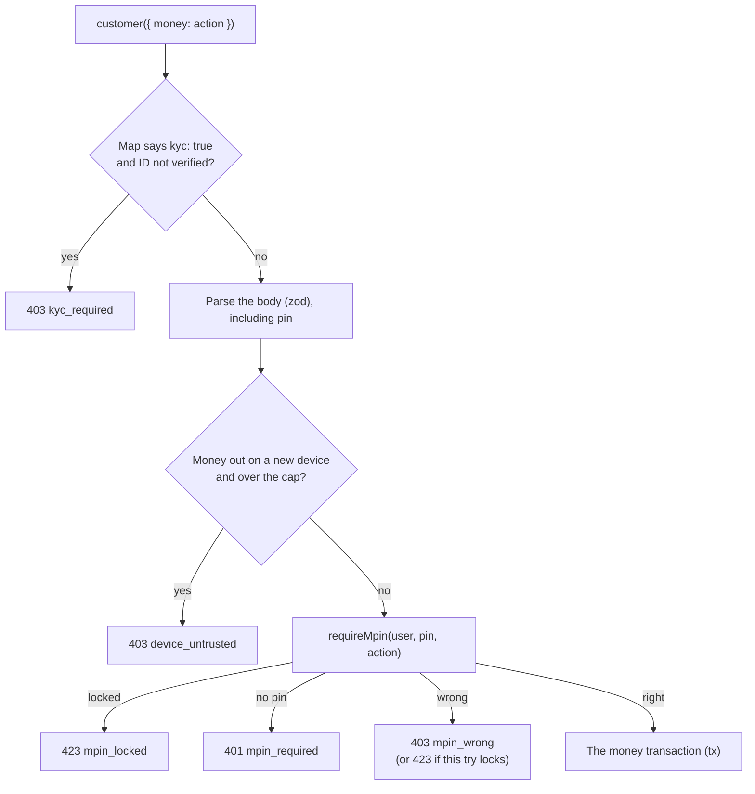

# MPIN

> A 6-digit PIN that the server checks before any money leaves an account, with a lock that gets longer after repeated wrong tries.

**Status:** built on the server, the web app and the phone ([plan 03](../plans/03-mpin.md)); the phone side is in [On the phone](#on-the-phone). · **Switch:** `MPIN_ENFORCED` (on unless set to `false`) on the server; `MPIN_ENABLED` on the phone

The module's own notes are in [src/lib/mpin/README.md](../../src/lib/mpin/README.md). The binding interface is in [contracts.md](../plans/contracts.md), "MPIN (plan 03)". Where the code differs from the contract is listed in that file under "Deviations as built".

## What it does

For a person using Vaultwise:

- Every money move out (a vault withdrawal, wallet spend, cash-out or move, any emergency tier, raising a limit, buying investments, closing the account) asks for the MPIN. The server checks it, not the app.
- Five wrong tries lock money moves for 1 minute. The next five lock for 5 minutes, then 30 minutes, then 24 hours (and every five after that keep the 24 hours). Reading balances still works while locked.
- A new MPIN must be exactly 6 digits and not easy to guess: not one digit repeated, not a straight run like `123456` or `654321`, not on a list of common PINs, and not their date of birth.
- Changing the MPIN always needs the current one. A forgotten MPIN can be reset with a texted code, but only from a trusted device, and not within 72 hours of the verified phone number being added or changed ([devices-alerts-otp.md](devices-alerts-otp.md)).
- Adding or replacing the verified phone number, trusting a device and signing a device out also need the MPIN, even in rollback mode.
- Accounts opened before MPINs keep their old 4-digit PIN until they choose a 6-digit one. The web Settings page shows a "Choose a 6-digit MPIN" notice for them.
- A lock and a change each raise an alert (`mpin_locked`, `mpin_changed`).

Money coming in (deposits, wallet top-ups, the simulated salary) never asks for the MPIN.

## How it works

### Which actions need it

One map in [src/lib/money-routes.ts](../../src/lib/money-routes.ts) (`MONEY_ROUTES`) lists every money action. Each entry says whether it needs the MPIN, whether it keeps the ID-check (KYC) gate, and whether the new-device cap applies (`deviceCap`, from plan 06).

| Action | Route | MPIN | KYC gate | New-device cap |
|---|---|---|---|---|
| `withdraw` | `POST /vaults/{id}/withdrawals` | yes | yes | yes |
| `wallet_spend` | `POST /wallet/spend` | yes | yes | yes |
| `wallet_cash_out` | `POST /wallet/cash-out` | yes | yes | yes |
| `wallet_move` | `POST /wallet/move` | yes | yes | no |
| `wallet_limit_raise` | `PUT /wallet/settings`, only when raising or removing the daily limit | yes | no | no |
| `emergency` | `POST /emergency/withdrawals` (every tier) | yes | yes | yes |
| `limits_loosen` | `PUT /limits` when any limit goes up; `POST /limits/emergency` always | yes | no | no |
| `invest_buy` | `POST /invest/core/buy` | yes | yes | no |
| `close_account` | `POST /reset` in firebase mode | yes | no | no |
| `mpin_change` | `POST /mpin` and `PATCH /me` with a new `pin` (checks the current MPIN) | yes | no | no |
| `device_trust` | `POST /devices/trust` (MPIN always checked) | yes | no | no |
| `device_revoke` | `POST /devices/{id}/revoke` (MPIN always checked) | yes | no | no |
| `phone_change` | `POST /me/phone`, adding or replacing the verified number (MPIN always checked) | yes | no | no |

The KYC column keeps the gates exactly as they were before MPINs.

### A money route, step by step

1. `customer({ money: "<action>" })` in [src/lib/api.ts](../../src/lib/api.ts) looks the action up with `moneyPolicy()` and applies its KYC gate.
2. The route parses the body. The `pin` field is `mpinField` (an optional string of at most 12 characters, `MAX_PIN_INPUT`).
3. Money-out routes call `assertDeviceMayMove()` ([src/lib/devices](../../src/lib/devices/service.ts)) before the MPIN.
4. `requireMpin(user, pin, action)` in [src/lib/mpin/verify.ts](../../src/lib/mpin/verify.ts):
   - returns at once if the map says the action needs no MPIN;
   - **throws if called inside a transaction** (`db().isTransaction`), so a wrong try's audit row can never be rolled back with the money move;
   - is **strict** when enforcement is on, or when the caller passes `always: true` (then whatever `MPIN_ENFORCED` says);
   - during a lock: a strict check refuses (423 `mpin_locked`) without checking the PIN or counting the try; a non-strict one (a money move in rollback mode) lets the move go ahead and doesn't check a PIN that was sent;
   - refuses a missing PIN (401 `mpin_required`) when strict;
   - on a right PIN, clears the count (`recordSuccess()`) and records the PIN's length (`rememberPinLength()`);
   - on a wrong PIN, counts it (`recordFailure()`), writes audit `mpin.failed`, and `mpin.locked` too if this try starts a lock, then (when strict) throws 403 `mpin_wrong` with `triesLeft`, or 423 `mpin_locked` with `lockedUntil`.
5. Only then does the route start the money transaction.

Special cases:

| Route | What is different |
|---|---|
| `POST /emergency/withdrawals` | The route passes `pin` and `mpinEveryTier: true` to `executeEmergency()` ([src/lib/emergency.ts](../../src/lib/emergency.ts)), which calls `requireMpin()` before its `tx()`. Tier 2 passes `always: true`, so it keeps its PIN check even with `MPIN_ENFORCED=false`. `planEmergency()` reports `needsPin: true` on every tier while enforcement is on. |
| `PUT /limits` | Compares the new values with `getLimits(user)`. Only a raise asks for the MPIN; tightening never does. |
| `POST /limits/emergency` | A multipart form: `pin` is a form field. It is checked before the upload is read and before the AI assessment. |
| `PUT /wallet/settings` | Asks for the MPIN only when a daily limit exists and the new value is higher, or `null` (turned off). |
| `POST /reset` | Firebase mode only: `resolveCustomer()`, then `requireMpin(..., "close_account")`, then `closeAccount()`. Prototype mode still wipes the database with no MPIN. |
| `POST /devices/trust`, `POST /devices/{id}/revoke` | Call `requireMpin(..., { always: true })`, so the MPIN is checked, lock included, even in rollback mode. |
| `POST /me/phone` | `customer({ money: "phone_change" })`; replacing a verified number first needs a trusted device (`assertTrustedDevice()`); then `requireMpin(..., "phone_change", { always: true })`; then, in one `tx()`, `consumeVerification(..., "phone_verify")` and `setVerifiedPhone()`. A wrong MPIN leaves the token unused. The number receives the codes that trust devices and reset the MPIN, so a stolen sign-in alone can't put its own number on the account. |

### Choosing and changing an MPIN

| Where | Code | What happens |
|---|---|---|
| Sign-up (`POST /onboarding`) | `assertNewMpin(pin)`, then `createUser()` or `seedDemo()`, then `recordChosenMpin()` | The policy runs without a date of birth (no ID yet). The length is recorded in `mpin_meta`. |
| Change (`POST /mpin`, `PATCH /me` with `pin`) | `changeMpin(user, currentPin, newPin)` in [change.ts](../../src/lib/mpin/change.ts) | Checks the new PIN against the policy, then the current PIN with `always: true` (wrong tries count toward the lock), then `setMpin()`. An account with no PIN yet needs no current one. |
| Reset (`POST /mpin/reset`) | [route](../../src/app/api/v1/mpin/reset/route.ts) | `assertNewMpin()`, then `assertTrustedDevice(..., "mpin_reset")`, then `assertPhoneSettled()` (403 `phone_recently_changed` within 72 hours of the verified number being added or changed), then in one `tx()`: `consumeVerification(..., "mpin_reset")` and `setMpin(user, pin, "reset")`. |

`setMpin()` stores the scrypt hash (`hashPin()` in `src/lib/users.ts`), records the length, clears wrong tries and any lock, writes audit `mpin.changed` (`{ by, digits }`, never the PIN) and raises an `mpin_changed` alert.

### The policy

`checkNewMpin(pin, { dob })` in [policy.ts](../../src/lib/mpin/policy.ts) is pure (no database). It refuses, in this order:

| Reason | Rule |
|---|---|
| `length` | Not exactly 6 digits |
| `repeated` | One digit repeated (`000000`) |
| `sequence` | Each digit one more, or one less, than the one before. `9` to `0` wraps, so `567890` and `098765` count. |
| `common` | On `COMMON_MPINS` (20 entries, such as `121212`, `112233`, `147258`) |
| `birth_date` | Equals the date of birth as `DDMMYY` (`birthDateAsPin()`). The date comes from the latest verified KYC record (`latestVerifiedRecord()`). |

The phone's Practice simulator mirrors this file. Keep both in step.

### The lock

| Function ([attempts.ts](../../src/lib/mpin/attempts.ts)) | Rule |
|---|---|
| `lockMsAfter(failures)` | A lock starts on every 5th wrong try. The 1st lock is 1 minute, the 2nd 5 minutes, the 3rd 30 minutes, every later one 24 hours (`LOCK_STEPS_MS`). |
| `triesLeftAfter(failures)` | Wrong tries left before the next lock |
| `activeLock(userId)` | The unlock time if a lock is running now, else null |
| `recordFailure(userId)` | Adds a wrong try; sets `locked_until` when this try starts a lock, and raises an `mpin_locked` alert (in rollback mode its text says anything that needs the MPIN is locked, not money moves) |
| `recordSuccess(userId)` | Sets the count to 0 and clears the lock |

The count is per user, not per device, and survives restarts (it is in SQLite).

### Old 4-digit PINs

A scrypt hash does not reveal the PIN's length. So `mpin_meta` records the length whenever a PIN is set through this module or typed correctly. `upgradeDue(userId)` is true until the server has seen a 6-digit PIN for the account. That includes accounts with no `mpin_meta` row yet (not seen since the module shipped). `GET /me` reports it as `mpin.upgradeDue`.

### Rollback mode (`MPIN_ENFORCED=false`)

- Money routes don't ask for the MPIN. If one is sent, it is still checked, counted and audited, but a wrong one doesn't stop the move. While a lock is on, a PIN sent with a money move isn't checked at all, so money routes can't be used to keep guessing.
- Money moves are not locked. `GET /me` reports `mpin.lockedUntil: null` and `mpin.enforced: false`.
- The `always` checks behave exactly as when enforced, **the lock included**, with `triesLeft` and `lockedUntil`: Tier 2 emergency (its check existed before MPINs), changing the PIN, changing the phone number, and trusting or signing out a device. Wrong tries from money moves and from these checks share one count, so a lock started by money moves holds for these checks too. Rollback mode therefore can't be used to guess the PIN without limit.
- The lock messages and the `mpin_locked` alert say "anything that needs your MPIN is locked", not money moves.
- A new PIN only has to be 4 to 6 digits (400 `PIN must be 4–6 digits`, no code), so older phone builds can still sign up.

### Bug fixes that came with it

- **B1:** a wrong Tier 2 PIN's audit row used to be rolled back. The check now runs before the emergency transaction. The old `emergency.pin_failed` audit action is replaced by `mpin.failed`.
- **B3:** `payoutWithdrawal()` in [src/lib/vaults.ts](../../src/lib/vaults.ts) now loads the withdrawal by id **and** user, does nothing if it is already `paid`, and refuses (409) any status other than `verifying`, `in_review` or `appealed` (`PAYABLE_WITHDRAWAL`).

## Where the code is

### Server

| File | What it holds | Key exports |
|---|---|---|
| [src/lib/mpin/config.ts](../../src/lib/mpin/config.ts) | The switch and fixed numbers | `mpinEnforced()`, `MPIN_LENGTH` (6), `TRIES_PER_LOCK` (5), `LOCK_STEPS_MS`, `MAX_PIN_INPUT` (12) |
| [src/lib/mpin/policy.ts](../../src/lib/mpin/policy.ts) | The policy (pure) | `checkNewMpin()`, `birthDateAsPin()`, `COMMON_MPINS`, `WeakReason` |
| [src/lib/mpin/attempts.ts](../../src/lib/mpin/attempts.ts) | `mpin_attempts` table and lock maths | `lockMsAfter()`, `triesLeftAfter()`, `attemptState()`, `activeLock()`, `recordFailure()`, `recordSuccess()` |
| [src/lib/mpin/meta.ts](../../src/lib/mpin/meta.ts) | `mpin_meta` table | `rememberPinLength()`, `knownPinLength()`, `upgradeDue()` |
| [src/lib/mpin/verify.ts](../../src/lib/mpin/verify.ts) | The check | `requireMpin()`, `mpinStatus()`, `MpinError`, `waitText()` |
| [src/lib/mpin/change.ts](../../src/lib/mpin/change.ts) | Choosing, changing and storing | `mpinField`, `assertNewMpin()`, `recordChosenMpin()`, `setMpin()`, `changeMpin()` |
| [src/lib/mpin/index.ts](../../src/lib/mpin/index.ts) | The module's public surface | re-exports |
| [src/lib/money-routes.ts](../../src/lib/money-routes.ts) | The one policy map | `MONEY_ROUTES`, `MONEY_ACTIONS`, `moneyPolicy()`, `MoneyAction`, `MoneyPolicy` |
| [src/lib/api.ts](../../src/lib/api.ts) | `customer({ money })` applies the map's KYC gate | `customer()` |
| [src/lib/emergency.ts](../../src/lib/emergency.ts) | MPIN before the emergency transaction | `executeEmergency()` (`mpinEveryTier`), `planEmergency()` (`needsPin`) |
| [src/lib/vaults.ts](../../src/lib/vaults.ts) | B3 fix | `payoutWithdrawal()` |
| Routes: [mpin](../../src/app/api/v1/mpin/route.ts), [mpin/reset](../../src/app/api/v1/mpin/reset/route.ts), [me](../../src/app/api/v1/me/route.ts), [me/phone](../../src/app/api/v1/me/phone/route.ts), [onboarding](../../src/app/api/v1/onboarding/route.ts), and every money route in the table above | Lines marked `// mpin` | `GET`, `POST`, `PUT`, `PATCH` |

### Web app

| File | What it holds | Key exports |
|---|---|---|
| [src/components/mpin.tsx](../../src/components/mpin.tsx) | The MPIN box and error text | `MpinField` (password input, digits only, up to 6), `mpinReady()` (4 to 6 digits, so old PINs still work), `moneyErrorText()` (shows the server's message and clears the box on `mpin_wrong` or `mpin_locked`) |
| [src/components/verification.tsx](../../src/components/verification.tsx) | Vault withdrawal form | sends `pin` |
| [src/app/emergency/page.tsx](../../src/app/emergency/page.tsx) | Emergency request | sends `pin` when `plan.needsPin` |
| [src/app/invest/core/page.tsx](../../src/app/invest/core/page.tsx) | One-off Core buy | sends `pin` |
| [src/components/limits-panel.tsx](../../src/components/limits-panel.tsx) | Raising a limit | sends `pin` in the JSON body or the form |
| [src/app/settings/page.tsx](../../src/app/settings/page.tsx) | MPIN card (change, upgrade notice) and Close account | `POST /api/v1/mpin`; `POST /api/v1/reset` with `{ pin }` |
| [src/components/devices-alerts.tsx](../../src/components/devices-alerts.tsx) | Adding or changing the phone number, trusting this browser, signing a device out | `POST /me/phone` with `{ verificationToken, pin }`; `POST /devices/trust` with `{ verificationToken, pin }`; `POST /devices/{id}/revoke` with `{ pin }` |
| [src/components/onboarding.tsx](../../src/components/onboarding.tsx) | Sign-up | asks for a 6-digit MPIN |
| [src/components/shell.tsx](../../src/components/shell.tsx) | The `/me` type | `mpin?: { upgradeDue, lockedUntil }` |

## API endpoints

| Method | Path | Who can call | Body | Returns |
|---|---|---|---|---|
| POST | `/api/v1/mpin` | customer write (`money: "mpin_change"`) | `{ currentPin, newPin }` | `{ ok: true }` |
| POST | `/api/v1/mpin/reset` | customer write, trusted device, verified number at least 72 hours old | `{ verificationToken, newPin }` (token from an OTP with purpose `mpin_reset`) | `{ ok: true }` |
| POST | `/api/v1/me/phone` | customer write (`money: "phone_change"`) | `{ verificationToken, pin }` (`pin` is the current MPIN, always checked) | `{ ok: true }`. See [devices-alerts-otp.md](devices-alerts-otp.md). |
| PATCH | `/api/v1/me` | customer write | `{ pin, currentPin }` (plus the other profile fields) | `{ ok: true }`, same rules as `POST /mpin` |
| GET | `/api/v1/me` | signed in | | adds `mpin: { upgradeDue, lockedUntil, enforced }`. `lockedUntil` is ms, or null (always null in rollback mode). `enforced` is always sent: true unless `MPIN_ENFORCED=false`. The phone copies a typed MPIN into its unlock PIN only when it is true, since in rollback mode a money move may go through with a wrong PIN. |

Every money route in the table above accepts `pin` in its JSON body (`POST /limits/emergency`: a form field).

### Errors

Extra fields are sent next to `error` and `code` (`errorResponse()` spreads `MpinError.extra` into the JSON).

| Code | Status | Extra | When |
|---|---|---|---|
| `mpin_required` | 401 | | A money action without `pin` |
| `mpin_wrong` | 403 | `triesLeft` | Wrong PIN. The message says how many tries are left. In rollback mode only the `always` checks answer it. |
| `mpin_locked` | 423 | `lockedUntil` (ms since epoch) | Locked now, or this wrong try started a lock. The message says how long. In rollback mode only the `always` checks answer it. |
| `mpin_weak` | 400 | `reason`: `length`, `repeated`, `sequence`, `common` or `birth_date` | Choosing a weak PIN |
| `device_untrusted` | 403 | `trustableAt` | Reset (or replacing the phone number) from an untrusted device, or a money-out move over the new-device cap (checked before the MPIN) |
| `phone_recently_changed` | 403 | `allowedAt` (ms) | Reset within 72 hours of the verified number being added or changed |
| `verification_invalid` | 400 | | Reset with a token that is unknown, used, expired or for another purpose |
| (no code) | 409 | | `payoutWithdrawal()` on a withdrawal that can't be paid |

## Data

| Table | Columns | Created |
|---|---|---|
| `mpin_attempts` | `user_id` PK, `failures`, `locked_until` (ms, may be in the past), `updated_at` | On first use, by `ensureAttemptsTable()` |
| `mpin_meta` | `user_id` PK, `pin_length`, `updated_at` | On first use, by `ensureMetaTable()` |
| `users.pin_hash` | scrypt hash (unchanged column) | `SCHEMA` in `db.ts` |

Audit actions: `mpin.failed` (`{ action, failures, triesLeft, enforced }`), `mpin.locked` (`{ action, failures, lockedUntil, enforced }`), `mpin.changed` (`{ by: "change" | "reset", digits }`). The PIN is never logged.

## Rules and limits

| Rule | Value |
|---|---|
| Length | exactly 6 digits for a new MPIN; old 4- and 5-digit PINs still work |
| Wrong tries per lock | 5 |
| Lock lengths | 1 minute, 5 minutes, 30 minutes, then 24 hours for every later lock |
| Tries during a lock | refused without checking, not counted |
| Longest `pin` accepted | 12 characters (longer is a 400 from validation, not hashed) |
| Counted per | user, on the server |
| Reset | texted code (10-minute single-use token) plus a trusted device, and a verified number at least 72 hours old |
| Checked even with `MPIN_ENFORCED=false` | Tier 2 emergency, changing the PIN, changing the phone number, trusting or signing out a device (lock included) |

## Configuration

| Variable | Default | Effect |
|---|---|---|
| `MPIN_ENFORCED` | on (anything but `false`, trimmed, any case) | `false` turns on rollback mode (above). Read on every call. |

Turn enforcement on only after the phone build that sends the MPIN is out, or older phones will fail every money move.

## Tests

| File | What it covers |
|---|---|
| [tests/mpin.test.ts](../../tests/mpin.test.ts) | Policy refusals and the date-of-birth rule; lock escalation and reset; refusal inside a transaction; every action in the map refuses without, with a wrong, and while locked; tightening needs no MPIN; old 4-digit PINs work; change and weak-PIN errors; rollback mode (money moves skip the check, a PIN sent during a lock isn't checked, `/me` reports `lockedUntil: null` and `enforced: false`, the `always` checks keep the lock and `triesLeft`, the alert's wording); B1 audit row kept; B3 payout statuses; sign-up and closing an account in firebase mode; `triesLeft` and `lockedUntil` in the JSON |
| [tests/otp.test.ts](../../tests/otp.test.ts) | Reset with a texted code: policy first, then token, lock cleared, audit and alert; refused from a new device and for 72 hours after a number change; adding a number needs the MPIN, wrong tries count toward the lock |
| [tests/emergency.test.ts](../../tests/emergency.test.ts) | Tier 1 from the Health vault; Tier 2 PIN |
| [tests/auth.test.ts](../../tests/auth.test.ts) | Changing the PIN needs the current one in both modes |
| [scripts/e2e.mjs](../../scripts/e2e.mjs) | A weak MPIN refused at sign-up; withdrawals, emergency and limit raises without the MPIN get 401 `mpin_required` |

## On the phone

The phone asks for the MPIN just before each money move, sends it in the request body, and shows the server's answer in plain words. The server (or, in Practice, the simulator) decides. The module is [mobile/src/features/mpin/](../../mobile/src/features/mpin/README.md); its README has the full touch-point and removal tables. The phone's copy of the PIN for unlocking the app, and its wrong-PIN guard, are in [phone-security.md](phone-security.md).

### What a person sees

- **The MPIN sheet** (`app/mpin.tsx`, a full-screen modal) opens over a money flow with a reason ("Pay ₹1,200 to City Clinic"). It stays up while the server checks the MPIN:
  - wrong: the dots shake and it says "Wrong MPIN. 3 tries left." (`triesLeft` from the error body);
  - locked: "Too many wrong tries. Money moves are locked until 3:40 pm." The pad pauses until then (`lockedUntil`, or `/me` `mpin.lockedUntil`). With `MPIN_ENFORCED=false` the server still locks, and sends `triesLeft`, for the checks that always need the MPIN (trusting or signing out a phone, changing the MPIN or the phone number, Tier 2 emergency); the prompt reads them the same way;
  - missing (401 `mpin_required`): it simply asks again. A 401 here is never treated as a sign-out;
  - any other failure: the sheet closes and the flow shows the error as before.
- **While the MPIN is with the server** Close, Android Back, "Forgot your MPIN?" and "Reset with a code" are off, so the person is never told "cancelled" while the move may still go through.
- **Upgrade.** When `/me` says `mpin.upgradeDue`, the sheet first asks for the 4-digit PIN, then a new 6-digit MPIN twice (`POST /mpin`), then carries on with the money move. "My PIN has 6 digits" skips this for an older account whose PIN already has 6.
- **Forgot your MPIN?** on the sheet closes it (the move counts as cancelled) and opens `settings/reset-mpin`: a code to the verified number (purpose `mpin_reset`), a new MPIN twice, then `POST /mpin/reset`. It needs a verified number and a trusted phone ([devices-alerts-otp.md](devices-alerts-otp.md#on-the-phone)). Within 72 hours of the number being added or changed, the code (or the reset) answers 403 `phone_recently_changed` with `allowedAt`, and the screen says "Resetting your MPIN is paused" with the end time (`ResetOnHold`), with a person one tap away.
- **A phone that isn't trusted yet** (403 `device_untrusted` over the new-device cap): the sheet says when large amounts can move and offers **Trust this phone** instead of asking again. With `trustableAt: null` (a phone first seen after a device sign-out) it says waiting won't do it, with **Trust with a code**. For a phone the account couldn't add (`/me` `device.registered: false`) it explains that calmly, with no button (`deviceProblemFor()`).
- **Face ID / fingerprint for payments** (Settings → Security): once on, the sheet offers the biometric as it opens and on the pad's biometric key. Live only: Practice shows "Live only" and never offers, saves or reads it.
- **Adding or changing the phone number** asks for the MPIN after the code, with the same `MpinPanel` ([devices-alerts-otp.md](devices-alerts-otp.md#on-the-phone)).
- **Practice** screens show "Practice MPIN: 246810" while the simulator still uses it (`/me` `mpin.practiceDefault`).

### How it works

| Piece | File | What it does |
|---|---|---|
| `withMpin(reason, call)` | [ask.ts](../../mobile/src/features/mpin/ask.ts) | Opens the sheet and runs `call(pin)` while it's up. Resolves with the call's result once the sheet has closed, `null` if cancelled; any non-MPIN failure is thrown to the flow. Most flows use this. |
| `ensureMpin(reason)` | ask.ts | Only collects the MPIN (`null` if cancelled). The flow sends it and reads the answer with `readMpinError()`. |
| `MpinPanel` | [MpinPanel.tsx](../../mobile/src/features/mpin/MpinPanel.tsx) | The same prompt as a component, for flows inside a React Native `Modal`, where a route can't open on top. |
| `useMpinEntry()` | [useMpinEntry.ts](../../mobile/src/features/mpin/useMpinEntry.ts) | The prompt's logic: enter, checking, the upgrade steps, the lock countdown, the biometric offer, `device_untrusted`. |
| `readMpinError()`, `readDeviceError()`, `phoneTrust()`, `deviceProblemFor()` | [errors.ts](../../mobile/src/features/mpin/errors.ts) | Read answers by `code`, never by status. `triesLeft`, `lockedUntil`, `reason` and `trustableAt` come from `ApiError.data` (the error body's extra fields, added in `lib/api/http.ts`), with the server's message as a fallback. `phoneTrust()` gives every screen the same four trust states (`trusted`, `cooling`, `needs_code`, `unrecognised`). |
| `checkNewMpin()`, `lockMsAfter()`, `triesLeftAfter()`, `waitText()` | [policy.ts](../../mobile/src/features/mpin/policy.ts) | The policy and lock steps, pure, copied from `src/lib/mpin/policy.ts` and `attempts.ts`. Screens and the simulator share them. |
| `rememberMpin()`, `changeMpin()`, `resetMpin()`, `useMpinStatus()`, `mpinCheckedByServer()` | [sync.ts](../../mobile/src/features/mpin/sync.ts) | One PIN: onboarding, a change and a reset update the server, then the phone's copy and the biometric copy. An MPIN typed for a money move becomes the unlock PIN only when the server's acceptance proves it: live, and `/me` says `mpin.enforced: true` (`mpinCheckedByServer()`). In rollback mode a wrong MPIN goes through, and Practice checks its own `246810`, so neither ever replaces the unlock PIN. |
| `turnOnMpinShortcut()`, `mpinFromBiometric()`, `turnOffMpinShortcut()` | [biometric.ts](../../mobile/src/features/mpin/biometric.ts) | The payments shortcut (below). |
| `ResetMpinScreen` | [ResetMpinScreen.tsx](../../mobile/src/features/mpin/ResetMpinScreen.tsx) | Forgot your MPIN. |

- **One ask at a time.** A second ask while the sheet is open resolves as cancelled. If the sheet hasn't opened within 3 seconds (`SHEET_OPEN_TIMEOUT_MS`; say the app locked meanwhile), the ask counts as cancelled. Each ask is settled once, and only by its own sheet, so a late answer can never settle a newer ask.
- **The flow carries on only after the sheet has gone**, so it can't pop the wrong screen. If the sheet goes while `call(pin)` is still running (the app locks and its route is removed), the flow gets the call's real result when it ends (done, or the error; a wrong MPIN or an untrusted phone counts as cancelled, since nothing moved), and the sheet doesn't navigate once it's gone.
- **No blind resend after a timeout.** When a money move's answer doesn't arrive (status 0 or 504, `mayHaveGoneThrough()` in `lib/api/errors.ts`), the emergency request, withdraw, Core buy, limit changes and the wallet's flows don't send it again; they re-read the data and say "We couldn't confirm this", with a way to look.
- **The payments shortcut.** Live only. Turning it on needs the MPIN, checked against the phone's copy with the wrong-PIN guard. Then the MPIN is saved with `expo-secure-store`, `requireAuthentication: true`, in its own keychain service (`vw.mpin.biometric`), and `vw.mpin.biometric = "1"` says to offer it. iOS asks for a biometric first (it doesn't prompt on write); Android prompts for the write. The phone hands the MPIN back only after a biometric, and the server checks it like a typed one. A newly enrolled fingerprint or face invalidates the entry; the read then gives null, the shortcut turns off and the person types the MPIN. A saved MPIN the server refuses (changed elsewhere) turns it off too. In Practice it reads as off ("Live only" in Settings) and is never offered, saved or read, and a Practice MPIN change leaves it alone: the simulator would refuse the live MPIN, and a copy saved in Practice would cost a real wrong try live. Not available on the web.

### Which phone flows send it

| Flow | File | How | Server action |
|---|---|---|---|
| Vault withdrawal | `features/proof/withdraw/useWithdrawalSubmission.ts` | `withMpin`, `api.withdraw(..., pin)` | `withdraw` |
| Wallet spend, cash out, move | `features/wallet/flows/SpendFlow.tsx`, `CashOutFlow.tsx`, `MoveFlow.tsx` | `withMpin` | `wallet_spend`, `wallet_cash_out`, `wallet_move` |
| Raise or turn off the wallet's daily limit | `features/wallet/flows/LimitFlow.tsx` | `withMpin`, only on a raise or turn-off | `wallet_limit_raise` |
| Emergency money, every tier | `features/emergency/request/RequestFlow.tsx` | `withMpin` after the hold; the old Tier 2 PIN step is gone | `emergency` |
| Raise a limit | `features/account/settings/limits/LimitEditor.tsx` | `MpinPanel` | `limits_loosen` |
| One-off Core buy | `features/invest/core/LumpSumModal.tsx` | `MpinPanel` | `invest_buy` |
| Close a signed-in account | `features/account/settings/delete/DeleteAccountScreen.tsx` | `withMpin`, `api.reset(pin)` | `close_account` |
| Change MPIN | `features/account/settings/security/SecurityFlow.tsx` | current MPIN, then `changeMpin()` | `mpin_change` |
| Trust this phone, sign out a device | `features/devices/TrustDeviceScreen.tsx` (`MpinPanel`), `DevicesScreen.tsx` (`withMpin`) | | `device_trust`, `device_revoke` |
| Add or change the phone number | `features/phone-verify/PhoneVerifyScreen.tsx` (`MpinPanel`, a prop from `app/settings/verify-phone.tsx`) | after the code; a wrong MPIN keeps the token | `phone_change` |
| Pay with Vaultwise | `features/pay/checkout/useCheckoutFlow.ts`, `PinStep.tsx` | its own 6-digit pad; answers read with `readMpinError()` | none yet: the phone's simulator confirms it |

Not wired on the phone: `POST /limits/emergency` (the emergency limit request is on the web app only), and the actions the server map doesn't cover (SIP set-up, Satellite).

### Practice

[lib/api/demo/mpin.ts](../../mobile/src/lib/api/demo/mpin.ts) mirrors the server: `requirePracticeMpin()` runs in every simulated money move out (`demo/vaults.ts` withdraw and limit raises, `wallet.ts`, `emergency.ts`, `invest.ts`, and the Practice checkouts, where `settle.ts` passes it to `practiceCheckouts()` in `pay-sim.ts`), with the same codes, extra fields and lock steps (5 wrong tries: 1 minute, then 5, 30 minutes and 24 hours). A live dry-run checkout moves nothing and takes only `246810`. `changePracticeMpin()` and `resetPracticeMpin()` apply the same policy; in `demo/devices.ts`, keeping a phone number checks the MPIN as `phone_change`, and a reset within 72 hours of a number change answers `phone_recently_changed`. The MPIN starts as `246810` (`PRACTICE_PIN`). Its state is the `mpin` Practice slice, saved in secure storage (`sensitive: true`, chunked). A Practice MPIN is never copied into the unlock PIN, and the payments shortcut is off in Practice. "Start Practice over" clears the wrong-try count and keeps the MPIN; Delete account and sign-out put `246810` back. See [practice-mode.md](practice-mode.md).

### Phone switch and limits

- `MPIN_ENABLED` in [features/mpin/config.ts](../../mobile/src/features/mpin/config.ts). Off: nothing is asked and flows send no MPIN. Only for a server with `MPIN_ENFORCED=false`; the Practice simulator still checks it, so leave it on while Practice is in use.
- Turning app lock on with no PIN on the phone keeps the MPIN typed twice, unchecked, because no endpoint only checks an MPIN. The next MPIN a server with `mpin.enforced: true` accepts on a live money move replaces it if it differs; in rollback mode or Practice it stays until changed in Settings → Security.
- The date-of-birth rule is only checked by the server; the phone shows its `mpin_weak` answer.
- In the embedded `MpinPanel` (Core buy, limit raise), `device_untrusted` and "Forgot your MPIN?" say where to go instead of opening the flow.
- No phone tests yet; `policy.ts` and `errors.ts` are pure and ready for a test runner.

### Adding a phone money flow

1. Give the API method a `pin` argument in `lib/api/client.ts` (or its area file) and send it in the body.
2. In the flow, wrap the call: `await withMpin("What is being approved", (pin) => api.x(..., pin))`. Treat `null` as cancelled. Inside a React Native `Modal`, embed `MpinPanel` instead.
3. In the simulator method, call `requirePracticeMpin(pin)` before anything moves, and `assertPracticeDeviceCap()` if the server caps it.
4. Mark each added line `// mpin`.

## How to change it safely

- **Add a money route:** add a line to `MONEY_ROUTES`, call `customer({ money: "<action>" })`, and call `requireMpin(user, b.pin, "<action>")` **before** any `tx()`. If it moves money out, set `deviceCap: true` and call `assertDeviceMayMove()` first. Then add the route to the "every money route" cases in `tests/mpin.test.ts`; the test checks that every action in the map is covered.
- **Change the policy:** edit `policy.ts` and the matching phone simulator code in the same pull request. Existing PINs are not re-checked, so a stricter rule only applies to new ones.
- **Change lock lengths:** edit `LOCK_STEPS_MS` or `TRIES_PER_LOCK` in `config.ts` and the lock test.
- **Never** call `requireMpin()` inside `tx()`. It throws on purpose.
- **Roll back** with `MPIN_ENFORCED=false`. Nothing needs migrating either way.

## Known limits and open issues

- The lock is per account, so someone who knows a person's sign-in can lock that person's money moves for up to 24 hours by guessing. This is the usual trade-off; the `mpin_locked` alert tells the owner.
- In rollback mode money moves still go through with a wrong or missing MPIN, so rollback mode is only for the time before the phone build that sends the MPIN is out. (Before the 22 November 2026 security review, the `always` checks in rollback mode had no lock and the `mpin_locked` alert said money moves were locked; both are fixed, see [security.md](../security.md#security-review-2026-11-22).)
- `upgradeDue` is true for every account the server hasn't seen since the module shipped, even one that already has a 6-digit PIN. Typing it once clears it.
- The date-of-birth rule needs a full `YYYY-MM-DD` date. The KYC steps flow stores only the year of birth, so it never applies to those accounts.
- Setting up a recurring SIP (`POST /invest/core/sip`), opting in to Satellite and the round-up sweep don't ask for the MPIN. The contract lists only `invest_buy`.
- The policy is copied into the phone simulator, so the two can drift.

## Maintainability notes

- **Open/closed:** a new money route is one line in the map plus two calls. `requireMpin()` and `customer()` don't change.
- **Single responsibility:** the policy is pure and tested alone; storage (`attempts.ts`, `meta.ts`) is separate from the check (`verify.ts`).
- **Schema in code:** both tables are created on first use with their own `WeakSet`, like the other removable modules ([maintainability review](../maintainability.md), O3).
- **Two places check `money`:** `PUT /limits` and `PUT /wallet/settings` call `customer()` without `money`, because they only need the MPIN for some bodies. Their map entries have `kyc: false`, so the gate is the same.
