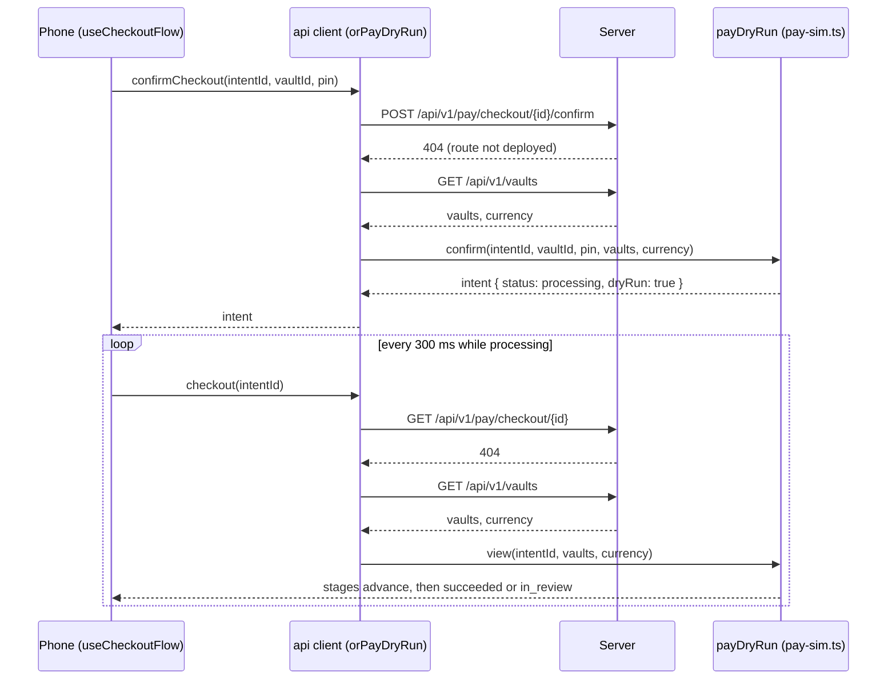

# Pay with Vaultwise

> A merchant checkout paid straight from a matching vault, with the bill checked as you pay instead of a proof upload later.

**Status:** Practice-simulated (phone only; the server has no `/pay` routes yet) · **Switch:** none. The phone falls back to an on-device dry run whenever the server answers 404 on `/pay/*`.

## What it does

- Opens a checkout from a scanned QR code, a "Waiting for you" card, a typed merchant code, or a merchant link (`vaultwise://pay/<intentId>`).
- Shows the verified merchant, the invoice line items, the amount, a zero fee, and which vault pays.
- Picks the eligible vault with the most money available. Lists the other vaults as disabled, with the reason.
- Asks for press-and-hold, then Face ID or fingerprint, or the PIN as a fallback.
- Follows the payment through six check stages, then shows Paid, In review, Declined, Expired or Cancelled.
- In **Practice**, moves money in the practice vaults (pay, or hold then pay after a simulated review).
- In a **live session**, runs a **dry run** against the customer's real vaults: balances are checked, nothing is paid or held.

## How it works

The build plan (linked at the top of [pay-types.ts](../../mobile/src/lib/api/pay-types.ts)) puts the server's `/api/v1/pay/*` routes in its Phase 1, which is not built. Until then the phone simulates the checkout with [pay-sim.ts](../../mobile/src/lib/api/pay-sim.ts). The same three sample checkouts run in two places:

| Mode | Entry point | Vaults used | Money moves? |
|---|---|---|---|
| Practice (on-device simulator) | `practiceCheckouts(ledger, currency)` in [demo/settle.ts](../../mobile/src/lib/api/demo/settle.ts) | practice vaults in `S.vaults` | Yes: `pay`, `hold`, `release` on the simulator ledger |
| Live session, `/pay` missing | `payDryRun` via `orPayDryRun()` in [client.ts](../../mobile/src/lib/api/client.ts) | the customer's real vaults, fetched fresh from `GET /vaults` | No. Every view is marked `dryRun: true` |

### The dry run in a live session

`orPayDryRun(call, dryRun)` in [client.ts](../../mobile/src/lib/api/client.ts) first tries the real route. If it throws `ApiError` with status 404, it fetches `GET /vaults` and hands the vaults and wallet currency to the dry run. Any other error is re-thrown.

- `checkout(intentId)` tries `GET /pay/checkout/{id}`, then `payDryRun.view()`.
- `confirmCheckout(intentId, vaultId, pin)` tries `POST /pay/checkout/{id}/confirm`, then `payDryRun.confirm()`.
- `payIntents()` never calls a `/pay` route, because there is no listing route. It fetches `GET /vaults` and always returns the dry run's list.
- `reset()` (Settings → Delete account) also calls `payDryRun.reset()`.

### Confirming a checkout

1. `useCheckoutFlow()` ([useCheckoutFlow.ts](../../mobile/src/features/pay/checkout/useCheckoutFlow.ts)) loads the intent with `useCheckout()`, which polls every 300 ms while the status is `processing`.
2. The review step shows merchant, invoice, paying vault and breakdown. The hold-to-pay button is the deliberate friction.
3. For a simulated intent (Practice, or `intent.simulated`), a passed biometric check submits `PRACTICE_PIN` ("1234"). Otherwise the PIN step opens. A real checkout always asks for the PIN.
4. `startPayment()` in pay-sim.ts checks, in order: still `requires_customer` (409), not expired (409), PIN equals `PRACTICE_PIN` (403), vault covers the bill's category (400), vault has enough available (400). Then the status becomes `processing`.
5. `advanceIntent()` moves the intent on once the stage timers have run (1,550 ms in total). A `succeeded` outcome pays from the vault in Practice. An `in_review` outcome holds the money in Practice, and after 90 s the simulated reviewer approves it: the hold is released and the payment made. In a dry run, nothing moves and `in_review` stays `in_review`.
6. The phone maps errors: 401/403 opens the PIN step, 409 refetches, anything else shows "Payment failed".

### Merchant links and pending checkouts

- [mobile/src/app/+native-intent.ts](../../mobile/src/app/+native-intent.ts) catches links from outside the app (native only). For a pay link it stores the id with `setPendingCheckout()` and returns Home on launch or stays put later. It never routes the link itself, because the app may be locked or onboarding. A pay link with an invalid id is dropped. Other links pass through.
- [mobile/src/lib/pending-checkout.ts](../../mobile/src/lib/pending-checkout.ts) holds the latest waiting id in memory. `takePendingCheckout()` returns it and clears it.
- The root layout ([_layout.tsx](../../mobile/src/app/_layout.tsx)) watches `usePendingCheckout()` and pushes `/checkout/[intentId]` once the person is in the app.
- [mobile/src/app/pay/[intentId].tsx](../../mobile/src/app/pay/%5BintentId%5D.tsx) covers the web preview and in-app links: it validates the id and redirects to the checkout, or dismisses to Home.

## Where the code is

### Server

None. There are no `/api/v1/pay` routes, tables or library code. The dry run reads `GET /api/v1/vaults` only.

### Web app

None.

### Phone app

| File | What it holds | Key exports |
|---|---|---|
| [mobile/src/lib/api/pay-types.ts](../../mobile/src/lib/api/pay-types.ts) | The intent contract | `PaymentIntent`, `IntentStatus` (`requires_customer`, `processing`, `in_review`, `succeeded`, `declined`, `expired`, `cancelled`) |
| [mobile/src/lib/api/pay-sim.ts](../../mobile/src/lib/api/pay-sim.ts) | The on-device simulator | `practiceCheckouts()` Practice store over a ledger, `payDryRun` live dry run (`view()`, `confirm()`, `list()`, `reset()`), `PayLedger` interface |
| [mobile/src/lib/api/client.ts](../../mobile/src/lib/api/client.ts) | Live client with the 404 fallback | `orPayDryRun()` (internal), `api.checkout()`, `api.confirmCheckout()`, `api.payIntents()` |
| [mobile/src/lib/api/demo/settle.ts](../../mobile/src/lib/api/demo/settle.ts) | Practice ledger adapter | `checkouts` Practice store, `settleDue()` catches proofs and payments up before reads |
| [mobile/src/lib/api/demo/index.ts](../../mobile/src/lib/api/demo/index.ts) | Practice API | `demo.checkout()`, `demo.confirmCheckout()`, `demo.payIntents()` |
| [mobile/src/lib/api/hooks.ts](../../mobile/src/lib/api/hooks.ts) | Queries | `useCheckout()` polls while processing, `usePayIntents()` |
| [mobile/src/lib/pending-checkout.ts](../../mobile/src/lib/pending-checkout.ts) | Link that arrived before the app could open it | `setPendingCheckout()`, `takePendingCheckout()`, `usePendingCheckout()` |
| [mobile/src/app/+native-intent.ts](../../mobile/src/app/+native-intent.ts) | Expo Router system-link hook | `redirectSystemPath()` keeps pay link ids, drops bad ones |
| [mobile/src/features/pay/intent-link.ts](../../mobile/src/features/pay/intent-link.ts) | Code and link parsing | `parseIntentId()` link or raw id to a safe id, `resolveMerchantCode()` code to newest checkout, `PRACTICE_MERCHANT_CODES` |
| [mobile/src/features/pay/PayScreen.tsx](../../mobile/src/features/pay/PayScreen.tsx) | Pay tab root, scanner first | `PayScreen` |
| [mobile/src/features/pay/scanner/](../../mobile/src/features/pay/scanner/usePayScanner.ts) | Camera, permission and QR handling | `usePayScanner()` ignores repeats for 2.5 s, `ScannerArea`, `Viewfinder` |
| [mobile/src/features/pay/PendingCheckouts.tsx](../../mobile/src/features/pay/PendingCheckouts.tsx) | "Waiting for you" list | `PendingCheckouts` unexpired `requires_customer` intents |
| [mobile/src/features/pay/MerchantCodeEntry.tsx](../../mobile/src/features/pay/MerchantCodeEntry.tsx) | Typed code fallback | `MerchantCodeEntry` |
| [mobile/src/features/pay/checkout/CheckoutScreen.tsx](../../mobile/src/features/pay/checkout/CheckoutScreen.tsx) | Picks the view for the intent's state | `CheckoutScreen` |
| [mobile/src/features/pay/checkout/useCheckoutFlow.ts](../../mobile/src/features/pay/checkout/useCheckoutFlow.ts) | Checkout state machine | `useCheckoutFlow()` phases `review`, `authenticating`, `pin`, `submitting`, `failed` |
| [mobile/src/features/pay/checkout/outcome-table.ts](../../mobile/src/features/pay/checkout/outcome-table.ts) | Per-status screen, haptic and decision step | `outcomeOf()` unknown status treated as expired |
| [mobile/src/features/pay/checkout/stages.ts](../../mobile/src/features/pay/checkout/stages.ts) | Stage names in plain words | `checkoutSteps()` |
| [mobile/src/features/pay/checkout/vaults.ts](../../mobile/src/features/pay/checkout/vaults.ts) | Vault choice | `selectedVault()` most available, `vaultOptions()` with disabled reasons, `remainingAfter()`, `payingVault()` |
| [mobile/src/features/pay/checkout/](../../mobile/src/features/pay/checkout/ReviewStep.tsx) (views) | Review, PIN, processing and outcomes | `ReviewStep`, `PinStep`, `Processing`, `Paid`, `InReview`, `Declined`, `Expired`, `Cancelled`, `Unavailable`, `PaymentFailed`, `Breakdown`, `PayFromCard`, `VaultPicker`, `MerchantHeader`, `InvoiceDisclosure` |
| [mobile/src/app/(tabs)/pay.tsx](../../mobile/src/app/%28tabs%29/pay.tsx), [checkout/[intentId].tsx](../../mobile/src/app/checkout/%5BintentId%5D.tsx), [pay/[intentId].tsx](../../mobile/src/app/pay/%5BintentId%5D.tsx) | Routes: Pay tab, checkout modal, link redirect | default route components |

## API endpoints

None exist on the server. The phone expects these once Phase 1 ships:

| Method | Path | Who can call | Purpose |
|---|---|---|---|
| GET | `/api/v1/pay/checkout/{intentId}` | Customer (not built) | Load one intent with eligible vaults and stages |
| POST | `/api/v1/pay/checkout/{intentId}/confirm` | Customer (not built) | Body `{ vaultId, pin }`; start the payment |
| GET | `/api/v1/vaults` | Customer, read access (built) | Used by the dry run for fresh vault balances |

There is no listing route; `payIntents()` is always simulated.

## Data

- **Server tables:** none.
- **Phone storage:** none on disk at commit 012a9fc. The pending link id and the dry-run checkout store (module-level `dryRunStore`) live in memory and reset when the app restarts. The Practice checkout store is saved on the device by the Practice save ([plan 01](../plans/01-practice-data-saved.md)).
- **Query keys:** `["checkout", intentId]` and `["pay-intents"]`, both in `MONEY_QUERIES`.

## Rules and limits

| Rule | Value | Where |
|---|---|---|
| Sample checkouts | City General Hospital (health, succeeds), Westfield College Bookstore (education, succeeds), Greenleaf Pharmacy (health, goes to review) | `makeIntents()` |
| Sample pricing | written in USD, scaled by a per-currency table (USD 1, EUR 0.95, GBP 0.8, SGD 1.3, INR 80, CAD 1.35, AUD 1.5, AED 3.67) | `CURRENCY_SCALE` in pay-sim.ts |
| Link lifetime | 1 day from creation | `makeIntents()` |
| Refill | a new batch with new ids only when nothing is waiting or processing | `intentStore().refill()` |
| Merchant codes | `CITYGEN`, `WESTFIELD`, `GREENLEAF`; open that merchant's newest waiting checkout | `MERCHANT_CODES` |
| Accepted ids | raw `pi_` + 2–64 of `[A-Za-z0-9_-]`; ids from links 3–64 of the same set | `RAW_ID`, `SAFE_ID` |
| Stage timings | intake 250 ms, forensics skipped, extract 300, classify 450, tamper 300, decision 250 (1,550 ms total) | `PAY_STAGES` |
| Practice review | 90 s, then approved | `PAY_REVIEW_MS` |
| PIN | the simulator accepts only `PRACTICE_PIN` = "1234", in Practice and in the live dry run | `startPayment()`, [practice.ts](../../mobile/src/lib/api/practice.ts) |
| Vault eligibility | `covers(vault, category)`: same rules category, and never a vault with a custom rule | [categories.ts](../../mobile/src/lib/categories.ts) |
| Fee | always 0, shown as "no fees in Practice" | [Breakdown.tsx](../../mobile/src/features/pay/checkout/Breakdown.tsx) |
| Haptics | `irreversible.commit` on confirm (not on decline); `pay.success`, `proof.review` or `error` on the outcome, once, only when confirmed on this screen | `useCheckoutFlow()`, `useCheckoutOutcomeHaptics()` |

## Configuration

No env vars or flags. Practice versus live comes from the connection mode (`isPracticeMode()` in [practice.ts](../../mobile/src/lib/api/practice.ts)). The dry run turns on by itself when `/pay` answers 404.

## Tests

None. Neither the server nor the phone has tests for this feature. pay-sim.ts is mostly pure (it reads `Date.now()`), so it is a good candidate.

## Known limits and open issues

- The server side does not exist. Everything here is simulated on the phone.
- In a live session the dry run asks for the Practice PIN ("1234"), not the customer's real PIN. The PIN step shows it.
- `orPayDryRun()` treats every 404 as "routes not deployed". Once `/pay` exists, a 404 for an unknown intent would fall back to the sample checkouts instead of saying "not found". Not confirmed how Phase 1 will signal this.
- In a dry run, a payment that goes to review stays in review forever.
- The fee line says "no fees in Practice" in every mode.
- The pending link is kept in memory only.
- Universal links (`https://…/pay/<id>`) are parsed but not set up in [app.json](../../mobile/app.json), which declares only the `vaultwise` scheme.

## Maintainability notes

- **Good seam: `PayLedger`.** The simulator talks to money only through `vaults()`, `hold()`, `release()` and `pay()`. Practice plugs in the simulator state; the dry run passes `null`. This is a clean dependency inversion.
- **Good seam: the outcome table.** [outcome-table.ts](../../mobile/src/features/pay/checkout/outcome-table.ts) keeps screen, haptic and decision text per status in one record, so a new status is one entry (OCP).
- **Coupling: 404 sniffing.** The fallback decision in [client.ts:47-56](../../mobile/src/lib/api/client.ts) depends on an HTTP status rather than a capability flag or error code.
- **Duplication: currency scale.** `CURRENCY_SCALE` in [pay-sim.ts:35](../../mobile/src/lib/api/pay-sim.ts) copies the server table in [src/lib/shared.ts:72](../../src/lib/shared.ts). A change on one side will not reach the other.
- **Global state.** `dryRunStore` is a module-level singleton, which makes the dry run hard to test in isolation.
- **Contract drift risk.** `PaymentIntent` is defined only on the phone. When the server is built, a shared schema (or generated types) would stop the two sides drifting.
- **`useCheckoutFlow()` size.** It holds loading, caching rules, vault choice, biometrics, PIN retries, submit and navigation (about 200 lines). Splitting the auth step from the submit step would make each easier to test.
