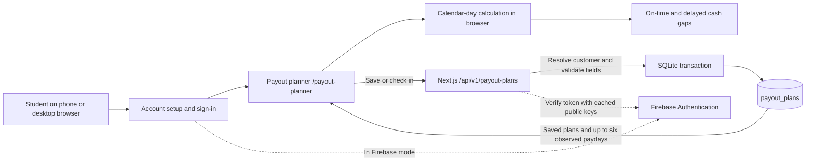

# How the payout planner works

A student enters the cash they can spend today, their usual daily costs (travel, food) and bills with due dates. Before they save anything, the browser shows whether that cash will last until the expected payout, and what changes if it arrives late. When the money arrives, they can reopen the saved plan and compare the deposit with their original expectation. The inputs and outcome are self-reported. The planner has no connection to their bank.

**Status:** built for the web app (27 November 2026); not in the phone app yet · **Plan:** [plan 10](../plans/10-payout-planner.md)

## Why it exists

Vaults lock money for a goal, but a student also has to get through the month on what's left. Their money arrives in lumps (an allowance, a stipend, part-time pay), often later than expected, with daily costs and bills in between. When it runs out, they raid the vault or borrow. The planner shows, before that happens, how much they can spend each day and which bill they'd miss if the money is late. It also tells them how much they can safely lock away.

It's plain arithmetic on figures the student types, so anyone can check the answer by hand, and it uses no AI and moves no money. The reasons behind each design choice are in [plan 10](../plans/10-payout-planner.md#design-decisions-and-why).

## Architecture walkthrough

1. The browser displays the form, computes two forecasts from the same inputs, and sends a request when the user saves or checks in. A forecast costs zero model calls and zero payment-provider calls. An already loaded form can recompute without a network request. Opening the account and saving or retrieving a plan require the server. [Web screen](../../src/app/payout-planner/page.tsx) · [Calculation and validation](../../src/lib/payout-planner.ts)
2. The server accepts only a customer's own requests. A signed-in account can plan while its ID check is pending. Local prototype mode uses one shared practice customer. Each input is validated again on the server. Unexpected errors get a support ID, and failed writes leave the previous data intact. [Route handler](../../src/app/api/v1/payout-plans/route.ts) · [Session resolution](../../src/lib/auth/session.ts)
3. SQLite stores one row per saved plan. A transaction keeps the save and its outcome consistent, even if two requests arrive together. The server derives the actual-vs-expected comparison when it reads the record. The user's account export includes every saved plan. Closing the account clears its planning records from the active database. [Storage implementation](../../src/lib/payout-plan-store.ts) · [Table definition](../reference/data-model.md#payout_plans)

## Calculate one example by hand

The fictional India example starts with ₹2,000. A ₹4,000 payout is expected after five days. Daily costs are ₹100 per calendar day, a ₹1,000 hostel mess fee falls due two days after the start and a ₹500 phone repair falls on the expected payday.

| Question | On time | Two days late |
|---|---:|---:|
| Days before payout | 5 | 7 |
| Daily costs before payout | ₹500 | ₹700 |
| Bills before payout | ₹1,000 | ₹1,500 |
| Opening cash less those costs | ₹500 | −₹200 |
| Flexible spending per day | ₹100 | ₹0 |

The payout is assumed to arrive at the start of its day. On time, the phone repair falls outside the interval. With a delay, the user has ₹400 left after that day's daily cost when the ₹500 repair falls due. That repair creates the first ₹100 gap. The next day's work takes the total gap to ₹200. Changing the expected payout amount alone cannot cover an earlier bill.

The algorithm visits each date from the start through the day before arrival. It deducts the daily cost first, then that day's bills in entry order. It keeps the first expense that makes the balance negative. Daily flexible spending equals the positive balance left after all included costs, divided by the number of days and rounded down to the nearest minor unit. A negative closing balance becomes the total shortfall. Actual dates and amounts are compared with the original expectation. Two days late and ₹300 less than a ₹4,000 expectation read as a day difference of +2 and an amount difference of −₹300.

The bounds are 1–90 days until the expected payout, 0–14 extra days and up to 24 bills. Calendar dates avoid daylight-saving shifts and each account uses a single currency. Exact shift-by-shift expenses, extra income during the interval, and expenses on or after the scenario's payday are outside the calculation. A zero gap depends on the expenses the user entered. [Regression tests](../../tests/payout-plans.test.ts)

## Use recorded delays in a new plan

After a user records a real payout, the next plan can use the longest delay among their six most recent eligible paydays. For example, three eligible payouts arriving two days late, one day early and on time give a sample of three, one late arrival and a longest delay of two days. Applying it changes the delay being tested. It gives the user a scenario they have actually experienced. It gives no probability for the next payout.

Only completed check-ins for the same account and currency qualify. The server's local save date must precede the expected payday and fall on or before the actual arrival. The calculation excludes labelled examples. If several saved plans share an expected payday, the earliest eligible save counts once. Paydays are sorted by actual arrival, with the expected date breaking ties. The example above uses invented figures to explain the method.

For a plan starting in the past, the summary uses only outcomes already recorded before that local day began. Current and future start dates use information available now. The recorded maximum can exceed 14 days. In that case the interface can test up to its 14-day limit while displaying the observed delay in full. Early and on-time payments add to the sample with zero late days. [Selection and aggregation](../../src/lib/payout-plan-store.ts) · [Regression tests](../../tests/payout-plans.test.ts)

## Screens and API calls

| Feature | Data path and responsibility |
|---|---|
| Sign-in and setup | Firebase mode signs the person in, `GET /me` resolves the account, and `POST /onboarding` creates the linked customer profile. |
| Create a plan or load an example | The browser collects dates and amounts. An example stays labelled if saved. Own plans start from an empty form. |
| Compare possible delays | The shared calculation computes both scenarios in the browser. When the user changes the start date, the screen can request their eligible past delays and apply one as a stress test. |
| Save a plan | `POST /payout-plans` saves validated inputs under a client-generated UUID. A retry with identical inputs returns the same record. A different payload under the same ID returns 409. |
| History and check-in | `GET /payout-plans` lists the customer's most recent 30 plans and an account-specific summary of prior delays. `PATCH /payout-plans` records one actual payout. An identical retry is safe, and a conflicting second outcome returns 409. |
| Download or close the account | `GET /me/export` includes the complete plan history. `POST /reset` deletes the signed-in customer's planner rows on closure or wipes the local practice database in prototype mode. |

API paths in this table are relative to `/api/v1`. The complete platform inventory, including vaults, proof checks, wallet, emergency access, investing, identity and operations, is in the [feature catalogue](../README.md#features) and [HTTP reference](../reference/api.md#routes).

## Cost and failure of dependencies

| Service | What to budget and what the user experiences |
|---|---|
| Node server and SQLite storage | A local demonstration uses the existing computer. For hosted use, allocate compute time, disk, backups and network to active users. A server outage prevents account access and saving. A failed save can be retried with the same ID. [Hosting pricing](https://aws.amazon.com/ec2/pricing/on-demand/) · [Backup and restore](../../deploy/restore.md) |
| Firebase | Email/password authentication costs depend on the project's plan and usage tier. A six-person pilot is within the published no-cost usage threshold for email/password on Identity Platform if the rest of the project also fits. When the server cannot verify the token, it denies account access. [Firebase rates](https://firebase.google.com/pricing) · [Token verification](../../src/lib/auth/verify.ts) |
| Groq | The planner issues zero inference requests. Consented document reads and assistant queries elsewhere in the app depend on model-specific input and output token charges. A failed document read can be routed to a human reviewer. [Model rates](https://console.groq.com/docs/models) · [Document reader](../../src/lib/verification/stages/ai-read.ts) |
| Twilio and Expo Push | The planner sends zero SMS or push messages. Optional account-security SMS is charged per segment, with country and sender affecting rates. A provider refusal shows a send error. Expo's push service has no sending fee, and an in-app alert remains available if push delivery fails. [Twilio India](https://www.twilio.com/en-us/sms/pricing/in) · [Expo Push FAQ](https://docs.expo.dev/push-notifications/faq/) |
| Setu and market prices | The planner requests zero ID checks and zero quotes. Budget live Setu checks from the team's provider agreement before enabling them. An unavailable provider can return a retryable error. In the investing simulator, a failed price request falls back to cached or synthetic data with its source labelled. Commercial data licensing is an open cost if this separate investing feature enters a paid product. [KYC adapter](../../src/lib/kyc/checks/providers/setu.ts) · [Price fallback](../../src/lib/invest/market.ts) |

For a founder walkthrough, trace the ₹500 repair from the input to the first shortfall, show where the account ID comes from on save, and explain what the user would see after a failed save or a duplicate check-in. The tests exercise leap day, a daylight-saving boundary, zero cash at the boundary, account isolation, payout differences and conflicting retries.
