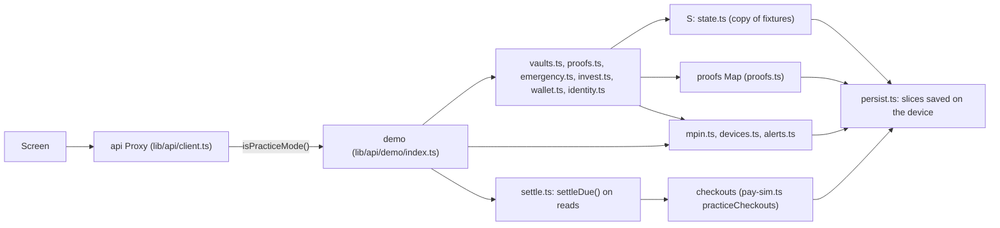

# Practice mode (on-device simulator)

> The phone app's built-in copy of the Vaultwise API: it answers every call on the device, from a
> snapshot of real server responses, and simulates the parts that move.

**Status/Switch:** On whenever the connection mode is `"demo"`: when the person picks **Demo data**
on **Profile → Data source**, when **Auto** can't reach the server at launch, and always in
Practice-only builds (`apk`, `production` and the tester site; see
[app-structure.md](../mobile/app-structure.md#build-profiles-and-practice_only)). Code checks it
with `isPracticeMode()` / `usePracticeMode()` from
[`mobile/src/lib/api/practice.ts`](../../mobile/src/lib/api/practice.ts). Written against commit
`012a9fc` (2026-11-22) and updated for the Practice save
([plan 01](../plans/01-practice-data-saved.md)): Practice data is now saved on the device and
survives a restart. Updated again for the phone side of plans 03, 04, 06 and 07: the MPIN, the
sensitive slices, devices, alerts, texted codes and the ID check steps.

## What it does

- Implements the same `Api` as the live client, method for method, so screens don't know which
  source they talk to.
- Starts from the JSON snapshot in [`mobile/src/data/fixtures`](../../mobile/src/data/fixtures):
  one onboarded person (Alex Morgan, India, INR), six vaults, a bank balance, a wallet, a limits
  overview, an emergency history, investments and activity.
- Simulates what changes: creating and editing vaults, deposits, withdrawals with proof, the
  six-stage proof check, appeals, emergency money with the Tier 2 safety pause, limits, Core
  investing, the wallet, ID checks (the photo check and the PAN, DigiLocker and bank steps) and
  account recovery, Pay with Vaultwise checkouts, the MPIN and its lock, registered devices and the
  new-device cap, texted codes, and the alerts inbox.
- Mirrors the server's rules where the UI depends on them (see [Rules it mirrors](#rules-it-mirrors)).
- Sends nothing off the phone. The AI consent question is never asked in Practice
  (`features/ai-consent/ask.ts`), push is never registered and no text is sent.
- Checks the Practice MPIN `246810` (or the one the person changed it to) on every money move out,
  with the server's lock.

## How it works

1. **Routing.** The `api` Proxy in [`client.ts`](../../mobile/src/lib/api/client.ts) returns the
   `demo` method instead of the live one while the mode is `"demo"`. Query keys start with the
   mode, so Practice and live caches never mix ([data-layer.md](../mobile/data-layer.md#keysts-and-hooksts-react-query)).
2. **State.** [`state.ts`](../../mobile/src/lib/api/demo/state.ts) builds `S` from the fixtures with
   `fresh()`. Modules change `S` in place. `resetState()` replaces its fields with
   `Object.assign`, so every module keeps the same object.
3. **Latency.** Most methods `await wait(ms)` (200 to 2200 ms) so loading states show as they would
   live.
4. **Time-based results, settled on read.** Nothing runs on a timer. A proof, payment, Tier 2
   release or pretend reviewer stores a start time; the outcome is worked out from the clock the
   next time something reads it. `settleDue()` (proofs and checkouts), `refreshEmergency()` and
   `settleIdentity()` run at the start of the reads that show balances or statuses. So a result
   lands whether or not anyone is watching, as on the server.
5. **Money moves through ledger helpers.** `record()` writes a movement to the vault's history,
   the activity feed and the dashboard's recent list (kept to 12). `journal()` writes a
   double-entry journal. `recompute(v)` refreshes `available`, `progress` and `monthlyNeeded`.
6. **Errors.** Refusals throw `ApiError` with the status, and often the `code`, the server would
   use, so screens handle Practice and live failures the same way. MPIN, device and code refusals
   also carry the server's extra fields (`triesLeft`, `lockedUntil`, `trustableAt`, `retryAt`) in
   `ApiError.data`.
7. **Saved after every call.** `demo` is wrapped in `savingAfterEachCall()` (`persist.ts`), so
   each call, reads included, schedules a save.

## Where the code is

All simulator files are in [`mobile/src/lib/api/demo/`](../../mobile/src/lib/api/demo).

| File | What it holds | Key exports |
|---|---|---|
| [`index.ts`](../../mobile/src/lib/api/demo/index.ts) | The `demo` object (`satisfies Api`), wrapped in `savingAfterEachCall()`. Spreads the area modules (wallet, identity, devices, alerts, emergency, invest) and adds `/me` (with `mpin`, `phone` and `device`), onboarding (updates name and email only), dashboard, activity, accounts, insight, badges, region (`IN`), samples, a keyword-based assistant reply streamed word by word, checkout calls, `changeMpin`, and `reset` (every slice back to the sample data; the `pin` is accepted and ignored). | `demo` |
| [`persist.ts`](../../mobile/src/lib/api/demo/persist.ts) | Saving and loading slices on the device; sensitive slices in secure storage. | `registerPracticeSlice`, `PracticeSlice`, `resetPracticeSlices`, `restorePracticeData`, `savePracticeSoon`, `savingAfterEachCall` |
| [`state.ts`](../../mobile/src/lib/api/demo/state.ts) | The live state `S` and shared helpers. Registers the `state` slice and the sensitive `person` slice. | `S`, `resetState`, `record`, `journal`, `recompute`, `findVault`, `withdrawnToday`, `applyEmergencyCap`, `limitsView`, `PENDING_REVIEW`, `clone`, `wait`, `newId`, `toMinor`, `DAY`, `PERIOD`, `currency` |
| [`mpin.ts`](../../mobile/src/lib/api/demo/mpin.ts) | The simulator's MPIN, wrong-try count and lock, mirroring `src/lib/mpin`. The sensitive `mpin` slice. | `requirePracticeMpin`, `changePracticeMpin`, `resetPracticeMpin`, `practiceMpinStatus` |
| [`devices.ts`](../../mobile/src/lib/api/demo/devices.ts) | Devices, the new-device cap, texted codes, phone number and MPIN reset, mirroring `src/lib/devices` and `src/lib/otp`. The sensitive `devices` slice. | `devicesDemo`, `assertPracticeDeviceCap`, `practiceSecurityMe`, `practiceDeviceTools`, `PRACTICE_OTP` |
| [`alerts.ts`](../../mobile/src/lib/api/demo/alerts.ts) | The alerts inbox, mirroring `GET /alerts` and `POST /alerts/read`. The `alerts` slice. Push calls do nothing. | `alertsDemo`, `practiceAlert` |
| [`vaults.ts`](../../mobile/src/lib/api/demo/vaults.ts) | Vault list and detail (with a balance series), create, update, deposit from the bank, withdraw, cancel, upload a bill, limits and limit changes. | `vaultsApi` |
| [`proofs.ts`](../../mobile/src/lib/api/demo/proofs.ts) | The proof pipeline: six timed stages, outcome from the file name, settle, appeal. Seeds the snapshot vault's three past proofs. | `submitWithdrawalProof`, `submitReceiptProof`, `settleProofs`, `proofById`, `appealProof`, `resetProofs` |
| [`emergency.ts`](../../mobile/src/lib/api/demo/emergency.ts) | Emergency overview, plan preview with guardrails, request, receipt upload, Tier 2 release. | `emergencyApi`, `refreshEmergency` |
| [`invest.ts`](../../mobile/src/lib/api/demo/invest.ts) | Core investing: the snapshot plus this session's plan change and buys. Portfolio and Satellite are static. | `investApi` |
| [`wallet.ts`](../../mobile/src/lib/api/demo/wallet.ts) | Wallet view (payday, safe to spend today, daily limit), top-up, move to a vault, pay someone, cash out, settings. | `walletDemo` |
| [`wallet-state.ts`](../../mobile/src/lib/api/demo/wallet-state.ts) | The wallet's starting state: the last four paydays and everyday spending since, dated relative to now. Imports nothing from `state.ts`. | `freshWallet`, `WalletState` |
| [`identity.ts`](../../mobile/src/lib/api/demo/identity.ts) | ID check (photo and steps), Find my account, password reset, recovery request, and the read-only rule. | `identityDemo`, `withIdentity`, `assertPracticeCanMove`, `PRACTICE_REVIEW_MS` |
| [`identity-state.ts`](../../mobile/src/lib/api/demo/identity-state.ts) | The starting identity: verified passport ending 4821, no recovery request, all three steps to do, no open tries. | `freshIdentity`, `freshSteps`, `freshStep`, `DemoIdentity`, `DemoStep`, `DemoOpenTry` |
| [`settle.ts`](../../mobile/src/lib/api/demo/settle.ts) | The ledger Pay with Vaultwise uses in Practice, the Practice checkouts, and `settleDue`. | `checkouts`, `settleDue` |
| [`../pay-sim.ts`](../../mobile/src/lib/api/pay-sim.ts) | Sample merchant checkouts, shared by Practice (`practiceCheckouts`, money moves) and live sessions (`payDryRun`, nothing moves). | `practiceCheckouts`, `payDryRun`, `PayLedger` |
| [`../samples.ts`](../../mobile/src/lib/api/samples.ts) | The seven sample bills and their bundled images (`mobile/assets/samples/`). | `DEMO_SAMPLES`, `sampleSource` |
| [`../practice.ts`](../../mobile/src/lib/api/practice.ts) | What features may import about Practice. | `PRACTICE_PIN` (`"246810"`), `isPracticeMode`, `usePracticeMode`, `restorePracticeData` |
| [`../client.ts`](../../mobile/src/lib/api/client.ts) | Re-exports the Practice device tools, so the Your devices screen doesn't import the simulator. | `practiceDeviceTools` |

## Rules it mirrors

"Checked" means the matching server code was found; "comment" means the simulator's comment says
so but the server side was not checked line by line.

| Rule | Practice code | Server code | Checked |
|---|---|---|---|
| One bill per withdrawal; a second upload is refused (409). | `vaults.ts` `uploadProof` | `src/app/api/v1/vaults/[id]/proofs/route.ts` | checked |
| Only a request still waiting for proof can be cancelled (409). | `vaults.ts` `cancelWithdrawal` | `src/lib/vaults.ts` | checked |
| Single-withdrawal and daily-withdrawal limits, with the same "past your daily limit" message. | `vaults.ts` `withdraw` | `src/lib/limits.ts` | checked |
| "Today" starts at local midnight and skips denied, cancelled and expired requests. | `state.ts` `withdrawnToday` | not checked | comment |
| A limit can't go above the market maximum (400), and loosening a limit is allowed once (409 after that). | `vaults.ts` `setLimits` | `src/lib/limits.ts` (once per calendar month) | checked |
| The emergency cap is the lower of the market cap and the personal monthly limit, and a new limit applies at once. | `state.ts` `applyEmergencyCap` | `src/lib/emergency.ts` | checked |
| Emergency money: Tier 1 (Health) vaults first, then Tier 2 vaults, after the PIN and a `tier2HoldSeconds` pause (90 s in the fixture). Weekly request limit (3). Attestation required. | `emergency.ts` | `src/lib/emergency.ts` | checked |
| Only a declined check can be appealed, once; the money is held again meanwhile. | `proofs.ts` `appealProof` | `src/lib/verification/pipeline.ts` `appeal` | checked (409 rule) |
| A custom vault with its own rule sends every bill to a person. | `proofs.ts` `outcomeFor`, `lib/categories.ts` `covers` | not checked | comment |
| Wallet payday: last income plus the median gap between incomes; 30 days with no income. | `wallet.ts` `payday` | `src/lib/wallet/plan.ts` | checked |
| Wallet daily limit: lower or turn on any time; raise or turn off once per 30 days. | `wallet.ts` `walletSettings` | `src/lib/wallet/plan.ts`, `moves.ts` | checked |
| Wallet money moves need a verified ID (`kyc_required`). | `wallet.ts` `assertCanMove` | not checked | comment |
| Auto-save dates step weekly, biweekly or monthly. | `wallet.ts` `nextRun` | `src/lib/vaults.ts` `nextRun` | checked |
| Sample checkout prices are scaled per currency. | `pay-sim.ts` `CURRENCY_SCALE` | `src/lib/shared.ts` `CURRENCY_SCALE` (same values) | checked |
| ID number formats per market. | `lib/api/identity-ids.ts` | `src/lib/kyc/ids.ts` | comment |
| No money moves while a recovery request waits for a person (403 `recovery_restricted`). | `identity.ts` `assertPracticeCanMove` | not checked | comment |
| A Core buy is paid from the bank and refused when the bank is short. | `invest.ts` `buyCore` | not checked | comment |
| MPIN policy: 6 digits, no repeated digit, no straight run (with 9 to 0 wrapping), not one of 20 common PINs. | `features/mpin/policy.ts` `checkNewMpin` (shared with screens) | `src/lib/mpin/policy.ts` | checked (list and order) |
| MPIN lock: every 5th wrong try locks for 1 minute, then 5, 30 minutes, then 24 hours; 401 `mpin_required`, 403 `mpin_wrong` with `triesLeft`, 423 `mpin_locked` with `lockedUntil`. | `mpin.ts` `requirePracticeMpin` | `src/lib/mpin/attempts.ts`, `verify.ts` | checked |
| New-device cap: USD 50 scaled by currency and rounded to a whole unit, per move out, checked before the MPIN, for 24 hours after first seen, unless trusted; 403 `device_untrusted` with `trustableAt`. Trusted means trusted with a code and the MPIN, or 24 hours after first seen, never when signed out; a device first seen after a sign-out never trusts itself. | `devices.ts` `assertPracticeDeviceCap`, `practiceTrusted`, `untrustedCapFor` | `src/lib/devices/rules.ts` (`isTrusted`, `untrustedMoveCap`), `service.ts` | checked |
| Codes: 6 digits, 5 minutes, 3 tries, 5 sends an hour, newer code replaces older, single-use 10-minute tokens; an untrusted phone can't change the number or reset the MPIN. | `devices.ts` `devicesDemo` | `src/lib/otp/service.ts`, `src/lib/otp/config.ts` | checked |
| Phone number: keeping one needs the MPIN (`phone_change`; a wrong MPIN keeps the token); a number added or changed in the last 72 hours can't reset the MPIN (403 `phone_recently_changed` with `allowedAt`). Checks in the server's order: a trusted phone and the hold, then the number, then the send limits. | `devices.ts` | `src/app/api/v1/me/phone/route.ts`, `src/lib/otp/phone.ts` | comment |
| Trusting checks the MPIN, then the token; signing out checks the MPIN first and records the account's last sign-out. | `devices.ts` | `src/app/api/v1/devices/**`, `src/lib/devices/service.ts` | comment |
| Steps flow answers: sample PANs, Aadhaar ending 1234, IFSC `HDFC0000001` ending 4321; order and "already done" refusals. | `identity.ts` | `src/lib/kyc/checks/providers/test.ts`, `service.ts` | comment |

## Data

### Fixtures

| Fixture | Used by | For |
|---|---|---|
| `me.json` | `state.ts` | The person, rulebook, countries. `onboarded: true`. |
| `vaults.json` | `state.ts`, `wallet-state.ts` | The six vaults (Health, Education, Housing, Emergency, Retirement, Custom). |
| `vault-detail.json` | `state.ts`, `proofs.ts` | History and three past withdrawals (paid, denied, in review) for the Family Health Fund. |
| `dashboard.json` | `state.ts`, `index.ts` | Totals (bank, invested), recent items, dashboard layout. |
| `activity.json` | `state.ts`, `index.ts` | 40 journals for the activity feed. |
| `emergency.json` | `state.ts` | Caps, rules and one past request. |
| `limits.json` | `state.ts` | Limits, country bounds and the loosening quota. |
| `accounts.json` | `index.ts`, `wallet-state.ts` | Linked accounts; its income credit sets the payday. |
| `proof-view.json` | `proofs.ts` | The snapshot's emergency receipt proof (shown, not re-run; `practiceSnapshot`). |
| `invest-core.json`, `portfolio.json`, `invest-satellite.json` | `invest.ts` | Core holdings and plan, portfolio, Satellite. |
| `insight.json`, `badges.json` | `index.ts` | Static. |
| `emergency-preview.json`, `invest-profile.json` | nothing | Not imported at `012a9fc`. |

Fixture timestamps are absolute (for example the activity feed ends on 2026-10-06). Only the wallet
seed is dated relative to "now". No script to regenerate the fixtures was found; how they were
captured is not confirmed.

### Sample bills (proof uploads)

The outcome comes from the upload's **file name**, not its contents. `sampleUpload` names a sample
`<key>.jpg`, and `api.sampleUri` returns the bare key in Practice.

| Sample key | Category | Outcome |
|---|---|---|
| `medical-invoice`, `pharmacy-receipt` | health | Approved from a vault whose rules cover health (or the Emergency vault). |
| `tuition-invoice` | education | Approved from an Education vault. |
| `rent-receipt` | housing | Approved from a Housing vault. |
| `coffee-receipt` | other | Declined: purpose doesn't match. |
| `old-invoice` | health | Sent to a person (review) from a vault that covers health. |
| `tampered-invoice` | health | Declined: tamper check fails, in any vault. |

A sample from another category is declined with a reason ("This is a medical bill, and this vault
only covers housing costs."), except in the Emergency vault, which takes any bill. A custom vault
that follows its own rule (or borrows no template) sends every bill that isn't already declined to
a person. Any other file name, such as a real photo, is approved unless the vault follows its own
rule. Emergency receipts use the same file-name rules without a vault. The six stages take
4.1 s in total. An approved bill pays out and moves the money to the bank; a declined one releases
the hold; a review keeps it held.

### Sample merchant checkouts (Pay with Vaultwise)

Three checkouts, written in USD and scaled to the wallet currency (INR ×80):

| Merchant | Category | Total in INR | What happens |
|---|---|---|---|
| City General Hospital | health | ₹23,800.00 | Paid after 1.55 s of checks. |
| Westfield College Bookstore | education | ₹4,250.00 | Paid after 1.55 s of checks. |
| Greenleaf Pharmacy | health | ₹1,180.00 | Held for review, then paid by the pretend person 90 s later. |

Each link expires after a day. When none is left to pay or being paid, a fresh batch with new ids
is added.

### Practice MPIN 246810

- The simulator's MPIN starts as `PRACTICE_PIN` (`"246810"`, which passes the MPIN policy; the old
  `1234` is gone). `requirePracticeMpin()` checks it on every money move out: withdraw, limit
  raises, wallet spend, cash out, move and daily-limit raise or turn-off, emergency (every tier),
  Core buy, checkout confirm, trusting this phone and signing a device out. Wrong tries lock money
  moves like the server ([mpin.md](mpin.md#on-the-phone)).
- Change MPIN in Practice changes the simulator's MPIN (with the same policy) and the phone's
  unlock PIN. `/me` reports `mpin.practiceDefault` while it is still `246810`; MPIN screens show
  "Practice MPIN: 246810" only then. An MPIN typed for a Practice money move never becomes the
  unlock PIN (`mpinCheckedByServer()` is false in Practice).
- `pinVerifier()` in `features/account/pin-guard.ts` accepts `246810` when the phone has no PIN of
  its own.
- The payments shortcut (Face ID or fingerprint for payments) is live only: in Practice it reads as
  off ("Live only" in Settings) and is never offered, saved or read, so a Practice checkout takes the
  typed MPIN. A live dry-run checkout moves nothing and takes only `246810`.

### Devices, codes and alerts in Practice

- **One device**, "This phone", trusted since 30 days ago. **No phone number** at the start.
- **New-device cap:** while this phone is untrusted, withdraw, wallet spend, cash out and emergency
  refuse more than ₹4,000 per move (USD 50 × 80, rounded to a whole unit) with `device_untrusted`
  and `trustableAt`, until 24 hours after it was first seen. The cap is checked on the amount asked
  for, before the MPIN, as on the server. A phone first seen after a Practice sign-out never trusts
  itself (`trustableAt: null`): only Trust with a code.
- **Texted codes** are never sent. The code is always `123456` (`PRACTICE_OTP`) and comes back as
  `testCode`, so the code screen shows "Test mode code: 123456" with **Use this code**. The other
  rules match the server: 5 minutes, 3 tries, 5 sends an hour, single-use 10-minute tokens.
- **Phone number:** keeping it needs the MPIN after the code, and resetting the MPIN pauses for
  72 hours after the number was added or changed. The slice keeps only the masked number and a
  one-way key of the whole number (to tell the same number apart; proving it again doesn't restart
  the hold).
- **Alerts:** the inbox starts with one read "This phone is trusted" alert. Money moves out, limit
  raises, MPIN changes and resets, phone verification, trusting, signing out and new sign-ins add
  one (`practiceAlert()`). Nothing is pushed, and push registration does nothing. The alerts are in
  the plain bulk save, so their words never carry the phone number or a typed payee ("your verified
  number", "the payee"); `generaliseAlert()` rewords alerts from older saves as they load.
- **Not simulated:** the new-device limit (`/me` `registered: false`) and the 401 `signed_out` for
  sign-ins older than a device sign-out.

**Try it in Practice** controls (Practice only):

| Where | Control | What it does |
|---|---|---|
| Your devices | Pretend another phone signed in | Adds an untrusted iPhone or Android phone and a `new_device` alert, so Sign out can be tried |
| Your devices | Start this phone over as new | Makes this phone untrusted, first seen now, so the cap and Trust this phone can be tried. After signing the pretend phone out, it is a phone first seen after a sign-out: no 24-hour wait, only Trust with a code. |
| Any code step | Use this code | Types the Practice code `123456` |
| Verify your ID | Practice the check again | Runs the PAN, DigiLocker and bank steps again from the start |
| PAN step | Use the sample PAN | Types `ABCDE1234F` |
| Steps flow | Practice the photo check instead | Switches to the photo check, where **Use a sample ID** passes at once |
| Settings → Account | Start Practice over | Puts back the sample account (below) |

The device tools are outside the API, so `practiceDeviceTools` (re-exported from
`lib/api/client.ts`) saves the Practice data itself.

### Identity in Practice

The sample ID card (`sample-id.jpg`, from `features/kyc/sample.tsx`) passes the ID check at once.
Any other photo goes to a pretend person who approves it after 20 s (`PRACTICE_REVIEW_MS`). Find my
account always finds the Practice account with the email masked. Password resets say they were
`simulated`. A recovery request with the sample card is `read_only` (the first name only and a
masked email in `/me`, and money moves refused); with any other photo it is `after_approval`.
Both are approved after 20 s and can be cancelled. In builds that are not Practice-only, Settings
can open the sign-in and recovery screens as previews while on Practice data.

The ID check steps answer like the server's test provider: see
[identity.md](identity.md#on-the-phone). Verify your ID (and so the steps) is off in Practice-only
builds (`KYC_ENABLED`); it's reachable on Practice data in development and preview builds.

### Where the data lives, and reset

Each part of the simulator registers a **slice** with
[`demo/persist.ts`](../../mobile/src/lib/api/demo/persist.ts). `persist.ts` saves them at most every
500 ms after a call, and straight away when the app goes to the background. The root layout runs
`restorePracticeData()` before the connection check, so data comes back before any screen asks for
it. Slices load in the order they registered.

| Slice | Registered in | Holds | Stored |
|---|---|---|---|
| `state` | `state.ts` | `S`: vaults, histories, withdrawals, limits, emergency, wallet, identity (with the ID steps), activity. The person's name and email are replaced by the sample ones, and names typed on vault members by blanks. | Bulk: `vw.bulk.practice` (AsyncStorage on phones, localStorage on the web) |
| `person` | `state.ts` (after `state`, so it loads over it) | The typed name and email, and names typed on vault members | Secure: `vw.practice.person` |
| `proofs` | `proofs.ts` | Proof checks | Bulk |
| `checkouts` | `settle.ts` | Pay with Vaultwise checkouts | Bulk |
| `mpin` | `mpin.ts` | The simulator's MPIN, wrong tries, lock | Secure: `vw.practice.mpin` |
| `devices` | `devices.ts` | Devices (this phone plus up to 7 other signed-in ones), the last Practice sign-out, the masked phone number, a one-way key of the whole number and when it was added or changed | Secure: `vw.practice.devices` |
| `alerts` | `alerts.ts` | The inbox (at most 200) | Bulk |

- **Sensitive slices** (`sensitive: true`) are each saved on their own in the secure store as
  `{ format, data }` under `vw.practice.<key>`, never in the bulk save, which isn't encrypted.
  They go through the chunked secure helpers (`setSecureChunked()`), so a slice bigger than one
  Keychain entry (about 2 KB) still saves, and a write cut short reads as the old value. A
  sensitive write counts as saved only once it has worked; a failed one is written again at the
  next save. A save from before this split may still hold them in the bulk save, or as a plain
  value from before the chunks; they are read from there once and moved on the next write.
- **Checkouts:** a saved checkout list without its batch number (`gen`) is restored with the
  highest batch found in the list, so new sample ids don't clash with old ones.
- **Damaged or older saves.** If any slice's `load()` throws, or `FORMAT` differs, every slice goes
  back to the sample data, and the bulk and sensitive keys are removed. Bump `FORMAT` in
  `persist.ts` when a slice changes shape on purpose.
- Codes, tokens and the open-code list are memory only.

| Action | Practice data | Phone data |
|---|---|---|
| **Settings → Account → Start Practice over** ([`StartOverScreen.tsx`](../../mobile/src/features/account/settings/StartOverScreen.tsx)) | `api.reset()` → `resetPracticeSlices()`: sample data back, devices and alerts fresh, the MPIN's wrong tries cleared but the MPIN kept. Cached queries are reset and the app returns Home. | Kept: the PIN, app lock and settings |
| **Settings → Delete account** in Practice (`finishDeletion`) | `api.reset()` as above | `resetDevice()` wipes every account key; the simulator's MPIN goes back to `246810` (an `onDeviceReset` listener in `mpin.ts`). The install id is kept. If a live login is on the phone (Practice as the fallback while the server is out of reach), it is signed out too (`signOutOfVaultwise()`), since the phone's PIN and lock are gone; the install id is still kept. `/me` is fetched again; the sample account is always there. |
| **10 wrong PINs in a row with a live login on the phone** (`signOutAfterWrongPins()`) | `api.reset()` | Signs out of Vaultwise (`signOutOfVaultwise(notice, { forgetDevice: true })`): the login, PIN, lock and install id go |
| **Start Practice over after 10 wrong PINs**, nobody signed in (on the Unlock, Security or Delete account pad, `startPracticeOverAfterLockout()`) | `api.reset()` | `resetDevice({ forgetDevice: true })`: the PIN, lock and install id go too; the Practice MPIN shows on screen again. A login restored meanwhile is signed out instead of left behind an empty lock. |

## Configuration

| Setting | Where | Effect |
|---|---|---|
| Data source (Auto, Live server, Demo data) | **Profile → Data source**, saved as `vw.connection` | Picks Practice; see [data-layer.md](../mobile/data-layer.md#connectionts-auto-live-demo). |
| `EXPO_PUBLIC_PRACTICE_ONLY=1` | `eas.json` `apk` and `production` env, `scripts/update.mjs`, `scripts/build-tester.mjs` | Forces Practice and turns off sign-in, KYC and recovery. |
| `PRACTICE_PIN` | `lib/api/practice.ts` | `"246810"`, the simulator's MPIN until changed. |
| `PRACTICE_OTP` | `demo/devices.ts` | `"123456"`, the only code Practice accepts. |
| New-device cap | `demo/devices.ts` `untrustedCapFor()` | USD 50 × `CURRENCY_SCALE`, rounded to a whole unit (₹4,000), for 24 hours after first seen. |
| Proof stage timings | `proofs.ts` `STAGES` | 450, 700, 1200, 600, 750, 400 ms. |
| Checkout timings | `pay-sim.ts` `PAY_STAGES`, `PAY_REVIEW_MS` | 1.55 s of checks; 90 s review. |
| Pretend reviewer | `identity.ts` `PRACTICE_REVIEW_MS` | 20 s. |
| Emergency rules | `emergency.json` `rules` | Weekly limit 3, Tier 2 hold 90 s, receipt window 14 days. |
| Wallet seed | `wallet-state.ts` | ₹36,000 of each payday into the wallet; daily limit off; auto-saves from the bank. |

## Tests

There are no automated tests for the simulator. `mobile/package.json` has no test script and no
test files exist under `mobile/`. Two things guard it today:

- `satisfies Api` at the end of `demo/index.ts`: `npm run typecheck` fails if a method is missing
  or its signature drifts from the live client.
- The server's own tests in `tests/` (for example `emergency.test.ts`, `limits.test.ts`,
  `vaults.test.ts`, `wallet.test.ts`, `kyc.test.ts`, `recovery.test.ts`) cover the server rules the
  simulator copies. They do not run the simulator.

## Known limits

- Data is saved per device. It doesn't sync between devices; that needs the server ([plan 05](../plans/05-server-online.md)).
- Proof outcomes depend only on the file name. A real photo is approved in most vaults.
- Emergency guardrails differ from the server. Practice uses the key `frequency` and status
  `fail`; the server uses `velocity` and `block`. Cooling-off and the risk check always pass, and
  `coolingOff` is always false. `features/emergency/copy.ts` handles both status words.
- `requestsLast7d` never goes down within a session, and the limit-loosening quota never comes
  back, because neither rolls over with the calendar.
- `assertPracticeCanMove` (the read-only recovery rule) is not called by `updateVault`,
  `cancelWithdrawal`, `setLimits`, `cancelSip`, `appeal` or `emergencyReceipt`.
- Portfolio, Satellite, accounts, insight and badges are static. `simulate` and `sweep` do nothing.
  No scheduled saves or Core plan buys ever run.
- The assistant answers from four keyword patterns, or says it is in demo mode.
- The Practice `/me` is always onboarded, so Welcome and onboarding never open on Practice data.
- `currency` in `state.ts` is read once from `me.json` when the module loads.
- Practice can't revoke the phone it runs on, so a real remote sign-out needs the live server.
- The new-device limit and the 401 `signed_out` for older sign-ins aren't simulated.
- The bulk save still holds the masked email on a recovery request, and payee names on Practice
  withdrawals and wallet payments (the alerts no longer repeat them).
- A live sign-out also wipes the Practice save on the device (its keys are `vw.*` keys); whatever
  Practice data is still in memory is written again at the next Practice call.

## Maintainability notes

- **Settle-on-read is easy to miss.** A new read that shows balances or statuses must call
  `settleDue()` (and `refreshEmergency()` or `settleIdentity()` where relevant), or it shows stale
  results.
- **State lives in slices.** `demo.reset` calls `resetPracticeSlices()`, so a new part of the
  simulator only has to register a slice (with `sensitive: true` if it holds personal details or a
  PIN). Registration order matters where one slice loads over another (`person` after `state`).
- **The simulator imports one feature file.** `demo/mpin.ts`, `demo/devices.ts` and
  `features/mpin` share the pure `features/mpin/policy.ts`, so screens and Practice can't disagree.
  It has no imports; keep it that way.
- **The read-only guard is opt-in per method.** A wrapper that applies `assertPracticeCanMove` to
  every write would match the server's rule without relying on each method.
- **Shapes drift silently.** `satisfies Api` checks types, not values; the guardrail keys and
  statuses already differ from the server.
- **Small helpers are duplicated.** `DAY` is declared in `state.ts`, `identity-state.ts`,
  `wallet-state.ts` and `pay-sim.ts`; `dayStart` in `wallet.ts` repeats `startOfToday` in
  `state.ts`.
- **"Practice" means three things.** The simulator (connection mode `"demo"`, folder `demo/`), the
  product-wide "no real money" label (`PracticeBadge`), and the Invest tab's paper-trading view
  (`features/invest/practice`). UI copy still says "Demo data" on Data source, while PIN screens now
  say "Practice MPIN".
- **Pure functions make good first tests.** `outcomeFor`, `payday`, the emergency `plan`, `stepFor`
  in tab-swipe, `startPayment`, `requirePracticeMpin` and `assertPracticeDeviceCap` need no device.
