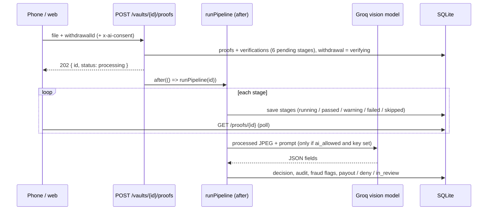

# Proof-of-purpose verification

> Every vault withdrawal needs a photo of a bill; a six-stage pipeline reads it, checks it and approves, declines or hands it to a person.

**Status:** built (server and web) · Practice-simulated on the phone in Practice mode · **Switch:** always on; `GROQ_API_KEY` decides whether the vision model reads the bill (without it every bill goes to a person)

## What it does

- A withdrawal waits in `awaiting_proof` until the customer uploads a photo or scan of a bill. An emergency payout can ask for a receipt afterwards; that receipt goes through the same pipeline.
- The upload returns at once (HTTP 202). Six stages then run in the background and save their progress after every step, so the web page and the phone can show it live.
- The vision model reads the bill into fields (issuer, date, total, line items, name, category scores). A keyword classifier and business rules check purpose, amount, date and name.
- Forensics look for an exact duplicate file, a reused document, editing software in the metadata, pasted-in regions (error level analysis) and totals that don't add up.
- The decision is one of three: `auto_approved` (money is paid out), `auto_denied` (the customer can appeal) or `human_review` (money stays held until a reviewer decides).
- Automation never approves when the AI did not read the bill, when any check failed, or for a custom vault without a template.
- Seven generated sample bills let anyone try every outcome.

## How it works

1. The client creates a withdrawal (`POST /api/v1/vaults/{id}/withdrawals`, documented with vaults). It starts in `awaiting_proof` and holds the money.
2. The client uploads the bill: `POST /api/v1/vaults/{id}/proofs` with `file` and `withdrawalId` (multipart). The route checks the withdrawal belongs to the customer and is still `awaiting_proof`.
3. `validateUpload()` rejects files the pipeline can't read. `createProof()` writes the file to disk, inserts a `proofs` row and a `verifications` row with six `pending` stages, moves the withdrawal to `verifying`, records `ai_allowed` and writes the `proof.uploaded` audit entry. `aiAllowed` is a required input, and only `true` (the route's `aiConsented()`, a `yes` in `x-ai-consent`) stores 1; anything else stores 0.
4. The route schedules `runPipeline()` with Next's `after()` and returns `{ id, status: "processing" }`.
5. `runPipeline()` runs the six stages in order. Each `begin()`/`finish()` saves the stage list to `verifications.stages`.
6. The decision stage writes the result, the audit entry and any fraud flags, then `applyOutcome()` pays out, declines or marks the withdrawal `in_review`.
7. Clients poll `GET /api/v1/proofs/{id}` until the verification is no longer `processing`.

### The six stages

| # | Key | Name shown | What it checks | Stage score |
|---|---|---|---|---|
| 1 | `intake` | Upload & integrity | File type and size; exact duplicate by SHA-256 across every account (fail, hard fail, high flag). | 1, or 0 on a duplicate |
| 2 | `preprocess` | Pre-processing & forensics | `preprocess()`: auto-orient, trim, fit inside 1024×1024, normalise, median denoise, JPEG q88. Reads EXIF. Warns if the short side is under 300 px, if EXIF `Software` matches an editing app (also a medium flag), or if the file was modified more than 24 h after capture. Saves EXIF to `proofs.exif`. | 0.6 with any warning, else 1 |
| 3 | `extract` | OCR & layout understanding | Sends the processed JPEG to the vision model with the vault name, category, amount, today's date and any custom-vault rule. Skipped when `ai_allowed = 0` or no key. Checks "Document detected" (not a document is a hard fail) and "Fields extracted" (pass at 3 of 4: issuer, date, total, type). A failed call marks the stage `failed` with a customer-safe reason. | 0.5 if a document + 0.3 × fields/4 + 0.2 × legibility |
| 4 | `classify` | Purpose classification | Purpose match, amount covered, totals add up, document date, name on document, currency. Skipped without extracted fields. | the purpose match score |
| 5 | `tamper` | Tamper & reuse detection | Error level analysis, document reuse (content fingerprint and dHash), capture time vs document date, visual edit signs from the model, arithmetic. | 1 − tamper score |
| 6 | `decision` | Decision & audit trail | Weighted confidence, then the routing rules below. | the confidence |

**Classify details** (`src/lib/verification/pipeline.ts`, stage 4):

- Purpose: `0.6 × model category score + 0.25 × keyword score + 0.15 × purpose_match`, using the best of the vault's accepted categories (`acceptedCategories()`: an Emergency vault accepts emergency, health and housing bills; a custom vault uses `purpose_match` alone). Pass at ≥ 0.7, warn at ≥ 0.4, fail below. Below 0.2 on a real document is a hard fail.
- Amount: the document total must be at least 98% of the requested amount (score 1). Less is a fail with score `ratio × 0.6`. No total is a warning (score 0.5).
- Totals add up: with two or more line items, the smallest gap between the total and (items, items + tax, subtotal + tax) is compared to the total. ≤ 2% passes, ≤ 25% warns, more fails and raises a high flag.
- Date: more than 2 days in the future is a hard fail (score 0). Older than `maxDocAgeDays` is a fail (score 0.2). No date warns (0.5).
- Name: the account holder's first name on the bill scores 1; only the family name scores 0.6 ("likely a dependant"); neither scores 0.35 (warn). No name on the bill leaves 0.7.

**Tamper details** (stage 5):

- ELA (`errorLevelAnalysis()`): re-saves at JPEG quality 75, compares luminance in 8×8 blocks, flags outlier blocks and measures the largest cluster. Score = `(largestCluster − 10) / 20`, clamped to 0..1. Fail at ≥ 0.5 (medium flag), warn at ≥ 0.2. Photos above 25 MP skip ELA. The heatmap is saved as `{proofId}_ela.png`.
- Reuse: content keys `ref:{issuer}:{reference}` and `amt:{issuer}:{total}:{date}`. A match with any earlier proof is a hard fail and a high flag. With no extracted fields, a dHash within 10 of 256 bits of an earlier proof fails and adds a review reason.
- Timestamp: a document date more than 7 days after the EXIF capture time fails (medium flag).
- Tamper score = `1 − (1 − 0.85·ELA)(1 − exif)(1 − min(1, 0.3·signs))(1 − arith)`, where `exif` is 0.7 for the timestamp gap or 0.5 for editing software, and `arith` is 0.6 for a mismatch or 0.15 for a minor gap. ≥ 0.8 is a hard fail and a high flag.

### Decision and confidence

`confidence = 0.15 × extraction + 0.35 × purpose + 0.15 × amount + 0.10 × date + 0.05 × name + 0.20 × integrity`

Without extracted fields, extraction counts as 0.3 and confidence is capped at 0.6. The rules run in this order:

1. Any hard fail → `auto_denied`.
2. No extraction because the customer said no to the AI → `human_review`.
3. No extraction for another reason (no key, call failed) → `human_review`, with the reason.
4. Confidence ≥ `autoApprove` (0.85), tamper score < 0.3, amount fully covered, no failed check in extract/classify/tamper, and not a custom vault → `auto_approved`.
5. Confidence ≤ `autoDeny` (0.35) → `auto_denied`.
6. Anything else → `human_review`, listing every failed or warned check.

If the pipeline throws, the verification is marked `status = 'error'` and `human_review`, running stages become `failed`, pending ones `skipped`, and `verification.error` is audited.

### Human review and appeals

- The review queue (admin overview) holds verifications with `decision = 'human_review'` and no final decision, plus every `final_decision = 'appealed'`, oldest first.
- A reviewer posts `approved` or `denied` with a note. `reviewDecision()` refuses (409) anything not awaiting review, records the reviewer and note, audits `verification.reviewed.{decision}` and calls `applyOutcome()`.
- A customer can appeal only a `denied` verification, and only once: if it already has an appeal note, `appeal()` refuses with 409 `already_appealed` ([tests/appeals.test.ts](../../tests/appeals.test.ts)). The phone hides the button in the same case. `appeal()` sets `final_decision = 'appealed'`, stores the note, re-queues it and moves the withdrawal to `appealed` (an active hold in `src/lib/vaults.ts`).

### How the phone shows progress

- `useProofPoll()` polls `GET /proofs/{id}` every 400 ms until `outcomeOf()` returns an outcome. After a network or 5xx error it retries every 2.5 s; a 4xx stops it.
- `VerifyingStep` shows a four-step tracker (`trackerSteps()`): Reading your bill (intake + preprocess + extract), Matching it to {vault} (classify), Checking it's genuine (tamper), Paying out (decision). After 30 s it says it is taking longer. "Continue in background" closes the screen; nothing cancels the check.
- A `proof.verifying` haptic beats every 1.2 s, at most 6 times, only while the screen is focused and the app is in the foreground. The result appears 300 ms after the last beat.
- `ResultView`, `ProofTrack` (`/track?kind=proof&id=…`) and `ProofDetailScreen` (`/proof/{id}`) use `describeProof()` and `declineCopy()`: one plain reason and a next step, never confidence, thresholds or model names. The review due time is `queuedAt + reviewSlaHours`.
- In Practice mode `mobile/src/lib/api/demo/proofs.ts` simulates the six stages (450/700/1200/600/750/400 ms, about 4.1 s). The sample's file name decides the outcome.

The web page `/proofs/{id}` polls every 700 ms (`useProof()`) and shows every stage with its checks, the original image and ELA heatmap, what the model read, and an appeal form. The web withdraw dialog (`WithdrawFlow()`) shows "Waiting for model capacity" after 6 s of verifying.

## Where the code is

### Server

| File | What it holds | Key exports |
|---|---|---|
| [src/lib/verification/pipeline.ts](../../src/lib/verification/pipeline.ts) | Upload checks, the six stages, decision, review, appeal, view | `validateUpload()` rejects unreadable files · `createProof()` stores file and rows · `runPipeline()` runs all stages · `reviewDecision()` reviewer verdict · `appeal()` customer appeal · `proofView()` API shape · `PIPELINE_VERSION` |
| [src/lib/verification/forensics.ts](../../src/lib/verification/forensics.ts) | Image helpers with sharp and exifr | `probeImage()` decodability · `sha256()` file hash · `dHash()` 256-bit perceptual hash · `hamming()` bit distance · `readExif()` EXIF summary · `preprocess()` image for the model · `errorLevelAnalysis()` ELA + heatmap · `EDITING_SOFTWARE`, `ELA_MAX_PIXELS` |
| [src/lib/verification/classify.ts](../../src/lib/verification/classify.ts) | Keyword lexicon per category | `keywordScores()` weighted keyword scores and hits · `acceptedCategories()` which bills a vault accepts |
| [src/lib/samples.ts](../../src/lib/samples.ts) | Sample bill generator | `SAMPLES` the seven samples · `renderSample()` JPEG for a user |
| [src/lib/custom-rules.ts](../../src/lib/custom-rules.ts) | A custom vault's own rule, added to the prompt | `customRuleFor()` · `customRulePrompt()` |
| [src/lib/compliance.ts](../../src/lib/compliance.ts) | Per-market thresholds | `rulesFor()` → `verification` |
| [src/app/api/v1/vaults/[id]/proofs/route.ts](../../src/app/api/v1/vaults/[id]/proofs/route.ts) | Withdrawal proof upload | `POST` |
| [src/app/api/v1/emergency/[id]/receipt/route.ts](../../src/app/api/v1/emergency/[id]/receipt/route.ts) | Emergency receipt upload | `POST` |
| [src/app/api/v1/proofs/](../../src/app/api/v1/proofs/) | View, file, appeal | `GET [id]` · `GET [id]/file` · `POST [id]/appeal` |
| [src/app/api/v1/samples/](../../src/app/api/v1/samples/) | Sample list and images | `GET` · `GET [key]` |
| [src/app/api/v1/admin/reviews/[proofId]/route.ts](../../src/app/api/v1/admin/reviews/[proofId]/route.ts) | Reviewer view and verdict | `GET` · `POST` |

### Web app

| File | What it holds | Key exports |
|---|---|---|
| [src/components/verification.tsx](../../src/components/verification.tsx) | Proof UI pieces and the web withdraw flow | `ProofPicker()` upload + samples · `DecisionBanner()` verdict · `PipelineStages()` stage list · `useProof()` 700 ms poll · `ProofImages()` original/ELA · `AppealForm()` · `WithdrawFlow()` |
| [src/app/proofs/[id]/page.tsx](../../src/app/proofs/[id]/page.tsx) | Customer proof page | `ProofPage()` |
| [src/app/admin/review/[proofId]/page.tsx](../../src/app/admin/review/[proofId]/page.tsx) | Reviewer page | default page |

### Phone app

| File | What it holds | Key exports |
|---|---|---|
| [mobile/src/features/proof/withdraw/](../../mobile/src/features/proof/withdraw/) | Withdraw-with-proof flow (choose, amount, payee, proof, camera, samples, review, verifying) | `WithdrawFlow` · `useWithdrawalSubmission()` creates request, asks AI consent, uploads · `VerifyingStep` · `SamplesStep` |
| [mobile/src/features/proof/hooks.ts](../../mobile/src/features/proof/hooks.ts) | Polling and heartbeat | `useProofPoll()` 400 ms poll · `useProofRecord()` · `useRefreshProof()` · `useVerifyingHeartbeat()` |
| [mobile/src/features/proof/stages.ts](../../mobile/src/features/proof/stages.ts) | Server stages → plain steps | `trackerSteps()` four-step tracker · `stageSteps()` six stages · `plainCheck()` plain check text |
| [mobile/src/features/proof/verdict.ts](../../mobile/src/features/proof/verdict.ts) | Outcome and decline reason | `outcomeOf()` · `reviewDueAt()` · `declineKind()` · `declineCopy()` |
| [mobile/src/features/proof/describe.ts](../../mobile/src/features/proof/describe.ts) | Headline, lines, pill per proof | `describeProof()` · `amountText()` |
| [mobile/src/features/proof/track/](../../mobile/src/features/proof/track/) | Compact tracker sheet | `TrackSheet` · `ProofTrack` · `EmergencyTrack` |
| [mobile/src/features/proof/detail/ProofDetailScreen.tsx](../../mobile/src/features/proof/detail/ProofDetailScreen.tsx) | Full release tracker | `ProofDetailScreen` |
| [mobile/src/features/proof/components/AppealBox.tsx](../../mobile/src/features/proof/components/AppealBox.tsx) | Appeal note form (5+ chars) | `AppealBox` |
| [mobile/src/lib/api/samples.ts](../../mobile/src/lib/api/samples.ts) | Bundled sample list and images | `DEMO_SAMPLES` · `sampleSource()` |
| [mobile/src/lib/media/pick.ts](../../mobile/src/lib/media/pick.ts) | Photo picker and sample upload shape | `sampleUpload()` |
| [mobile/src/lib/api/demo/proofs.ts](../../mobile/src/lib/api/demo/proofs.ts) | Practice simulation of the pipeline | `settleProofs()` · `resetProofs()` |

## API endpoints

| Method | Path | Who can call | Purpose |
|---|---|---|---|
| POST | `/api/v1/vaults/{id}/proofs` | Customer, verified ID (`kyc: true`) | Upload a bill for an `awaiting_proof` withdrawal; 202 |
| POST | `/api/v1/emergency/{id}/receipt` | Customer, verified ID | Upload an emergency receipt; 202 |
| GET | `/api/v1/proofs/{id}` | Owner (read access) | Proof, stages, extraction, verdict |
| GET | `/api/v1/proofs/{id}/file?kind=original\|ela` | Firebase mode: owner or admin. Prototype mode: any customer | The stored image or ELA heatmap |
| POST | `/api/v1/proofs/{id}/appeal` | Owner | Appeal a declined verification (`note` 5–500 chars) |
| GET | `/api/v1/samples` | Anyone | Sample list |
| GET | `/api/v1/samples/{key}` | Anyone (uses the signed-in name if present) | Rendered sample JPEG |
| GET | `/api/v1/admin/reviews/{proofId}` | Admin | Proof plus owner, decision history and recent flags |
| POST | `/api/v1/admin/reviews/{proofId}` | Admin | `approved` or `denied` with a note (3–500 chars) |

## Data

| Table | Columns used |
|---|---|
| `proofs` | `id`, `user_id`, `vault_id`, `withdrawal_id`, `emergency_id`, `purpose` (`withdrawal` / `emergency_receipt`), `category`, `file_name`, `mime`, `size`, `sha256`, `phash`, `stored_path`, `ela_path`, `exif`, `extracted` (model JSON), `ai_allowed` (0/1, default 0; every insert passes it, and the seed passes 1 for the bundled samples), `created_at` |
| `verifications` | `proof_id` (unique), `status` (`processing` / `complete` / `error`), `stages` (JSON), `confidence`, `decision`, `final_decision` (`approved` / `denied` / `appealed`), `reasons` (JSON), `model_version`, `reviewer`, `reviewer_note`, `appeal_note`, `queued_at`, `decided_at`, `duration_ms` |
| `withdrawals` | `status` (`verifying`, `in_review`, `denied`, `appealed`, paid via `payoutWithdrawal()`), `proof_id`, `decided_at` |
| `emergency_requests` | `receipt_status` (`submitted`, `verified`, `rejected`, `in_review`), `receipt_proof_id` |
| `audit_log` | `proof.uploaded`, `verification.{auto_approved,auto_denied,human_review}`, `verification.error`, `verification.reviewed.{approved,denied}`, `verification.appealed` |
| `fraud_flags` | via `raiseFlag()`, source `proof_verification` (scores: high 85, medium 60, low 35) or `emergency` (rejected receipt, 65) |

**Proof files:** `{VAULTWISE_DATA_DIR or ./data}/uploads/{proofId}.{jpg|png|webp}` and `{proofId}_ela.png`. The phone keeps no proof data in storage; it uses the React Query cache. Practice proofs are held by the demo simulator.

## Rules and limits

| Rule | Value |
|---|---|
| Accepted files | JPEG, PNG, WebP. HEIC/HEIF get a 415 with a tip. Must decode. |
| Max size | 10 MB (413) |
| Proofs per withdrawal | One; the withdrawal must be `awaiting_proof` (409 otherwise) |
| Emergency receipt accepted when | `receipt_status` is `requested`, `optional`, `overdue` or `rejected` |
| Auto-approve / auto-deny | ≥ 0.85 / ≤ 0.35 (same in every market today) |
| Max document age | 120 days |
| Review target | 4 hours (`reviewSlaHours`) |
| Vision call | temperature 0, 900 tokens, 60 s budget |
| ELA limit | 25 MP; above it ELA is skipped |
| Near-duplicate | dHash distance ≤ 10 of 256 bits (with no readable content) |
| Custom vault without a template | Never auto-approved |
| Upload route time limit | `maxDuration = 90` s |
| Model version stored | `vw-proof@1.4 · vision=<VISION_MODEL>` |

### Sample bills

| Key | Billed to | Built to show |
|---|---|---|
| `medical-invoice` | account holder | Health vault approval |
| `pharmacy-receipt` | account holder | Health vault approval (with tax) |
| `tuition-invoice` | "Maya {surname}" | Dependant name, Education vault |
| `rent-receipt` | account holder | Housing vault approval |
| `coffee-receipt` | "Jordan" | Purpose mismatch |
| `old-invoice` | account holder | Dated 300 days ago, outside the 120-day window |
| `tampered-invoice` | account holder | A new total pasted over the real one (ELA fires) |

`renderSample()` draws each bill as SVG, places it on a desk-coloured background with a 1.2° tilt and saves it as a JPEG. Dates are fresh, amounts scale to the user's currency, and reference numbers are deterministic, so the same sample twice is a byte-identical duplicate. The phone bundles static copies in `mobile/assets/samples/` for Practice mode and the live AI test; live, it uploads the server's copy by URL.

## Configuration

| Setting | Effect |
|---|---|
| `GROQ_API_KEY` | Without it the extract stage is skipped and every bill goes to a person |
| `GROQ_VISION_MODEL` | Vision model (default `qwen/qwen3.8-27b`) |
| `VAULTWISE_DATA_DIR` | Where uploads and the database live (default `./data`) |
| `x-ai-consent` header | Only `yes` is stored as `ai_allowed = 1`; `no` or no header is 0, and the bill goes to a person. See [ai.md](ai.md) |
| `rulesFor(jurisdiction).verification` | `autoApprove`, `autoDeny`, `maxDocAgeDays`, `reviewSlaHours` |

## Tests

| File | What it covers |
|---|---|
| [tests/forensics.test.ts](../../tests/forensics.test.ts) | ELA flags the tampered sample but not the genuine one; deterministic samples; keyword classifier; ELA skip above 25 MP; `validateUpload()` 415/413 cases |
| [tests/ai-consent.test.ts](../../tests/ai-consent.test.ts) | `ai_allowed = 0` skips the vision model and routes to a person |
| [tests/ai-verification.test.ts](../../tests/ai-verification.test.ts) | No key → `human_review`; with `npm run test:ai` all seven samples through the live model |
| [scripts/e2e.mjs](../../scripts/e2e.mjs) | Upload, second proof 409, appeal into the queue, sample path traversal 404, and (with `E2E_AI_SAMPLES`) expected decisions per sample |

There are no phone tests for `stages.ts`, `verdict.ts` or the withdraw flow.

## Known limits and open issues

- No job queue: the pipeline runs in `after()`. No code was found that restarts a verification left `processing` by a crash or restart, so its withdrawal would stay `verifying`.
- The reuse check reads every earlier proof and parses its JSON on each run, so it slows as proofs grow.
- In prototype auth mode, `GET /proofs/{id}/file` serves any proof to any customer who knows the id.
- `plainCheck()` on the phone matches labels `matches purpose` and `perceptual reuse`, but the server emits `Matches {Category}` and `Document reuse`, so those fall back to generic text. The `metadata` line always says "No camera details" because that check is always `info`.
- The server's sample notes and the phone's `DEMO_SAMPLES` differ (for example the old invoice: "Outside the document-age window" vs "goes to a person"; the pipeline sends it to a person).
- The bundled sample JPEGs have fixed dates and the name "Alex Morgan" (the medical invoice is dated 2026-10-06), so in the live test they will pass the 120-day window in early 2027 and never match the test user's name.
- `extractionPrompt()` receives `userName` but does not use it.
- A total of 0 read from a bill becomes `null` (`Number(...) || null`).

## Maintainability notes

- **Good seams:** `forensics.ts` and `classify.ts` are pure and reused by KYC (`src/lib/kyc/analyse.ts`). Stage results are plain data (`Stage`, `Check`), so the web and phone render the same record. Thresholds come from `compliance.ts`.
- **SRP:** `runPipeline()` is about 530 lines with all six stages, scoring and persistence inline. One function per stage over a shared context would make each stage testable alone.
- **DIP / testing:** the pipeline calls `chatJson()` directly. KYC has `setIdExtractor()` for tests; the pipeline has no such seam, so its AI path can only be tested with a live key.
- **Coupling:** the phone reads English check labels and reasons with regexes (`plainCheck()`, `declineKind()`). A stable code per check would remove that and the drift listed above.
- **Duplication:** `createProof()` repeats the MIME and size checks of `validateUpload()`. The review target "4 business hours" is hard-coded in `verification.tsx`, the admin page and the admin overview route instead of reading `reviewSlaHours`. The sample list exists twice.
- **Coupling:** KYC, recovery and limit requests import `validateUpload()` from the 900-line pipeline module.
