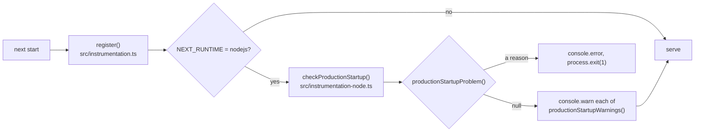

# Running the server online

> What keeps the server safe once it is on the internet: a start-up guard, security headers, rate limits, plain error answers with an id, careful proxy trust, public policy pages, and the deployment, backup and restore scripts.

**Status:** built ([plan 05](../plans/05-server-online.md)) and online at [vaultwise.online](https://vaultwise.online), on one AWS EC2 server in Mumbai set up with [deploy/README.md](../../deploy/README.md). · **Switches:** `NODE_ENV=production` turns the guard and the headers on; `ALLOW_PROTOTYPE_IN_PRODUCTION`, `RATE_LIMIT_PER_MINUTE`, `TRUST_PROXY_HOPS`, `TRUST_PROXY_HEADER`

The AI consent change from the same plan (a missing `x-ai-consent` header now means no) is in [ai.md](ai.md). The deployment steps themselves are in [deploy/README.md](../../deploy/README.md); this page explains the code and points there rather than copying it.

## What it does

For a person using Vaultwise:

- The site is only served over HTTPS, with headers that stop it being framed, sniffed or loaded with outside scripts.
- A broken server can't leak its insides: an unexpected error says "Something went wrong. Try again." with an id the person can quote to support.
- Nobody can hammer the API: every address and every signed-in person gets 120 requests a minute, and photo uploads 20 an hour.
- The privacy policy, terms of use and account-deletion page open for anyone at `/privacy`, `/terms` and `/delete-account`, signed in or not (Google Play checks these links).
- The data is backed up every night and can be restored.

For the team:

- A production server **refuses to start** without sign-in configured, because the open prototype lets anyone with the address be the customer, open the admin console and wipe the database.

## How it works

### The start-up guard

- Next.js runs `register()` once when a server starts (`next start` or `next dev`), before it serves anything. It is skipped during `next build`.
- `productionStartupProblem(env)` in [src/lib/auth/config.ts](../../src/lib/auth/config.ts) returns a reason only when `NODE_ENV=production`, `FIREBASE_PROJECT_ID` is empty, and `ALLOW_PROTOTYPE_IN_PRODUCTION` isn't `true`. The process then exits with code 1, so systemd sees the failure (the unit stops retrying after 5 failures in 2 minutes).
- `productionStartupWarnings(env)` lists settings a production server should have, as `[vaultwise] …` warnings that don't stop it: no sign-in (prototype on purpose), `IDENTITY_SECRET`, `ADMIN_EMAILS` or `FIREBASE_WEB_API_KEY` missing, neither `TRUST_PROXY_HOPS` nor `TRUST_PROXY_HEADER` set, and, when `KYC_FLOW=steps` with `KYC_CHECKS_PROVIDER=setu`, a missing `SETU_BASE_URL` or Setu's sandbox without `KYC_CHECKS_TEST_ALLOWED=true` (ID checks then answer 500 `server_config`, see [identity.md](identity.md)).
- The Node-only half lives in its own file so the Edge build never sees `process.exit`.

### Security headers and CORS

`headers()` in [next.config.ts](../../next.config.ts) depends on `NODE_ENV`:

| Mode | Paths | Headers |
|---|---|---|
| `production` | every path (`/:path*`) | `SECURITY_HEADERS` below |
| anything else | `/api/:path*` | Development CORS for the Expo web preview: `Access-Control-Allow-Origin: <MOBILE_DEV_ORIGIN>`, methods `GET, POST, PUT, PATCH, DELETE, OPTIONS`, headers `Content-Type, Authorization, X-Device-Id, X-AI-Consent, X-Device-Platform, X-App-Version`, `Vary: Origin` |

| Header | Value |
|---|---|
| `Strict-Transport-Security` | `max-age=63072000; includeSubDomains` (2 years) |
| `X-Content-Type-Options` | `nosniff` |
| `X-Frame-Options` | `DENY` |
| `Referrer-Policy` | `strict-origin-when-cross-origin` |
| `Permissions-Policy` | `camera=(self), microphone=()` |
| `Content-Security-Policy` | `CSP` below |

The Content Security Policy is the "without nonces" kind, because most pages are static:

| Directive | Value | Why |
|---|---|---|
| `default-src` | `'self'` | |
| `script-src` | `'self' 'unsafe-inline' https://apis.google.com https://www.gstatic.com https://www.google.com` | Next's inline bootstrap and the theme script; Firebase sign-in's script loader. No `'unsafe-eval'`. |
| `style-src` | `'self' 'unsafe-inline'` | Inline styles from React, Next and the charts |
| `img-src` | `'self' blob: data:` | Photo previews and signed-in downloads |
| `font-src` | `'self' data:` | |
| `connect-src` | `'self' https://*.googleapis.com https://www.google.com` | Firebase sign-in. Groq is called by the server only, so it isn't listed. |
| `frame-src` | `'self' https://*.firebaseapp.com https://*.web.app https://www.google.com`, plus a custom `NEXT_PUBLIC_FIREBASE_AUTH_DOMAIN` | Firebase's hidden sign-in frame |
| `media-src`, `worker-src` | `'self' blob:` | |
| `object-src` | `'none'` | |
| `base-uri`, `form-action` | `'self'` | |
| `frame-ancestors` | `'none'` | |

`poweredByHeader: false` drops `X-Powered-By`. There is no CORS in production: the phone app is native and sends no `Origin`. Caddy passes the app's headers through and removes `Server`.

### Plain errors with an id

`errorResponse()` in [src/lib/api.ts](../../src/lib/api.ts) (called by `handle()` for every route):

| Thrown | Answer |
|---|---|
| `HttpError` and its subclasses (`MpinError`, `DeviceError`, `OtpError`, `RateLimitError`, `WalletError`) | Its status and `{ ...extra, error, code }`. A 429 with `retryAfterSeconds` also gets a `Retry-After` header. |
| `LedgerError` | 400 `{ error }` |
| `AiError` | 503 `{ error: "AI is unavailable right now: …" }` |
| `ZodError` | 400 `{ error: "path: message; …" }` |
| anything else | 500 `{ error: "Something went wrong. Try again.", code: "server_error", errorId }` |

The `errorId` is 16 hex characters (8 random bytes). The full exception goes to the server log as `[vaultwise] server_error <errorId>: …`, so support can find it with `journalctl -u vaultwise | grep <errorId>`.

### Rate limits

The shared limiter is [src/lib/rate-limit.ts](../../src/lib/rate-limit.ts). `checkRateLimit(key, limit, windowMs)` counts one request against `key` in a fixed window (for example each whole minute). Once a key has used `limit` requests in the window, it throws `RateLimitError`: 429 `rate_limited` with `Retry-After` in seconds until the window ends. Counts live in the SQLite table `rate_limits`, so they survive a restart. Keys are stored as a SHA-256 hash, because they contain IP addresses and user ids. Ended windows are swept at most once a minute.

| Limit | Where it runs | Key | Value |
|---|---|---|---|
| General, per address | `handle()`, before every route (`limitClient()`) | `all:ip:<ip>`, only when `clientIp()` knows the address | `RATE_LIMIT_PER_MINUTE` per minute (default 120) |
| General, per person | `session()` in [src/lib/auth/session.ts](../../src/lib/auth/session.ts) once a wallet is found (firebase mode, `limitPerson()`), so it covers every customer route and `GET /me`, and runs before the calling device is recorded; `admin()` for reviewers (`limitReviewer()`) | `all:user:<id>`; a recovery claimant `all:uid:<uid>` (its own sign-in, so it can't use up the owner's limit); `all:admin:<email>` | the same |
| Photo uploads | `POST /vaults/{id}/proofs` and `POST /emergency/{id}/receipt` call `assertUploadsLeft(userId)` right after `customer()` (429 before the body is read, nothing counted), then `limitUploads(userId)` once the withdrawal or emergency request is known to take the file; `POST /kyc` calls `limitUploads()` after the steps-flow refusal (`assertPhotoFlow()`), so only a real photo check counts; `POST /limits/emergency` only when the form carries a file | `upload:user:<id>` | `UPLOADS_PER_HOUR` = 20 per hour, shared across those routes |

Other limits have their own code and answers:

| Limit | Value | Answer |
|---|---|---|
| Recovery find, reset, claim ([src/lib/recovery/limits.ts](../../src/lib/recovery/limits.ts)) | see [identity.md](identity.md) | 429 `rate_limited`, no `Retry-After` |
| Texted codes ([src/lib/otp](../../src/lib/otp/README.md)) | 5 per hour per person, and per person to one number; 15 `phone_verify` per hour to one number from accounts that haven't verified it | 429 `otp_rate_limited` with `retryAt` |
| New devices ([src/lib/devices](../../src/lib/devices/README.md)) | 5 new device ids an hour and 20 signed in, per account | not refused: past it a new id isn't recorded and counts as untrusted |
| KYC photo check | 5 per day | 429 `rate_limited` |
| KYC steps (PAN, DigiLocker, bank) | 5 tries per step per day | 429 `rate_limited` |
| MPIN guesses | the escalating lock ([mpin.md](mpin.md)) | 423 `mpin_locked` |

In prototype mode there is no sign-in, so only the per-address limit applies, and only behind a trusted proxy.

### Which client address to believe

A client can send `X-Forwarded-For`, `X-Real-IP` or `Cf-Connecting-Ip` itself and pick its own rate-limit key. So `clientIp(h)` in [src/lib/auth/context.ts](../../src/lib/auth/context.ts) believes them only when the deployment says a proxy controls them:

| `TRUST_PROXY_HEADER` | `TRUST_PROXY_HOPS` | Address used |
|---|---|---|
| unset | unset or 0 | none: IP limits are skipped |
| unset | 1 or more | `cf-connecting-ip`, else `x-real-ip`, else the `x-forwarded-for` entry that many places from the right (never the client-supplied left end) |
| `cf-connecting-ip` or `x-real-ip` | unset or 0 | only that header |
| `cf-connecting-ip` or `x-real-ip` | 1 or more | that header, else the trusted `x-forwarded-for` entry |
| any other value | any | neither direct header; the trusted `x-forwarded-for` entry if hops ≥ 1 |

The address is cut to 64 characters. Behind Caddy set `TRUST_PROXY_HOPS=1`: [deploy/Caddyfile](../../deploy/Caddyfile) sets `X-Real-IP` to the real connecting address and removes any `Cf-Connecting-Ip` a visitor sent. `clientKeys()` (used by recovery) adds the `x-device-id` as a second key; it can only add a limit, never remove one.

### Public policy pages

| Path | File | What it says |
|---|---|---|
| `/privacy` | [src/app/privacy/page.tsx](../../src/app/privacy/page.tsx) | What is collected, why, who it goes to (Firebase, Groq with consent), how long it is kept, people's rights |
| `/terms` | [src/app/terms/page.tsx](../../src/app/terms/page.tsx) | Terms of use for the student project (pretend money) |
| `/delete-account` | [src/app/delete-account/page.tsx](../../src/app/delete-account/page.tsx) | How to close an account in the app or on the web, and what happens to the data |

`isPublicPage()` in [src/components/legal/config.ts](../../src/components/legal/config.ts) lists them (`PUBLIC_PAGES`). `Shell` in [src/components/shell.tsx](../../src/components/shell.tsx) renders them in `PublicFrame` with no sign-in gate. Shared values (`CONTACT_EMAIL`, `LAST_UPDATED`, `OPERATOR`, `CLOSED_ACCOUNT_DAYS` 90, `BACKUP_DAYS` 14, `REPLY_DAYS` 30) are in the same config file. **`CONTACT_EMAIL` is still the placeholder `privacy@<your-domain>`**; replace it before going live.

### Deployment, backups and restore

Read [deploy/README.md](../../deploy/README.md) for the full, step-by-step guide. In short:

| File | What it does |
|---|---|
| [deploy/vaultwise.service](../../deploy/vaultwise.service) | systemd unit: `npm start` as user `vaultwise` on `127.0.0.1:3000`, `NODE_ENV=production`, `VAULTWISE_DATA_DIR=/var/lib/vaultwise`, secrets from `/etc/vaultwise.env`, restart on failure, write access only to the data folder and `.next/cache` |
| [deploy/Caddyfile](../../deploy/Caddyfile) | HTTPS with an automatic Let's Encrypt certificate, compression, a 25 MB body limit, `X-Real-IP` set, `Cf-Connecting-Ip` dropped, `Server` removed |
| [deploy/update.sh](../../deploy/update.sh) | Installed as `/usr/local/sbin/vaultwise-update` (root:root, 0755) and run as `sudo vaultwise-update [--no-pull]`: pull, `npm ci --include=dev` and `npm run build` as the `vaultwise` user with `/etc/vaultwise.env` loaded, restart, wait up to 30 s for `/api/v1/region`. When the repository's `update.sh`, `backup.sh` or `vaultwise.service` differs from the installed copy, it prints the difference (lines starting `!!`, control characters made visible) and the `sudo install …` command, and keeps using the installed copy. It never installs them itself. |
| [deploy/backup.sh](../../deploy/backup.sh) | Installed as `/usr/local/sbin/vaultwise-backup` (root:root, 0755); `/etc/cron.d/vaultwise-backup` runs that copy nightly (`30 21 * * *` UTC = 03:00 IST): copies the audit anchors file first (`AUDIT_ANCHOR_FILE`, default `$VAULTWISE_DATA_DIR/audit-anchors.jsonl`), then `sqlite3 .backup`, `PRAGMA integrity_check`, a check that the newest anchor's row has the same hash in the copy (the run fails if not; it never runs app code), `uploads.tar.gz`, and keeps `KEEP_DAYS` (14) in `BACKUP_DIR` (`/var/backups/vaultwise`). With `BACKUP_S3_URI` set (a line in the cron file) it also copies each backup to S3 with server-side encryption. |
| [deploy/restore.md](../../deploy/restore.md) | A monthly test restore into a scratch folder (checked with `npm run audit:verify -- --db ... --anchors ...` as the app user), a real restore that puts back the anchors from the same backup, and rebuilding the server from an EBS snapshot |

**Why root-owned copies.** `/opt/vaultwise` belongs to the `vaultwise` user, and `npm ci` runs every package's install scripts as that user, so any file there could have been changed by a package. Root runs only the copies in `/usr/local/sbin`, which only root can write; the build still runs as `vaultwise`. A server set up the old way (cron or a person running `/opt/vaultwise/deploy/*.sh` as root) is moved over by reading the two scripts, checking `git status` and `git diff` show no local changes, and running the three `sudo install` lines and the new cron line (deploy/README.md, step 15).

Daily EBS snapshots of the server's disk (an EC2 Lifecycle Manager policy that keeps 7) are a second, whole-disk backup. Photo paths are stored in full, so a real restore must go back into `/var/lib/vaultwise`.

## Where the code is

| File | What it holds | Key exports |
|---|---|---|
| [src/instrumentation.ts](../../src/instrumentation.ts) | The start-up hook | `register()` |
| [src/instrumentation-node.ts](../../src/instrumentation-node.ts) | The Node-only check | `checkProductionStartup()` |
| [src/lib/auth/config.ts](../../src/lib/auth/config.ts) | The guard's rules | `productionStartupProblem()`, `productionStartupWarnings()` |
| [next.config.ts](../../next.config.ts) | Headers, CSP, development CORS | `SECURITY_HEADERS`, `CSP` (module constants), default export |
| [src/lib/api.ts](../../src/lib/api.ts) | Error answers and where limits run | `handle()`, `customer()`, `admin()`, `SERVER_ERROR`; internal `errorResponse()`, `limitClient()`, `limitReviewer()` |
| [src/lib/auth/session.ts](../../src/lib/auth/session.ts) | The per-person limit | `session()`; internal `limitPerson()` |
| [src/lib/rate-limit.ts](../../src/lib/rate-limit.ts) | The shared limiter | `checkRateLimit()`, `checkRateLimits()`, `limitUploads()`, `assertUploadsLeft()` (checks without counting), `generalLimitPerMinute()`, `RateLimitError`, `DEFAULT_PER_MINUTE` (120), `UPLOADS_PER_HOUR` (20) |
| [src/lib/auth/context.ts](../../src/lib/auth/context.ts) | Proxy trust | `clientIp()`, `clientKeys()` |
| Upload routes: [vaults/[id]/proofs](../../src/app/api/v1/vaults/[id]/proofs/route.ts), [emergency/[id]/receipt](../../src/app/api/v1/emergency/[id]/receipt/route.ts), [kyc](../../src/app/api/v1/kyc/route.ts), [limits/emergency](../../src/app/api/v1/limits/emergency/route.ts) | `assertUploadsLeft()` and `limitUploads()`, marked `// rate-limit` | `POST` |
| [src/components/legal/](../../src/components/legal/) | Shared pieces of the policy pages | `LegalPage`, `LegalSection`, `Bullets`, `InfoTable`, `ContactLink`, `PublicFrame`, `isPublicPage()`, `PUBLIC_PAGES` |
| [src/app/privacy](../../src/app/privacy/page.tsx), [terms](../../src/app/terms/page.tsx), [delete-account](../../src/app/delete-account/page.tsx) | The pages | default exports, `metadata` |
| [src/components/shell.tsx](../../src/components/shell.tsx) | Public pages skip the sign-in gate | lines marked `// legal` |
| [deploy/](../../deploy/) | Server set-up | see the table above |

## API effects

No new routes. Every route now:

- may answer **429 `rate_limited`** with `Retry-After` (the general limit), and upload routes after 20 uploads in the hour;
- answers **500 `server_error`** with `errorId` for any unexpected error, instead of the exception's text.

`POST /api/v1/reset` on a live server (firebase mode) closes only the caller's account and needs the MPIN; with no sign-in it answers 401 `signed_out`. `deploy/README.md` step 14 uses this as the check that sign-in is on.

## Configuration

| Variable | Default | Effect |
|---|---|---|
| `NODE_ENV` | set by Next.js | `production` turns on the start-up guard, the security headers and the `IDENTITY_SECRET` requirement, and turns off development CORS. |
| `ALLOW_PROTOTYPE_IN_PRODUCTION` | unset | `true` lets a production server run without sign-in (a local `npm start` check, the e2e suite). Never on the internet. |
| `RATE_LIMIT_PER_MINUTE` | `120` | General limit per address and per person. `0` turns it off. Anything that isn't a whole number ≥ 0 falls back to 120. |
| `TRUST_PROXY_HOPS` | `0` | How many trusted proxies stand in front. `1` behind Caddy. |
| `TRUST_PROXY_HEADER` | unset | `cf-connecting-ip` or `x-real-ip`: believe only that header. |
| `MOBILE_DEV_ORIGIN` | `http://localhost:8081` | The origin allowed by development CORS. |

The deploy scripts read `VAULTWISE_DATA_DIR`, `BACKUP_DIR`, `KEEP_DAYS`, `BACKUP_S3_URI` and `AUDIT_ANCHOR_FILE` (see [commands.md](../reference/commands.md)); the backup's settings go as lines in `/etc/cron.d/vaultwise-backup`, so neither copy of `backup.sh` is edited.

## Tests

| File | What it covers |
|---|---|
| [tests/server-hardening.test.ts](../../tests/server-hardening.test.ts) | The guard (refuses, allows with sign-in, allows the prototype on purpose, never blocks development, warnings); headers in production and CORS in development; no `X-Powered-By`; the generic 500 with an id in the log; deliberate errors keep their extra fields; `Retry-After`; proxy trust with and without `TRUST_PROXY_HOPS` and `TRUST_PROXY_HEADER`; the per-address and per-person limits; the upload limit before the file is read |
| [tests/rate-limit.test.ts](../../tests/rate-limit.test.ts) | Windows, keys, `limit` 0, hashed keys, sweeping, wait text, several keys at once, `generalLimitPerMinute()` |
| [tests/devices.test.ts](../../tests/devices.test.ts) | The per-person limit on `GET /me` too |
| [tests/deploy.test.ts](../../tests/deploy.test.ts) | Reads the deploy files as text: `update.sh` and `backup.sh` installed to `/usr/local/sbin` as root and the cron line pointing at the installed backup; `update.sh` builds as the app user and never installs deploy files itself; `backup.sh` documents the root-owned copy and takes the S3 bucket as a setting; it copies the anchors before the database and checks the newest anchor without running app code, with validated values; the README and `restore.md` run the checker as the app user and restore the matching anchors |
| [scripts/e2e.mjs](../../scripts/e2e.mjs) | Runs the built server with `ALLOW_PROTOTYPE_IN_PRODUCTION=true` and `TRUST_PROXY_HEADER=x-real-ip`; one address gets 429 with `Retry-After` while another doesn't |

On the live server, `deploy/README.md` step 14 checks the headers with `curl -I` and that `POST /api/v1/reset` is refused.

## How to change it safely

- **A new upload route:** call `assertUploadsLeft(user.id)` right after `customer()`, before reading the form, then `limitUploads(user.id)` once the request is known to take the file; both outside any `tx()`.
- **A new limit:** call `checkRateLimit()` with a key named after what it limits (`"<what>:user:<id>"`), outside `tx()` (inside one, a later error would roll the count back).
- **A new outside service the browser talks to:** add its origin to the right CSP directive in `next.config.ts`, and check the page in a production build (`npm run build`, then `npm start` with `ALLOW_PROTOTYPE_IN_PRODUCTION=true`), because development sends no CSP.
- **A different proxy** (Cloudflare in front of Caddy, a load balancer): set `TRUST_PROXY_HOPS` to the number of proxies, or `TRUST_PROXY_HEADER` to the one header the outermost proxy overwrites. Getting this wrong either lets clients pick their own key or puts every visitor under one key.
- **Policy text:** edit the page and update `LAST_UPDATED` in `src/components/legal/config.ts`.

## Known limits and open issues

- **The owner's steps after going online.** The disk-encryption check and daily snapshots, the nightly backup schedule with a copy off the server (S3 or a weekly download), a test restore and the uptime check are steps 16 to 19 of [deploy/README.md](../../deploy/README.md).
- **`.env.example`** lists the plan 03 to 07 switches (`MPIN_ENFORCED`, `DEVICES_ENFORCED`, `OTP_MODE`, `KYC_FLOW`, `SETU_BASE_URL` and others) and `ALLOW_PROTOTYPE_IN_PRODUCTION`. [configuration.md](../reference/configuration.md) is the full list.
- **One process only.** Counts live in SQLite and the limiter relies on Node running one request's statements at a time. Several servers would need a shared store ([plan 09](../plans/09-postgres.md), not built).
- **`'unsafe-inline'` scripts** are allowed. Nonces would remove it but make every page dynamic.
- **Sign-in itself is not rate limited here.** Firebase handles password tries; the server only sees tokens.
- **An upload counts once its route accepts it**, not when it is refused for the account or the request (an unknown withdrawal, a steps-flow account). A file that then fails `validateUpload()` (unreadable, too big) still counts.
- The audit chain is anchored outside the database since 24 November 2026 (`src/lib/audit-anchors`, [security](../security.md) gap 15). Root on the server can still edit every copy kept there; the journal, the S3 copy and a check run elsewhere against a downloaded backup are what make that hard.

## Maintainability notes

- The guard takes the environment as an argument, so tests pass their own instead of changing `process.env`.
- Each limit is one call at the edge of a route or in `session()`; nothing deeper in `src/lib` knows about rate limits, except the OTP, KYC, devices and recovery modules, which keep their own business limits.
- Rate-limit counts and the recovery limiter's `recovery_attempts` are two designs for one job; the recovery limiter could move onto `checkRateLimits()`.
