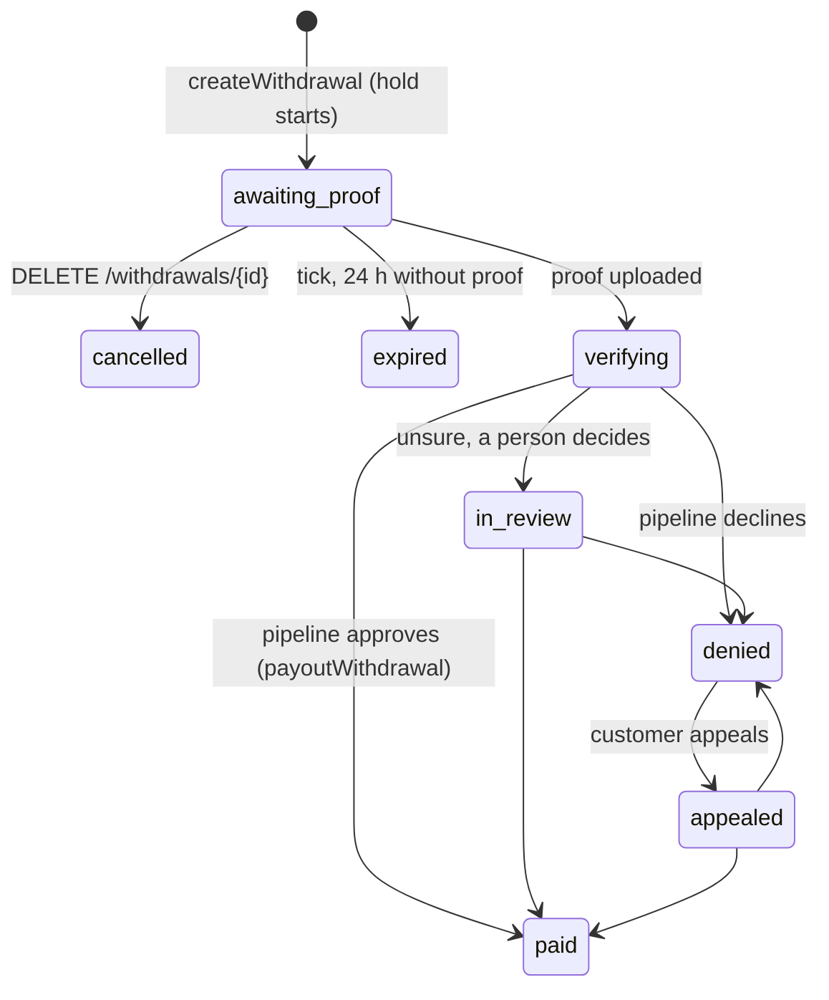

# Vaults and the money engine

> Purpose-locked savings pots on a double-entry ledger: money goes in by hand or by rule, and comes out only against verified proof.

**Status:** built (server and web app); phone app built, with a Practice simulator that copies the main rules · **Switch:** always on

## What it does

- A customer opens a vault for one of six purposes (health, education, housing, emergency, retirement, custom). Each vault gets its own ledger account and starts `locked`.
- Money goes in by hand from the linked bank, or by an auto-save rule: a fixed amount on a schedule, a percentage of each salary credit, or card round-ups.
- Money comes out only through a withdrawal request. The amount is held, the customer uploads proof within 24 hours, and the verification pipeline decides. Approved requests pay out to the linked bank.
- A request still waiting for proof can be cancelled. One left without proof for 24 hours expires. Both release the hold.
- Every money movement is a balanced journal in an append-only ledger. Balances are a projection that the ops console reconciles against a full replay.
- A lazy scheduler (`tick`) runs due jobs whenever a customer's data is read. There is no background worker.
- A simulated bank account feeds the engine: salary credits, card spends and round-ups.
- The dashboard, activity feed, streaks, badges, nudges and a tax CSV are all read from the ledger and the audit log.

## How it works

### Vault lifecycle

1. **Create.** `POST /api/v1/vaults` validates the body with zod, then calls `createVault()` inside one transaction. It makes a `vlt_` id, a `vault` ledger account (`ensureAccount` with `refId` = vault id), and a `vaults` row with status `locked`. Only the columns for the chosen rule are kept. A `fixed` rule defaults to `monthly` and gets `next_run_at = nextRun(createdAt)`. A joint vault adds the owner and up to 4 co-savers to `vault_members`. The audit log gets `vault.created`. The route then saves a custom rule (see [custom-rules.md](custom-rules.md)) and makes an optional opening deposit.
2. **Category and template.** The category is the purpose. The template decides which proof verifies a withdrawal. For non-custom vaults the template equals the category. A custom vault either borrows a category's template or keeps `custom`, the strictest tier: a person confirms every withdrawal ([pipeline.ts](../../src/lib/verification/pipeline.ts) around line 673).
3. **Target.** `target_amount` (minor units) and an optional `target_date` (`YYYY-MM-DD`). `toView()` derives `progress = min(1, balance / target)` and `monthlyNeeded = max(0, round((target - balance) / months))`, where `months = max(1, daysLeft / 30.44)`.
4. **Edit.** `PATCH /api/v1/vaults/{id}` changes name, target, date or rule. Changing the rule resets `next_run_at` to `nextRun(now)`.
5. **Deposit.** `deposit()` posts a transfer from the customer's `bank` account to the vault account. Rule-driven kinds (`contribution_rule`, `roundup`) are audited as `system`, others as `user`. On a joint vault the owner's (or the given member's) `contributed` total goes up.
6. **Withdraw.** See the flow below.
7. **Close.** Not built on the server. `listVaults()` hides `closed` vaults and `deposit()` refuses them, but no code sets that status. The phone's "Close vault" menu sends the customer to support.

### Withdrawals: held until proof is verified

1. `createWithdrawal()` checks the amount is positive and not above `available` (balance minus held), then calls `assertWithinWithdrawalLimits()` (see [limits.md](limits.md)). It inserts a `withdrawals` row with status `awaiting_proof` and audits `withdrawal.requested` with the template's proof hint. No ledger entry is made yet.
2. The hold is computed, not posted. `heldFor()` adds the amounts of withdrawals in `awaiting_proof`, `verifying`, `in_review` or `appealed`, plus unsettled legs of emergency releases in `processing` or `cooling_off` (read from the JSON `plan` of `emergency_requests`).
3. `POST /api/v1/vaults/{id}/proofs` (multipart) creates a proof, moves the request to `verifying`, and runs the pipeline in the background with Next's `after()`. The pipeline is documented with the verification feature; its code is [pipeline.ts](../../src/lib/verification/pipeline.ts).
4. On approval the pipeline calls `payoutWithdrawal()`, which posts vault → bank (kind `withdrawal`) and sets the row to `paid` with its `journal_id`.
5. `cancelWithdrawal()` works only from `awaiting_proof`; anything else returns 409.
6. `expireStaleWithdrawals()` (run by `tick`) marks `awaiting_proof` rows older than `PROOF_WINDOW_MS` (24 h) as `expired` and audits `withdrawal.expired`.

### Auto-save rules

| Rule | Trigger | Amount | Journal kind |
|---|---|---|---|
| `none` | Manual deposits only | — | `deposit` |
| `fixed` | `tick` → `runDueContributions()` when `next_run_at <= now` | `rule_amount`, weekly / biweekly / monthly | `contribution_rule` |
| `percent_income` | `creditIncome()` (a salary credit) | `round(salary × rule_percent / 100)` | `contribution_rule` |
| `roundup` | `recordSpend()` marks; `sweepRoundups()` moves | Sum of pending round-ups | `roundup` |

- **Fixed.** For each locked fixed vault that is due, the scheduler deposits once per missed date (at most 12 per vault per tick), stamping each journal with the scheduled time. A run the bank can't cover is recorded as `contribution.missed` in the audit log and skipped, not retried. Each run and its move of `next_run_at` commit in one transaction, so an unexpected error part-way through never pays a run twice. `next_run_at` ends past `now`. `nextRun()` adds 7 days, 14 days, or one calendar month. When the customer chose the wallet as the auto-save source, `tick` runs `runDueWalletContributions()` instead; see the [wallet README](../../src/lib/wallet/README.md).
- **Percent of income.** Inside the same transaction as the salary credit, every locked `percent_income` vault gets its share, stamped 1 second after the credit.
- **Round-ups.** Each card spend stores `roundup = 100 - (amount mod 100)` minor units (0 for a whole amount). It is `pending` only if a locked round-up vault exists. `sweepRoundups()` moves the pending total into the oldest locked round-up vault and marks the rows `swept`. Sweeping is manual (`POST /api/v1/accounts/sweep`); `tick` does not sweep. The seed data sweeps every Sunday.

### The double-entry ledger

- [ledger.ts](../../src/lib/ledger.ts) holds accounts, journals and entries. Sign convention: positive = debit (asset goes up), negative = credit.
- `post()` refuses a journal with fewer than 2 entries, a non-zero sum, non-integer amounts, an unknown account, or mixed currencies ("Cross-currency journals need an FX leg").
- It inserts the journal and its entries, updates the `balances` projection (and its `version`), and checks that no non-negative account went below zero. A failure throws `LedgerError`, which rolls back the whole transaction.
- Non-negative kinds: `bank`, `vault`, `core_cash`, `core_securities`, `satellite_cash`, `wallet`. `world` (one per currency, for employers, merchants and payees) and `fees` may go negative.
- Database triggers make `ledger_entries` and `audit_log` append-only ([db.ts](../../src/lib/db.ts)).
- `tx()` uses `BEGIN IMMEDIATE`; nested calls join the outer transaction.
- `reconcile()` lists unbalanced journals, per-currency totals (must be zero), projection drift against a replay, and a trial balance by account kind. The admin overview shows it.

### The lazy scheduler

`tick(user)` in [scheduler.ts](../../src/lib/scheduler.ts) runs, in order: auto-saves (wallet or bank), `expireStaleWithdrawals`, `revertExpiredLimitIncreases`, `settleEmergencies`, then `runDueSips` (market-data errors are swallowed and retried next tick). `customer()` in [api.ts](../../src/lib/api.ts) calls it before every route unless the route passes `tick: false`. Most write routes pass `tick: false`; most read routes run it.

### Simulated bank account

- `createUser()` opens a `bank` ledger account for every customer. It stands in for an open-banking link.
- `POST /api/v1/accounts/simulate` with `salary` credits `2150 × CURRENCY_SCALE` major units from "Acme Analytics Inc." (which fires percent rules). With `spend` it records 3 random purchases from 6 merchants, scaled the same way.
- `GET /api/v1/accounts` returns `external_accounts` (the seed adds Harbor Federal checking ····4821 as primary, a Northwind credit card and savings account). The primary row shows the ledger bank balance. With no rows it returns a placeholder "Everyday Checking ····0000". It also returns the last 60 bank transactions, pending round-ups, the round-up vault and 30-day spend by category.

### Dashboard, activity, badges and streaks

- **Dashboard** (`GET /api/v1/dashboard`): totals (`saved` = sum of vault balances, `bank`, `wallet`, `invested` = core value + core cash + satellite equity, `netWorth`), the vault list, a weekly balance series by category over about 17 weeks, an emergency summary, up to 4 nudges, streak, badges, pending round-ups, the 8 latest journals (excluding `invest_buy`), and a count of withdrawals in `verifying`, `in_review` or `appealed`.
- **Activity** (`GET /api/v1/activity?limit=`): audit-log rows (default 200, max 500) and journals with their entries.
- **Streaks** (`contributionStreak()` in [engagement.ts](../../src/lib/engagement.ts)): a week counts if any vault account received a positive entry. Weeks start Monday, computed from UTC day numbers. The current week is skipped while empty, so a streak doesn't break mid-week. Also returns the best run and the last 12 weeks.
- **Badges** (`badges()`): 11 badges — first vault, 25 %, 50 %, 100 % of a goal, 4-week and 12-week streaks, 10+ round-ups swept, a paid withdrawal, a health vault at 50 %, a joint vault, and 3+ Core funds.
- **Nudges** (`nudges()`): a missed contribution in the last 14 days; a vault behind schedule (needed per month above 1.1 × what the rule saves; weekly × 4.33, biweekly × 2.17); round-ups of 500+ minor units waiting; an emergency receipt requested; no health vault; and a SIP suggestion when the bank holds over 100,000 minor units and there is a risk profile but no SIP.
- **Tax report** (`GET /api/v1/reports/tax?year=`): a CSV of vault contributions, vault withdrawals and Core buys for a calendar year.

### Phone app

The phone calls the same endpoints through [client.ts](../../mobile/src/lib/api/client.ts). In Practice mode, [demo/vaults.ts](../../mobile/src/lib/api/demo/vaults.ts) simulates vaults, deposits, withdrawals and limits on the device. It copies the single and daily limit checks and the one-proof-per-request rule, but it has no scheduler: fixed auto-saves never run there and requests never expire. Home's "Coming up" list ([schedule.ts](../../mobile/src/features/home/schedule.ts)) computes upcoming moves on the device. Its "Pause all auto-saves" and per-move skips are stored on the phone only; the server does not know about them.

## Where the code is

### Server

| File | What it holds | Key exports |
|---|---|---|
| [src/lib/vaults.ts](../../src/lib/vaults.ts) | Vault rows and views, rules, deposits, withdrawals, bank simulation | `createVault()` opens a vault, `toView()` derives balance/held/progress, `listVaults()`, `getVaultRow()` owner-checked load, `deposit()`, `runDueContributions()` fixed rules, `creditIncome()` salary + percent rules, `recordSpend()`, `sweepRoundups()`, `pendingRoundups()`, `createWithdrawal()`, `cancelWithdrawal()`, `expireStaleWithdrawals()`, `payoutWithdrawal()`, `heldFor()`, `nextRun()`, `PROOF_WINDOW_MS` |
| [src/lib/ledger.ts](../../src/lib/ledger.ts) | Double-entry ledger | `post()` balanced journal, `transfer()` two-leg post, `ensureAccount()`, `userAccount()`, `worldAccount()`, `balanceOf()`, `accountHistory()`, `reconcile()` replay check, `LedgerError` |
| [src/lib/scheduler.ts](../../src/lib/scheduler.ts) | Lazy scheduler | `tick()` runs all due jobs for one customer |
| [src/lib/engagement.ts](../../src/lib/engagement.ts) | Streaks, badges, nudges, insight | `contributionStreak()`, `badges()`, `nudges()`, `snapshot()` for the AI insight, `weeklyInsight()` |
| [src/lib/shared.ts](../../src/lib/shared.ts) | Shared by server and clients | `CATEGORIES` labels and proof hints, `CATEGORY_ORDER`, `CURRENCY_SCALE`, `fmtMoney()`, `toMinor()` |
| [src/lib/db.ts](../../src/lib/db.ts) | SQLite schema, triggers, helpers | `tx()` nested transactions, `all()`, `get()`, `run()`, `newId()` |
| [src/lib/api.ts](../../src/lib/api.ts) | Route wrapper | `customer()` resolves the user and runs `tick`, `handle()` error mapping, `minor()` major → minor units |
| [src/lib/users.ts](../../src/lib/users.ts) | Customer rows | `createUser()` also opens the `bank` account, `HttpError` |
| [src/lib/seed.ts](../../src/lib/seed.ts) | Practice data | `seedDemo()` 120 days of salary, spend, 6 vaults, sweeps, withdrawals |
| `src/app/api/v1/...` | Route handlers | See the API table |

### Web app

| File | What it holds | Key exports |
|---|---|---|
| [src/app/page.tsx](../../src/app/page.tsx) | Dashboard | `DashboardPage()` totals, trend, emergency readiness, milestones |
| [src/app/vaults/page.tsx](../../src/app/vaults/page.tsx) | Vault list and create dialog | `VaultsPage()`, `CreateVault()` (`?new=health` opens it) |
| [src/app/vaults/[id]/page.tsx](../../src/app/vaults/[id]/page.tsx) | Vault detail | `VaultDetailPage()` chart, summary, withdrawals, ledger; `AddMoney()`, `EditRule()` |
| [src/app/accounts/page.tsx](../../src/app/accounts/page.tsx) | Linked accounts | `AccountsPage()` salary/spend simulation, sweep |
| [src/app/activity/page.tsx](../../src/app/activity/page.tsx) | Audit trail and journals | `ActivityPage()` |
| [src/components/vault-bits.tsx](../../src/components/vault-bits.tsx) | Shared vault UI | `VaultCard()`, `CategoryIcon()`, `ruleLabel()`, `RuleIcon()`, `WITHDRAWAL_STATUS` labels, `VaultView` type |
| [src/components/verification.tsx](../../src/components/verification.tsx) | Withdraw-with-proof flow | `WithdrawFlow()` (verification feature) |

### Phone app

| File | What it holds | Key exports |
|---|---|---|
| [mobile/src/features/vaults/VaultsListScreen.tsx](../../mobile/src/features/vaults/VaultsListScreen.tsx) | Vaults tab | `VaultsListScreen()` |
| [mobile/src/features/vaults/VaultDetailScreen.tsx](../../mobile/src/features/vaults/VaultDetailScreen.tsx) | Vault detail | `VaultDetailScreen()` hero, release contract, withdrawals, members, rule, history |
| [mobile/src/features/vaults/NewVaultScreen.tsx](../../mobile/src/features/vaults/NewVaultScreen.tsx) | New-vault flow | `NewVaultScreen()` purpose → name → goal → auto-save → review |
| [mobile/src/features/vaults/AddMoneyScreen.tsx](../../mobile/src/features/vaults/AddMoneyScreen.tsx) | Add money | `AddMoneyScreen()` keypad, confirm, coin drop |
| [mobile/src/features/vaults/EditVaultModal.tsx](../../mobile/src/features/vaults/EditVaultModal.tsx) | Edit goal and rule | `EditVaultModal()` |
| [mobile/src/features/vaults/withdrawal-status.ts](../../mobile/src/features/vaults/withdrawal-status.ts) | One row per withdrawal status | `withdrawalStatus()` normalises raw status, `withdrawalRule()` label/tone/actions, `isPending()`, `resumeTarget()`, `PROOF_WINDOW_MS` |
| [mobile/src/features/vaults/format.ts](../../mobile/src/features/vaults/format.ts) | Pure helpers | `ruleLine()`, `monthlyFromFixed()`, `framing()` daily figure, `monthlyNeeded()`, `progressOf()` |
| [mobile/src/features/vaults/hooks.ts](../../mobile/src/features/vaults/hooks.ts) | Currency, rules, milestones | `useCurrency()`, `useReleaseRules()`, `recordMilestone()`, `useMilestoneWatch()` |
| [mobile/src/features/vaults/ReleaseContract.tsx](../../mobile/src/features/vaults/ReleaseContract.tsx) | "How this vault unlocks" | `ReleaseContract()` |
| [mobile/src/features/home/HomeScreen.tsx](../../mobile/src/features/home/HomeScreen.tsx) | Home tab | `HomeScreen()` |
| [mobile/src/features/home/schedule.ts](../../mobile/src/features/home/schedule.ts) | Upcoming automatic moves | `upcomingMoves()` next 30 days, `nextRun()` copy of the server's, `monthlyOf()`, `freshStartSuggestion()` |
| [mobile/src/features/home/prefs.ts](../../mobile/src/features/home/prefs.ts) | On-device pause and skips | `useHomePrefs()`, `setAutoSavesPaused()`, `setSkipped()`, `markFreshStartDone()` |
| [mobile/src/features/home/activity-model.ts](../../mobile/src/features/home/activity-model.ts) | Plain-language activity rows | `buildActivity()` journals + audit → rows, `humaniseJournal()`, `humaniseAudit()`, `groupByDay()`, `recentMoney()`, `lastPayday()` |
| [mobile/src/features/home/StreakCard.tsx](../../mobile/src/features/home/StreakCard.tsx) | Forgiving weekly streak | `StreakCard()` |
| [mobile/src/lib/api/demo/vaults.ts](../../mobile/src/lib/api/demo/vaults.ts) | Practice simulator for vaults | `vaultsApi` |

## API endpoints

"Customer" means the signed-in person's wallet (firebase mode) or the first user (prototype mode). "ID check" means the route passes `kyc: true`.

| Method | Path | Who can call | Purpose |
|---|---|---|---|
| GET | `/api/v1/vaults` | Customer (read; recovery access allowed) | List open vaults; runs `tick` |
| POST | `/api/v1/vaults` | Customer | Create a vault (+ optional custom rule, opening deposit) |
| GET | `/api/v1/vaults/{id}` | Customer (read) | Vault view, last 100 postings, balance series (`balanceSeries()`, starting from the balance before the oldest posting shown), last 30 withdrawals |
| PATCH | `/api/v1/vaults/{id}` | Customer | Edit name, target, date, rule |
| POST | `/api/v1/vaults/{id}/deposits` | Customer | Deposit from the bank (`amount` in major units, `memo` ≤ 80) |
| POST | `/api/v1/vaults/{id}/withdrawals` | Customer, ID check | Request a proof-gated withdrawal (`amount`, `payee` 2–80, `note` ≤ 200) |
| POST | `/api/v1/vaults/{id}/proofs` | Customer, ID check | Upload proof for a request in `awaiting_proof`; returns 202 |
| DELETE | `/api/v1/withdrawals/{id}` | Customer | Cancel a request still waiting for proof |
| GET | `/api/v1/accounts` | Customer (read) | Linked accounts, bank transactions, round-ups |
| POST | `/api/v1/accounts/simulate` | Customer, ID check | `{type: "salary" \| "spend"}` |
| POST | `/api/v1/accounts/sweep` | Customer, ID check | Sweep pending round-ups |
| GET | `/api/v1/dashboard` | Customer (read; recovery access allowed) | Home screen data |
| GET | `/api/v1/activity` | Customer (read) | Audit log and journals |
| GET | `/api/v1/badges` | Customer (read) | Streak and badges |
| GET | `/api/v1/reports/tax` | Customer (read) | Yearly CSV |

## Data

| Table | Columns used here |
|---|---|
| `vaults` | `id`, `user_id`, `account_id`, `name`, `category`, `template`, `target_amount`, `target_date`, `rule_type`, `rule_amount`, `rule_percent`, `rule_frequency`, `next_run_at`, `is_joint`, `status`, `created_at` |
| `vault_members` | `vault_id`, `name`, `email`, `role` (`owner` / `co-saver`), `contributed` |
| `withdrawals` | `vault_id`, `amount`, `payee`, `note`, `status`, `proof_id`, `journal_id`, `created_at`, `decided_at` |
| `accounts` | `kind`, `user_id`, `currency`, `ref_id` (vault id for vault accounts) |
| `journals` | `kind`, `memo`, `ref_type`, `ref_id`, `created_at` |
| `ledger_entries` | `journal_id`, `account_id`, `amount` (signed minor units), `currency` — append-only |
| `balances` | `account_id`, `balance`, `version` — projection |
| `bank_transactions` | `merchant`, `category`, `amount`, `direction`, `roundup`, `roundup_status` (`none` / `pending` / `swept`), `journal_id` |
| `external_accounts` | Display rows for linked accounts |
| `audit_log` | `vault.created`, `vault.updated`, `withdrawal.*`, `contribution.missed`, `ledger.*` — hash-chained, append-only |

Phone storage keys (SecureStore on device, localStorage on web): `vw.milestone.<vaultId>` (last celebrated quarter), `vw.home.moves` (paused flag and skips), `vw.home.freshStart` (month the fresh-start card was dismissed).

## Rules and limits

- All amounts are integer minor units on the server. Routes take major units and convert with `minor()`, which rejects zero and negatives.
- Vault name 2–50 characters. Target must be positive. Date format `YYYY-MM-DD`.
- Percent rule: 1–50 %, default 5 %. Fixed rule frequency: weekly, biweekly or monthly; default monthly.
- Joint vaults: up to 4 co-savers, names only.
- A withdrawal can't exceed `available` and must pass the single and daily limits.
- Proof window: 24 hours (`PROOF_WINDOW_MS`). One proof per request.
- Scheduler catch-up: at most 12 fixed runs per vault per tick.
- Round-up nudge threshold: 500 minor units. The activity feed returns at most 500 rows per list.

## Configuration

| Setting | Effect |
|---|---|
| `VAULTWISE_DATA_DIR` | Folder for the SQLite file and uploads (default `./data`) |
| Wallet auto-save source | Per customer; moves fixed rules to the wallet (see the [wallet README](../../src/lib/wallet/README.md)) |
| `KYC_ENFORCED`, auth mode | Decide whether "ID check" routes block (see the [auth README](../../src/lib/auth/README.md)) |

## Tests

| File | What it covers |
|---|---|
| [tests/vaults.test.ts](../../tests/vaults.test.ts) | Fixed rules run and record misses; percent of income; round-up sweep; holds block double-spend; cancel releases; 24 h expiry |
| [tests/ledger.test.ts](../../tests/ledger.test.ts) | Balanced posts, unbalanced and overdraft rejection with rollback, append-only entries, reconcile, audit hash chain |
| [tests/fuzz.test.ts](../../tests/fuzz.test.ts) | 400 random operations × 3 seeds; after each step journals balance, no drift, currencies net to zero, no asset account negative, holds ≤ balance |
| [tests/scheduler.test.ts](../../tests/scheduler.test.ts) | Emergency cooling-off and overdue receipts; SIP catch-up (not vault rules) |

The phone app has no automated tests.

## Known limits and open issues

- No vault close on the server; `status = 'closed'` is never set.
- The lazy scheduler only runs when someone reads the customer's data. A customer who never opens the app gets no auto-saves until they do.
- Phone "Pause all auto-saves" and skips are stored on the device only; the server still runs the rules.
- Practice mode has no scheduler, no expiry, and stores joint members with role `member` (the server uses `co-saver`).
- The streak uses UTC weeks; the wallet uses the customer's own time zone ([timezones.ts](../../src/lib/timezones.ts)).
- Joint vault members are names only; they cannot sign in or deposit themselves.

## Maintainability notes

- **Good seams.** `post()` is the single write path for money, and the fuzz test guards its invariants. `toView()` is the one place that derives held, available and progress. `customer({ tick })` centralises the scheduler call.
- **Coupling.** `heldFor()` reads the JSON plan inside `emergency_requests`, so vaults depend on the emergency module's storage format. `tick()` hard-codes every job, so each new feature edits it.
- **Business logic in routes.** The PATCH route rebuilds rule columns and `next_run_at` itself instead of reusing the normalisation in `createVault()`. The dashboard, accounts, activity, vault detail and tax routes run raw SQL directly.
- **Atomicity.** `deposit()` posts the journal in its own transaction and updates `vault_members` after it. `runDueContributions()` now commits each run together with its `next_run_at` (fixed 2026-11-22, item B4 in the [maintainability review](../maintainability.md)).
- **Duplication.** The web `VaultView` interface copies the server's; `PROOF_WINDOW_MS`, `nextRun()` and `weekIndex()` are copied in the phone app; the "pending review" status list appears in `vaults.ts`, the dashboard route and the Practice state.
- **Performance.** `toView()` makes several queries per vault, and one dashboard request calls `listVaults()` three times (dashboard, badges, nudges).
