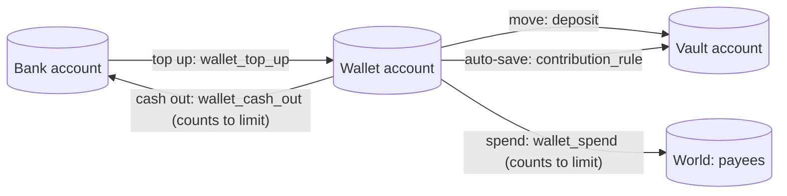

# Wallet

> A spending balance inside the app: money comes in from the linked bank and goes out to a vault, a payee, or back to the bank.

**Status:** built (server and phone; the web app has no wallet screen) · **Switch:** `WALLET_ENABLED=false` on the server, `WALLET_ENABLED` constant in [mobile/src/features/wallet/config.ts](../../mobile/src/features/wallet/config.ts) on the phone

The two module READMEs are the detailed reference. This page summarises them and adds the cross-cutting view:

- Server: [src/lib/wallet/README.md](../../src/lib/wallet/README.md) (moves, rules, API bodies, switch, removal)
- Phone: [mobile/src/features/wallet/README.md](../../mobile/src/features/wallet/README.md) (screens, routes, error handling, Practice, removal)

## What it does

- Shows a wallet balance, the bank balance, and recent wallet activity (last 20 moves).
- Works out **safe to spend today** from the balance, the days to the next payday, and any auto-saves the wallet must cover first.
- Estimates the **next payday** from past income credits.
- Lets the customer **top up** (bank → wallet), **move to a vault** (wallet → vault), **spend** (wallet → a named payee) and **cash out** (wallet → bank).
- Offers an optional **daily limit** on spends and cash-outs. Lowering or turning it on works any time. Raising or turning it off works once per 30 days.
- Lets the customer choose where **fixed auto-saves** come from: the bank (default) or the wallet.
- Never moves money from a vault back into the wallet. Vaults release money only through proof-checked withdrawals.

## How it works

Every move is one double-entry journal and two audit rows (the ledger's `ledger.<kind>` row from `post()` and the wallet's own, such as `wallet.spent`), inside one database transaction. The wallet is a ledger account of kind `wallet`, which the ledger keeps non-negative ([src/lib/ledger.ts](../../src/lib/ledger.ts)).

A money move from the phone, step by step:

1. The phone checks the amount against the balance and the limit left today (`outgoingProblem()` in [model.ts](../../mobile/src/features/wallet/model.ts)), so most refusals show before anything is sent.
2. The phone posts a major-unit amount, for example `POST /api/v1/wallet/spend { amount, payee, note }`.
3. The route resolves the customer with `customer({ tick: false, money: "wallet_spend" })`, which applies the action's ID gate from the money map ([money-routes.ts](../../src/lib/money-routes.ts)), checks the body with zod ([schemas.ts](../../src/app/api/v1/wallet/schemas.ts)), applies the new-device cap (`assertDeviceMayMove()`) and the MPIN (`requireMpin()`, see [mpin.md](mpin.md)), and converts the amount to minor units with `minor()`.
4. `spend()` in [moves.ts](../../src/lib/wallet/moves.ts) checks the switch, the amount and the payee, then opens a transaction. Inside it, it checks the daily limit (in the customer's own time zone), checks the balance, posts the journal, records the payee and note in `wallet_payments`, and writes the wallet's audit row (the ledger has already written its own).
5. The route answers `201 { journalId, wallet }`, where `wallet` is a fresh `walletView()`.
6. The phone refreshes every money query (`MONEY_QUERIES` in [keys.ts](../../mobile/src/lib/api/keys.ts)).

Auto-saves from the wallet run in the lazy scheduler ([src/lib/scheduler.ts](../../src/lib/scheduler.ts)). On every customer read that ticks, `tick()` calls `runDueWalletContributions()` when `autoSaveSource(user)` is `"wallet"`, and `runDueContributions()` (bank) otherwise. A scheduled auto-save writes only the ledger's audit row. Each run commits together with its move of `next_run_at`, a paid run and a missed one alike, so if something unexpected fails part-way through, the runs already paid are never paid again on the next tick (2026-11-24, the same fix the bank's run got as B4 on 22 November; before, `next_run_at` moved once after the loop).

**Which moves need what.** Each money route names its action in the money map ([money-routes.ts](../../src/lib/money-routes.ts)):

| Move | Action | Verified ID | MPIN | New-device cap |
|---|---|---|---|---|
| Top up (bank → wallet) | `wallet_top_up` | yes | no (money in) | no |
| Move to a vault | `wallet_move` | yes | yes | no |
| Spend | `wallet_spend` | yes | yes | yes |
| Cash out | `wallet_cash_out` | yes | yes | yes |
| Raise or turn off the daily limit (`PUT /wallet/settings`) | `wallet_limit_raise` | no | yes | no |

Top-up is money coming in from the linked bank, so since 2026-11-24 it follows the one money-in rule (`moneyIn: true`, security review gap 7): the ID gate and never the MPIN. It needed a verified ID before too (`kyc: true`), so nothing changed for the customer.

## Where the code is

### Server

| File | What it holds | Key exports |
|---|---|---|
| [src/lib/wallet/index.ts](../../src/lib/wallet/index.ts) | Public surface of the module | re-exports below |
| [src/lib/wallet/config.ts](../../src/lib/wallet/config.ts) | The switch and the error type | `walletEnabled()` reads the env var, `assertWalletEnabled()` throws 404 `wallet_off`, `WalletError` HttpError with a `code` |
| [src/lib/wallet/store.ts](../../src/lib/wallet/store.ts) | The module's own tables, created on first use | `ensureWalletTables()` creates tables per database, `walletSettings()` reads settings with defaults, `saveWalletSettings()` upserts, `recordPayment()` / `paymentById()` payee and note of a spend |
| [src/lib/wallet/plan.ts](../../src/lib/wallet/plan.ts) | The wallet's numbers | `paydayEstimate()` next payday, `upcomingFromWallet()` auto-saves due before a date, `spentOn()` spends and cash-outs on a day, `limitState()` limit left and raise lock, `safeToSpend()` the daily figure, `dayStart()` server-local midnight |
| [src/lib/wallet/moves.ts](../../src/lib/wallet/moves.ts) | Every money move and settings change | `topUp()`, `moveToVault()`, `spend()`, `cashOut()`, `updateWalletSettings()`, `autoSaveSource()` bank while switched off, `runDueWalletContributions()` scheduler run, `walletAccount()` the ledger account |
| [src/lib/wallet/view.ts](../../src/lib/wallet/view.ts) | What `GET /wallet` returns | `walletView()` the full `WalletView`, `walletActivity()` recent moves with counterparty and note |
| [src/app/api/v1/wallet/](../../src/app/api/v1/wallet/route.ts) | Six route handlers and the request schemas | `GET`, `POST`, `PUT` handlers; `TopUpBody`, `MoveBody`, `SpendBody`, `CashOutBody`, `SettingsBody` |
| [src/lib/scheduler.ts](../../src/lib/scheduler.ts) | Lazy scheduler (touch point marked `// wallet`) | `tick()` picks the bank or wallet auto-save run |
| [src/lib/ledger.ts](../../src/lib/ledger.ts) | `wallet` account kind, non-negative (marked `// wallet`) | `userAccount()`, `transfer()` |
| [src/lib/seed.ts](../../src/lib/seed.ts) | Demo history tops up the wallet two days back (marked `// wallet`) | calls `topUp()` |
| [src/app/api/v1/dashboard/route.ts](../../src/app/api/v1/dashboard/route.ts) | Counts the wallet in net worth, even when switched off (marked `// wallet`) | `GET` |
| [src/lib/engagement.ts](../../src/lib/engagement.ts) | A missed wallet auto-save says "Your wallet" was short (marked `// wallet`) | `missedFromWallet()` (internal) |

### Web app

None. The web app has no wallet screen. Wallet journals still appear in `/api/v1/activity` like any other journal.

### Phone app

The phone screens and routes are listed in the [phone README](../../mobile/src/features/wallet/README.md#whats-here). The supporting code:

| File | What it holds | Key exports |
|---|---|---|
| [mobile/src/features/wallet/index.ts](../../mobile/src/features/wallet/index.ts) | Public surface used by Home and Limits | `WalletCard`, `WalletLimitCard`, `WalletScreen`, `WalletFlow`, `useWallet()`, `walletActionHref()` |
| [mobile/src/features/wallet/model.ts](../../mobile/src/features/wallet/model.ts) | Words and rules as the screens show them | `outgoingProblem()` why an amount can't go, `limitLeft()`, `paydayLine()`, `safeToSpendNote()`, `describeActivity()`, `recentPayees()`, `moveUnconfirmed()` timeout or dropped connection, `moveBlock()` KYC or recovery refusal |
| [mobile/src/features/wallet/hooks.ts](../../mobile/src/features/wallet/hooks.ts) | Wallet query | `useWallet()` no retry on 403/404, `useRefreshWallet()`, `walletMissing()` |
| [mobile/src/features/wallet/flows/](../../mobile/src/features/wallet/flows/WalletFlow.tsx) | One flow per action | `WalletFlow` router, `AddFlow`, `MoveFlow`, `SpendFlow`, `CashOutFlow`, `LimitFlow` |
| [mobile/src/lib/api/wallet.ts](../../mobile/src/lib/api/wallet.ts) | Live API calls | `walletLive` with `wallet()`, `walletTopUp()`, `walletMove()`, `walletSpend()`, `walletCashOut()`, `walletSettings()` |
| [mobile/src/lib/api/wallet-types.ts](../../mobile/src/lib/api/wallet-types.ts) | Response shapes and server limits | `Wallet`, `WalletActivity`, `WALLET_MAX_AMOUNT`, `WALLET_PAYEE_MAX`, `WALLET_NOTE_MAX` |
| [mobile/src/lib/api/demo/wallet.ts](../../mobile/src/lib/api/demo/wallet.ts) | Practice simulator with the same methods | `walletDemo` mirrors the server rules on `S.wallet` |
| [mobile/src/lib/api/demo/wallet-state.ts](../../mobile/src/lib/api/demo/wallet-state.ts) | Practice starting state | `freshWallet()` four past paydays, a payday top-up, everyday spends since |

## API endpoints

All under `/api/v1`. Requests use major units; responses use minor units. Errors are `{ error, code? }`. "Verified ID" means the money action's `kyc` column: the identity module answers 403 `kyc_required` unless the ID is verified (and `KYC_ENFORCED` is not `false`). Routes marked MPIN take the MPIN as `pin` in the body. Any route here answers 403 `recovery_restricted` while a sign-in has only provisional recovery access.

| Method | Path | Who can call | Purpose |
|---|---|---|---|
| GET | `/wallet` | Customer, read access (runs the lazy scheduler) | Full `WalletView`: balance, safe to spend, payday, limit, auto-save source, recent moves |
| POST | `/wallet/top-up` | Customer, write, verified ID, no MPIN (`wallet_top_up`) | Bank → wallet. Body `{ amount }` |
| POST | `/wallet/move` | Customer, write, verified ID, MPIN (`wallet_move`) | Wallet → vault. Body `{ vaultId, amount, pin }` |
| POST | `/wallet/spend` | Customer, write, verified ID, MPIN, device cap (`wallet_spend`) | Wallet → payee. Body `{ amount, payee, note?, pin }` |
| POST | `/wallet/cash-out` | Customer, write, verified ID, MPIN, device cap (`wallet_cash_out`) | Wallet → bank. Works with the wallet switched off |
| PUT | `/wallet/settings` | Customer, write (no ID check); MPIN when raising or removing the daily limit (`wallet_limit_raise`) | Body `{ dailyLimit?: number \| null, autoSaveSource?: "bank" \| "wallet", pin? }` |

Money routes answer `201 { journalId, wallet }`. Settings answers `200 { wallet }`. Error codes: `insufficient_funds`, `daily_limit`, `limit_raise_locked` (409), `bad_amount`, `bad_payee`, `vault_closed`, `wallet_off` (404).

## Data

| Table | Columns used | Written by |
|---|---|---|
| `wallet_settings` | `user_id` (PK), `daily_limit` (minor units or null), `limit_raised_at`, `auto_save_source` (`bank` default) | `saveWalletSettings()` |
| `wallet_payments` | `id` (`wpm_…`), `user_id`, `journal_id`, `payee`, `note`, `created_at`; index on `(user_id, created_at)` | `recordPayment()` on every spend |
| `accounts`, `balances` | one account of kind `wallet` per customer and currency | `userAccount(…, "wallet", …)` |
| `journals`, `ledger_entries` | kinds `wallet_top_up`, `deposit`, `contribution_rule`, `wallet_spend`, `wallet_cash_out`; `income` read for payday | `transfer()` |
| `vaults` | `rule_type = 'fixed'`, `status = 'locked'`, `rule_amount`, `rule_frequency`, `next_run_at` | read for upcoming auto-saves; `next_run_at` advanced by the scheduler run, in the same transaction as each run |
| `vault_members` | `contributed` for the owner of a joint vault | `depositFromWallet()` |
| `audit_log` | actions `wallet.topped_up`, `wallet.moved_to_vault`, `wallet.spent`, `wallet.cashed_out`, `wallet.settings_changed`, `contribution.missed` (with `source: "wallet"`) | `audit()` |

The two wallet tables are created on first use by `ensureWalletTables()`, not in [src/lib/db.ts](../../src/lib/db.ts).

**Phone storage:** the wallet stores nothing on the phone. React Query caches the `["wallet"]` query in memory. The Move flow records crossed vault milestones through `recordMilestone()` from the vaults feature, which uses the `vw.milestone.<vaultId>` key.

## Rules and limits

| Rule | Value | Where |
|---|---|---|
| Amount in a request | positive, at most 100,000,000 major units; converted with `Math.round(n × 100)` | [schemas.ts](../../src/app/api/v1/wallet/schemas.ts), `minor()` in [src/lib/api.ts](../../src/lib/api.ts) |
| Payee | 2–80 characters after trim; `·` and runs of whitespace collapse to one space; at least 2 characters after that | `SpendBody`, `clean()` in moves.ts |
| Note | up to 200 characters; empty becomes null | `SpendBody`, `spend()` |
| Daily limit counts | `wallet_spend` and `wallet_cash_out` only (not top-ups, moves or auto-saves) | `LIMITED_KINDS` in plan.ts |
| Daily limit day | midnight to midnight in the customer's time zone (`timeZoneFor(user)`) | `spentOn()` |
| Turning on or lowering | allowed any time; must be a whole number of minor units above zero | `updateWalletSettings()` |
| Raising or turning off | once per 30 days (`RAISE_WINDOW_MS`); otherwise 409 `limit_raise_locked` naming the next date | `updateWalletSettings()` |
| Payday | last income + median gap between the last 7 paydays (same-day credits count once); 30 days with one payday; now + 30 days with none; rolls forward by whole gaps; gap at least 1 day | `paydayEstimate()` |
| Days to payday | calendar days, server-local, at least 1 | `paydayEstimate()` |
| Safe to spend today | `floor(max(0, balance − upcomingFromWallet) ÷ daysToPayday)`, then capped by the limit left today | `safeToSpend()` |
| Upcoming auto-saves | fixed rules on locked vaults, only when the source is the wallet; at most 60 runs per vault counted | `upcomingFromWallet()` |
| Wallet auto-save run | catches up at most 12 due runs per vault per tick; each run (paid or missed) commits with its `next_run_at`; a short wallet records `contribution.missed` and skips; the bank is never used as a fallback | `runDueWalletContributions()` |
| Auto-save source | only fixed recurring rules follow it; percent-of-income and round-up rules stay on the bank | server README |
| Switched off | top-up, move, spend and settings answer 404 `wallet_off`; auto-saves use the bank; reads and cash-out still work | `assertWalletEnabled()`, `autoSaveSource()` |

## Configuration

| Name | Where | Effect |
|---|---|---|
| `WALLET_ENABLED` | server env | Anything other than `false` means on |
| `WALLET_ENABLED` | [mobile/src/features/wallet/config.ts](../../mobile/src/features/wallet/config.ts) | `false` hides the wallet on Home and Limits and skips the query |
| `KYC_ENFORCED` | server env | `false` turns off the verified-ID check on the four money routes (top-up, move, spend, cash out) |

## Tests

| File | What it covers |
|---|---|
| [tests/wallet.test.ts](../../tests/wallet.test.ts) | Top up, move, spend and cash out keep the ledger balanced; no overdraft of wallet or bank; the daily limit counts only spends and cash-outs; the limit resets at the customer's midnight; lower any time and raise once per 30 days; safe to spend with the limit cap; payday from the median gap and the 30-day fallback; auto-saves held back before payday; auto-saves from the bank by default, from the wallet when chosen, with a recorded miss; a wallet auto-save is never paid twice when something fails part-way through; the switch |
| [tests/money-in.test.ts](../../tests/money-in.test.ts) | Top-up refused with 403 `kyc_required` without a verified ID and allowed with one and no MPIN; wallet → vault stays `wallet_move` (ID and MPIN) |
| [tests/contract/wallet-maths.test.ts](../../tests/contract/wallet-maths.test.ts) | The server's payday, daily limit and safe-to-spend against the shared vectors in `tests/contract/vectors/wallet-maths.json` |

On the phone, the Practice simulator's copies (`paydayFrom()`, `limitState()`, `safeToSpend()` in [demo/wallet.ts](../../mobile/src/lib/api/demo/wallet.ts)) run against the same vectors in `mobile/src/lib/api/demo/__tests__/contract-wallet-maths.test.ts` (see [tests/contract/README.md](../../tests/contract/README.md)). The screens and flows have no tests.

## Known limits and open issues

- Payday and days-to-payday use the server's local midnight, while the daily limit uses the customer's time zone. The server README states this on purpose.
- Spends go to the shared `world` account. There is no payout rail; the payee is a free-text name.
- The limit-raise message formats the date with a fixed `en-GB` locale.
- The phone's Practice simulator re-implements the rules. Since 2026-11-24 its payday uses the server's last-7-paydays window and the shared contract vectors hold payday, the limit and safe to spend to the server's answers; it still counts the day on the device clock.
- The web app cannot see or use the wallet.
- The server README's "Remove it completely" table lists only `ledger.ts` and `scheduler.ts`. The `// wallet` lines in `seed.ts`, the dashboard route and `engagement.ts` also need removing.

## Maintainability notes

- **Good seams.** The module has one switch, one public `index.ts`, its own tables created on first use, and every outside touch point marked `// wallet`. That makes it easy to switch off or delete.
- **Pure rule functions.** `limitState()` and `safeToSpend()` are pure and easy to test. `paydayEstimate()` and `spentOn()` read the database directly, so tests need a real database.
- **Duplication with vaults.** `runDueWalletContributions()` ([moves.ts](../../src/lib/wallet/moves.ts)) copies `runDueContributions()` ([src/lib/vaults.ts](../../src/lib/vaults.ts)) almost line for line, except for the funding account and memo (both now commit each run with its `next_run_at`). A single scheduler loop that takes a funding strategy would close this (OCP).
- **Duplication across server and phone.** [demo/wallet.ts](../../mobile/src/lib/api/demo/wallet.ts) re-implements `dayStart`, `median`, payday, upcoming auto-saves and the raise lock; the contract vectors (`wallet-maths.json`) now catch drift in payday, the limit and safe to spend. `safeToSpendNote()` in [model.ts:62](../../mobile/src/features/wallet/model.ts) recomputes the per-day figure to decide which sentence to show. If the server returned the uncapped per-day figure, the phone would not need to recompute it.
- **Error type.** `WalletError` adds a `code` field, but `HttpError` now has an optional `code` of its own ([src/lib/users.ts](../../src/lib/users.ts)). The subclass could go.
- **View coupling.** `walletView()` runs one vault-name or payment lookup per activity row (`walletActivity()`). That is fine for 20 rows but would need a join for larger pages.
