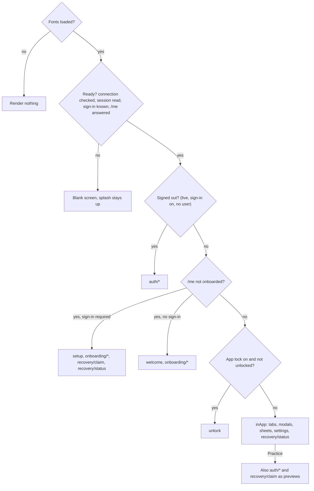

# Phone app structure

> How the Expo app in `mobile/` is laid out: folders, routes and their guards, tabs, modals and
> sheets, feature modules, build profiles, versioning and over-the-air updates.

Written against commit `012a9fc` (2026-11-22) and updated for the phone side of plans 02 to 07
(update banner, MPIN, phone protection, devices, alerts, texted codes, ID check steps, the
`tester-live` build), and on 2026-11-24 for the phone tests (Jest), version 0.2.0 and the MPIN
on Core plans and Satellite allocations. The app runs on Expo SDK 58, React Native 0.88 and
expo-router (see [`mobile/package.json`](../../mobile/package.json)). How to run it is in
[`mobile/README.md`](../../mobile/README.md). Why screens look the way they do is in
[`mobile/DESIGN.md`](../../mobile/DESIGN.md). The data layer has its own page:
[data-layer.md](data-layer.md).

## Folder layout

All paths are under `mobile/`. The `@/` import alias points at `src/`, and `@/assets/` at `assets/`
([`tsconfig.json`](../../mobile/tsconfig.json)).

| Path | What lives there | Rule of thumb |
|---|---|---|
| [`src/app/`](../../mobile/src/app) | expo-router routes. Every file is a screen; each `_layout.tsx` defines a navigator. | Keep route files thin. Most are 3 to 14 lines that read params and render a screen from `src/features`. |
| [`src/features/`](../../mobile/src/features) | One folder per product area: screens, flows, area hooks and helpers. | A route imports a screen from here. Features never import the Practice simulator (see [data-layer.md](data-layer.md#the-practice-boundary)). |
| [`src/components/ui/`](../../mobile/src/components/ui) | The shared UI kit: `Button`, `AmountKeypad`, `PinPad`, `HoldToConfirm`, `ModalScreen`, `Screen`, `Txt`, `Timeline` and more. | Import from the `index.ts` barrel. Usage rules are in [DESIGN.md](../../mobile/DESIGN.md). |
| [`src/components/nav/`](../../mobile/src/components/nav) | The tab bar (native and web) and the single list of tabs. | See [Tabs](#tabs). |
| [`src/components/icons.ts`](../../mobile/src/components/icons.ts) | Phosphor icons, required one file at a time to keep the bundle small. | Add an icon here, then import it from `@/components/icons`. |
| [`src/lib/`](../../mobile/src/lib) | Code with no screens: API client and simulator, storage, device session, sign-in, haptics, media, money and category helpers, build and version info, and the adapters for native packages (`screen-capture.ts`, `device-integrity.ts`, `notify.ts`). | Covered in [data-layer.md](data-layer.md). Features use an adapter, never the native package itself. |
| [`src/theme/`](../../mobile/src/theme) | Colour tokens, fonts, spacing and the `ThemeProvider`. | |
| [`src/data/fixtures/`](../../mobile/src/data/fixtures) | A JSON snapshot of server responses that seeds Practice mode. | See [practice-mode.md](../features/practice-mode.md). |
| [`assets/`](../../mobile/assets) | Icons, splash, Fluent 3D emoji (`emoji3d/`) and the sample bills (`samples/`). | |
| [`scripts/`](../../mobile/scripts) | `update.mjs` (over-the-air updates) and `build-tester.mjs` (public test site). | See [Versioning](#versioning-and-over-the-air-updates). |
| `__tests__/` folders, [`src/test/`](../../mobile/src/test) | Jest tests next to the code they test (`<what>.test.ts`), and the Jest setup and helpers (`setup.ts`, `practice.ts`, `contract.ts`). Not part of the app: [`tsconfig.json`](../../mobile/tsconfig.json) excludes them, [`tsconfig.test.json`](../../mobile/tsconfig.test.json) type-checks them. | Never put a test under `src/app/`: every file there is a screen. See [Checks](#checks). |

`ios/` and `android/` are not in the repo. They are generated from `app.json` and config plugins
(Continuous Native Generation), as [`mobile/AGENTS.md`](../../mobile/AGENTS.md) says.

## Root layout

[`src/app/_layout.tsx`](../../mobile/src/app/_layout.tsx) is the entry point. It does three jobs.

**1. Start-up.** `RootLayout` keeps the splash screen up, loads fonts, then starts these once, in
this order:

| Call | Module | Why |
|---|---|---|
| `startAuth()` | [`features/auth`](../../mobile/src/features/auth/README.md) | First, so the connection check knows whether a 401 means "sign in" or "no server". |
| `restorePracticeData()`, then `initConnection()` | [`lib/api/practice.ts`](../../mobile/src/lib/api/practice.ts), [`lib/api/connection.ts`](../../mobile/src/lib/api/connection.ts) | Loads the saved Practice data, then picks live server or Practice. Queries wait for the connection check, so no screen shows the sample data first. |
| `initHaptics()` | [`lib/haptics`](../../mobile/src/lib/haptics/index.ts) | Reads the saved haptics level and the Reduce Motion setting. |
| `initSession()` | [`lib/session.ts`](../../mobile/src/lib/session.ts) | Reads app lock (on by default once there's a PIN), the device PIN, biometric unlock and consents. |
| `initQueryFocus()` | [`lib/api/hooks.ts`](../../mobile/src/lib/api/hooks.ts) | Treats "app back in the foreground" as window focus for React Query. |

It wraps the app in `GestureHandlerRootView`, `SafeAreaProvider`, `QueryClientProvider` and the
app's `ThemeProvider`, then renders `Shell`. The `GestureHandlerRootView` has
`onTouchStartCapture={noteActivity}` (`// protection`): every touch resets the idle lock in
[`lib/auth/app-lock.ts`](../../mobile/src/lib/auth/app-lock.ts).

**2. Gate.** `Shell` reads the connection, the device session, `/me` and the sign-in gate. It
keeps a blank screen (with a spinner only when sign-in is required) until all of these are known:
the first connection check, the saved session, the sign-in state, and an answer (or error) from
`/me`. Then it hides the splash. It also sets the money locale from `/me`, starts the app-lock
watcher (`watchAppLock`: the background lock and the idle lock), and opens a waiting merchant
checkout once the person is in the app (see [Deep links](#deep-links)).

**3. Routes and chrome.** One `Stack` with `Stack.Protected` groups. A screen inside a group exists
only while its guard is true, so a locked or signed-out person cannot reach in-app screens by a
link. Around the `Stack`, from the outside in:

| Piece | Module | What it does |
|---|---|---|
| `SensitiveRouteGuard` | [`features/protection`](../../mobile/src/features/protection/README.md) | Renders nothing. Blocks screenshots and recordings while the route is in `SENSITIVE_ROUTES`: money-out, MPIN and ID screens and every screen with a PIN pad, `unlock` included (see [phone-security.md](../features/phone-security.md)). |
| `TesterHost` | [`features/tester`](../../mobile/src/features/tester/README.md) | Tester build only. |
| `UpdateChrome` | [`features/updates`](../../mobile/src/features/updates/README.md) | "A new version is ready" with **Restart**, above the main tabs only. In Expo Go, development builds, on the web or with the switch off, it renders the app untouched. |
| `RecoveryChrome` | [`features/recovery`](../../mobile/src/features/recovery/README.md) | The read-only bar while a recovery request waits. |
| `PrivacyCover` | `features/protection` | After the `Stack`: the iOS blur whenever the app isn't active. |

`UpdateChrome` and `RecoveryChrome` both sit above the app and give the screens below a top inset of
0 while their bar shows, so screens don't leave a gap.

### Route guards

The guards are plain booleans computed in `Shell`:

| Guard | True when | Screens it opens |
|---|---|---|
| `needsOnboarding` | not signed out, and `/me` says the account isn't onboarded | `setup` (only when sign-in is required), `welcome` (only when it isn't), `onboarding/*` |
| `locked` | not signed out, not onboarding, app lock on and not yet unlocked | `unlock` (fades in) |
| `inApp` | ready, not signed out, not onboarding, not locked | `(tabs)` and every in-app screen, modal and sheet listed below |
| `authOpen` | signed out, or `inApp` in Practice (a preview from Settings) | `auth/*` (fades in when signed out, a full-screen modal as a preview) |
| `claimOpen` | onboarding with sign-in required, or `inApp` in Practice | `recovery/claim` |
| `statusOpen` | `inApp`, or onboarding with sign-in required | `recovery/status` |
| none | always | `ai-consent` (sheet, can open over any screen) |

"Sign-in required" means sign-in is switched on and the app is on the live server
(`useSignInGate` in [`features/auth/gate.ts`](../../mobile/src/features/auth/gate.ts)). Practice
never asks anyone to sign in. While a recovery request waits for a person, `RecoveryChrome` adds a
read-only bar around the whole stack (see [`features/recovery/README.md`](../../mobile/src/features/recovery/README.md)).

### In-app screens and how they open

Two option presets sit in `Shell`:

- `modal`: `presentation: "fullScreenModal"`, no header, swipe-to-dismiss off.
- `sheet`: `presentation: "formSheet"`, grabber visible, detents `[0.55, 1]`.

| Route | Presentation | Screen comes from |
|---|---|---|
| `(tabs)` | tab navigator | [`components/nav/app-tabs.tsx`](../../mobile/src/components/nav/app-tabs.tsx) |
| `withdraw/[vaultId]` | `modal` | `features/proof/withdraw/WithdrawFlow` |
| `add-money/[vaultId]`, `new-vault` | `modal` | `features/vaults` |
| `emergency-request` | `modal` (`?receipt=<id>` opens the receipt upload) | `features/emergency` |
| `checkout/[intentId]` | `modal` | `features/pay/checkout` |
| `pay/[intentId]` | no animation; redirects to the checkout | [`app/pay/[intentId].tsx`](../../mobile/src/app/pay/[intentId].tsx) |
| `assistant` | `modal` | `features/assistant` |
| `proof/[id]` | pushed | `features/proof/detail` |
| `track`, `rules/[category]` | `sheet` | `features/proof/track`, `features/vaults/RulesSheet` |
| `wallet/index` / `wallet/[action]` | pushed / `modal` | [`features/wallet`](../../mobile/src/features/wallet/README.md) |
| `upcoming`, `activity`, `support`, `settings/*` | pushed | `features/home`, `features/assistant/support`, `features/account/settings` |
| `tester-feedback` | `modal` | [`features/tester`](../../mobile/src/features/tester/README.md) |
| `verify-id` | `modal` | [`features/kyc`](../../mobile/src/features/kyc/README.md) (photo check or the PAN, DigiLocker and bank steps) |
| `mpin` | `modal` | [`features/mpin`](../../mobile/src/features/mpin/README.md): the MPIN sheet, opened by `withMpin()` / `ensureMpin()` over a money flow |
| `ai-consent` | `sheet` with detents `[0.8, 1]` | [`features/ai-consent`](../../mobile/src/features/ai-consent/README.md) |

New screens under `settings/` (all inside the in-app guard, through the `settings` stack):

| Route | Presentation | Screen comes from |
|---|---|---|
| `settings/devices` | pushed | [`features/devices`](../../mobile/src/features/devices/README.md) `DevicesScreen` |
| `settings/trust-device` | full-screen modal, no swipe | `features/devices` `TrustDeviceScreen` |
| `settings/alerts` | pushed | [`features/alerts`](../../mobile/src/features/alerts/README.md) `AlertsScreen` |
| `settings/verify-phone` | full-screen modal, no swipe | [`features/phone-verify`](../../mobile/src/features/phone-verify/README.md) `PhoneVerifyScreen`; the route hands it `features/mpin`'s `MpinPanel` as a prop, since `features/mpin` already imports the code step from `features/phone-verify` |
| `settings/reset-mpin` | full-screen modal, no swipe | `features/mpin` `ResetMpinScreen` |
| `settings/start-over` | pushed | `features/account/settings/StartOverScreen` (Practice only; the row shows only in Practice) |

Nested layouts add a few rules of their own:

| Layout | What it sets |
|---|---|
| [`(tabs)/_layout.tsx`](../../mobile/src/app/%28tabs%29/_layout.tsx) | Renders `AppTabs`. |
| [`(tabs)/vaults/_layout.tsx`](../../mobile/src/app/%28tabs%29/vaults/_layout.tsx) | A stack with `initialRouteName: "index"`, so a deep link to one vault still has the list beneath it. |
| [`onboarding/_layout.tsx`](../../mobile/src/app/onboarding/_layout.tsx) | No back swipe on `protect`, because the PIN step has already created the account. |
| [`settings/_layout.tsx`](../../mobile/src/app/settings/_layout.tsx) | `security` (Change MPIN, app lock, payments shortcut), `trust-device`, `reset-mpin` and `verify-phone` (flows with a code or the MPIN) are full-screen modals with no swipe. |
| [`auth/_layout.tsx`](../../mobile/src/app/auth/_layout.tsx) | A plain headerless stack for the signed-out screens. |

The rule for choosing a presentation is R7 in [DESIGN.md section 3](../../mobile/DESIGN.md#3-navigation-and-placement-thumb-reach-research):
money flows, camera, PIN, checkout and the assistant are full-screen modals; short choices and
explanations are form sheets; vault detail and settings are pushed; sheets are never stacked.
A new modal or sheet must be registered in the root `Stack` inside the right guard, or the
default (pushed) presentation applies.

### Deep links

The URL scheme is `vaultwise` ([`app.json`](../../mobile/app.json)). Merchant links
(`vaultwise://pay/<intentId>`) take a special path:

1. [`src/app/+native-intent.ts`](../../mobile/src/app/+native-intent.ts) catches the link on a
   phone before routing. It checks the id with `parseIntentId`, stores it with
   `setPendingCheckout` ([`lib/pending-checkout.ts`](../../mobile/src/lib/pending-checkout.ts)), and
   sends the app to Home on a cold start (or leaves the current screen alone). A pay link with a bad
   id is dropped. Every other link passes through unchanged.
2. Once `inApp` is true, `Shell` takes the pending id and pushes `checkout/[intentId]`. So a link
   that arrives while the app is locked or onboarding opens after unlock or onboarding.
3. [`src/app/pay/[intentId].tsx`](../../mobile/src/app/pay/[intentId].tsx) covers the web preview
   and in-app links. It sits behind the same `inApp` guard and redirects to the checkout, or goes
   back to Home with `router.dismissTo("/")` when the id is not valid.

The DigiLocker step opens its in-app browser with `vaultwise://verify-id` as the return address
(`Linking.createURL("verify-id")` in `features/kyc/external.ts`). That link passes through
`+native-intent.ts` unchanged and lands behind the `inApp` guard like any other.

## Tabs

Five tabs, defined once in [`components/nav/tabs.ts`](../../mobile/src/components/nav/tabs.ts)
(`TABS`): Home, Vaults, Pay (centre), Invest, Emergency. The native bar, the web bar and tab
swiping all read this list, so the order cannot drift. `neighbourTab(name, step)` returns the tab
before or after one.

| File | Platform | What it does |
|---|---|---|
| [`app-tabs.tsx`](../../mobile/src/components/nav/app-tabs.tsx) | iOS, Android | System tabs (`NativeTabs` from `expo-router/unstable-native-tabs`). `minimizeBehavior="never"`, a `tab.change` haptic on press, and a badge on Home for emergency receipts due. |
| [`app-tabs.web.tsx`](../../mobile/src/components/nav/app-tabs.web.tsx) | Web preview | A phone-style bottom bar built with `expo-router/ui` (`Tabs`, `TabList`, `TabTrigger`) that mirrors the native one. |

Each tab root in `src/app/(tabs)/` does the same two things: calls `useRefreshOnFocus()` (tabs
stay mounted, so coming back re-reads stale queries) and wraps its screen in
`<TabSwipe tab="...">`. The vault detail route `(tabs)/vaults/[id].tsx` is pushed and has no
`TabSwipe`, which matches DESIGN.md rule R12 (no custom horizontal gestures on pushed screens).

### Tab swipe module

[`src/features/tab-swipe/`](../../mobile/src/features/tab-swipe) lets a sideways swipe on a tab
root move to the next or previous tab.

| File | What it holds |
|---|---|
| [`config.ts`](../../mobile/src/features/tab-swipe/config.ts) | `TAB_SWIPE`: `enabled`, `direction` (`"page"` or `"reverse"`), `distance` 72 pt, `velocity` 650 pt/s, `activeX` 24 pt, `cancelY` 14 pt. |
| [`model.ts`](../../mobile/src/features/tab-swipe/model.ts) | Pure functions: `stepFor` (-1, 0 or +1 from distance and speed; a swipe must be more than twice as wide as it is tall), `follow` (how far the screen trails the finger, with a small rubber band at either end), and `markEntering` / `takeEntering` (which side the next tab slides in from). |
| [`TabSwipe.tsx`](../../mobile/src/features/tab-swipe/TabSwipe.tsx) | A `Gesture.Pan` from react-native-gesture-handler with Reanimated. Vertical movement past `cancelY` cancels it, so scrolling wins. On a step it plays `tab.change` and calls `router.navigate(target.href)`. Respects Reduce Motion. |
| [`index.ts`](../../mobile/src/features/tab-swipe/index.ts) | Barrel. Its comment says how to switch it off (`TAB_SWIPE.enabled`) or remove it (delete the folder and the `<TabSwipe>` wrappers). |

## Feature modules

Most areas (home, vaults, pay, proof, emergency, invest, assistant, account) are plain folders.
Routes import their screens by file path, for example `@/features/home/HomeScreen`.

Areas that can be switched off or removed follow a stricter pattern. These are `auth`, `kyc`,
`recovery`, `wallet`, `custom-rules`, `tester`, `updates`, `mpin`, `protection`, `devices`,
`alerts`, `phone-verify`, and in part `ai-consent` and `tab-swipe`.

| Part | Purpose | Example |
|---|---|---|
| `index.ts` barrel | The only import path other code uses. It re-exports the switch, the screens and the hooks. | [`features/wallet/index.ts`](../../mobile/src/features/wallet/index.ts) |
| `config.ts` switch | One exported constant that turns the feature on or off. Some read `PRACTICE_ONLY`. | `WALLET_ENABLED = true`; `KYC_ENABLED = !PRACTICE_ONLY` |
| `README.md` | What the feature does, how to switch it off, and a table of every line to delete to remove it. | [`features/wallet/README.md`](../../mobile/src/features/wallet/README.md) |
| `// marker` comments | Each line the feature adds to shared files carries a trailing comment with the feature name (`// wallet`, `// identity`, `// tester`, `// custom-rules`, `// ai-consent`; `{/* wallet */}` in JSX). The README's removal table says "remove each line marked ...". | `...walletLive, // wallet` in [`lib/api/client.ts`](../../mobile/src/lib/api/client.ts) |

Markers in use: `identity` (covers `auth`, `kyc` and `recovery` together), `kyc-checks` (the ID
check steps), `wallet`, `ai-consent`, `custom-rules`, `tester`, `updates`, `mpin`, `protection`,
`devices` (also used by `phone-verify` and the MPIN reset), and `alerts`. To see every line a
module adds to shared code, grep for its marker, for example `grep -rn "// protection" mobile/src`.

| Module | Switch | README |
|---|---|---|
| auth (sign-in) | `SIGN_IN_ENABLED = !PRACTICE_ONLY` | [README](../../mobile/src/features/auth/README.md) |
| kyc (Verify your ID) | `KYC_ENABLED = !PRACTICE_ONLY && !TESTER_LIVE` | [README](../../mobile/src/features/kyc/README.md) |
| recovery | `RECOVERY_ENABLED = !PRACTICE_ONLY && !TESTER_LIVE` | [README](../../mobile/src/features/recovery/README.md) |
| wallet | `WALLET_ENABLED = true` | [README](../../mobile/src/features/wallet/README.md) |
| custom-rules | `CUSTOM_RULES_ENABLED = true` | [README](../../mobile/src/features/custom-rules/README.md) |
| tester | `TESTER_ENABLED = PRACTICE_ONLY && EXPO_PUBLIC_TESTER === "1"` | [README](../../mobile/src/features/tester/README.md) |
| updates ("A new version is ready") | `UPDATES_PROMPT_ENABLED = true`; active only where `UPDATES_ACTIVE` (a release build with updates) | [README](../../mobile/src/features/updates/README.md) |
| mpin (the MPIN sheet, shortcut, reset) | `MPIN_ENABLED = true` | [README](../../mobile/src/features/mpin/README.md) |
| protection (plan 04) | one switch per protection in `PROTECTION` | [README](../../mobile/src/features/protection/README.md) |
| devices (Your devices, Trust this phone, remote sign-out) | `DEVICES_ENABLED = true` | [README](../../mobile/src/features/devices/README.md) |
| alerts (bell, inbox, push) | `ALERTS_ENABLED = true` | [README](../../mobile/src/features/alerts/README.md) |
| phone-verify (phone number, code step) | `PHONE_VERIFY_ENABLED = true` | [README](../../mobile/src/features/phone-verify/README.md) |
| ai-consent | no `config.ts` | [README](../../mobile/src/features/ai-consent/README.md) |
| tab-swipe | `TAB_SWIPE.enabled = true` | none; see `index.ts` |

`protection/config.ts` has no imports, because three files in `lib/` (`auth/app-lock.ts`,
`auth/firebase.ts`, `session.ts`) read its switches directly. Everything else imports the barrel.

**Shared seams these modules use:**

| Seam | Where | Used by |
|---|---|---|
| `onBeforeSignOut(fn)` | [`features/auth/gate.ts`](../../mobile/src/features/auth/gate.ts) | `features/alerts/push.ts` (unregisters the push token while the login still works) |
| `signOutOfVaultwise(notice, { forgetDevice })` | `features/auth/gate.ts` | Every sign-out: before-sign-out steps, then Firebase, then `resetDevice()`. Used by Settings, `startAuth()` on `signed_out`, the remote sign-out (`useDeviceWatch`), the wrong-PIN lockout and Delete account with a login on the phone |
| `resetDevice({ forgetDevice })` | [`lib/session.ts`](../../mobile/src/lib/session.ts) | `signOutOfVaultwise()`, and directly: Delete account with nobody signed in, Start Practice over after the lockout with nobody signed in, Firebase ending a session by itself |
| `onDeviceRevoked(fn)` | [`lib/api/device.ts`](../../mobile/src/lib/api/device.ts) | `features/devices/useDeviceWatch.ts` (signs out, or with sign-in off drops the install id with `forgetInstallId()`) |
| `onSignedOut(fn)` | [`lib/api/signed-out.ts`](../../mobile/src/lib/api/signed-out.ts) | `startAuth()` in `features/auth/gate.ts`: 401 `signed_out` from any request |
| `withMpin()` / `ensureMpin()` | [`features/mpin/ask.ts`](../../mobile/src/features/mpin/ask.ts) | Every money flow ([mpin.md](../features/mpin.md#on-the-phone)) |
| `registerPracticeSlice({ sensitive })` | [`lib/api/demo/persist.ts`](../../mobile/src/lib/api/demo/persist.ts) | The simulator's `state`, `person`, `proofs`, `checkouts`, `mpin`, `devices`, `alerts` |
| `withSystemUi()` | [`lib/auth/app-lock.ts`](../../mobile/src/lib/auth/app-lock.ts) | Camera, picker, biometric prompts, DigiLocker, UPI apps, saving the payments shortcut |

When a switch is off, the routes stay registered but send people elsewhere. For example
[`app/wallet/index.tsx`](../../mobile/src/app/wallet/index.tsx) returns `<Redirect href="/" />`
when `WALLET_ENABLED` is false.

## Build profiles and PRACTICE_ONLY

[`mobile/eas.json`](../../mobile/eas.json) defines the EAS build profiles. Each has its own update
channel.

| Profile | Channel | Distribution | Practice only | Notes |
|---|---|---|---|---|
| `development` | `development` | internal | no | Development client (custom haptics, Face ID). |
| `development-simulator` | `development` | internal | no | Extends `development`; iOS simulator build. |
| `preview` | `preview` | internal | no | |
| `apk` | `apk` | internal | yes (`EXPO_PUBLIC_PRACTICE_ONLY=1`) | Android `.apk`; build number counts up. |
| `tester-live` | `tester-live` | internal | no | Android `.apk` for online testers: live data and sign-in against `EXPO_PUBLIC_API_URL` (in the profile's `env`: `https://vaultwise.online`), EAS environment `preview`, no ID check or recovery (`TESTER_LIVE`). Build number counts up. No npm script: `npx eas-cli@latest build --profile tester-live --platform android`. |
| `production` | `production` | store (default) | yes (`EXPO_PUBLIC_PRACTICE_ONLY=1`) | Build number counts up. `submit.production` is empty. |

`cli.appVersionSource` is `"remote"`, so EAS keeps the build numbers.

The `tester-live` build is bundled on EAS, which doesn't upload `mobile/.env.local` (it's
git-ignored). Its Firebase values (`EXPO_PUBLIC_FIREBASE_*`) must come from the EAS `preview`
environment or the profile's `env`, or sign-in stays off.

[`src/lib/build.ts`](../../mobile/src/lib/build.ts) exports `PRACTICE_ONLY`. It is true when
either signal says so, so neither alone can switch it off:

- `EXPO_PUBLIC_PRACTICE_ONLY === "1"` at bundle time, or
- the build's `expo-updates` channel is `apk` or `production` at run time (an over-the-air update
  is bundled on a computer, where the build profile's env does not apply).

It also exports `TESTER_LIVE`: true when the `expo-updates` channel is `tester-live` (read at run
time only; there is no bundle-time variable for it).

What `PRACTICE_ONLY` and `TESTER_LIVE` change:

| Where | `PRACTICE_ONLY` | `TESTER_LIVE` |
|---|---|---|
| [`lib/api/connection.ts`](../../mobile/src/lib/api/connection.ts) | The connection preference starts as `"demo"`, and `applyConnection` forces `"demo"`. The app never talks to a server. | Nothing: live, like a preview build |
| [`features/auth/config.ts`](../../mobile/src/features/auth/config.ts) | Sign-in off | Sign-in on (needs the Firebase values in the build) |
| [`kyc/config.ts`](../../mobile/src/features/kyc/config.ts), [`recovery/config.ts`](../../mobile/src/features/recovery/config.ts) | Verify your ID and account recovery off | Also off, so testers never upload real IDs |
| [`features/tester/config.ts`](../../mobile/src/features/tester/config.ts) | Tester mode can only be on in a Practice-only bundle | |
| [`features/account/settings/SettingsHome.tsx`](../../mobile/src/features/account/settings/SettingsHome.tsx) | Shows a fixed "Practice" row instead of the "Data source" row | |
| [`features/account/settings/AboutScreen.tsx`](../../mobile/src/features/account/settings/AboutScreen.tsx) | A short Practice privacy summary, no web links | Not tied to it: any build that isn't Practice-only and has `EXPO_PUBLIC_API_URL` links to the server's `/privacy` and `/terms` pages |

The comment in `build.ts` gives the reason: Apple (5.1.1(ix), 3.2.1(viii)) and Google Play accept
real-money finance apps, and apps that collect ID documents, only from a licensed company.

## Versioning and over-the-air updates

| Piece | Where | What it does |
|---|---|---|
| Version | `expo.version` in [`app.json`](../../mobile/app.json) (`0.2.0` since 2026-11-24) | `MAJOR.MINOR.PATCH`. Rules for each part are at the top of the changelog. A release is tagged `v<version>` on the commit that releases it ([development process](../process/development-process.md)). |
| Changelog | [`mobile/CHANGELOG.md`](../../mobile/CHANGELOG.md) | Notes go under **Unreleased**; on release they move under the new version and date. |
| Runtime version | `runtimeVersion.policy: "fingerprint"` in `app.json` | An update only reaches builds whose native fingerprint matches, so a JS update can't land on a build missing a native module. |
| Update server | `updates.url` in `app.json` | EAS Update for this project. |
| Publish script | [`scripts/update.mjs`](../../mobile/scripts/update.mjs) | `npm run update:apk -- "What changed"`, `npm run update:production -- "..."` or `npm run update:tester-live -- "..."`. |
| Update banner | [`src/features/updates/`](../../mobile/src/features/updates/README.md) | "A new version is ready" with **Restart** once an update has downloaded. |
| Running version | [`src/lib/version.ts`](../../mobile/src/lib/version.ts) | `appVersion()` and `versionLine()`, shown on **Profile → About Vaultwise**. |

`scripts/update.mjs` takes a channel (`apk`, `production`, `preview` or `tester-live`), maps it to an
EAS environment, and runs `npx eas-cli@latest update --channel <channel> --environment <env>`. The
message gets the short commit hash appended so an update can be traced. It warns when `mobile/`
has uncommitted changes, and it sets `EXPO_PUBLIC_PRACTICE_ONLY=1` for the `apk` and
`production` channels. `package.json` has scripts for `apk`, `production` and `tester-live`.

**`tester-live` carries its build profile's values.** An update is bundled on the computer, so a
build profile's `env` in `eas.json` doesn't reach it by itself. For `tester-live` (`profile` in
`CHANNELS`), `profileEnv()` reads the profile's `EXPO_PUBLIC_*` values from `eas.json` and passes
the ones not already set in the shell. It stops with a message if `EXPO_PUBLIC_API_URL` is missing
or still the `YOUR-DOMAIN` placeholder.

**The update banner.** expo-updates checks once at launch and applies a downloaded update on the
next cold start. On top of that, `useUpdatePrompt()` checks again (and downloads) each time the app
comes back to the foreground, at most every 30 minutes (`CHECK_EVERY_MS`), and not while an update is
already waiting. When `isUpdatePending` is true, `UpdateChrome` shows the banner on the main tabs
only, never over a flow, PIN pad, sheet or sign-in screen. **Restart** calls `Updates.reloadAsync()`;
if that fails the banner says to close and reopen the app. The close button hides it until the next
restart. `UPDATES_ACTIVE` is false on the web, in development (`__DEV__`), in Expo Go and when
expo-updates is disabled; then the Updates API is never called. Only a release build (the APK, a
store or `tester-live` build) can show it.

`appVersion()` reads the version from `expo-constants`, the channel from `expo-updates`, and the
first 8 characters of the running update's id (null when the build's own code runs). On the web
the channel is `"web"`. In Expo Go and development builds the update fields are null.
`versionLine()` formats it as one line, for example `0.2.0 · apk · update 3f2a9c1b (22 Nov)`.

The release steps (code change vs native change vs tagged release) are in
[`mobile/README.md`](../../mobile/README.md#releases-and-updates).

## Tester build

`npm run build:tester` runs [`scripts/build-tester.mjs`](../../mobile/scripts/build-tester.mjs).
It loads `mobile/.env.local`, stops if `EXPO_PUBLIC_POSTHOG_KEY` is missing, and runs
`npx expo export --platform web` with `EXPO_PUBLIC_PRACTICE_ONLY=1` and `EXPO_PUBLIC_TESTER=1`.
The result is a Practice-only website in `dist/`. `npm run deploy:tester` builds it and publishes
with `eas deploy --prod`. Set-up, what is recorded, and how to remove it are in
[`src/features/tester/README.md`](../../mobile/src/features/tester/README.md).

## Checks

| Command (in `mobile/`) | What it checks |
|---|---|
| `npm run typecheck` | `tsc --noEmit` for the app, then `tsc --noEmit -p tsconfig.test.json` for the tests (it adds Jest's and Node's types) |
| `npm run lint` | `expo lint` (CI runs `npx eslint src scripts --max-warnings=0`) |
| `npm test` | Jest with the `jest-expo` preset ([`jest.config.js`](../../mobile/jest.config.js)): unit tests and the contract tests. One area: `npx jest src/features/mpin`; the contract tests only: `npx jest contract` |
| `npm run doctor` | After package changes |
| `npx expo export --platform android` (and `web`) | Before a build or update; CI builds the web bundle |

**Tests** (since 2026-11-24) match `src/**/__tests__/**/*.test.ts(x)`; `src/app/` is ignored.
[`src/test/setup.ts`](../../mobile/src/test/setup.ts) runs after the preset's own setup: in-memory
AsyncStorage (the package's own Jest mock) and secure store (a `Map`), so `lib/storage.ts` and the
Practice save run for real. `src/test/practice.ts` (`settle()`) runs Practice calls under fake timers;
`src/test/contract.ts` reads the shared vectors. `contract-<rule>.test.ts` files check the phone's
copy of a rule the server also implements against `../tests/contract/vectors/<rule>.json`, the
same file the server's suite reads, so CI checks out the whole repo
([tests/contract/README.md](../../tests/contract/README.md)). Today's tests cover the MPIN policy
and errors, the protection module (`routes.ts`, `pin-policy.ts`, `https.ts`), `lib/invest.ts`, API
errors and ID numbers, and the Practice simulator (save and restore, devices, investing, every money
move against the server's money table); see [practice-mode.md](../features/practice-mode.md#tests).

CI ([`.github/workflows/ci.yml`](../../.github/workflows/ci.yml), job "Phone app") runs the type
check, lint, `npm test` and the web export on every push to `main` and every pull request.

`app.json` turns on typed routes and the React Compiler (`experiments.typedRoutes`,
`experiments.reactCompiler`). Native behaviour (screen capture, the secure store, biometrics, push,
the root check, the update banner) can only be checked on a release or development build on a real
phone.

## Maintainability notes

- **Guards live inline in `Shell`.** Eight booleans in
  [`_layout.tsx`](../../mobile/src/app/_layout.tsx) (lines 72-81 at `012a9fc`) mix sign-in,
  onboarding, lock, recovery and Practice rules. A pure function that takes the inputs and returns
  the guards would be easier to read and could be unit tested.
- **Registering a screen is a two-step job.** A route file alone gets the default pushed
  presentation and no guard. Modals and sheets must also be added to the right `Stack.Protected`
  group in the root layout.
- **The feature-module pattern is not uniform.** `tab-swipe` has no README and no `// tab-swipe`
  markers on the five tab roots. `ai-consent` has no `config.ts`. The remaining areas have no
  barrel, so other code imports their internal files directly.
- **The Practice-only rule is written in three places:** `eas.json` (`env`), `lib/build.ts`
  (`PRACTICE_CHANNELS`) and `scripts/update.mjs` (`CHANNELS[...].practiceOnly`). Adding a channel
  means editing all three. `tester-live` adds a fourth spot: `TESTER_LIVE` compares the channel
  name as a string in `build.ts`.
- **Root layout chrome is growing.** Five pieces (`SensitiveRouteGuard`, `TesterHost`,
  `UpdateChrome`, `RecoveryChrome`, `PrivacyCover`) sit around the `Stack`, each marked
  with its module. Keep the order in the table above: the two bars both rewrite the top inset.
- **The version is written twice.** `app.json` `expo.version` is the one the app reads;
  `package.json` `version` (also `0.2.0`) is set by hand and no script keeps the two together.
- **Tests reach logic, not screens.** No component or route is tested. `tab-swipe/model.ts`,
  `+native-intent.ts`, `lib/version.ts` and the guards in `Shell` are the next pure candidates.
