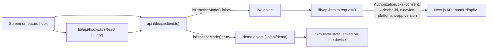
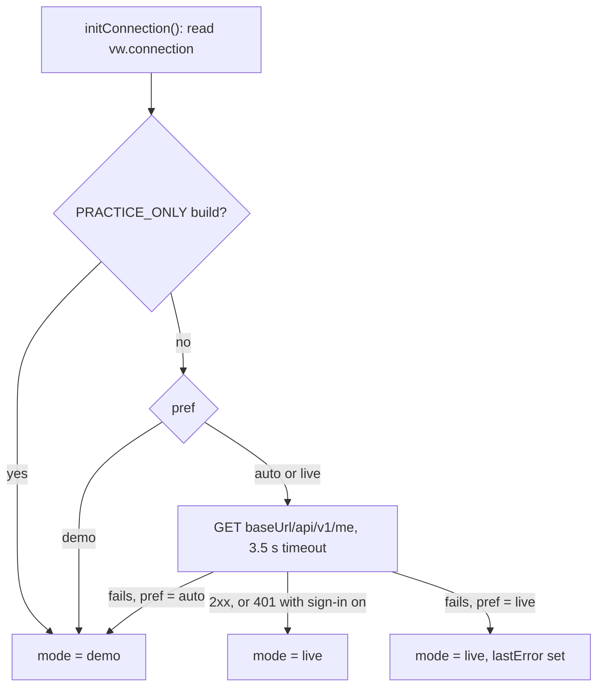

# Phone app data layer

> How the app in `mobile/` gets, caches and stores data: the API client that switches between the
> live server and Practice, HTTP and headers, React Query keys and hooks, errors, on-device storage,
> the device session, and the small helpers screens use for money, categories, media and links.

Written against commit `012a9fc` (2026-11-22) and updated for the phone side of plans 03 to 07:
device headers, the MPIN in request bodies, devices, alerts and codes, the ID check steps, secure
storage for the sign-in session, and sign-out clean-up. All paths are under `mobile/src/lib/` unless
the link says otherwise. The folder layout and routes are in [app-structure.md](app-structure.md).
The on-device simulator is in [practice-mode.md](../features/practice-mode.md). Server endpoints
are in [docs/reference/api.md](../reference/api.md).

## Overview

Screens never call `fetch` for app data. They call `api.*` directly for writes and use React Query
hooks for reads. Every response uses integer minor units (paise, cents); request bodies take major
units ([`api/types.ts`](../../mobile/src/lib/api/types.ts) header comment).

## lib/api

| File | What it holds | Key exports |
|---|---|---|
| [`client.ts`](../../mobile/src/lib/api/client.ts) | The live API as one object, and the Proxy that picks live or Practice per call. | `api`, `Api`, `ApiError` (re-export), `practiceDeviceTools` (re-export) |
| [`http.ts`](../../mobile/src/lib/api/http.ts) | `fetch` wrapper: base URL, timeout, headers, JSON, errors, multipart. | `request`, `post`, `formWith`, `authHeaders` |
| [`device.ts`](../../mobile/src/lib/api/device.ts) | This install's id, the three device headers, and the "signed out from another device" signal. | `installId`, `deviceHeaders`, `devicePlatform`, `appVersionName`, `noteDeviceRevoked`, `onDeviceRevoked`, `clearDeviceRevoked` |
| [`connection.ts`](../../mobile/src/lib/api/connection.ts) | Which source the app uses and the server address. | `initConnection`, `applyConnection`, `getConnection`, `subscribeConnection`, `defaultBaseUrl`, `ConnectionPref`, `Mode` |
| [`practice.ts`](../../mobile/src/lib/api/practice.ts) | Practice as features see it. | `PRACTICE_PIN` (`"246810"`), `isPracticeMode`, `usePracticeMode`, `restorePracticeData` |
| [`keys.ts`](../../mobile/src/lib/api/keys.ts) | Query keys and invalidation helpers. | `qk`, `withMode`, `byName`, `byKey`, `invalidate`, `MONEY_QUERIES` |
| [`hooks.ts`](../../mobile/src/lib/api/hooks.ts) | The `QueryClient` and the shared query hooks. | `queryClient`, `useApiQuery`, `useConnection`, `useRefreshOnFocus`, `useMe`, `useDashboard`, `useRules`, `useInvalidateMoney`, ... |
| [`errors.ts`](../../mobile/src/lib/api/errors.ts) | The one error type and its plain-English messages. | `ApiError` (with `code` and `data`), `errorMessage`, `isRecoveryHold`, `ON_HOLD` |
| [`observe.ts`](../../mobile/src/lib/api/observe.ts) | A hook to hear when a named call succeeds (tester mode). | `observeApi`, `observed` |
| [`wallet.ts`](../../mobile/src/lib/api/wallet.ts), [`wallet-types.ts`](../../mobile/src/lib/api/wallet-types.ts) | Live wallet endpoints and their types (money moves take `pin`). See [`features/wallet/README.md`](../../mobile/src/features/wallet/README.md). | `walletLive` |
| [`identity.ts`](../../mobile/src/lib/api/identity.ts), [`identity-types.ts`](../../mobile/src/lib/api/identity-types.ts), [`identity-ids.ts`](../../mobile/src/lib/api/identity-ids.ts) | Live KYC (photo and steps) and recovery endpoints, defensive parsing, ID number rules. See [identity.md](../features/identity.md#on-the-phone). | `identityLive`, `toKycView`, `toKycSteps`, `toClaim`, `installId` (re-export), `docTypesFor`, `validateIdNumber` |
| [`security.ts`](../../mobile/src/lib/api/security.ts), [`security-types.ts`](../../mobile/src/lib/api/security-types.ts) | Live devices, alerts, push registration, texted codes, phone number and MPIN reset, read defensively. See [devices-alerts-otp.md](../features/devices-alerts-otp.md#on-the-phone). | `securityLive`, `toDevice`, `toAlert`, `Device`, `AlertItem`, `OtpSent`, `OtpVerified` |
| [`pay-sim.ts`](../../mobile/src/lib/api/pay-sim.ts), [`pay-types.ts`](../../mobile/src/lib/api/pay-types.ts) | Pay with Vaultwise, simulated on the phone (the server has no `/pay` routes yet). | `practiceCheckouts`, `payDryRun`, `PaymentIntent` |
| [`samples.ts`](../../mobile/src/lib/api/samples.ts) | The seven sample bills and where to load their images. | `DEMO_SAMPLES`, `sampleSource` |
| [`types.ts`](../../mobile/src/lib/api/types.ts) | Response shapes of `/api/v1`. | `Me`, `Vault`, `Dashboard`, `ProofView`, `Minor`, ... |
| [`demo/`](../../mobile/src/lib/api/demo) | The Practice simulator. | See [practice-mode.md](../features/practice-mode.md). |

### client.ts: one API, two sources

`live` is an object literal with one method per endpoint. It spreads `walletLive`, `identityLive`
and `securityLive` in, then adds the rest: `/me`, onboarding, dashboard, vaults, deposits,
withdrawals, proofs and appeals, emergency, limits, portfolio and Core investing, `changeMpin`,
region, reset, export, insight, activity, accounts, badges, samples, the assistant, and Pay with
Vaultwise.

Every money move out takes the MPIN as a last, optional `pin` argument and sends it in the body:
`withdraw`, `walletSpend`, `walletCashOut`, `walletMove`, `walletSettings` (in `input.pin`),
`emergencyWithdraw` (in `input.pin`), `setLimits`, `buyCore` and `reset`. Screens get the MPIN from
`withMpin()` in [`features/mpin`](../../mobile/src/features/mpin/README.md); see
[mpin.md](../features/mpin.md#on-the-phone).
`export type Api = typeof live` makes that object the contract. The simulator in
[`demo/index.ts`](../../mobile/src/lib/api/demo/index.ts) ends with `satisfies Api`, so a missing
or mismatched method fails the type check.

`api` is a `Proxy` over `live`. On every property read it asks `isPracticeMode()` and returns the
method from `demo` or `live`, passed through `observed()`. A screen therefore always calls the
source that is current at the moment it reads `api.x`.

A few live methods do more than one request:

| Method | Extra behaviour |
|---|---|
| `onboarding` | 130 s timeout, because seeding demo history on the server can take about 2 minutes. |
| `emergencyWithdraw` | Accepts a 422 body (a safety limit stopped it). If the reply has no plan it asks `/emergency/preview` again, so the screen can still say why. |
| `checkout`, `confirmCheckout` | `orPayDryRun`: on a 404 from `/pay/*` it reads `/vaults` and runs `payDryRun` against the customer's real vaults. Nothing is paid; the intent is marked `dryRun`. |
| `payIntents` | Always the dry run's sample checkouts, sized to the live wallet currency. |
| `reset(pin?)` | Posts `/reset` (with `{ pin }` when given: closing a signed-in account needs the MPIN), then resets the dry-run checkouts. |
| `assistant` | Streams with `expo/fetch` and calls `onDelta` per chunk. It builds its own headers: `Authorization`, the three device headers, and `x-ai-consent` from the **assistant** switch (`session.aiConsent`), not from `aiChecks`. The server answers 403 `ai_consent_required` without a yes; `useChat.ts` turns that into "Turn on AI answers first…" ([ai.md](../features/ai.md)). |
| `exportUrl`, `sampleUri` | Build URLs from the current base URL; no request. |

### http.ts: requests and headers

`request<T>(path, init, { timeoutMs, acceptStatus })`:

- Calls `${baseUrl}/api/v1${path}` with a 20 s timeout (`AbortController`).
- Adds `Content-Type: application/json` unless the body is `FormData`.
- Adds `authHeaders(baseUrl)`: `Authorization: Bearer <Firebase ID token>` only while someone is
  signed in and `baseUrl` is the server their login belongs to. It waits for the saved session
  first. If the token can't be fetched it throws instead of sending the request unsigned.
- Adds `x-ai-consent: yes | no` from the session's `aiChecks`. It is `no` until the person says yes
  ([`features/ai-consent/README.md`](../../mobile/src/features/ai-consent/README.md)).
- Adds the device headers from `deviceHeaders()` in [`device.ts`](../../mobile/src/lib/api/device.ts):
  `x-device-id` (the install id), `x-device-platform` (`ios`, `android` or `web`) and
  `x-app-version` (`expo.version`). They go with every request, signed in or not. (Practice calls
  never reach `request()`.)
- Parses the body as JSON if it can. A non-2xx status not in `acceptStatus` throws
  `ApiError(body.error ?? "Request failed (<status>)", status, body.code, body)`. The fourth
  argument, `data`, is the whole error body, so callers can read extra fields such as `triesLeft`,
  `lockedUntil`, `trustableAt`, `allowedAt` and `retryAt`. A 429 with a `Retry-After` header (the
  shared rate limiter's) gets `retryAt` (ms) from it when the body has none. A 429 is never read as
  a sign-out.
- A 401 with code `device_revoked` also calls `noteDeviceRevoked()` before throwing, which tells
  `features/devices` to sign out (see [Sign-out and device reset](#sign-out-and-device-reset)).
- A 401 with code `signed_out`, from any request, calls `noteSignedOut({ message, sentAt })` in
  [`signed-out.ts`](../../mobile/src/lib/api/signed-out.ts), with when the request went out.
  `startAuth()` signs out once with the server's words, live, while someone is signed in, and only
  when the request was sent since the current sign-in. The assistant stream reports it the same way.
- A network failure throws `ApiError` with status 0: "Can't reach Vaultwise..." or, on timeout,
  "Vaultwise took too long to answer...".

`post(path, body)` is a JSON POST. `formWith(file, fields)` builds a multipart body: a `Blob` on the
web, a `{ uri, name, type }` object on native.

### connection.ts: auto, live, demo

| Preference | Behaviour |
|---|---|
| `auto` (default) | Pings the server at launch. Live if it answers, Practice (`demo`) if not. |
| `live` | Pings, but stays live even if the ping fails; `lastError` explains. |
| `demo` | Practice on the phone; no ping. |

State is `{ pref, mode, baseUrl, checked, lastError }`. It starts as `mode: "demo"`,
`checked: false`. `checked` turns true after the first decision; `useApiQuery` waits for it, so no
query runs against the wrong source.

- `defaultBaseUrl()`: `EXPO_PUBLIC_API_URL` if set; `http://localhost:3000` on the web; otherwise
  port 3000 on the host Metro serves from (`Constants.expoConfig.hostUri`).
- `applyConnection(pref, baseUrl)` saves `{ pref, baseUrl }` under `vw.connection` in the
  background and re-checks. A sequence number (`applySeq`) drops the result of a slower, older
  check. People change it on **Profile → Data source**
  ([`ConnectionScreen.tsx`](../../mobile/src/features/account/settings/ConnectionScreen.tsx)).
- A 401 to the unsigned ping counts as "reachable" only when this app can sign in.
- `usableBaseUrl(url)`: a saved address that fails the https rule (`allowedServerAddress()` in
  `features/protection/https.ts`) is replaced by `defaultBaseUrl()`, both in `initConnection()` and
  `applyConnection()`. The default comes with the build and isn't checked again.

### keys.ts and hooks.ts: React Query

A cached query's key is `[mode, name, ...args]`. `qk` builds the part after the mode (for example
`qk.vault(id)` is `["vault", id]`), and `useApiQuery` prepends the mode with `withMode`. Switching
between live and Practice therefore never shows the other source's cache.

| Helper | Use |
|---|---|
| `byName(...names)` / `byKey(key)` | Predicates that match cached queries in either mode. |
| `invalidate(qc, ...names)` | Marks the named queries stale in both modes. |
| `MONEY_QUERIES` | Every query that shows a balance (dashboard, vaults, vault, emergency, limits, activity, badges, portfolio, pay-intents, invest-core, invest-satellite, checkout, accounts, wallet), plus `alerts`, because a money move adds one. `useInvalidateMoney()` refreshes them all after money moves. |

New keys: `qk.devices()` (Your devices) and `qk.alerts()` (the bell and the inbox, which poll every
60 seconds and stop on a 404; see `features/alerts/hooks.ts`).

`queryClient` defaults: `staleTime` 15 s, `refetchOnWindowFocus` on, and `retry: shouldRetry`: a
4xx answer (429 included) is never retried, anything else (status 0, a 5xx) once. Mutations do not
retry. `useMe()` stays fresh for 30 s (`ME_STALE_MS`), since `GET /me` counts toward the server's
per-person rate limit. `initQueryFocus()` maps `AppState` "active" to React Query focus on phones.
`useRefreshOnFocus()` refetches stale active queries each time a tab or screen regains focus
(after the first).

Shared hooks in `hooks.ts`: `useMe`, `useDashboard`, `useVaults`, `useVault(id)`, `useEmergency`,
`useLimits`, `usePortfolio`, `useInvestCore`, `useInvestSatellite`, `useInsight` (stale after
5 min), `useActivity`, `useAccounts`, `useBadges`, `useSamples` (never stale), `useCheckout(id)`
(polls every 300 ms while `processing`) and `usePayIntents`. Features add their own on top of
`useApiQuery`, for example `useProofPoll` in `features/proof/hooks.ts`, the wallet, KYC and
recovery queries, the emergency plan preview, `useAlerts` and the devices list.

`useRules()` returns the customer's rulebook values with published defaults until `/me` answers
(review SLA 4 h, max bill age 120 days, Tier 2 hold 90 s, receipt window 14 days).
`DEFAULT_CURRENCY` is `"INR"`.

There is no `useMutation` in the app. Writes call `api.someMethod(...)` and then `invalidate` or
`useInvalidateMoney()`.

### errors.ts

Every failed call, live or Practice, throws `ApiError(message, status, code?, data?)`. `data` holds
the error body's extra fields. Feature code reads answers by `code`, never by status: a 401 can be
`mpin_required` or `device_revoked`, not only `signed_out`. The MPIN answers are read in
`features/mpin/errors.ts`, the code answers in `features/phone-verify/errors.ts`, the ID-step answers
in `features/kyc/steps-model.ts`. `errorMessage(e)` turns any other error into text for the screen,
in this order:

1. `signed_out` from a server when this app has no sign-in set up: a fixed message.
2. A known `code` (`signed_out`, `no_wallet`, `kyc_required`, `recovery_restricted`,
   `has_wallet`, `demo_taken`, and the plan 06 fallbacks `device_untrusted`, `device_revoked`,
   `device_unknown`, `phone_required`, `phone_recently_changed`, `verification_invalid`,
   `otp_unavailable`, `otp_send_failed`): a fixed plain message.
3. Server messages with internal words ("insufficient funds", "velocity", "guardrail",
   "attestation", bare "Request failed (5xx/4xx)"): rewritten (DESIGN.md section 5).
4. A `TypeError`: "Can't reach Vaultwise...". Otherwise the raw message or the fallback.

`isRecoveryHold(e)` is true for `recovery_restricted`; screens then show `ON_HOLD` calmly instead of
an error.

`mayHaveGoneThrough(e)` is true for status 0 (no answer, or a timeout) and 504: the move may have
reached the server. The money flows that use it (the wallet's flows, the emergency request,
withdraw, Core buy and limit changes in `LimitEditor`) never send it again by themselves; they
re-read the data and show "We couldn't confirm this" with a way to look.

### observe.ts

`observeApi(names, fn)` sets one listener for a list of method names. `observed(name, value)` (used
by the `api` Proxy) wraps only those methods and calls the listener with the name, never the
arguments, after the call succeeds. With no listener it returns the method unchanged. Only
[`features/tester/TesterHost.tsx`](../../mobile/src/features/tester/TesterHost.tsx) calls it.

### The Practice boundary

[`practice.ts`](../../mobile/src/lib/api/practice.ts) is the only Practice module features import.
It exports `PRACTICE_PIN` (`"246810"`, the Practice MPIN), `isPracticeMode()` (connection mode is
`"demo"`), `usePracticeMode()` and `restorePracticeData()` (for the root layout). The Practice-only
device tools on Your devices come through `client.ts` (`practiceDeviceTools`), so still no file
outside `lib/api/` imports `lib/api/demo`. In the other direction, `demo/mpin.ts` and
`demo/devices.ts` import the pure `features/mpin/policy.ts`, so the simulator and the screens share
one copy of the MPIN policy.

A few files still read `getConnection().mode` or `useConnection().mode` directly instead of
`practice.ts`: the root layout, `features/ai-consent/ask.ts`, `features/auth/gate.ts` and
`settings.tsx`, `features/account/settings/delete/finishDeletion.ts` and `features/alerts/push.ts`.

## lib/storage.ts

A small key-value store. Native builds use the Keychain / Keystore through `expo-secure-store`; the
web preview uses `localStorage`. Every call is wrapped in `try/catch`: a read that fails returns
`null`, a write that fails is ignored, so the app keeps working without storage. The one exception
is `getItemStrict()`, for a caller that must not mistake a failed read for "nothing saved".

| Export | What it does |
|---|---|
| `getItem`, `setItem`, `removeItem` | Read, write, delete one string. |
| `getItemStrict` | Like `getItem`, but a storage failure throws. `installId()` uses it, so a failed read never makes a new install id. |
| `KEYS` | Shared fixed keys: `connection`, `haptics`, `appLock`, `devicePin`, `theme`, `onboardedLocally`, `cases`, `deviceId`. |
| `caseMessageKey(id)` | `vw.cases.<id>`, one support message. |
| `onDeviceReset(fn)` | Subscribe once at module level; `fn` runs after a wipe so a store can clear its memory copy. |
| `wipeDeviceData({ keep })` | Deletes every `vw.*` key except `keep`, then calls the subscribers. |
| `getBulkItem`, `setBulkItem`, `removeBulkItem` | The bulk store (below). |
| `getSecureChunked`, `setSecureChunked`, `removeSecureChunked` | A secret too big for one Keychain entry, split into 600-character chunks. A write puts the chunks in the slot the head doesn't name (`<key>_a.<i>` or `<key>_b.<i>`), switches the head under `<key>` (`chunks:<slot>:<n>`) last, then removes the old slot's chunks, so a write cut short reads as the old value, never a mix. Older `chunks:<n>` heads (chunks at `<key>.<i>`) still read. Calls on one key run one at a time, and `setSecureChunked` returns whether the write worked. Used for the Firebase session and the sensitive Practice slices. A `vw.*` head is indexed, so `wipeDeviceData` removes it with its chunks; other keys (the session's `vwauth.*`) are listed apart under `vw.chunkedKeys` and left to their owner. |
| `secureKeyFor(prefix, raw)` | A secure-store key (letters, digits, `.`, `-`, `_`) for any text, one to one. |

The Keychain can't list its keys, so every `vw.*` write is also recorded in an index key,
`vw.itemKeys`. Index updates run one at a time through a promise queue. `wipeDeviceData` deletes
the indexed keys plus a frozen list of keys older builds wrote without the index
(`UNINDEXED_KEYS`), support-message keys found through the case list, and, on the web, every
listed `vw.*` key.

Many keys are declared in the module that owns them rather than in `KEYS`: `vw.consents`
(`lib/consents.ts`), `vw.authServer` (`lib/auth/firebase.ts`), `vw.bioUnlock`
(`lib/auth/app-lock.ts`), `vw.practice.<slice>` (`lib/api/demo/persist.ts`), and in features
`vw.pinAttempts`, `vw.hideBalances`, `vw.mpin.biometric`, `vw.kyc.openTry`, `vw.notifications`,
`vw.aiReports`, `vw.aiTone`, `vw.home.moves`, `vw.home.freshStart`, `vw.tester` and
`vw.milestone.<vaultId>`. The payments shortcut also keeps one entry outside the `vw.*` keys: `mpin`
in keychain service `vw.mpin.biometric`, with `requireAuthentication` (see
[mpin.md](../features/mpin.md#on-the-phone)). `KEYS.onboardedLocally` is not read or written
anywhere.

`onDeviceReset` subscribers: `lib/auth/session-state.ts`, `lib/auth/firebase.ts`,
`lib/auth/device-pin.ts`, `lib/api/device.ts` (re-reads the install id), the Practice save
(`demo/persist.ts`) and the Practice MPIN (`demo/mpin.ts`), and in features the onboarding draft,
PIN attempts, notification choices, assistant hand-off and chat, support cases, Home choices, hide
balances, the payments shortcut (deletes its keychain entry), push registration, the recovery
intent and the tester state. The simulator's other memory is reset through `api.reset()`.

The Firebase sign-in session sits in the secure store too, in chunks, through an adapter in
`lib/auth/firebase.ts` (keys `vwauth.*`; [phone-security.md](../features/phone-security.md)). A
session an older build kept in AsyncStorage is moved over: each key is deleted from AsyncStorage
only once the Keychain gives the same value back, and the AsyncStorage copy wins over one already
in the Keychain.

**Fresh install wipe (iOS).** The Keychain outlives the app on iOS, so every storage call first
waits for `installReady()`. A marker in AsyncStorage, `vw.install`, goes with the app: missing,
with AsyncStorage empty, means a fresh install, and every `vw.*` secure item and every session key
listed in `vw.chunkedKeys` is wiped before anything reads them; missing with something in
AsyncStorage (a Practice save, an older build's `firebase:*` session) means an upgrade, and nothing
is wiped. The marker is set to `"wiping"` and read back first, so a wipe cut short runs again and a
marker that can't be kept never wipes. Android removes the secure store with the app. A second, non-secret **bulk** store
(`getBulkItem`, `setBulkItem`, `removeBulkItem`) uses AsyncStorage on phones and localStorage on the
web, for data too big for the Keychain. Only the Practice save uses it
([`demo/persist.ts`](../../mobile/src/lib/api/demo/persist.ts),
[plan 01](../plans/01-practice-data-saved.md)); its sensitive slices go to the secure store instead
([practice-mode.md](../features/practice-mode.md#where-the-data-lives-and-reset)). It isn't
encrypted, so never put secrets or personal details in it. Android backups are off
(`android.allowBackup: false` in `app.json`), so neither store goes into Google backups.

## Device session and consents

| File | What it holds | Key exports |
|---|---|---|
| [`session.ts`](../../mobile/src/lib/session.ts) | Starts the device session and resets the device. | `initSession`, `resetDevice` |
| [`auth/session-state.ts`](../../mobile/src/lib/auth/session-state.ts) | The session store screens read. | `useSession`, `getSession`, `setSession`, `SessionState` |
| [`consents.ts`](../../mobile/src/lib/consents.ts) | One-time consents saved as JSON under `vw.consents`. | `readConsents`, `giveAiConsent`, `withdrawAiConsent`, `confirmAge`, `answerAiChecks` |
| [`auth/app-lock.ts`](../../mobile/src/lib/auth/app-lock.ts) | App lock on/off (on by default once there's a PIN), lock on background and after 5 idle minutes, biometric unlock, `withSystemUi`, `openAppSettings`. | `watchAppLock`, `noteActivity`, `applyLockDefault`, `lockNow`, `markUnlocked`, `setLockEnabled`, `readBiometricUnlock`, `setBiometricUnlock` |
| [`auth/device-pin.ts`](../../mobile/src/lib/auth/device-pin.ts) | The phone's copy of the MPIN, stored only as a PBKDF2 hash with a per-phone iteration count. | `setDevicePin`, `checkDevicePin`, `readHasDevicePin`, `readDevicePinLength` |
| [`auth/biometrics.ts`](../../mobile/src/lib/auth/biometrics.ts) | Face ID / fingerprint. | `biometricKind`, `authenticateBiometric` |

`SessionState` is `{ ready, lockEnabled, unlocked, biometricUnlock, hasDevicePin, aiConsent,
aiChecks, ageConfirmed }`. `initSession()` reads the lock setting, whether a device PIN exists, the
consents and whether Face ID may unlock, in parallel, then sets `ready: true`. App lock counts as
on only when a device PIN exists, because the PIN is the fallback; a person who never chose gets
it on by default. `aiChecks` is `null` until the person answers the AI question. The rules are in
[phone-security.md](../features/phone-security.md).

`saveConsents` merges the change with the current session, writes `vw.consents`, then updates the
session.

### Sign-out and device reset

`resetDevice({ forgetDevice })` calls `wipeDeviceData` and keeps `theme`, `haptics` and
`connection` (device settings that outlive an account). It also keeps `vw.deviceId`, unless
`forgetDevice` is true.

| What happens | Calls | Install id |
|---|---|---|
| Settings → Sign out | `signOutOfVaultwise()` | Kept: signing back in is the same, still trusted device |
| The server stops accepting the sign-in (401 `signed_out` on any request sent since this sign-in) | `signOutOfVaultwise(notice)` from `startAuth()` (`onSignedOut`), backed up by `useServerSignOut` for `/me` | Kept |
| Firebase ends the session by itself | `resetDevice()` from `startAuth()`'s user listener (not while `signOutOfVaultwise()` is running, which clears the phone itself) | Kept |
| Delete account in Practice, or on a server without sign-in, with nobody signed in | `resetDevice()` from `finishDeletion` | Kept |
| Delete account in Practice while a live login is on the phone | `signOutOfVaultwise(null)` from `finishDeletion` (the phone's PIN and lock go, so the login can't stay open) | Kept: the live account still exists |
| Delete account closes a signed-in account | `signOutOfVaultwise(null, { forgetDevice: true })` | New |
| Another device signed this one out (401 `device_revoked`) | `signOutOfVaultwise(notice, { forgetDevice: true })` from `useDeviceWatch` | New: the old id stays refused on the server |
| 401 `device_revoked` with sign-in off (a prototype server) | `forgetInstallId()` from `useDeviceWatch`, at most once a minute; nothing else is cleared | New |
| 10 wrong PINs in a row with a Firebase login on the phone (live or Practice) | `signOutOfVaultwise(notice, { forgetDevice: true })` from `signOutAfterWrongPins` (Practice data is reset first) | New |
| 10 wrong PINs in a row, Practice, nobody signed in: **Start Practice over** | `api.reset()`, then `resetDevice({ forgetDevice: true })`, or `signOutOfVaultwise()` if a login was restored meanwhile (`startPracticeOverAfterLockout`) | New |

`signOutOfVaultwise()` ([`features/auth/gate.ts`](../../mobile/src/features/auth/gate.ts)) runs in
this order:

1. **Before-sign-out steps**, registered with `onBeforeSignOut(fn)`, while the login still works.
   They run together; failures are ignored and the wait is capped at 3 seconds
   (`BEFORE_SIGN_OUT_MS`), so a step can never stop anyone signing out. Today the only step is
   `features/alerts/push.ts`, which sends `DELETE /push/register` for this phone's push token.
2. `signOutNow(notice)`: Firebase forgets the login; the notice shows on the sign-in screen. If
   Firebase can't sign out, it throws and nothing is cleared.
3. `resetDevice({ forgetDevice })`: every account key goes, and each store clears its memory copy.

So the PIN and app lock stay until the login is gone (a live account is never on screen unlocked),
and no request goes out signed in with a fresh install id. Meanwhile `startAuth()`'s own wipe on
Firebase's "signed out" stands aside (`ownWipes`), so the phone isn't cleared twice.

When the install id is dropped, `installId()` makes a new random one at the next request, so the
server sees a new, untrusted device ([devices-alerts-otp.md](../features/devices-alerts-otp.md#on-the-phone)).
`installId()` makes a new id only when none is saved: a read that fails (`getItemStrict`) is tried
once more after 250 ms, and if it still fails the phone sends `unknown` for that run and keeps the
saved id.

## Helpers

| File | What it holds | Key exports |
|---|---|---|
| [`money.ts`](../../mobile/src/lib/money.ts) | Currency formatting with a cached `Intl.NumberFormat` per locale, currency and options. Locale comes from `/me` (`setMoneyLocale`) or a per-currency default. | `money` (2 decimals), `moneyWhole`, `moneyCompact` (with a manual fallback), `moneyParts`, `currencySymbol`, `parseAmount` (typed text to minor units) |
| [`categories.ts`](../../mobile/src/lib/categories.ts) | Vault categories: label, icon, 3D object, what each unlocks for, proof hint, emergency tier, and rule helpers shared with the simulator. | `CATEGORIES`, `VAULT_CATEGORIES`, `TEMPLATE_CATEGORIES`, `emoji3d`, `categoryOf`, `billWord`, `emergencyTier`, `TIER1_CATEGORY`, `rulesCategory`, `covers` |
| [`pending-checkout.ts`](../../mobile/src/lib/pending-checkout.ts) | One merchant intent id waiting to open (see [deep links](app-structure.md#deep-links)). Only the latest is kept. | `setPendingCheckout`, `takePendingCheckout`, `usePendingCheckout` |
| [`media/camera.ts`](../../mobile/src/lib/media/camera.ts) | Camera permission for the in-app camera: `unsupported` (web), `checking`, `granted`, `needs-permission`, `blocked`. Optional re-check when the app returns from Settings. | `useCameraAccess` |
| [`media/pick.ts`](../../mobile/src/lib/media/pick.ts) | One photo from the system picker or camera, or a sample bill, in one upload shape. iOS picks are asked for as JPEG. | `pickImage`, `takePhoto`, `sampleUpload`, `PickResult`, `PickedImage` |
| [`invest.ts`](../../mobile/src/lib/invest.ts) | Core plan timing and lump-sum split, using the server's rounding. | `nextRunFrom`, `splitByWeight` |
| [`build.ts`](../../mobile/src/lib/build.ts), [`version.ts`](../../mobile/src/lib/version.ts) | Build and version info. | `PRACTICE_ONLY`, `TESTER_LIVE`; see [app-structure.md](app-structure.md#build-profiles-and-practice_only). |
| [`screen-capture.ts`](../../mobile/src/lib/screen-capture.ts) | Adapter for `expo-screen-capture` (plan 02): blocks screenshots while any key is held; the iOS app-switcher blur. Loaded lazily; does nothing on the web or without the package. | `useSensitiveScreen`, `preventScreenCapture`, `allowScreenCapture`, `coverAppSwitcher` |
| [`device-integrity.ts`](../../mobile/src/lib/device-integrity.ts) | Adapter for `expo-device`'s root check (plan 02), once per launch. `rooted: null` on the web or on failure. | `checkDeviceIntegrity`, `DeviceIntegrity` |
| [`notify.ts`](../../mobile/src/lib/notify.ts) | Adapter for `expo-notifications` (plan 02): the Android `default` channel, the permission, the Expo push token, local notifications. Never throws; `null` or `false` in Expo Go, on the web, without permission or FCM credentials. | `registerForPushNotifications`, `showLocalNotification` |

`covers(vault, billCategory)` decides whether a vault can pay a bill without a person: false for a
custom vault with its own rule, otherwise the vault's rules category (a custom vault's borrowed
template, or its own category) must match. The Practice proof checks and Pay with Vaultwise use it.

Camera, picker and biometric prompts, DigiLocker's in-app browser and UPI apps run inside
`withSystemUi` from `auth/app-lock.ts`, so the background lock does not fire while system UI the
app opened is on screen (Android), and the idle lock waits for it on both platforms.

`sampleUpload(sample)` names the file `<sample key>.jpg`. Live, the server's copy is uploaded by
URL. In Practice the simulator reads only the file name to decide the outcome.

## Maintainability notes

- **`client.ts` is large.** `live` holds every endpoint, the Pay dry-run fallback and the assistant
  stream. `wallet.ts`, `identity.ts` and `security.ts` already show the split-by-area pattern; the
  rest could follow.
- **Headers are built in more than one place.** `request()` adds them for almost everything, but
  the assistant stream (`client.ts`) and the signed-in export (`features/auth/exportData.ts`) call
  `fetch` themselves and add `authHeaders()` and `deviceHeaders()` by hand. A new direct `fetch`
  must do the same.
- **The Practice boundary leaks a little.** Several files check `mode === "demo"` or `"live"`
  directly (listed under [The Practice boundary](#the-practice-boundary)). Using `isPracticeMode()`
  keeps the meaning of "Practice" in one place.
- **Server reachability is checked twice.** `ping()` in `connection.ts` and `testServer()` in
  `ConnectionScreen.tsx` both GET `/api/v1/me` with a timeout and the same 401 rule.
- **Storage keys are scattered.** About a dozen `vw.*` keys are declared in their own modules, and
  `KEYS.onboardedLocally` is unused. One registry would make the wipe rules easier to check.
- **Rule defaults are copied from the server.** `RULE_DEFAULTS` and `DEFAULT_CURRENCY` in
  `hooks.ts` must change by hand if the server's rulebook changes.
- **`observe.ts` holds a single listener.** A second `observeApi` call replaces the first without
  warning.
- **No automated tests.** `errorMessage`, `keys.ts`, `money.ts`, `categories.ts` and the storage
  index are pure or nearly pure and could be tested without a device.
