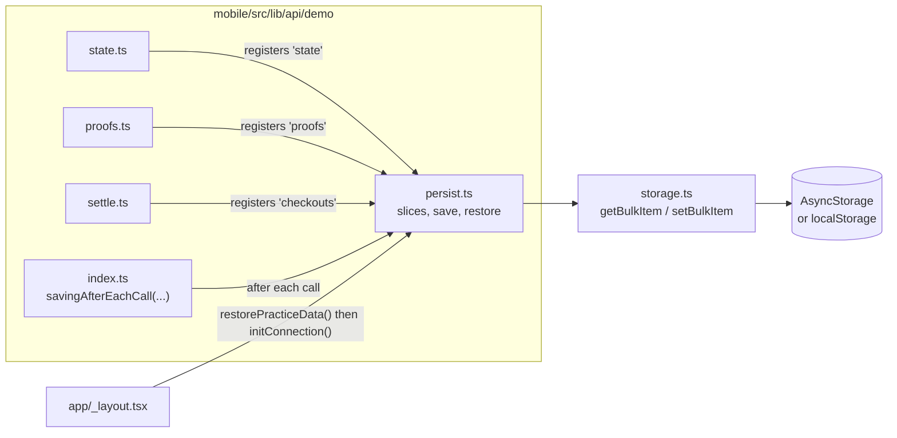

# 01. Practice data saved on the phone

**Status:** done (browser-tested; phone check pending) · **Owner:** Shaik · **Size:** M

## Goal

Practice mode used to keep everything in memory, so closing the app or reloading the tester website wiped testers' vaults and withdrawals. Now Practice data is saved on the device and comes back on the next open, with a "Start Practice over" button for a clean start.

## Scope

- **In:** the simulator's state (vaults, histories, withdrawals, wallet, emergency, limits, investing, identity), its bill checks, and its Practice checkouts. Phones and the web.
- **Out:** syncing between devices (that needs the server, [plan 05](05-server-online.md)); saving live-mode data (the server already does).

## Design

- **Slices (open/closed):** each part of the simulator registers a `PracticeSlice` with `save()`, `load()` and `reset()`. `persist.ts` stores and loads slices without knowing what's in them, so a new simulator part saves itself by registering.
- **When it saves:** `savingAfterEachCall()` wraps the simulator, so every call, reads included (they settle background checks), schedules a save. Saves are batched to one write per 500 ms, skipped when nothing changed, and written straight away when the app goes to the background.
- **When it loads:** the root layout runs `restorePracticeData()` before the connection check. Queries wait for that check, so no screen shows the sample data before the saved data is back.
- **Safety:** each save has a format number. An older or damaged save is thrown away and every slice resets to the sample data, rather than crashing. A newer version adding fields is safe, because saved state is laid over fresh state.
- **Storage:** a new bulk store in `storage.ts` (AsyncStorage on phones, localStorage on the web), because the Keychain only holds small values. It isn't encrypted and is only for non-secret data. Delete account clears it through `onDeviceReset`.
- **Start over:** Settings → Account → "Start Practice over" (Practice only) calls `api.reset()`, which resets every registered slice, then clears cached queries and returns Home.

## Changes

| File | Change |
|---|---|
| `mobile/src/lib/api/demo/persist.ts` | **New.** Slice registry, save, restore, reset, the save-after-each-call wrapper |
| `mobile/src/lib/storage.ts` | `getBulkItem`, `setBulkItem`, `removeBulkItem` |
| `mobile/src/lib/api/demo/state.ts` | Registers the `state` slice; Maps saved as `[key, rows]` pairs |
| `mobile/src/lib/api/demo/proofs.ts` | Registers the `proofs` slice |
| `mobile/src/lib/api/pay-sim.ts` | `snapshot()` and `restore()` on the checkout store |
| `mobile/src/lib/api/demo/settle.ts` | Registers the `checkouts` slice |
| `mobile/src/lib/api/demo/index.ts` | Wraps the simulator with `savingAfterEachCall`; `reset` resets all slices |
| `mobile/src/lib/api/practice.ts` | Re-exports `restorePracticeData` (the Practice boundary) |
| `mobile/src/app/_layout.tsx` | Restores Practice data before the connection check |
| `mobile/src/features/account/settings/StartOverScreen.tsx`, `src/app/settings/start-over.tsx` | **New.** The Start over screen |
| `mobile/src/features/account/settings/SettingsHome.tsx`, `ConnectionScreen.tsx` | The Start over row; text no longer says Practice data resets |

## Tests

- **Done, in the browser:** a new vault survived a full reload; Start over cleared it; a damaged save was dropped and the app loaded normally. Typecheck and lint pass.
- **To do:** on an Android phone, create a vault, force-close the app, reopen, and check the vault is there.
- **Later:** unit tests for `persist.ts` once the phone has a test runner (see the [maintainability review](../maintainability.md)).

## Acceptance criteria

- [x] A vault made in Practice is still there after closing and reopening the app or reloading the page.
- [x] "Start Practice over" puts back the sample account.
- [x] A damaged or older save never crashes the app.
- [x] Delete account removes the Practice save.
- [ ] Checked on a real phone.

## Risks and rollback

- **Changing a slice's shape** in a later version could make old saves fail to load. They're then dropped, so testers lose Practice data once. Bump `FORMAT` in `persist.ts` when you change a shape on purpose.
- **Rollback:** remove the `savingAfterEachCall` wrapper and the `restorePracticeData()` call; the simulator goes back to memory only.
