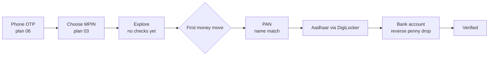

# 07. Onboarding checks in test mode

**Status:** server, web and phone built with a test provider (22 November 2026); the Setu adapter is written but not yet run against Setu's sandbox; the phone's DigiLocker and UPI hand-offs not yet tried on a real phone · **Owner:** Claude (code), Shaik (sandbox account) · **Size:** L

## Goal

Onboarding that works like GPay or FamPay: phone, MPIN, PAN, Aadhaar and a bank account, verified through a licensed provider's **test mode**. Real integration code, no real IDs. A student team can't run Aadhaar OTP checks or UPI itself, because both need government or NPCI approval.

## Scope

- **In:** PAN check (name match), Aadhaar through DigiLocker, bank account check by reverse penny drop, a tiered flow, all through one provider's sandbox.
- **Out:** going live (needs a registered company and the provider's business checks), video KYC, UPI.

## Design

### Flow (asked only when money moves)

### Providers (dependency inversion)

- The existing `KycProvider` interface (`src/lib/kyc/types.ts`) and the empty `external` slot get a real implementation, e.g. `src/lib/kyc/providers/setu.ts`, chosen by `KYC_PROVIDER`. The practice provider stays for development.
- New, smaller interfaces for the new checks, so each can come from a different provider:
  - `PanVerifier.verify(pan, name)`
  - `DigiLockerClient.start()` / `.finish(code)`
  - `BankVerifier.reversePennyDrop()`
- **Bank accounts:** new `src/lib/bank/` module with table `bank_accounts (id, user_id, ifsc, account_last4, holder_name, verified_at, provider_ref)`. The simulated "Linked bank" becomes this record.
- **Least data:** keep only what's needed. Aadhaar: name, year of birth and the last 4 digits from DigiLocker, never the full number or the document. PAN: the last 4 characters plus the HMAC, as today.
- Provider keys stay on the server. The phone only opens the provider's hosted pages (DigiLocker) or shows a UPI payment link (reverse penny drop).

## Changes

| File | Change |
|---|---|
| `src/lib/kyc/providers/<provider>.ts` | **New.** The sandbox provider |
| `src/lib/kyc/{pan,digilocker}.ts`, `src/lib/bank/*` | **New** |
| `src/app/api/v1/kyc/*`, `src/app/api/v1/bank/*` | New steps and callbacks |
| `mobile/src/features/kyc/*` | Stepped flow: PAN, then DigiLocker, then bank |
| `mobile/src/lib/api/demo/identity*.ts` | Practice mirrors the steps with sample answers |

## Tests

- Unit tests with fake providers: name matching, each status, failures sent to a person.
- Sandbox runs with the provider's published test data: a pass, a name mismatch and a failed bank check.

## Acceptance criteria

- [ ] A test account goes from phone to fully verified using sandbox data only.
- [ ] No full Aadhaar or PAN number is stored.
- [ ] Switching provider means writing one file and changing an env var.

## Who does what

- **You:** create a sandbox account with one provider (Setu, Cashfree or Digio) and put its test keys in `.env.local`.
- **Claude:** the provider adapter, flows, screens and tests.

## What was built (server)

Built 22 November 2026. The feature doc is [features/identity.md](../features/identity.md), section 3a; the module notes are [src/lib/kyc/checks/README.md](../../src/lib/kyc/checks/README.md). Differences from the contract are in [contracts.md](contracts.md), "Deviations as built".

### Files

| File | What it does |
|---|---|
| `src/lib/kyc/checks/config.ts`, `types.ts`, `registry.ts`, `store.ts`, `view.ts`, `service.ts`, `index.ts`, `README.md` | **New** module: switches, the three interfaces, provider choice, the `kyc_checks` table, step state, the steps and their outcome |
| `src/lib/kyc/checks/providers/test.ts`, `providers/setu.ts` | **New**: the deterministic test provider and the Setu adapter |
| `src/lib/bank/index.ts`, `store.ts`, `README.md` | **New**: the `bank_accounts` record |
| `src/lib/kyc/service.ts` | `kycView()` adds `flow` and `steps`; `setUserKyc()` exported; `submitKyc()` refuses with 409 `kyc_flow_steps` in the steps flow |
| `src/lib/kyc/levels.ts` | **New**: `kycLevelFor()`, the one status-to-level rule |
| `src/app/api/v1/kyc/{pan,digilocker/start,digilocker/finish,bank/start,bank/finish}/route.ts` | **New** routes (there is no `src/app/api/v1/bank/*`) |
| `src/components/identity/kyc-steps.tsx`, `kyc.tsx` | **New** web steps card on `/verify` |

### Decisions

- **A separate checks module, not a `KycProvider`.** The three checks have their own small interfaces (`PanVerifier`, `DigiLockerClient`, `BankVerifier`) under `src/lib/kyc/checks/`, chosen by `KYC_CHECKS_PROVIDER`. The photo flow's `KycProvider` and `KYC_PROVIDER` are unchanged.
- **India only.** `flowFor()` gives the steps only to India accounts; other markets keep the photo check.
- **One review for the whole check.** A step whose name doesn't match is marked `review`, but the check goes to a person only when all three steps are finished, as one `needs_review` row in `kyc_records`. The existing reviewer console decides it, and approving can't skip a step.
- **Least data.** PAN: last 4 and HMAC (and its registered name only when it differs; changed by the review below, which keeps it on the step). Aadhaar: name, year of birth, last 4. Bank: IFSC, last 4, holder name. Providers cut numbers to the last 4 before they leave the provider file.
- **Tries are reserved before the provider call** and deleted if the provider fails, so parallel tries count and outages don't.
- **The test provider is refused on production** unless `KYC_CHECKS_TEST_ALLOWED=true`, because it verifies anyone who types its sample PAN.
- **Finish polls.** There is no webhook yet.

### Tests

`tests/kyc-steps.test.ts`: the photo flow unchanged; the full steps flow through the routes with the test provider; review, rejection and retry; duplicate PANs; limits; provider failures; expired and foreign requests; the production guard; and the Setu adapter with `fetch` mocked, including a full flow.

### Acceptance criteria, server side

| Criterion | Server |
|---|---|
| A test account goes from phone to fully verified using sandbox data only | Done with the test provider (tests and the web `/verify` page). Not yet run against Setu's sandbox. |
| No full Aadhaar or PAN number is stored | Done (checked in the tests) |
| Switching provider means writing one file and changing an env var | Nearly: one provider file, one line in `SETS` in `registry.ts`, and `KYC_CHECKS_PROVIDER` |

### Left for the owner

- Ask Setu for sandbox access to PAN verification, DigiLocker and Reverse Penny Drop, and put the keys in `.env.local` (`SETU_CLIENT_ID`, `SETU_CLIENT_SECRET`, the product instance ids) with `KYC_FLOW=steps` and `KYC_CHECKS_PROVIDER=setu`.
- Give DigiLocker a public https return address (`KYC_DIGILOCKER_REDIRECT_URL`, a tunnel to `/verify` works) and ask Setu for sandbox DigiLocker test users.
- Run the sandbox steps in the checks README and record what differs from the adapter's assumptions.
- Going live needs a registered company and the provider's business checks (out of scope).
- Later: the "Linked bank" ledger account and the phone's simulated bank could read `bank_accounts`; a Setu webhook could finish the bank step by itself.
- On a production server with Setu, set `SETU_BASE_URL=https://dg.setu.co` (required since the review below).

### Review findings and fixes

The security review of 22 November 2026 ([security.md](../security.md#security-review-2026-11-22)) found these in plan 07's server and web work; all are fixed, with tests in `tests/kyc-steps.test.ts`:

| Finding | Severity | Fix |
|---|---|---|
| **Sandbox data on production.** `SETU_BASE_URL` defaulted to Setu's sandbox, which answers with sample data, even on a production server. | Medium | With `NODE_ENV=production`, `SETU_BASE_URL` must be set and https, and the sandbox is refused unless `KYC_CHECKS_TEST_ALLOWED=true`: 500 `server_config` (`setuBaseUrl()` in `providers/setu.ts`), plus a `productionStartupWarnings()` line. |
| **Steps carried over between providers.** Steps finished with the test provider's sample data still counted after a server switched to Setu. | Medium | Until the account is verified, a step whose newest try used another provider counts as `todo` (`currentProviderNames()` in `registry.ts`, read by `view.ts`). |
| **The name could change between steps,** so three steps could match three different people. | Medium | The account name is held during an ID check (`assertNameChangeAllowed()` in `src/lib/kyc/service.ts`: 409 `name_in_check`; `stepsHoldName()` in `view.ts`) and locked after verification (403 `name_locked`). The PAN name is now kept on the step, and `conclude()` sends steps whose document names no longer match the account name to a person. |
| **A bank account whose holder name went to a person was saved as verified.** | Medium | Saved verified only when the bank step is `done`; otherwise `confirmBankOnApproval()` (`approval.ts`, called by `decideKyc()`) marks it verified (`verifyBankAccount()` in `src/lib/bank`) when the person approves, and only from the newest try after the last rejection. |
| **Duplicate PANs were disclosed.** The customer was told the PAN was on another account. | Low | A generic sentence for the customer; the reason goes to the reviewer-only `kyc_checks.review_note`, and the audit row gets `duplicate: true`. |
| **DigiLocker's return link text was shown on `/verify`.** | Low | The web reads `errCode` only and maps it with `digilockerErrorText()` in `src/components/identity/kyc-steps.tsx`; `errMessage` is never shown. |
| **A steps-flow account's photo upload counted toward the upload limit** before `POST /kyc` refused it. | Low | The route calls `assertPhotoFlow()` before `limitUploads()`. |

## What was built (phone)

Built 22 November 2026. The phone side is described in [features/identity.md](../features/identity.md#on-the-phone); the module notes are in [mobile/src/features/kyc/README.md](../../mobile/src/features/kyc/README.md).

### Files

| File | What it does |
|---|---|
| `mobile/src/features/kyc/StepsFlow.tsx`, `StepsProgress.tsx`, `StepFrame.tsx` | **New**: one step at a time under a "Step 2 of 3" header |
| `mobile/src/features/kyc/PanStep.tsx`, `DigiLockerStep.tsx`, `BankStep.tsx` | **New**: the three steps |
| `mobile/src/features/kyc/steps-model.ts` | **New**, pure: the current step, the PAN format, what each error code means |
| `mobile/src/features/kyc/external.ts` | **New**: opening DigiLocker (`openAuthSessionAsync`, ephemeral) and the UPI link (`expo-linking`), inside `withSystemUi()` |
| `mobile/src/features/kyc/open-try.ts` | **New**: the open DigiLocker or ₹1 try kept in `vw.kyc.openTry`, so it can be picked up again |
| `mobile/src/features/kyc/VerifyIdScreen.tsx`, `config.ts`, `routes.ts`, `README.md` | Shows the steps when `GET /kyc` says `flow: "steps"`; the outcome with each step's last 4; `KYC_ENABLED` also off in `tester-live` |
| `mobile/src/features/recovery/config.ts` | `RECOVERY_ENABLED` also off in `tester-live` |
| `mobile/src/lib/api/identity.ts`, `identity-types.ts` | `flow` and `steps` on `KycView` (a missing `flow` means `"photo"`); `submitPan`, `startDigiLocker`, `finishDigiLocker` (60 s), `startBankCheck`, `finishBankCheck` (30 s); only an `http(s)` DigiLocker URL and a `upi://pay` link are accepted |
| `mobile/src/lib/api/demo/identity.ts`, `identity-state.ts` | The steps in Practice, answering like the server's test provider; saved inside the `state` slice |

### Decisions and deviations

- **The phone follows the server's `flow`.** India accounts on a server with `KYC_FLOW=steps` get the steps; everyone else keeps the photo check. A server from before plan 07 sends no `flow`, which reads as the photo check.
- **DigiLocker in an in-app browser, not a WebView** (`expo-web-browser`, an ephemeral session that shares no cookies with the phone's browser). The server sends DigiLocker back to its own web page, so the person closes the browser and the step finishes then; **I've allowed sharing** tries again if DigiLocker wasn't finished.
- **The ₹1 payment hands a `upi://pay` link to the person's UPI app** and waits until they're back. With no UPI app, the link is shown to copy. **I've paid** finishes the step.
- **The open try is kept on the phone** (its id and link only), so the app lock or a closed screen during payment never makes someone pay ₹1 twice.
- **Answers from the server are checked before use:** a DigiLocker URL that isn't `http(s)`, or a payment link that isn't `upi://pay`, is refused; step numbers are cut to their last 4.
- **Off in `tester-live`, the APK and the store build** (`KYC_ENABLED = !PRACTICE_ONLY && !TESTER_LIVE`), so testers never upload real IDs. Reachable in development and preview builds, live or on Practice data.
- **Practice lets a verified person run the steps again** ("Practice the check again"), so the flow can be shown; starting again unverifies the Practice person until all three are done.

### How it was checked

- `npm run typecheck` and `npm run lint` in `mobile/` pass (re-run for these docs); `npm run doctor`; `npx expo export` for Android and web.
- The steps were tried in the browser preview on Practice data. Practice never opens DigiLocker or a UPI app, so those hand-offs aren't covered there.
- To repeat by hand in Practice (a development or preview build): Settings → Identity verification → Practice the check again; PAN `ABCDE0000F` goes to a pretend person, `ABCDE1234F` passes; DigiLocker answers at once; **I've paid** finishes the bank step; with a step in review, the pretend person approves about 20 seconds later.

### Still needs a real phone

- Against a live server with `KYC_FLOW=steps` and the test provider: the DigiLocker page in the in-app browser on iOS and Android, coming back to the app, and finishing.
- The UPI hand-off with a real UPI app installed (the test provider's link has nothing to pay), and the no-UPI-app fallback.
- Leaving for the UPI app longer than 90 seconds on Android (the app locks), then picking the same try up again after unlocking.
- The same against Setu's sandbox once the owner has keys.

### Acceptance criteria, phone side

| Criterion | Phone |
|---|---|
| A test account goes from phone to fully verified using sandbox data only | Built against the server's steps routes; tried in Practice. Not yet run on a phone against a live server. |
| No full Aadhaar or PAN number is stored | Done on the phone: the PAN is sent once and cleared; only last 4s are shown or kept |
| Switching provider means writing one file and changing an env var | Server side; the phone doesn't know the provider |

### Left for the owner

- The server items above (Setu sandbox keys, a public `KYC_DIGILOCKER_REDIRECT_URL`).
- A development or preview build pointed at that server to try the steps on a phone (the APK and `tester-live` don't show them).
