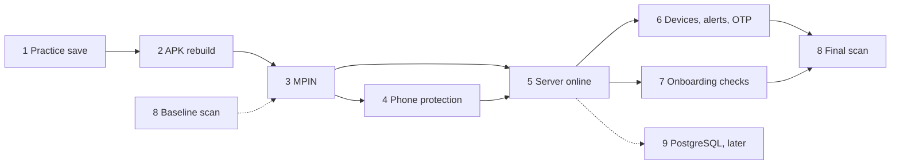

# Roadmap

> What's next, in order, and why. Each step has its own plan file with the design, changes, tests and acceptance criteria.

## Principles behind the order

1. Fix the most dangerous gap before adding anything visible.
2. Build what later steps depend on first.
3. Batch native changes into one APK rebuild, so everything after it ships over the air.
4. Don't put the server online until the money paths are protected.
5. Measure at the start and the end, so the capstone report can show the improvement.

## Steps

| # | Step | Why here | Size | Status |
|---|---|---|---|---|
| 0 | Commit work, versioning and over-the-air updates | Everything after it is traceable and shippable | M | **Done** |
| 1 | [Practice data saved on the phone](01-practice-data-saved.md) | Testers stop losing their work; no risk | M | **Done** (tested in the browser; not yet on a phone) |
| 2 | [Prepare the one-time APK rebuild](02-apk-rebuild-prep.md) | Native packages for steps 3, 4 and 6 go in now, so later steps need no reinstall | S | **Built** (the APK build itself is yours: needs `google-services.json` first) |
| 3 | [MPIN checked by the server](03-mpin.md) | Biggest real gap: money can move without a PIN | L | **Done** (server, web and phone) |
| 4 | [Phone-side protection](04-phone-protection.md) | Closes known phone gaps; builds on the MPIN screens | M | **Done** (checked in the browser; screenshot blocking, root check and Face ID need a real phone) |
| 5 | [Server online](05-server-online.md) | Real accounts and shared data, once money paths are safe | L | **Built** (hardening and `deploy/` scripts done; putting it on AWS is yours) |
| 6 | [Registered devices, alerts and phone OTP](06-devices-alerts-otp.md) | UPI-style protection against stolen passwords; needs the server online | L | **Done** (test-mode codes; real SMS needs a Twilio account) |
| 7 | [Onboarding checks in test mode](07-onboarding-checks.md) | PAN, Aadhaar via DigiLocker and bank checks, through licensed sandboxes | L | **Done** (test provider; Setu adapter written from the docs, needs sandbox keys to try) |
| 8 | [Security review](08-security-review.md) | "Before" scan now, "after" scan at the end, against OWASP MASVS | M | **Code review done** (baseline, four independent reviews, findings fixed); the MobSF scans of the APK are yours |
| 9 | [Move to PostgreSQL](09-postgres.md) | Only when one server isn't enough | L | Later (on purpose: SQLite until the end) |

## Dependencies

## What only you can do

| Step | You need to |
|---|---|
| 2 | Add Firebase's `google-services.json` to `mobile/` (for push notifications), log in to Expo (`npx eas-cli@latest login`) and run `npm run build:apk`, then share the APK |
| 5 | Follow [deploy/README.md](../../deploy/README.md): AWS account and Lightsail server, a domain, Firebase sign-in, `/etc/vaultwise.env`, then set `EXPO_PUBLIC_API_URL` in the `tester-live` profile of `mobile/eas.json`. Replace the contact address in `src/components/legal/config.ts` |
| 6 | For real texts, a Twilio account (`OTP_MODE=twilio` and the `TWILIO_` values). Until then `OTP_MODE=test` shows the code in the app |
| 7 | Setu sandbox keys (`KYC_CHECKS_PROVIDER=setu`, the `SETU_` values) to try the real checks; `KYC_FLOW=steps` turns the steps on for India |
| 8 | Install MobSF (Docker) or use its hosted scanner, and scan the new APK; record the result next to [the baseline](../security/baseline-2026-11-22.md) |

## Keeping this current

When a step finishes, mark it **Done** here, record what was built in the matching feature doc, and add a line to `mobile/CHANGELOG.md` under **Unreleased**.
