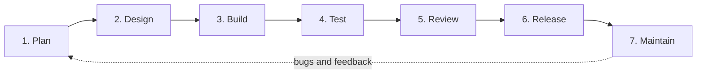

# Development process

> How a change goes from an idea to people's phones: plan, design, build, test, review, release, maintain.

This is a two-person team, so the process is deliberately light. Every step still happens, and none needs a meeting.

## The lifecycle at a glance



| Step | Output | Where it lives |
|---|---|---|
| 1. Plan | A short plan: goal, scope, acceptance criteria | `docs/plans/NN-name.md`, linked from the [roadmap](../plans/roadmap.md) |
| 2. Design | Modules, seams, data and API changes, risks | The same plan file, "Design" section |
| 3. Build | Code on a feature branch, following the [module guide](module-guide.md) | `feature/<name>` branch |
| 4. Test | Automated checks pass, plus manual checks of the flow | CI and the pull request description |
| 5. Review | An approved pull request | GitHub |
| 6. Release | A version, a changelog entry, a tag, then a build or an update | `CHANGELOG.md` (server and web), `mobile/CHANGELOG.md`, git tags, EAS |
| 7. Maintain | Bugs fixed, docs current, dependencies updated | Issues, `docs/` |

## 1. Plan

- Write a plan for anything bigger than a small fix. Use the plan template below.
- Every plan states **acceptance criteria**: plain sentences a reviewer can check, like "a wrong MPIN five times locks money moves for one minute".
- Add the plan to the [roadmap](../plans/roadmap.md) with its status.

### Plan template

```markdown
# NN. <Title>
**Status:** planned / in progress / done · **Owner:** <name> · **Size:** S / M / L
## Goal          (one paragraph: what changes for the user, and why now)
## Scope         (in / out)
## Design        (modules, seams, data, API; how it follows the module guide)
## Changes       (table: file | change)
## Tests         (automated and manual)
## Acceptance criteria
## Risks and rollback
## Who does what (things only you can do, like creating accounts)
```

## 2. Design

- Follow the [module guide](module-guide.md): one module per feature, a switch, a README, small seams.
- The server decides rules. If the phone simulator needs the same rule, the simulator file says which server code it mirrors.
- Changing the database: add the table or column in `src/lib/db.ts` (`SCHEMA` for new databases, `migrate()` for existing ones), and list it in [data-model.md](../reference/data-model.md).
- Changing the API: keep it backwards compatible for phones still running an older build. Add fields; don't rename or remove them until every build that uses them is gone.
- Anything touching money, sign-in, PINs or personal data gets a security note in the plan (see [security](../security.md)).

## 3. Build

### Branches and commits

- `main` always works and is what gets released.
- Work on a branch: `feature/<name>`, `fix/<name>` or `docs/<name>`.
- Commit small, working steps. Write messages in the imperative, saying what changed and why: `Add MPIN lockout after five wrong tries`.
- Never commit secrets. `.env.local` files are ignored by git; only the blank `.env.example` files are tracked.

### Code rules

- Read the framework docs for the version in use before writing code. Next.js 16 and Expo SDK 58 both change APIs between versions (see `AGENTS.md` in the root and in `mobile/`).
- Phone screens use the UI kit (`mobile/src/components/ui`) and theme tokens. Haptics go through `haptic(token)` only.
- Install phone packages with `npx expo install <package>`, so versions match the SDK.
- Mark lines you add to shared files with the module's name (`// wallet`, `// tester`) so the module can be removed cleanly.

## 4. Test

| Level | Command (run from) | When |
|---|---|---|
| Server unit and integration tests | `npm test` (root) | Every change to `src/` |
| Typecheck and lint, server | `npm run typecheck`, `npm run lint` (root) | Every change |
| Typecheck and lint, phone | `npm run typecheck`, `npm run lint` (`mobile/`) | Every change to `mobile/` |
| End-to-end API suite | `npm run build`, then `npm run test:e2e` (root) | Before a release that changes the server |
| Live AI check | `npm run test:ai` (root, needs `GROQ_API_KEY`) | When prompts, models or thresholds change |
| Expo health check | `npm run doctor` (`mobile/`) | After changing phone packages |
| Phone bundles build | `npx expo export --platform android` (`mobile/`) | Before building an APK or publishing an update |
| Manual check | Run the flow in the browser preview or on a phone | Every user-facing change |

- New server logic comes with a test in `tests/`.
- The phone app has no test runner yet. Adding one is in the [maintainability review](../maintainability.md). Until then, the pull request lists the manual checks done.

## 5. Review

Open a pull request into `main`. The other person reviews it. The description includes:

- what changed and why, linking the plan;
- how it was tested: commands run and manual checks;
- screenshots for visible changes;
- docs updated, or why none were needed.

### Reviewer checklist

- [ ] Does it do what the plan's acceptance criteria say?
- [ ] Is it a module with clear seams, or does it spread logic into unrelated files? (See the [module guide](module-guide.md).)
- [ ] Are rules on the server, and is the simulator kept in step?
- [ ] Are money moves, PINs and personal data handled per the [security overview](../security.md)?
- [ ] Tests added or updated, and checks green?
- [ ] Docs and changelog updated?
- [ ] No secrets, debug code or leftover test data?

## 6. Release

### Versions

Phone app versions follow `MAJOR.MINOR.PATCH` in `mobile/app.json`: PATCH for fixes, MINOR for features, MAJOR for the first real launch or a breaking change. Build numbers count up on their own.

### Steps

1. Move the **Unreleased** notes in `mobile/CHANGELOG.md` (and `CHANGELOG.md` for server changes) under the new version and date.
2. Set the same version in `mobile/app.json`.
3. Commit, then tag: `git tag v0.2.0` and `git push --tags`.
4. Ship it:
   - **Code or design only:** `npm run update:apk -- "What changed"` from `mobile/`. Phones get it over the air.
   - **Native changes** (new native package, permission, icon, splash, plugins): `npm run build:apk` and share the new APK.
   - **Tester website:** `npm run deploy:tester`.
   - **Server:** deploy following plan 05 once the server is online.
5. Check it: open the app, then Profile → About Vaultwise shows the new version and update.

### Environments

| Environment | Data | Build or command | Update channel |
|---|---|---|---|
| Development | Your local server, or Practice | `npm start` | none |
| Preview | Live server | `eas build --profile preview` | `preview` |
| Shareable APK | Practice | `npm run build:apk` | `apk` |
| Store | Practice | `eas build --profile production` | `production` |
| Tester website | Practice | `npm run deploy:tester` | not applicable |

### Rolling back

- **Bad over-the-air update:** check out the last good commit and publish it again with `npm run update:apk -- "Roll back to vX.Y.Z"`. Phones move to it on their next two opens.
- **Bad APK:** share the previous APK link again. Updates can't fix a broken native build.
- **Bad server deploy:** redeploy the previous tag. Database changes must stay backwards compatible, so this is safe.

## 7. Maintain

- **Bugs:** open a GitHub issue with steps, the version from Profile → About, and screenshots. Fix it on a `fix/` branch.
- **Docs:** a pull request that changes behaviour updates the docs in the same pull request.
- **Dependencies:** once a month, run `npx expo install --check` in `mobile/` and `npm outdated` in the root. Update, run every check, and release as a PATCH.
- **Security:** look at `npm audit` once a month. Before any release touching money or identity, run through the checks in the [security overview](../security.md).
- **Clean-up:** pick items from the [maintainability review](../maintainability.md) alongside feature work.

## Definition of done

A change is done when:

1. its acceptance criteria are met;
2. every check in section 4 that applies is green;
3. it's reviewed and merged into `main`;
4. docs, the changelog and the roadmap are updated;
5. it's released, or queued in **Unreleased**.
