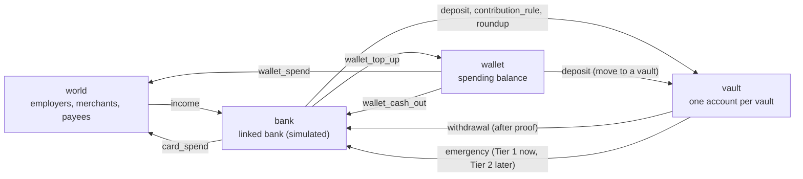

# Walkthrough: the double-entry ledger

> A self-study guide. After it you should be able to explain, without notes, how Vaultwise records money, why balances can be trusted, and where each rule is enforced and tested.

The feature doc with every detail is [features/vaults.md](../features/vaults.md) ("The double-entry ledger"). This page is the short path through it.

## Summary

Every movement of money is a **journal**: a group of two or more **entries** whose amounts add up to zero. Each entry moves money into or out of one **account** (a person's bank, a vault, the wallet, or the outside world). Entries are integers in minor units (cents, paise) and can never be edited or deleted, so the list of entries is the true history. Each account's balance is kept in a separate table, updated in the same database transaction as the entries, and a reconciliation check can replay every entry to prove the two still agree. Money that is promised but not yet moved (a withdrawal waiting for proof, a Tier 2 emergency release) is a **hold**, worked out from the request tables; it is not a ledger entry.

## The picture



Each arrow is one journal kind. Investing adds `invest_fund` (bank to Core cash), `invest_buy` (Core cash to Core securities), `satellite_allocate` and `satellite_return`. There is no arrow from a vault to the wallet: vaults release money only through a proof-checked withdrawal or the emergency path.

## Words to know

| Word | Meaning | Where |
|---|---|---|
| Account | A place money sits. Has a `kind`, an owner (`user_id`, null for `world`) and one currency. | `accounts` table; `AccountKind` in [src/lib/ledger.ts](../../src/lib/ledger.ts) |
| Journal | One money movement, with a `kind` (such as `deposit`), a memo and a reference (such as the withdrawal id). | `journals` table |
| Entry | One line of a journal: an account and a signed amount. | `ledger_entries` table |
| Sign | Positive = debit (the account goes up). Negative = credit (it goes down). | comment at the top of `ledger.ts` |
| Minor units | Whole cents or paise. `100_00` is 100.00. | everywhere on the server |
| Projection | The `balances` table: a running total per account, kept for fast reads. | `balances` table |
| Hold | Money reserved for an unfinished request. Lowers `available`, not `balance`. | `heldFor()` in [src/lib/vaults.ts](../../src/lib/vaults.ts) |

Account kinds: `bank`, `vault`, `wallet`, `core_cash`, `core_securities`, `satellite_cash` (the customer's own money, never below zero), `world` (everyone outside Vaultwise, which goes negative as money comes in) and `fees` (declared, not used by any journal today).

## Follow the code

### 1. Accounts are created on first use

- `ensureAccount()` finds or creates an account and its `balances` row (balance 0).
- `createUser()` in [src/lib/users.ts](../../src/lib/users.ts) opens the person's `bank` account.
- `createVault()` in [src/lib/vaults.ts](../../src/lib/vaults.ts) opens a `vault` account with `refId` = the vault id.
- `userAccount(userId, kind, currency)` and `worldAccount(currency)` are the short forms the rest of the code calls.

### 2. Every movement goes through `post()`

`transfer()` builds a two-entry journal (`from` gets `-amount`, `to` gets `+amount`) and calls `post()`. Every journal in the code today is a `transfer()`; `post()` can take more entries, but nothing uses that yet.

`post()` in [src/lib/ledger.ts](../../src/lib/ledger.ts), inside one transaction (`tx()`):

1. Refuses fewer than 2 entries, a sum that isn't 0, or an amount that isn't a whole number (`LedgerError`).
2. Loads every account; refuses an unknown one, or accounts in different currencies ("Cross-currency journals need an FX leg").
3. Inserts the `journals` row, then each `ledger_entries` row.
4. For each entry, adds the amount to `balances.balance` and bumps `version`. If the account is one of the `NON_NEGATIVE` kinds and is now below 0, throws "Insufficient funds".
5. Writes an audit row `ledger.<kind>` with the entries.

Any throw rolls back the whole transaction: no journal, no entries, no balance change, no audit row. `tx()` in [src/lib/db.ts](../../src/lib/db.ts) starts `BEGIN IMMEDIATE`; a `tx()` inside another `tx()` joins the outer one, so a caller that wraps several steps gets all-or-nothing too.

### 3. How each money move is recorded

Amounts below are in major units for reading; the code stores minor units.

**A deposit** (`deposit()` in `vaults.ts`). Customer puts 200 into the Health vault:

| Account | Entry |
|---|---|
| bank | −200 |
| vault (Health) | +200 |

Journal kind `deposit` (or `contribution_rule` and `roundup` when the scheduler does it). If the bank has less than 200, step 4 throws and nothing is saved.

**A withdrawal** (three moments, one journal):

1. `createWithdrawal()` checks the amount against the vault's `available` and the personal limits ([src/lib/limits/](../../src/lib/limits/)), then inserts a `withdrawals` row with status `awaiting_proof`. **No journal.** The amount is now held: `heldFor()` adds up withdrawals in `awaiting_proof`, `verifying`, `in_review` or `appealed`.
2. The bill is uploaded and checked (see the [verification walkthrough](verification-pipeline.md)). Still no journal.
3. On approval, `payoutWithdrawal()` posts:

| Account | Entry |
|---|---|
| vault (Health) | −150 |
| bank | +150 |

Journal kind `withdrawal`, reference = the withdrawal id. The row becomes `paid` with its `journal_id`. If the check is declined, cancelled or left 24 hours without proof (`expireStaleWithdrawals()`), the status changes and the hold simply stops counting. Nothing to reverse, because nothing was posted.

**An emergency withdrawal** (`executeEmergency()` and `settleEmergencies()` in [src/lib/emergency.ts](../../src/lib/emergency.ts)). Health has 150 available, Rainy Day has 1,000, the customer asks for 300:

1. `planEmergency()` takes 150 from Health (Tier 1) and the other 150 from the next vaults in order (Tier 2: emergency, custom, housing, education, retirement).
2. Tier 1 is posted at once: Health −150, bank +150 (kind `emergency`). The plan item is marked `settled`.
3. Tier 2 is not posted yet. The request is saved with status `processing` and a `release_at` (90 seconds later by default, `tier2HoldSeconds` in [src/lib/compliance.ts](../../src/lib/compliance.ts)). Its unsettled items count as a hold on Rainy Day (the second half of `heldFor()`).
4. When the scheduler runs after `release_at`, `settleEmergencies()` posts Rainy Day −150, bank +150 and marks the request `released`.

On repeat use (cooling-off), nothing is posted at step 2; every item waits for the release time.

**A wallet move** (`src/lib/wallet/moves.ts`). Top up 100, move 40 to Health, pay a shop 30:

| Journal | Entries |
|---|---|
| `wallet_top_up` | bank −100, wallet +100 |
| `deposit` (from the wallet) | wallet −40, vault (Health) +40 |
| `wallet_spend` | wallet −30, world +30 |

The wallet checks the balance and the daily limit itself first, so the customer gets a clear message, but the ledger's non-negative rule would refuse an overdraft anyway.

### 4. How balances are read

- `balanceOf(accountId)` reads `balances`. It never adds up entries.
- `toView()` in `vaults.ts` gives a vault `balance`, `held = heldFor()` and `available = balance − held`. Screens show `available` as what can be withdrawn.
- `accountHistory()` lists an account's entries with their journals.
- `reconcile()` replays the ledger: journals that don't sum to 0, totals per currency (each must be 0), accounts where `balances` differs from `SUM(ledger_entries.amount)` (drift), and a trial balance per account kind. The Ops console shows it (`GET /api/v1/admin/overview`, panel "Ledger reconciles").

Why each currency sums to 0: every journal sums to 0, so all entries ever made sum to 0. The `world` account's negative balance is exactly the money the outside world has paid in, net.

## The invariants, where they are enforced and tested

| Invariant | Enforced by | Tested in |
|---|---|---|
| Every journal sums to zero | `post()` | [tests/ledger.test.ts](../../tests/ledger.test.ts) "rejects unbalanced journals"; [tests/fuzz.test.ts](../../tests/fuzz.test.ts) after every step |
| At least two entries; whole minor units; one currency | `post()` | `post()` itself; no separate test |
| The customer's own accounts never go below zero | `NON_NEGATIVE` check in `post()` | ledger test "rejects overdrafts and rolls the whole journal back"; [tests/wallet.test.ts](../../tests/wallet.test.ts) "never lets the wallet (or the bank) go below zero"; fuzz |
| A failed journal leaves no trace | `tx()` rollback | ledger test (overdraft leaves both balances unchanged); [tests/vaults.test.ts](../../tests/vaults.test.ts) "never pays a run twice when something unexpected fails part-way through" |
| Entries are never edited or deleted | triggers `ledger_no_update` and `ledger_no_delete` in `src/lib/db.ts` | ledger test "keeps ledger entries append-only" |
| The `balances` projection equals a replay | `post()` updates both in one transaction; `reconcile()` checks | ledger test "reconciles..."; fuzz (drift after every step) |
| Each currency nets to zero | follows from the first rule; `reconcile()` checks | fuzz |
| Holds never exceed the balance | `createWithdrawal()` refuses more than `available`; `planEmergency()` takes at most `available` | vaults test "holds funds for a pending withdrawal so they can't be spent twice"; fuzz ("holds exceed the balance") |
| A withdrawal is paid once, only by its owner, only from a payable status | `payoutWithdrawal()` (`PAYABLE_WITHDRAWAL`) | [tests/mpin.test.ts](../../tests/mpin.test.ts) "payoutWithdrawal checks owner and status (B3)" |
| Every journal is audited | `post()` writes `ledger.<kind>` in the same transaction | ledger test "hash-chained audit log" covers the chain |

One known gap in "holds never exceed the balance": `appeal()` puts a declined withdrawal back on hold (status `appealed`) without checking `available`. If the money was withdrawn in the meantime, `available` can drop below zero, and a reviewer's approval then fails with "Insufficient funds". The ledger still refuses the overdraft, so no money is lost, but the fuzz test doesn't cover appeals.

The fuzz test is the strongest check: 400 random operations (salary, spend, deposit, withdraw, payout, deny, emergency, settle, sweep) for each of three seeds, and every invariant above checked after every single step.

## Questions you may be asked

**Why double entry and not just a balance column per vault?**
A single balance can be changed with no record of why. With double entry every change has a matching opposite change and a reason (the journal), so money can't appear or vanish, and the history explains every balance.

**Which is the source of truth, `ledger_entries` or `balances`?**
`ledger_entries`. `balances` is a copy kept for speed. `reconcile()` proves they agree.

**Why integers in minor units?**
Floating point can't store 0.10 exactly, so sums drift. Whole cents add up exactly.

**Why is the `world` account negative?**
It is the other side of every salary and every payment out. Its balance is minus the money the outside world has put in, net. It is not in `NON_NEGATIVE`.

**Why doesn't a withdrawal request create a journal?**
No money has moved yet. The request is a hold, worked out from the `withdrawals` table. Posting only on approval means a declined request needs no reversal.

**If entries can't be changed, how do you fix a mistake?**
Post a new journal with the opposite entries. There is no reversal helper in the code today; it would be a `transfer()` the other way with a memo saying what it corrects.

**What stops two requests spending the same money?**
Writes are serialised (`BEGIN IMMEDIATE`, one writer at a time in SQLite), `post()` checks for overdraft inside the transaction, and holds lower `available` before any money moves.

**Can someone with the database file edit the ledger?**
Plain `UPDATE` and `DELETE` are blocked by triggers, but someone with the file can drop a trigger. The audit log is hash-chained, so an edited audit row is detected (`verifyAuditChain()` in `src/lib/audit.ts`, tested in the ledger test). The chain isn't anchored outside the database yet ([security.md](../security.md), gap 15).

**What about money in two currencies?**
Not supported. A journal must be in one currency; `post()` refuses otherwise. Each customer's accounts use their market's currency.

**Where does the Ops console get "Ledger reconciles"?**
From `reconcile()`, called by `src/app/api/v1/admin/overview/route.ts`.

## Try it yourself

Start from a clean working tree, and undo any code change afterwards with `git restore <file>`.

1. **Run the ledger tests.**
   `npx vitest run tests/ledger.test.ts`
   Then the fuzz test: `npx vitest run tests/fuzz.test.ts`.
2. **Break the zero-sum rule.** In `post()` in `src/lib/ledger.ts`, comment out the line that throws "Unbalanced journal". Run the ledger tests. "rejects unbalanced journals" fails. Restore the file.
3. **Break the overdraft rule.** Remove `"bank"` from `NON_NEGATIVE`. Run `npx vitest run tests/ledger.test.ts tests/fuzz.test.ts`. The overdraft test fails, and the fuzz test reports "an asset account went negative" (deposits draw from the bank without checking first). Restore the file.
4. **On paper.** Start with every balance at 0. Record: salary 1,000; deposit 200 to Health; deposit 400 to Rainy Day; a 50 withdrawal from Health, approved; then an emergency of 300. Write each journal's entries. Check that each journal sums to 0 and that the final balances sum to 0. What is Rainy Day's `balance` and `available` just after the request, and after the Tier 2 release?
5. **Look at real entries.** Run the web app once with demo history (`npm run dev`, then onboard), stop it, then run `node` in the repo root and paste:
   ```js
   const { DatabaseSync } = require("node:sqlite");
   const d = new DatabaseSync("data/vaultwise.db", { readOnly: true });
   console.table(d.prepare(`SELECT j.kind, a.kind AS account, e.amount FROM ledger_entries e
     JOIN journals j ON j.id = e.journal_id JOIN accounts a ON a.id = e.account_id
     ORDER BY e.id DESC LIMIT 10`).all());
   ```
   Find a pair of entries and check they cancel out.
6. **Watch the reconciliation.** Open the Ops console at http://localhost:3000/admin and find "Ledger reconciles" with the number of journals replayed.

## Answer to the paper exercise

| Step | Entries | bank | Health | Rainy Day | world |
|---|---|---|---|---|---|
| Salary 1,000 | world −1,000, bank +1,000 | 1,000 | 0 | 0 | −1,000 |
| Deposit 200 to Health | bank −200, Health +200 | 800 | 200 | 0 | −1,000 |
| Deposit 400 to Rainy Day | bank −400, Rainy Day +400 | 400 | 200 | 400 | −1,000 |
| Withdrawal 50, approved | Health −50, bank +50 | 450 | 150 | 400 | −1,000 |
| Emergency 300, Tier 1 now | Health −150, bank +150 | 600 | 0 | 400 | −1,000 |
| Tier 2 released later | Rainy Day −150, bank +150 | 750 | 0 | 250 | −1,000 |

Final balances sum to 0 (750 + 0 + 250 − 1,000). Just after the request, Rainy Day has `balance` 400, `held` 150, `available` 250. After the release it has `balance` 250, `held` 0, `available` 250: the hold became a real entry.
