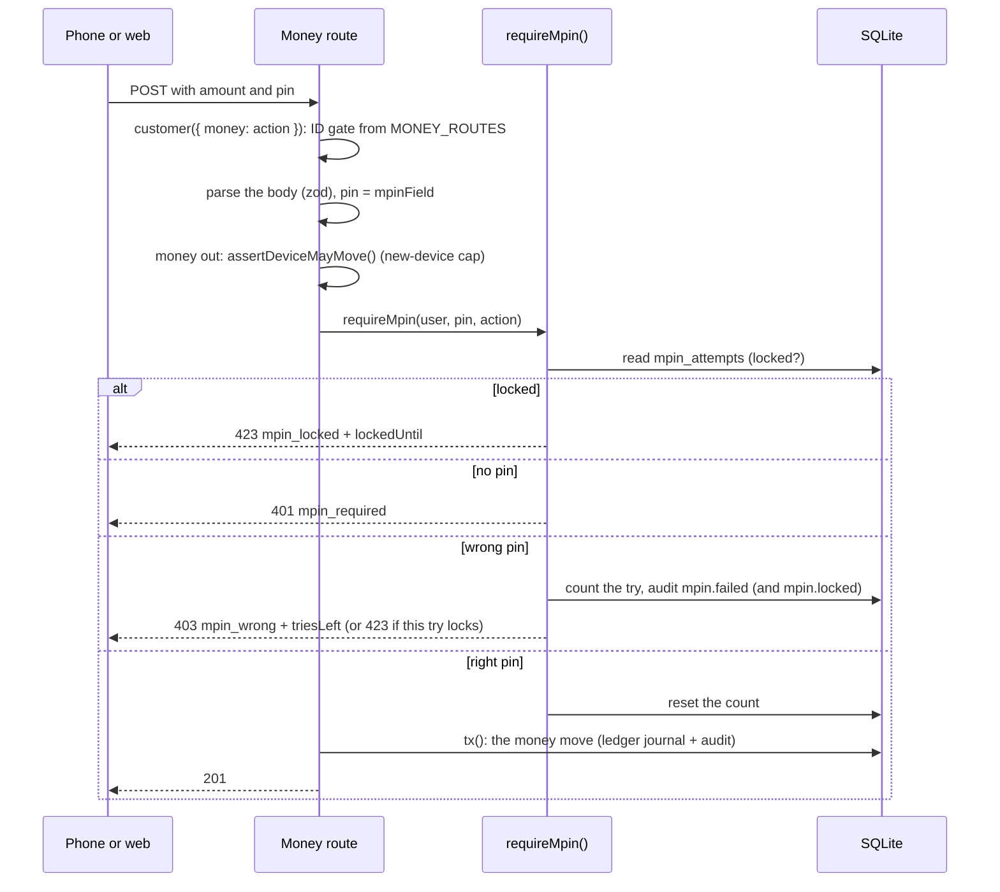
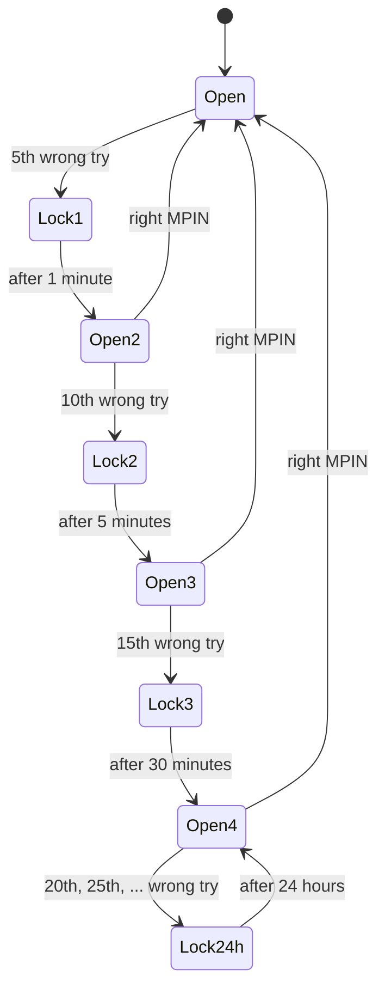

# Walkthrough: the MPIN

> A self-study guide. After it you should be able to explain, without notes, how the MPIN is chosen, stored and checked, how the lock works, how a reset is protected, and what the phone does.

The full feature doc is [features/mpin.md](../features/mpin.md); the module's own notes are in [src/lib/mpin/README.md](../../src/lib/mpin/README.md). This page is the short path through them.

## Summary

The MPIN is a 6-digit PIN that the **server** checks before any money leaves an account. It is stored only as a salted scrypt hash. One map, `MONEY_ROUTES` in [src/lib/money-routes.ts](../../src/lib/money-routes.ts), lists every money action; each money route names its action and calls `requireMpin()` with the PIN from the request body, **before** its database transaction starts. Five wrong tries lock money moves for 1 minute, the next five for 5 minutes, then 30 minutes, then 24 hours. A forgotten MPIN can be reset with a texted code, but only from a trusted device and only once the verified phone number has been on the account for 72 hours. A switch, `MPIN_ENFORCED=false`, turns on a rollback mode for older phone builds; even then the most sensitive checks keep the PIN and the lock. The phone asks for the MPIN in a sheet just before each money move and shows the server's answer; in Practice mode an on-phone copy of the same rules answers instead.

## The picture

A money move, from tap to transaction:

The lock, as wrong tries add up (a right MPIN goes back to the start):

## Follow the code

### 1. Choosing an MPIN

| Moment | Where | What happens |
|---|---|---|
| Sign-up | `src/app/api/v1/onboarding/route.ts` | `assertNewMpin(pin)`, then `createUser()` (or `seedDemo()`), then `recordChosenMpin()` |
| Change | `POST /api/v1/mpin` (`src/app/api/v1/mpin/route.ts`), or `PATCH /api/v1/me` | `changeMpin()` in [src/lib/mpin/change.ts](../../src/lib/mpin/change.ts): the new PIN must pass the policy, then the **current** PIN is checked with `always: true`, then `setMpin()` |
| Reset | `POST /api/v1/mpin/reset` | see step 5 below |

The policy is `checkNewMpin(pin, { dob })` in [src/lib/mpin/policy.ts](../../src/lib/mpin/policy.ts), a pure function. It refuses, in this order: not exactly 6 digits (`length`), one digit repeated (`repeated`), a straight run up or down, with 9 to 0 wrapping (`sequence`), a PIN on `COMMON_MPINS` (`common`), and the date of birth as DDMMYY from a verified ID (`birth_date`). A refusal is 400 `mpin_weak` with the `reason`.

### 2. Storing it

- `hashPin()` in [src/lib/users.ts](../../src/lib/users.ts): `crypto.scryptSync(pin, salt, 32)` with a fresh 16-byte random salt, stored in `users.pin_hash` as `salt:hash`.
- `checkPin()` hashes the typed PIN with the stored salt and compares with `crypto.timingSafeEqual()`, so the time taken doesn't leak how many bytes matched.
- A hash doesn't show the PIN's length, so `mpin_meta` records it whenever a PIN is set or typed correctly ([meta.ts](../../src/lib/mpin/meta.ts)). `upgradeDue()` is true until the server has seen a 6-digit PIN, so old 4-digit PINs keep working and the apps can ask for an upgrade.
- `setMpin()` stores the new hash, records the length, clears wrong tries and any lock, audits `mpin.changed` (`{ by, digits }`, never the PIN) and raises an `mpin_changed` alert.

### 3. Checking it on every money move

1. **The map.** `MONEY_ROUTES` says, per action, whether it needs the MPIN (all 13 do), whether it keeps the ID-check gate (`kyc`), and whether the new-device cap applies (`deviceCap`). Adding a money route means adding one line here.
2. **The route** calls `customer({ money: "<action>" })` from [src/lib/api.ts](../../src/lib/api.ts). That looks the action up with `moneyPolicy()` and applies the ID gate.
3. **The body** is parsed with zod; `pin` is `mpinField` (optional, at most 12 characters, so a huge string is refused before hashing).
4. **Money out** calls `assertDeviceMayMove()` ([src/lib/devices](../../src/lib/devices/README.md)) before the MPIN.
5. **`requireMpin(user, pin, action)`** in [src/lib/mpin/verify.ts](../../src/lib/mpin/verify.ts):
   - throws a plain `Error` if called inside a transaction (`db().isTransaction`), so a wrong try's audit row can never be rolled back with the money move;
   - is **strict** when `mpinEnforced()` is true, or when the caller passes `always: true`;
   - locked: strict refuses with 423 `mpin_locked` without checking the PIN or counting the try;
   - no PIN: strict refuses with 401 `mpin_required`;
   - right PIN: `recordSuccess()` clears the count, `rememberPinLength()` notes the length;
   - wrong PIN: `recordFailure()` counts it, audits `mpin.failed` (and `mpin.locked` if this try starts a lock), then throws 403 `mpin_wrong` with `triesLeft`, or 423 with `lockedUntil`.
6. **Only then** does the route start the money transaction.

Example: the handler in `src/app/api/v1/wallet/spend/route.ts` is a few lines that do exactly steps 2 to 6, then call `spend()`.

Two special cases worth knowing:

- **Vault withdrawals** check the MPIN when the request is made (`POST /vaults/{id}/withdrawals`). The payout happens later, when the bill is approved by the pipeline or a reviewer, with no PIN.
- **Emergency** (`POST /emergency/withdrawals`) passes the PIN into `executeEmergency()` in [src/lib/emergency.ts](../../src/lib/emergency.ts), which calls `requireMpin()` before its own `tx()`. Tier 2 always passes `always: true`.

### 4. The lock

[src/lib/mpin/attempts.ts](../../src/lib/mpin/attempts.ts) and the numbers in [config.ts](../../src/lib/mpin/config.ts):

- `TRIES_PER_LOCK = 5`; `LOCK_STEPS_MS = [1 min, 5 min, 30 min, 24 h]`.
- `lockMsAfter(failures)` returns a lock length only on every 5th wrong try; after the 4th lock it stays at 24 hours.
- `triesLeftAfter(failures)` gives the number shown to the person.
- The count lives in the `mpin_attempts` table (`user_id`, `failures`, `locked_until`), per **user**, not per device, and survives restarts.
- Every lock raises an `mpin_locked` alert, so the owner hears about guessing.

### 5. Reset with a texted code and the 72-hour hold

`src/app/api/v1/mpin/reset/route.ts`, in this order:

1. `assertNewMpin()`: the new PIN must pass the policy.
2. `assertTrustedDevice(..., "mpin_reset")`: only from a trusted device (403 `device_untrusted`).
3. `assertPhoneSettled()` in `src/lib/otp/phone.ts`: refused with 403 `phone_recently_changed` and `allowedAt` if the verified number was added or changed less than 72 hours ago (`PHONE_RESET_HOLD_MS` in `src/lib/otp/config.ts`).
4. In one `tx()`: `consumeVerification(..., "mpin_reset")` uses up the single-use token from the texted code, and `setMpin(user, pin, "reset")` stores the new PIN and clears the lock.

Why the hold: someone with a stolen sign-in could add their own phone number and then reset the MPIN with a code sent to it. Adding or replacing the number already needs the MPIN (`phone_change`, always checked), and the hold gives the real owner 72 hours to see the `phone_verified` alert and act. The texted code is also refused for `mpin_reset` during the hold, so no code is sent.

### 6. Rollback mode (`MPIN_ENFORCED=false`)

For phones still running a build that doesn't send `pin`. `mpinEnforced()` is read on every call.

- Money moves go ahead without the MPIN. A PIN that is sent is still checked, counted and audited, but a wrong one doesn't stop the move. During a lock, a PIN sent with a money move isn't checked at all, so money routes can't be used to keep guessing.
- `always` checks behave exactly as when enforced, lock included: Tier 2 emergency, changing the MPIN, changing the phone number, trusting or signing out a device.
- A new PIN only has to be 4 to 6 digits.
- `GET /me` reports `mpin.enforced: false` and `lockedUntil: null`.

### 7. The phone side

| Piece | Where | What it does |
|---|---|---|
| The ask | [mobile/src/features/mpin/ask.ts](../../mobile/src/features/mpin/ask.ts) | A money flow calls `withMpin(reason, call)` just before its API call. It opens the sheet and runs `call(pin)` while the sheet stays up. `ensureMpin(reason)` only collects the PIN. One ask at a time; a double tap is dropped. |
| The sheet | `mobile/src/app/mpin.tsx`, `MpinSheet.tsx`, `useMpinEntry.ts` | Shows the reason ("Pay ₹1,200 to City Clinic"), the pad, and the server's answer: dots shake with "3 tries left", or the pad pauses until the unlock time. Close and Back are off while the server is checking. |
| Reading errors | `errors.ts` | `readMpinError()` turns `mpin_wrong`, `mpin_locked` and `mpin_required` into plain text from the error body's `triesLeft` and `lockedUntil`. |
| One PIN | `sync.ts` | The app-unlock PIN is the MPIN. After a live money move succeeds, `rememberMpin()` copies the typed MPIN into the unlock PIN (a PBKDF2 hash, `mobile/src/lib/auth/device-pin.ts`), but only if `mpinCheckedByServer()` says the server really checked it (live, and `mpin.enforced` is true). |
| Reset | `ResetMpinScreen.tsx`, route `settings/reset-mpin` | Code to the verified number, new MPIN twice, `POST /mpin/reset`. Shows "Resetting your MPIN is paused" with the end time on `phone_recently_changed`. |
| Practice | [mobile/src/lib/api/demo/mpin.ts](../../mobile/src/lib/api/demo/mpin.ts), `mobile/src/features/mpin/policy.ts` | `requirePracticeMpin()` mirrors `requireMpin()`: same codes, same lock steps, same policy. The Practice MPIN is `246810`, shown on screen. |
| Face ID / fingerprint | `biometric.ts` | An optional shortcut that supplies the MPIN. Live only; Practice never offers it. |

## Key rules and where they are tested

| Rule | Tested in |
|---|---|
| Policy refusals (length, repeated, runs with wrap, common list) | [tests/mpin.test.ts](../../tests/mpin.test.ts) "refuses the wrong length, repeated digits, straight runs and common PINs" |
| Date of birth as DDMMYY refused when known | mpin test "refuses the person's date of birth as DDMMYY when known" |
| Lock steps 1 min, 5 min, 30 min, 24 h | mpin test "locks after every 5 wrong tries: 1 minute, 5 minutes, 30 minutes, then 24 hours for good" |
| Lock through `requireMpin()`, no counting while locked, audit, reset on a right PIN | mpin test "escalates through requireMpin, refuses while locked, audits each wrong try, and resets on a right MPIN" |
| Never inside a transaction | mpin test "refuses to run inside a money transaction, so its audit row can't be rolled back" |
| Every action in `MONEY_ROUTES` refuses without, with a wrong and while locked; no money moved | mpin tests under "every money route" |
| Tightening a limit needs no MPIN; old 4-digit PINs still move money | mpin tests "lets tightening and lowering through without an MPIN", "moves money with the right MPIN, including an existing 4-digit PIN" |
| Changing needs the current PIN | mpin tests under "changing the MPIN"; [tests/auth.test.ts](../../tests/auth.test.ts) |
| Rollback mode, and the `always` checks keeping the lock | mpin tests under "MPIN_ENFORCED=false" |
| Reset: 72-hour hold, policy first, token, lock cleared, new device refused | [tests/otp.test.ts](../../tests/otp.test.ts) under "resetting the MPIN with a texted code" |
| Adding a number needs the MPIN; wrong tries count | otp test "needs the MPIN to add a first number, and wrong tries count toward the lock" |
| Error JSON carries `triesLeft` and `lockedUntil` | mpin test "send triesLeft and lockedUntil in the error JSON, next to error and code" |

The phone sheet itself has no automated tests; it was checked by hand in the browser and on a phone.

## Questions you may be asked

**Why check the MPIN on the server and not in the app?**
The app runs on a device the attacker may control. Only the server's answer decides whether money moves.

**Why scrypt and not SHA-256?**
SHA-256 is fast, so a stolen hash of a 6-digit PIN could be cracked in moments. scrypt is deliberately slow and memory-hungry, and the random salt means two people with the same PIN have different hashes. Even so, a stolen hash of a 6-digit PIN is weak on its own; the real protection is that guesses go through the server and its lock.

**A 6-digit PIN has only a million options. Why is that enough?**
Because of the lock. After the first 20 wrong tries (about 36 minutes of locks), every 5 more cost 24 hours. Trying half the million PINs would take about 100,000 days. And every lock alerts the owner.

**Why must `requireMpin()` run before the transaction?**
If it ran inside, the error from a wrong PIN would roll back the transaction, and with it the audit row of the wrong try. That was a real bug (B1 in [maintainability.md](../maintainability.md)). Now the function refuses to run inside a transaction at all.

**Why count wrong tries per user, not per device?**
An attacker can change device ids freely. Counting per user means switching phones doesn't reset the count.

**Why the 72-hour hold on reset?**
So a stolen sign-in can't put its own number on the account and reset the MPIN before the owner notices. See step 5.

**What is rollback mode for, and why isn't it a hole?**
It lets older phone builds keep working if enforcement causes trouble. The checks that protect the account itself (changing the PIN or phone number, devices, Tier 2) still need the PIN and still lock.

**Does a payout after proof ask for the MPIN?**
No. The MPIN was checked when the withdrawal was requested. The payout is done later by the pipeline or a reviewer.

**Is the PIN ever logged?**
No. Audit rows hold the action, the count and the lock time, never the PIN.

**Why HTTP 423?**
423 means "Locked". It lets the apps tell a lock apart from a wrong PIN (403) and a missing PIN (401).

**Which money moves don't ask for the MPIN?**
Money in (deposits, wallet top-ups) never does. Setting up a SIP or a Satellite opt-in moves money with no MPIN today; that is listed as open in [maintainability.md](../maintainability.md).

## Try it yourself

Start from a clean working tree, and undo any code change afterwards with `git restore <file>`.

1. **Run the tests.**
   `npx vitest run tests/mpin.test.ts`
   Just the lock: `npx vitest run tests/mpin.test.ts -t "lockout"`.
2. **Change the tries per lock.** In `src/lib/mpin/config.ts` set `TRIES_PER_LOCK = 3`. Run the lockout tests and read which expectations fail and why. Restore the file.
3. **Remove the transaction guard.** In `requireMpin()` comment out the line that throws when `db().isTransaction`. Run `npx vitest run tests/mpin.test.ts -t "money transaction"`. Explain what could now go wrong. Restore the file.
4. **Remove the 72-hour hold.** In `src/app/api/v1/mpin/reset/route.ts` comment out `assertPhoneSettled(user.id)`. Run `npx vitest run tests/otp.test.ts -t "72 hours"`. Note the reset now gets past the hold (the test sees 400 for the bad token instead of 403). Restore the file.
5. **Add an action to the map without a route.** Add a line `test_action: { mpin: true, kyc: false, route: "none" },` to `MONEY_ROUTES`. Run `npx vitest run tests/mpin.test.ts -t "covers every action"`. The test keeps the map and the routes in step. Remove the line.
6. **See the lock on the phone.** In `mobile/`, run `npm run web`, choose Practice (Profile → Data source → Demo data), start a wallet cash-out and type a wrong MPIN five times. Watch the tries left and the lock time. Settings → Start Practice over clears the count.
7. **On paper.** Work out how long it takes to make 100 wrong tries, and how many tries fit in one week once the 24-hour lock is reached.

## Answer to the paper exercise

- Locks start on the 5th, 10th, 15th and 20th wrong try (1 minute, 5 minutes, 30 minutes, 24 hours), then on every 5th try after that (24 hours each).
- Making 100 wrong tries needs the locks after tries 5, 10, 15, then 16 locks of 24 hours (after tries 20, 25, ..., 95): about 16 days and 36 minutes, not counting typing time.
- Once the 24-hour lock is reached, 5 tries fit in each day: 35 a week.
