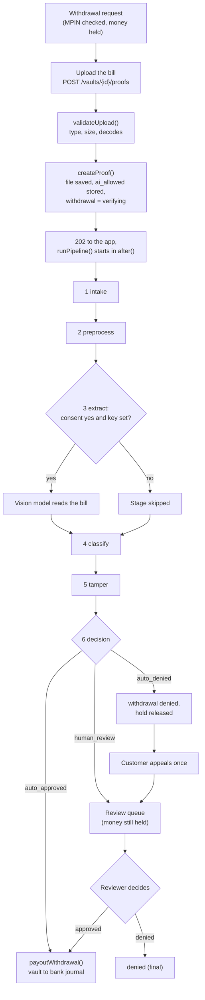

# Walkthrough: the verification pipeline

> A self-study guide. After it you should be able to explain, without notes, what happens between a customer uploading a bill and the money being paid, declined or handed to a person.

The full feature doc, with every score and threshold, is [features/proof-verification.md](../features/proof-verification.md). AI consent is in [features/ai.md](../features/ai.md). The code is in [src/lib/verification/](../../src/lib/verification/). The pipeline is being split into one file per stage, so this page names stages and functions, not line numbers.

## Summary

Every vault withdrawal needs proof of purpose: a photo or scan of a bill. The withdrawal is created first and holds the money. The upload route checks the file, saves it, records whether the customer said yes to an AI reading it, answers at once (HTTP 202), and starts `runPipeline()` in the background. Six stages run in order and save their progress after each step, so both apps can show it live: **intake** (file and exact-duplicate check), **preprocess** (image clean-up and metadata forensics), **extract** (the vision model reads the bill, only with consent and a key), **classify** (purpose, amount, date, name and arithmetic rules), **tamper** (error level analysis, reuse and edit signs) and **decision** (a weighted confidence and fixed routing rules). The result is one of three: `auto_approved` (the money is paid out on the ledger), `auto_denied` (the customer can appeal once) or `human_review` (the money stays held until a reviewer decides). Automation only ever approves clean cases; anything doubtful goes to a person.

## The picture

## Follow the code

### 0. Consent comes first

- Both apps ask "may an AI read this?" before anything is sent, and put the answer on every request as the header `x-ai-consent: yes | no`. Phone: `ensureAiAnswer()` in `mobile/src/features/ai-consent/ask.ts`, sent by `mobile/src/lib/api/http.ts`. Web: `src/components/ai-consent.tsx` and `src/lib/client.ts`.
- On the server, `aiConsented()` in [src/lib/ai-consent.ts](../../src/lib/ai-consent.ts) is true **only** for an explicit `yes`. A `no`, a missing header, or a background job all count as no.

### 1. The withdrawal and the upload

1. `POST /api/v1/vaults/{id}/withdrawals` checks the MPIN and creates the withdrawal in `awaiting_proof`; the amount is now held (see the [ledger walkthrough](ledger.md)).
2. `POST /api/v1/vaults/{id}/proofs` (`src/app/api/v1/vaults/[id]/proofs/route.ts`):
   - `customer({ kyc: true })`: a verified ID is needed;
   - `assertUploadsLeft()` and `limitUploads()` from `src/lib/rate-limit.ts`: an hourly upload limit;
   - the withdrawal must belong to the customer and still be `awaiting_proof` (otherwise 404 or 409, so one proof per withdrawal);
   - `validateUpload()`: JPEG, PNG or WebP, at most 10 MB, and the image must decode (HEIC gets a 415 with a tip);
   - `createProof(user, { ..., aiAllowed: await aiConsented() })` writes the file under `data/uploads/`, inserts a `proofs` row (with `sha256` and `ai_allowed`) and a `verifications` row with six `pending` stages, moves the withdrawal to `verifying`, and audits `proof.uploaded`. `aiAllowed` is a required input, and only `true` stores 1;
   - `after(() => runPipeline(proofId))` (Next.js runs it after the response), then 202 `{ id, status: "processing" }`.

Emergency receipts use the same pipeline through `src/app/api/v1/emergency/[id]/receipt/route.ts`.

### 2. The six stages

Each stage is a `Stage` record (`key`, `status`, `score`, `checks`). `begin()` marks it running and `finish()` sets passed, warning or failed from its checks, saving the whole list to `verifications.stages` each time. Three lists collect what matters for the decision: **hard fails** (deny), **review reasons**, and **fraud flags**.

| Stage | What it does | Can it hard-fail? |
|---|---|---|
| `intake` | File type and size; looks for a byte-identical file (`sha256`) in **any** account. | Yes: an exact duplicate, plus a high fraud flag. |
| `preprocess` | `preprocess()` in [forensics.ts](../../src/lib/verification/forensics.ts) straightens, trims, normalises and denoises the image for the model. `readExif()` reads metadata: warns on editing software (Photoshop, Canva...) or a file modified more than 24 hours after capture. | No, warnings only. |
| `extract` | Sends the cleaned image and a prompt (vault name, category, amount, today's date, any custom-vault rule) to the vision model via `chatJson()` in `src/lib/groq.ts`. **Skipped** if `ai_allowed = 0` or there is no `GROQ_API_KEY`. A failed call marks it failed with a plain reason. | Yes: the model says it isn't a bill at all. |
| `classify` | Purpose match (model category scores blended with the keyword lexicon in [classify.ts](../../src/lib/verification/classify.ts): `keywordScores()`, `acceptedCategories()`), amount covered (bill total at least 98% of the request), totals add up, document date, name on the bill, currency. Skipped without extracted fields. | Yes: dated in the future, or a purpose match below 0.2 on a real document. |
| `tamper` | Error level analysis (`errorLevelAnalysis()` finds pasted-in regions; skipped above 25 MP), document reuse (same issuer plus reference, or issuer plus total plus date, as any earlier proof; or a near-identical picture by `dHash()` when nothing could be read), capture time against the bill's date, visual edit signs from the model, and the arithmetic. Combines them into a tamper score. | Yes: reused content, or a tamper score of 0.8 or more. |
| `decision` | Weighted confidence and routing rules, below. | |

### 3. The decision

Confidence = 0.15 × extraction + 0.35 × purpose + 0.15 × amount + 0.10 × date + 0.05 × name + 0.20 × integrity (integrity = 1 − tamper score). Without extracted fields, extraction counts as 0.3 and confidence is capped at 0.6.

The rules run in this order; the first that matches wins:

1. Any hard fail: `auto_denied`.
2. Not read because the customer said no to the AI: `human_review`.
3. Not read for another reason (no key, the call failed): `human_review`, with the reason.
4. Confidence at least `autoApprove`, tamper score below 0.3, amount fully covered, **no failed check** in extract, classify or tamper, and not a custom vault without a template: `auto_approved`.
5. Confidence at most `autoDeny`: `auto_denied`.
6. Anything else: `human_review`, listing every failed or warned check.

**Thresholds per market.** `autoApprove`, `autoDeny`, `maxDocAgeDays` and `reviewSlaHours` come from `rulesFor(user.jurisdiction).verification` in [src/lib/compliance.ts](../../src/lib/compliance.ts), so each market can have its own. Today every market uses the same values: approve at 0.85 or more, deny at 0.35 or less, bills up to 120 days old, a 4-hour review target.

Then, in one transaction: the `verifications` row gets the confidence, decision and reasons; the audit log gets `verification.<decision>` with the model version; each fraud flag is raised with `raiseFlag()` (`src/lib/fraud.ts`); and `applyOutcome()` acts on the withdrawal:

- approved: `payoutWithdrawal()` in [src/lib/vaults.ts](../../src/lib/vaults.ts) posts vault to bank on the ledger;
- denied: the withdrawal becomes `denied`, so the hold stops counting;
- review: the withdrawal becomes `in_review` and stays held.

If anything throws, the verification is marked `error` and `human_review`, and `verification.error` is audited. A crash never approves.

### 4. A person reviews

- The Ops console (`/admin`, data from `src/app/api/v1/admin/overview/route.ts`) lists verifications waiting for a person, plus appeals, oldest first, with the SLA timer.
- The reviewer page `src/app/admin/review/[proofId]/page.tsx` shows the image, the ELA heatmap, what the model read and every stage. Its verdict goes to `POST /api/v1/admin/reviews/{proofId}`, which calls `reviewDecision(proofId, decision, reviewer, note)`.
- `reviewDecision()` refuses (409) anything not waiting for review, records the reviewer and note, audits `verification.reviewed.approved` or `.denied`, and calls `applyOutcome()`.

### 5. The customer appeals

- `POST /api/v1/proofs/{id}/appeal` with a note calls `appeal(user, proofId, note)`.
- Only a `denied` verification can be appealed, and only once (409 `already_appealed` if it has an appeal note).
- The verification becomes `appealed` and goes back in the queue; the withdrawal becomes `appealed`, which is a hold again.

### 6. What the apps show

- Phone: `useProofPoll()` in `mobile/src/features/proof/hooks.ts` polls `GET /api/v1/proofs/{id}`; `trackerSteps()` in `stages.ts` turns six stages into four plain steps; `outcomeOf()` in `verdict.ts` and `describeProof()` in `describe.ts` give one plain reason and a next step, never confidence or model names.
- Practice mode: `mobile/src/lib/api/demo/proofs.ts` simulates the six stages in about 4 seconds; the sample's name decides the outcome. No server, no AI.
- Web: `/proofs/{id}` shows every stage with its checks, the original and ELA images, and the appeal form.

### 7. Evaluation

How well the pipeline decides is measured in three places today:

- `npm run test:ai` sends the seven sample bills to the live model and prints each decision and confidence (`tests/ai-verification.test.ts` with a key). It must never auto-approve the coffee, old or edited bills.
- `E2E_AI_SAMPLES=1 npm run test:e2e` (after `npm run build`) runs the samples, the custom-vault tier and an emergency receipt through the built server ([scripts/e2e.mjs](../../scripts/e2e.mjs)).
- The Ops console's model metrics: decisions by type, appeals overturned, and a false-decline rate (appeals approved ÷ auto-denied).

There is no written evaluation report in `docs/` yet. If one is added, link it here.

## Key rules and where they are tested

| Rule | Where | Tested in |
|---|---|---|
| Only JPEG, PNG, WebP, up to 10 MB, must decode; HEIC gets a tip | `validateUpload()` | [tests/forensics.test.ts](../../tests/forensics.test.ts) "rejects unreadable or unsupported uploads with a helpful 415" |
| One proof per withdrawal | upload route | [scripts/e2e.mjs](../../scripts/e2e.mjs) (second proof gets 409) |
| AI reads the bill only after an explicit yes | `aiConsented()`, `createProof()`, extract stage | [tests/ai-consent.test.ts](../../tests/ai-consent.test.ts) "go to a person, not the vision model, when the person said no", "is 'no' for new databases, and every insert says it explicitly" |
| No key means a person reads it | extract stage, rule 3 | [tests/ai-verification.test.ts](../../tests/ai-verification.test.ts) "sends every bill to a person and says the vision model is unavailable" |
| ELA flags a pasted-in total but not a clean bill | `errorLevelAnalysis()` | forensics test "flags a pasted-in total with error level analysis, but not the genuine document" |
| A resubmitted sample is byte-identical (so intake catches it) | `renderSample()` in `src/lib/samples.ts`, `sha256()` | forensics test "renders samples deterministically, so a resubmission is a byte-identical duplicate" |
| Very large photos skip ELA instead of failing | `ELA_MAX_PIXELS` | forensics test "skips ELA (instead of failing) for photos above the size limit" |
| Keywords classify by purpose; an Emergency vault accepts health bills | `keywordScores()`, `acceptedCategories()` | forensics test "classifies document text by purpose" |
| A reviewer can only decide waiting items; one appeal per check | `reviewDecision()`, `appeal()` | [tests/appeals.test.ts](../../tests/appeals.test.ts) "allows one appeal per check, then refuses another" |
| The edited, old and coffee bills are never auto-approved | stages 4 to 6 | live only: `npm run test:ai` |

Not covered by unit tests: the approve and deny thresholds and the weights. Unit tests run without an AI key, so the extract stage is always skipped and every bill goes to a person. The pipeline calls the model directly, with no seam to plug in a fake (see "Maintainability notes" in the [feature doc](../features/proof-verification.md)).

## Questions you may be asked

**Why not just trust the AI's answer?**
The model is one input. Its category scores are blended with a keyword lexicon, and fixed rules check the amount, date, name and arithmetic. Forensics run without the model. Automation approves only when confidence is high **and** no check failed; everything else goes to a person, and a decline can be appealed.

**What happens if Groq is down, slow or out of free quota?**
The call has a 60-second budget with retries on rate limits. If it still fails, the extract stage is marked failed and the bill goes to a person (rule 3). The money stays held; nothing is approved or lost.

**Is a customer's bill sent to the AI without asking?**
No. Only an explicit `yes` in `x-ai-consent` stores `ai_allowed = 1`. The database column defaults to 0.

**What is error level analysis?**
The image is saved again as a JPEG at a fixed quality and compared with the original in 8×8 blocks. A region pasted in from elsewhere was compressed differently, so its error stands out. The score comes from the size of the largest cluster of odd blocks.

**How do you catch the same bill used twice?**
Three ways: the exact file hash (intake), the content fingerprint of issuer plus reference or issuer plus total plus date (tamper), and a perceptual hash for near-identical pictures when nothing could be read.

**Are the thresholds different per country?**
The code reads them per market from `compliance.ts`, so they can differ. Today all markets use the same numbers.

**Where is the money while a bill is being checked?**
Still in the vault, held. The withdrawal status (`verifying`, `in_review`, `appealed`) counts in `heldFor()`, so the money can't be withdrawn twice. It moves only on approval.

**Could text on a bill trick the model?**
It could try. The model only returns fields and scores; it can't approve anything itself. An inflated purpose score still has to pass the amount, date, arithmetic and tamper checks, with no failed check, and custom vaults always go to a person. It reduces the risk; it doesn't remove it.

**What if the server restarts mid-check?**
A verification left `processing` isn't restarted today, so its withdrawal stays `verifying` (listed under "Known limits" in the feature doc).

**Why answer 202 and run the pipeline in the background?**
The model call can take seconds. Answering at once keeps the app responsive, and saving each stage lets it show progress.

## Try it yourself

Start from a clean working tree, and undo any code change afterwards with `git restore <file>`.

1. **Run the tests.**
   `npx vitest run tests/forensics.test.ts tests/appeals.test.ts tests/ai-consent.test.ts`
2. **Weaken error level analysis.** In `errorLevelAnalysis()` in `src/lib/verification/forensics.ts`, change `(largestCluster - 10) / 20` to `(largestCluster - 10) / 60`. Run `npx vitest run tests/forensics.test.ts`. The tampered sample no longer scores above 0.5. Restore the file.
3. **Change a threshold and see that nothing fails.** In `src/lib/compliance.ts` change `autoApprove: 0.85` to `0.5`. Run `npm test`. Nothing fails, because no unit test reaches the model. Explain why that is a gap and how `npm run test:ai` covers it. Restore the file.
4. **Allow a second appeal.** In `appeal()` (in `src/lib/verification/`) comment out the `already_appealed` check. Run `npx vitest run tests/appeals.test.ts`. Restore the file.
5. **Watch the stages.** Run `npm run dev` without `GROQ_API_KEY` in `.env.local`, onboard with demo history, withdraw from the Family Health Fund with the Hospital invoice sample, and open the proof page. The extract stage is skipped and the bill goes to a person. Decide it in the Ops console at http://localhost:3000/admin.
6. **On paper.** A bill scores extraction 0.95, purpose 0.9, amount 1, date 1, name 1, tamper 0, with no failed check. Work out the confidence and the decision. Now change the name to 0.35 and the purpose to 0.6. Which rule decides it now?

## Answer to the paper exercise

- First bill: 0.15 × 0.95 + 0.35 × 0.9 + 0.15 × 1 + 0.10 × 1 + 0.05 × 1 + 0.20 × 1 = 0.9575. That is at least 0.85, the tamper score is below 0.3, the amount is covered and no check failed, so rule 4 gives `auto_approved` (unless it is a custom vault without a template).
- Second bill: 0.1425 + 0.21 + 0.15 + 0.10 + 0.0175 + 0.20 = 0.82. Below 0.85 and above 0.35, so rule 6 gives `human_review`. The purpose (0.6) and name (0.35) checks are warnings, and they are listed as the reasons.
