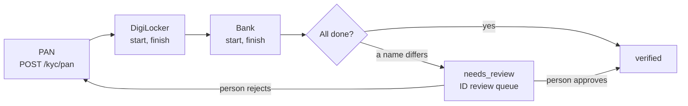

# Onboarding checks (KYC steps flow)

Plan 07. Instead of a photo of an ID, an India account proves who it is in three steps, through a licensed
provider's **test mode**: its **PAN** (name match), its **Aadhaar through DigiLocker**, and a **bank account by
reverse penny drop** (the person pays ₹1 by UPI; the provider reads the account from the payment and refunds it).
All three done: the KYC status becomes `verified`. A name that doesn't match goes to a person.

Going live needs a registered company and the provider's business checks. That is out of scope here.

## Switch and config

| Variable | Default | Effect |
|---|---|---|
| `KYC_FLOW` | `photo` | `photo`: today's ID photo check (see `../README.md`). `steps`: this flow, for India accounts. Other markets keep the photo check either way. |
| `KYC_CHECKS_PROVIDER` | `test` | `test`: deterministic, offline (below). `setu`: Setu's APIs. |
| `KYC_CHECKS_TEST_ALLOWED` | unset | The test provider verifies anyone who types its sample PAN, and Setu's sandbox answers with sample data, so with `NODE_ENV=production` both answer 500 `server_config` unless this is `true` (a test-mode deployment). |
| `KYC_DIGILOCKER_REDIRECT_URL` | `<server origin>/verify` | Where DigiLocker sends the person back. It appends `success`, `id` (the request id) and `scope`. Setu needs a public https URL. |
| `SETU_BASE_URL` | `https://dg-sandbox.setu.co` (not in production) | With `NODE_ENV=production` it must be set, to an https URL (`https://dg.setu.co`), and the sandbox host is refused unless `KYC_CHECKS_TEST_ALLOWED=true`: 500 `server_config` and a log line, like the test provider's refusal (`setuBaseUrl()`). `productionStartupWarnings()` warns at start-up. |
| `SETU_CLIENT_ID`, `SETU_CLIENT_SECRET` | | From Setu's bridge (sent as `x-client-id`, `x-client-secret`). |
| `SETU_PAN_PRODUCT_INSTANCE_ID`, `SETU_DIGILOCKER_PRODUCT_INSTANCE_ID`, `SETU_RPD_PRODUCT_INSTANCE_ID` | | One per product (`x-product-instance-id`). Each falls back to `SETU_PRODUCT_INSTANCE_ID`. |

`IDENTITY_SECRET` (see `../README.md`) is needed for the PAN's HMAC, as in the photo flow.

Switch off: leave `KYC_FLOW` unset. The photo flow's answers are then exactly as before.

## The steps

- Steps run in order. A step can start once the one before is `done` or `review` (409 `kyc_step_order`).
- A step that is `todo`, `failed` or `review` can be tried again, until the check goes to a person. Each step allows 5 tries a day (429 `rate_limited`). A try the provider couldn't answer (503) doesn't count.
- Names are compared with `compareNames()` (`../names.ts`). Only `match` passes; `partial`, `mismatch` and `unknown` send the step to `review`. A PAN already used by another open account also goes to `review` (skipped for the providers' shared sample PANs). The customer is told only that a person will look at the PAN (telling them it is on another account would let anyone find out whether a PAN has an account); the reason is kept for the reviewer in `kyc_checks.review_note`, shown in the PAN check line, and the audit row has `duplicate: true`.
- **A step counts only with the provider that runs it now.** Until the account is verified, a step whose newest try was made with another provider than the current one (for example the test provider's sample data, before a server switched to Setu) shows as `todo` and must be done again. A verified account keeps its steps as they were.
- **Going to a person:** a `review` step doesn't go to the queue alone. Once all three steps are finished (each `done` or `review`), the service writes one `kyc_records` row with `status = needs_review`, `doc_type = pan`, no photo, and a check line per step (names, IFSC, last 4). The existing reviewer console (`/admin/kyc`, `decideKyc()`) decides it. This way a person sees every name at once, and approving can't skip a step.
- All three `done`: a `verified` `kyc_records` row (`provider = checks:<provider>`), `users.kyc_status = verified`, `kyc_level = 2`. Account recovery by PAN then works as for a photo-verified PAN (`verifiedHolder()`).
- **The bank account** is saved verified only when the bank step is `done`. When it goes to a person (the holder's name differs) it is saved unverified, and `confirmBankOnApproval()` (`approval.ts`, called by `decideKyc()`) marks it verified when the person approves the check: only the newest bank try made after the last rejection, so an account from a try before a rejection is never marked verified.
- **After a rejection** the steps start again from `todo`, and the reviewer's note is the reason shown. Tries made earlier the same day still count toward the 5-a-day limit (`triesSince()` in `store.ts`).

## API (routes in `src/app/api/v1/kyc/`)

All call `customer()` (no MPIN: no money moves) and validate with zod.

| Method | Path | Body | Answer |
|---|---|---|---|
| GET | `/api/v1/kyc` | | The KYC view. In the steps flow it adds `flow: "steps"` and `steps: { pan, aadhaar, bank }`, each `{ status: "todo" \| "done" \| "review" \| "failed", last4? }`. In the photo flow neither field is sent (absent `flow` means photo). |
| POST | `/api/v1/kyc/pan` | `{ pan }` | The view |
| POST | `/api/v1/kyc/digilocker/start` | | `{ url, requestId }` |
| POST | `/api/v1/kyc/digilocker/finish` | `{ requestId }` | The view |
| POST | `/api/v1/kyc/bank/start` | | `{ upiLink, requestId, expiresAt }` (ms) |
| POST | `/api/v1/kyc/bank/finish` | `{ requestId }` | The view |

The view's `reasons` lists the plain sentences for steps in `review` or `failed` (plus a reviewer's note after a rejection).

| Code | Status | When |
|---|---|---|
| `invalid_id` | 400 | The PAN isn't 5 letters, 4 digits, 1 letter |
| `kyc_flow_off` | 409 | The account uses the photo flow |
| `kyc_done` | 409 | Already verified |
| `kyc_in_review` | 409 | A person is checking (or a photo check is running) |
| `kyc_step_order` | 409 | The step before isn't finished |
| `kyc_step_done` | 409 | This step is already done |
| `kyc_step_waiting` | 409 | finish: DigiLocker not finished yet, or the ₹1 hasn't arrived. Try again later. |
| `kyc_request_expired` | 409 | finish: the request expired or a newer one replaced it. Start again. |
| `kyc_request_not_found` | 404 | finish: not this account's request |
| `rate_limited` | 429 | 5 tries of a step today |
| `provider_unavailable` | 503 | The provider is down or not set up |
| `server_config` | 500 | `IDENTITY_SECRET` missing where required, or the test provider on production without `KYC_CHECKS_TEST_ALLOWED` |

A repeated finish of an already finished request answers the view again.

## The test provider (`providers/test.ts`)

| Check | Input | Answer |
|---|---|---|
| PAN | `ABCDE1234F` | Valid, registered to the account's own name: `done` |
| PAN | `ABCDE0000F` | Valid, registered to another name: `review` (goes to a person once the other steps are done) |
| PAN | any other valid PAN | Not found: `failed` ("We couldn't find that PAN.") |
| DigiLocker | start | `url` = the redirect URL plus `success=True&id=<requestId>&scope=ADHAR` (no real DigiLocker page), valid 10 minutes |
| DigiLocker | finish | The account name, year of birth 1990, Aadhaar ending `1234`: `done` |
| Bank | start | A test `upi://pay?...am=1.00...` link (nothing to pay), valid 10 minutes |
| Bank | finish | The account name, IFSC `HDFC0000001`, account ending `4321`: `done` |

## The Setu adapter (`providers/setu.ts`)

**Written from Setu's public docs (November 2026), not yet run against the sandbox.** Unit tests mock `fetch`.

| Check | Calls |
|---|---|
| PAN | `POST /api/verify/pan { pan, consent: "Y", reason }`. 200 with `verification: "success"`: valid, `data.full_name`. Other 200: invalid. 404: not found. |
| DigiLocker | `POST /api/digilocker/ { redirectUrl }` → `{ id, url, validUpto }`. Finish: `GET /api/digilocker/:id/status` (`unauthenticated` = waiting, `authenticated`, `revoked`), then `GET /api/digilocker/:id/aadhaar` (`aadhaar.name`, `dateOfBirth` DD-MM-YYYY, `maskedNumber`), then `GET /api/digilocker/:id/revoke` (best effort). |
| Bank | `POST /api/verify/ban/reverse {}` → `{ id, upiLink, validUpto }`. Finish: `GET /api/verify/ban/reverse/:id`: `..._CREATED` = waiting; `..._PAYMENT_SUCCESSFUL` → `data.bankAccountName`, `bankAccountIfsc`, `bankAccountNumber` (cut to last 4 at once); `accountType: PPI` (a wallet) fails; `..._EXPIRED`, `..._FAILED`, `..._PAYMENT_FAILED`, `..._PII_PURGED` fail. |

Assumptions to check in the sandbox: the reverse penny drop's `validUpto` has no time zone and is read as India time; the invalid-PAN 200 body isn't documented (anything but `verification: "success"` counts as invalid); a 4xx we don't expect is logged by code and answered as 503 `provider_unavailable`. Response bodies are never logged.

### Trying the Setu sandbox

1. Ask Setu for sandbox access to PAN verification, DigiLocker and Reverse Penny Drop; put the keys in `.env.local` with `KYC_FLOW=steps` and `KYC_CHECKS_PROVIDER=setu`.
2. PAN: `ABCDE1234A` is valid (registered to "John Doe" in Setu's example, so an account named John Doe passes and others go to `review`), `ABCDE1234B` is invalid, anything else is not found.
3. DigiLocker: set `KYC_DIGILOCKER_REDIRECT_URL` to a public https URL (a tunnel to `/verify` works); Setu doesn't publish sandbox DigiLocker users, so ask them for test credentials.
4. Bank: UPI links don't work in the sandbox. After **start**, call Setu's mock payment (`POST /api/verify/ban/reverse/mock_payment/:requestId { "paymentStatus": "successful" }`, or `"expired"`), then **finish**.

## What is stored

| Where | What | Never |
|---|---|---|
| `kyc_checks` (this module, created on first use) | Per try: step, status, provider, request id, last 4, PAN HMAC, name, year of birth, name-match result, reasons (the customer sees them), a reviewer-only note, expiry | A full PAN, Aadhaar or account number; the Aadhaar address, photo or document |
| `bank_accounts` (`src/lib/bank`) | IFSC, last 4, holder name, when confirmed, provider reference | The full account number |
| `kyc_records` (the existing table) | One row per outcome: PAN last 4 + HMAC, the Aadhaar name (or the name that differs) and year of birth, a check line per step | |

- PAN: last 4 + `HMAC-SHA256(IDENTITY_SECRET, "pan:<number>")`. The name registered with the PAN is kept on the step, like the Aadhaar and bank names, so the final check (`conclude()`) can compare all three with the account name and a person can see it.
- Aadhaar: name, year of birth and last 4 digits only.
- Bank: IFSC, last 4 and holder name.
- The audit log gets `kyc.step.<step>` (status, last 4, name-match result, provider) and `kyc.verified` / `kyc.needs_review`. No numbers or names.

## Adding or switching a provider

Write `providers/<name>.ts` exporting a `CheckProviders` (`PanVerifier`, `DigiLockerClient`, `BankVerifier` from
`types.ts`), add it to `SETS` in `registry.ts`, and set `KYC_CHECKS_PROVIDER`. Tests replace any one check with
`setCheckProviders({ pan })`.

## Files

| File | What it holds |
|---|---|
| `types.ts` | The three interfaces and the step view types |
| `config.ts` | `kycFlow()`, `flowFor(user)`, `checksProviderName()`, `checksTestAllowed()`, the production guard, the redirect URL |
| `store.ts` | `kyc_checks`: reserve, complete, expire, look up, count tries, duplicate PANs, reset time |
| `view.ts` | `stepsState()`, `stepsView()`: read-only, used by the KYC view |
| `approval.ts` | `confirmBankOnApproval()`: what a reviewer's approval means for the bank account (called by `decideKyc()`) |
| `service.ts` | `submitPan`, `startDigiLocker`, `finishDigiLocker`, `startBank`, `finishBank`, and the outcome |
| `registry.ts` | Which providers run; `currentProviderNames()` (read-only, for the view); `setCheckProviders()` for tests |
| `providers/test.ts`, `providers/setu.ts` | The providers |
| `index.ts` | What routes and tests import |

## Touch points outside this folder (marked `// kyc-checks`)

- `src/lib/kyc/service.ts`: `kycView()` adds `flow` and `steps`; `setUserKyc()` is exported; `decideKyc()` calls `confirmBankOnApproval()`.
- `src/lib/auth/config.ts`: `productionStartupWarnings()` warns about a missing or sandbox `SETU_BASE_URL`.
- `src/app/api/v1/kyc/{pan,digilocker/start,digilocker/finish,bank/start,bank/finish}/route.ts`.
- `src/components/identity/kyc.tsx` and `kyc-steps.tsx`: the web `/verify` page shows the steps. DigiLocker's return link is read for `success`, `id` and `errCode` only: known codes map to fixed sentences (`digilockerErrorText()`), anything else to a generic one. The link's `errMessage` is never shown, since anyone can craft a /verify link.
- `src/lib/bank`: the bank account record.

## Remove

Delete this folder, the five routes, `src/lib/bank`, `kyc-steps.tsx`, and the `// kyc-checks` lines in
`src/lib/kyc/service.ts` and `kyc.tsx`. The `kyc_checks` and `bank_accounts` tables can be dropped.

## Known gaps

- No webhook: finish polls the provider. Setu's `RPD_VERIFICATION_UPDATE` webhook (with its signature check) would let the server finish the bank step by itself.
- The server's "Linked bank" ledger account and the phone's simulated bank don't read `bank_accounts` yet.
