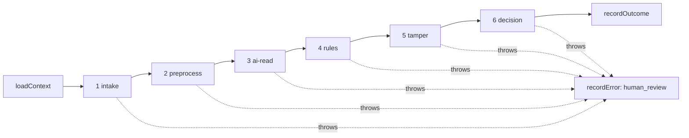

# Proof-of-purpose verification

Every vault withdrawal (and an emergency payout's receipt) needs a photo of a bill. `runPipeline()` runs six stages
over it and decides: `auto_approved` (paid out), `auto_denied` (the customer can appeal once) or `human_review`.
Product behaviour, thresholds and API: [docs/features/proof-verification.md](../../../docs/features/proof-verification.md).
How well it works, measured: [docs/evaluation/](../../../docs/evaluation/README.md) (`npm run eval:verification`).

Import from `@/lib/verification/pipeline`: it re-exports the public surface (`validateUpload`, `createProof`,
`runPipeline`, `reviewDecision`, `appeal`, `proofView`, `setBillReader`, `PIPELINE_VERSION` and the row types).

## Stage map

`pipeline.ts` only orchestrates. Each stage is a function over one shared `PipelineContext` (`stages/context.ts`):
it calls `ctx.begin(key)`, appends checks, may add to `ctx.hardFails` / `ctx.flags` / `ctx.reviewReasons`, and ends
with `ctx.finish(stage)`, which saves the stage list so clients can watch it live. A hard fail is
`{ reason, forensic }`: forensic ones (image evidence of editing) decline only with AI consent.

| # | Key | File | Function | Reads | Returns / adds | Pure part (unit-tested) |
|---|---|---|---|---|---|---|
| – | – | `stages/context.ts` | `loadContext()` | proof, user, market rules, vault, amount asked, the file | the context | – |
| 1 | `intake` | `stages/intake.ts` | `runIntake()` | SHA-256 of earlier proofs (every account) | exact duplicate → hard fail + high flag | – |
| 2 | `preprocess` | `stages/preprocess.ts` | `runPreprocess()` | the image | `{ processed, exif }`; editing software / modified-after-capture warnings; saves `proofs.exif` | – |
| 3 | `extract` | `stages/ai-read.ts` | `runAiRead()` | consent (`ai_allowed`), a reader (Groq key or `setBillReader()`) | the `Extraction` or `null`; not a document → hard fail; saves `proofs.extracted` | `normaliseExtraction()`, `parseAmount()`, `extractionPrompt()` |
| 4 | `classify` | `stages/rules.ts` | `runRules()` | the extraction | `RuleScores` (purpose, amount, date, name, arithmetic); wrong purpose or future date → hard fail; totals mismatch → flag | `evaluateRules()` |
| 5 | `tamper` | `stages/tamper.ts` | `runTamper()` | the image, earlier proofs' content keys and dHash, EXIF | a `TamperAssessment`; content reuse → hard fail; corroborated tamper ≥ 0.8 → forensic hard fail; saves ELA heatmap, `phash` | `assessTamper()`, `metadataScore()`, `tamperScoreOf()`, `contentKeys()` |
| 6 | `decision` | `stages/decision.ts` | `runDecision()` | everything above | `{ decision, confidence, reasons }` | `decide()`, `CONFIDENCE_WEIGHTS` |
| – | – | `persistence.ts` | `recordOutcome()` / `recordError()` | the outcome | one transaction: verification row, audit, fraud flags, `applyOutcome()` (payout / decline / hold) | – |

## Tamper and decision policy (`vw-proof@1.5`)

Set on 2026-11-24 from the evaluation's findings ([docs/evaluation](../../../docs/evaluation/README.md#what-changed-vw-proof15)).

- **Signals** (`assessTamper()`): ELA score; editing software in EXIF (0.5) and a capture time over a week before the
  bill's date (0.7), combined by `metadataScore()` (both: 0.85); totals that don't add up (0.6, a ≤ 25% gap 0.15);
  edit signs from the vision model (0.3 each); and, as corroboration only, a near-identical image (dHash ≤ 10) of an
  earlier proof with different content. `tamperScoreOf()` multiplies them as independent "chance it is clean".
- **ELA never declines alone.** Tamper ≥ 0.8 is a hard fail only if at least one signal other than ELA is present
  (a ≤ 25% totals gap doesn't count). ELA alone adds a "Tamper evidence" warning (a person decides), and the
  low-confidence decline ignores an ELA-only penalty.
- **Inconclusive ELA counts as no evidence.** `errorLevelAnalysis()` sets `inconclusive` when the block-error spread
  is zero (the image re-compresses unchanged, typically saved at JPEG quality ~75); the check becomes "info".
- **A customer who said no to the AI is only declined for non-forensic reasons** (in practice an exact duplicate);
  forensic evidence goes to the person they asked for. With consent, corroborated forensic evidence still declines,
  also when the AI read failed.
- Order of routing in `decide()`: applicable hard fail → decline; no reading → a person; confident, tamper < 0.3,
  amount covered, no failed check, not a custom vault → approve; confidence ≤ the market's auto-deny → decline;
  otherwise a person.

## Other files

| File | What it holds |
|---|---|
| `types.ts` | `PIPELINE_VERSION`, `STAGE_DEFS`, `Stage`, `Check`, `Extraction`, `ProofRow`, `VerificationRow` |
| `proofs.ts` | `validateUpload()` (before anything is stored), `createProof()` (file, rows, six pending stages, audit), `proofView()` (API shape) |
| `review.ts` | `reviewDecision()` (a reviewer's verdict), `appeal()` (once per check; refused with 409 `appeal_funds_unavailable` if the vault no longer has the money to hold again) |
| `persistence.ts` | `saveStages()`, `recordOutcome()`, `recordError()`, `applyOutcome()` (shared with review) |
| `forensics.ts` | sharp/exifr helpers: `sha256()`, `dHash()`, `hamming()`, `readExif()`, `preprocess()`, `errorLevelAnalysis()`, `probeImage()` |
| `classify.ts` | keyword lexicon: `keywordScores()`, `acceptedCategories()` |

## Swapping the bill reader

`setBillReader(fn)` replaces the Groq call (pass `null` to restore it). The reader receives the proof, the
pre-processed JPEG and the prompt, and returns an `Extraction`; the stage normalises it exactly as it does the model's
answer. Consent still comes first: with `ai_allowed = 0` no reader is called. Used by the offline evaluation
(`eval/verification/evaluate.eval.ts`, an oracle that returns what is printed on the bill) and
`tests/verification-stages.test.ts`.

## Tests

`tests/verification-stages.test.ts` (stage units and a run through a stand-in reader), `tests/forensics.test.ts`,
`tests/ai-verification.test.ts` (no key; `npm run test:ai` for the live model), `tests/ai-consent.test.ts`,
`tests/appeals.test.ts`. The split from one 530-line `runPipeline()` (2026-11-24) was checked against the offline
evaluation: identical decisions, confidences, reasons and checks for every bill (fingerprints in
[docs/evaluation/README.md](../../../docs/evaluation/README.md#refactor-check)). The 1.5 policy is covered rule by
rule in `tests/verification-stages.test.ts` ("tamper stage", "decision stage", "tamper policy, end to end") and the
inconclusive-ELA case in `tests/forensics.test.ts`.
